<!-- _class: capa -->
<!-- _paginate: false -->
<!-- _footer: "" -->

# Unidade 1

## Questões das Humanidades e problemas computacionais

**Problema orientador:** como representar um fenômeno histórico, social,
linguístico ou cultural sem reduzir indevidamente sua complexidade?

---

<!-- _class: exemplo -->

# Base fictícia usada nos exemplos

- **Unidade de observação:** 12 documentos jornalísticos simulados.
- **Cobertura:** 1890–1905; três periódicos, três gêneros e dois locais.
- **Campos principais:** ano, periódico, gênero, local, tema e número de palavras.
- **Finalidade:** praticar perguntas, operacionalização, corpus e cadeia de evidência.

Os documentos e metadados foram criados para ensino. Não descrevem periódicos,
pessoas ou processos históricos reais.

---

<!-- _class: exemplo -->

# Arquivo tabular da base

### `documentos_exemplo.csv`

| id | ano | periódico | gênero | local | tema | palavras |
|---|---:|---|---|---|---|---:|
| D001 | 1890 | Jornal Aurora | editorial | Capital | progresso | 860 |
| D002 | 1891 | Jornal Aurora | carta | Interior | trabalho | 420 |
| D003 | 1892 | Gazeta Popular | notícia | Capital | educação | 610 |

Cada linha representa um documento jornalístico fictício.

---

<!-- _class: exemplo -->

# Metadados e texto também precisam ser vistos

<div class="duas-colunas">

<div>

### `metadados_exemplo.json`

| Campo lógico | Valor de exemplo |
|---|---|
| título | Coleção didática de periódicos |
| natureza | dados fictícios para ensino |
| cobertura.início | 1890 |
| cobertura.fim | 1905 |

</div>

<div>

### `texto_exemplo.txt`

| Unidade | Conteúdo abreviado |
|---|---|
| fragmento | “Nesta edição fictícia, o periódico debate a abertura de uma escola noturna…” |

</div>

</div>

JSON e TXT não são originalmente tabelas: os quadros apenas tornam visíveis seus
campos lógicos e sua unidade de conteúdo.

---

<!-- _class: exemplo -->

# Antes da teoria: um caso

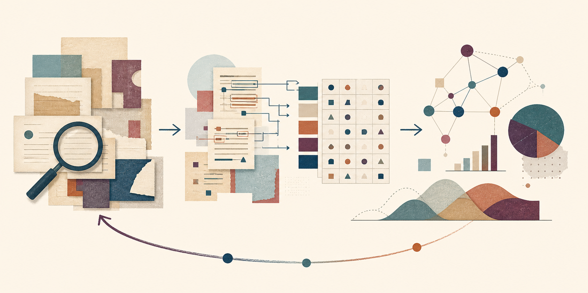

Uma pesquisadora quer compreender **como a ideia de progresso circulava na
imprensa entre 1890 e 1905**.

<!--
Peça que a turma apenas observe o percurso visual. Não apresente ainda os
nomes técnicos de suas etapas.
-->

---

# O que ela poderia contar?

<div class="tres-colunas">

<div class="cartao">

### A

Documentos que contêm a palavra “progresso”

</div>

<div class="cartao">

### B

Parágrafos dedicados a mudanças urbanas

</div>

<div class="cartao">

### C

Textos classificados como favoráveis à modernização

</div>

</div>

<br>

> As três medidas observam exatamente o mesmo fenômeno?

---

# A pergunta que organizará a unidade

Os números A, B e C podem estar tecnicamente corretos e, ainda assim, contar
**coisas diferentes**.

Precisamos decidir:

- o que significa “progresso” neste projeto;
- quais documentos podem responder à pergunta;
- qual será a unidade observada;
- como transformar uma interpretação em registros;
- até onde o resultado permite concluir.

<p class="pergunta">Como ligar pergunta, fonte, representação, operação e interpretação?</p>

---

# Agenda

1. Partir de uma questão humanística
2. Distinguir finalidade e estrutura da pergunta
3. Passar da pergunta à tarefa computacional
4. Operacionalizar conceitos e unidades
5. Delimitar corpus, dados e metadados
6. Construir e limitar uma evidência
7. Esboçar a proposta inicial do projeto

---

# Ao final, você deverá conseguir…

- formular uma pergunta delimitada e relevante;
- distinguir finalidade e estrutura analítica;
- propor mais de uma representação para um conceito;
- definir unidade de análise, população e corpus;
- reconhecer dados, documentos e metadados;
- justificar o alcance de uma evidência computacional;
- registrar a formulação inicial do projeto cumulativo.

---

<!-- _class: divisor -->

# 1 · Da questão humanística à pergunta

## A ferramenta vem depois do problema

---

<!-- _class: exemplo -->

# Exemplo: três começos possíveis

| Começo | Formulação | O que falta? |
|---|---|---|
| ferramenta | “Quero usar mineração de texto.” | problema substantivo |
| tema | “Quero estudar progresso.” | recorte e observação |
| pergunta | “Como o tema aparece em editoriais de três periódicos, entre 1890 e 1905?” | operacionalização |

<p class="pergunta">Qual formulação já permite discutir fontes e limites?</p>

---

# Humanidades Digitais: prática e reflexão

Humanidades Digitais articulam:

- perguntas humanísticas;
- construção e curadoria de acervos;
- modelagem e representação;
- análise e visualização;
- crítica das infraestruturas e de seus efeitos;
- comunicação e colaboração.

Não são um catálogo de ferramentas. São também uma **comunidade de práticas**,
formação e investigação situada.

<p class="fonte">Alves (2016); Burdick et al. (2012); Ferla, Lima e Feitler (2020).</p>

---

# Dados encontrados ou construídos?

<div class="duas-colunas">

<div>

### *Capta*

Drucker propõe enfatizar que registros são **tomados e construídos**, não
simplesmente dados pela realidade.

</div>

<div>

### Dados situados

Lavin preserva o termo “dados”, mas exige explicitar **posição, seleção,
descrição e transformação**.

</div>

</div>

> Convergência: uma tabela pronta não apaga as escolhas que a produziram.

<p class="fonte">Drucker (2011); Lavin (2021).</p>

---

# Uma pesquisa orientada por dados

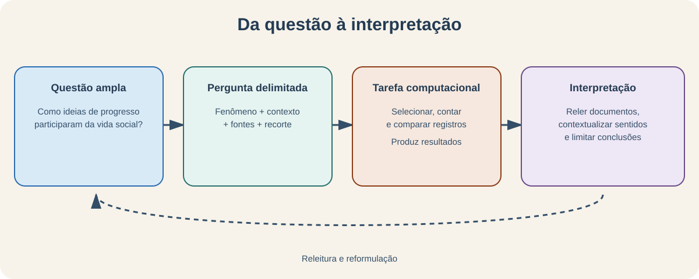

O retorno é parte do método: resultados podem exigir revisão da pergunta, do
recorte ou da representação.

---

<!-- _class: atividade -->

# U01-A01 · Diagnóstico inicial

**Modalidade:** individual · **Tempo:** 10 minutos  
**Produto:** registro do ponto de partida no Notebook 00

1. Qual é seu tema de interesse?
2. Com quais fontes gostaria de trabalhar?
3. Que experiência tem com Python?
4. Qual é sua maior dúvida sobre transformar uma questão em dados?

> Não formule uma pergunta definitiva ainda. Este registro será revisto.

---

<!-- _class: divisor -->

# 2 · Que tipo de pergunta estamos fazendo?

## Finalidade e estrutura não são a mesma coisa

---

<!-- _class: exemplo -->

# Primeiro, compare estas perguntas

1. **Quais** temas aparecem nos editoriais?
2. Os temas **diferem** entre Capital e Interior?
3. A presença de um tema **varia com** o gênero jornalístico?
4. Que condições históricas **ajudam a explicar** as diferenças?
5. É possível **prever** o período pelo vocabulário?

<p class="pergunta">O verbo basta para classificar a pergunta?</p>

<!--
Aceite hipóteses. A resposta será construída distinguindo finalidade de
estrutura analítica.
-->

---

# Duas dimensões combináveis

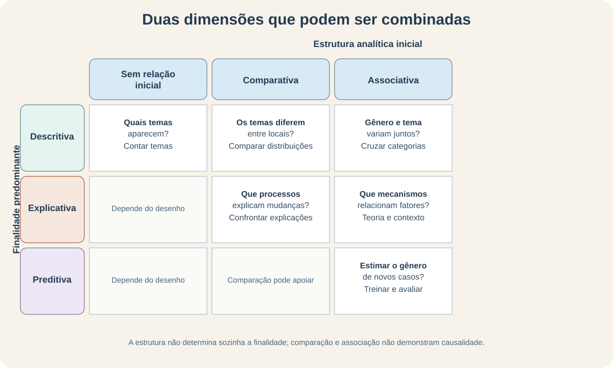

Esta é uma organização **didática**, não uma taxonomia universal.

---

# Finalidade: para que queremos conhecer?

| Finalidade predominante | Pergunta central | Exemplo |
|---|---|---|
| descritiva | o que ocorre e como se distribui? | quais temas aparecem? |
| explicativa | que mecanismo ou condição ajuda a explicar? | que condições ajudam a explicar a mudança? |
| preditiva | qual resultado estimar em novos casos? | qual é o período provável do texto? |

Explicar e prever podem usar variáveis semelhantes, mas perseguem objetivos
epistêmicos diferentes.

<p class="fonte">Shmueli (2010).</p>

---

# Estrutura: que relação será examinada?

| Estrutura inicial | Operação típica | Exemplo |
|---|---|---|
| sem relação inicial | caracterizar | distribuição dos temas |
| comparativa | confrontar | Capital × Interior |
| associativa | examinar variação conjunta | gênero × tema |

Uma estrutura comparativa ou associativa **não demonstra causalidade** por si
só.

---

# Classificando o exemplo inicial

> “Os temas dos editoriais diferem entre Capital e Interior?”

- **Finalidade predominante:** descritiva
- **Estrutura inicial:** comparativa
- **Operação possível:** atribuir temas, agrupar por local e comparar frequências
- **Limite:** a comparação não explica por que as diferenças existem

A mesma pesquisa pode acrescentar depois uma etapa explicativa.

---

<!-- _class: atividade -->

# U01-A03 · Classifique com justificativa

**Modalidade:** trios · **Tempo:** 15 min + 10 min de plenária  
**Produto:** finalidade, estrutura, justificativa e limite de cinco perguntas

Para cada pergunta do Notebook 01:

1. cada integrante classifica ao menos uma;
2. o trio compara as respostas;
3. preserva divergências justificadas;
4. escolhe um caso para apresentar à turma.

> Não basta nomear a classe: indique o que a pergunta solicita.

---

# Tratável não significa importante

Uma pergunta é computacionalmente tratável quando existe relação plausível
entre a questão, os dados disponíveis e operações realizáveis.

Isso **não** significa que:

- toda pergunta deva ser quantificada;
- o mais fácil de contar seja o mais relevante;
- as categorias sejam neutras;
- previsão seja compreensão;
- digitalização represente todas as experiências.

---

<!-- _class: atividade -->

# U01-A05 · Revisão em dupla

**Modalidade:** duplas · **Tempo:** 10 minutos  
**Produto:** comentários usados na formulação individual

Complete oralmente:

> Quero compreender ______ no contexto ______, observando inicialmente ______.

O colega pergunta: qual fenômeno? qual contexto? qual fonte? qual recorte? o
verbo promete descrição, explicação ou predição? O que ficará de fora?

---

<!-- _class: divisor -->

# 3 · Como representar um conceito?

## Toda medida incorpora uma decisão teórica

---

<!-- _class: exemplo -->

# Exemplo: “centralidade da educação”

Podemos observar:

- **presença:** educação aparece ou não?
- **frequência:** quantas menções aparecem?
- **extensão:** quanto do documento é dedicado ao tema?
- **posição:** o tema aparece no título, início ou conclusão?
- **conexão:** com quais outros temas aparece?
- **valência:** é tratado de modo favorável, crítico ou ambíguo?

> Nenhuma dimensão é automaticamente “a” centralidade.

---

# Conceito não é indicador

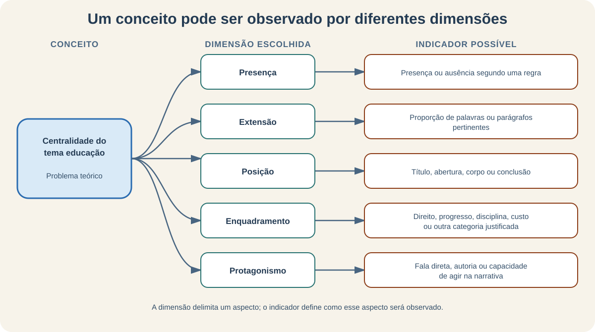

- **Conceito:** construção teórica que interessa à pesquisa
- **Dimensão:** aspecto específico do conceito
- **Indicador:** evidência observável escolhida

<p class="fonte">Babbie (2021, cap. 5); Adcock e Collier (2001).</p>

---

# Um indicador de extensão

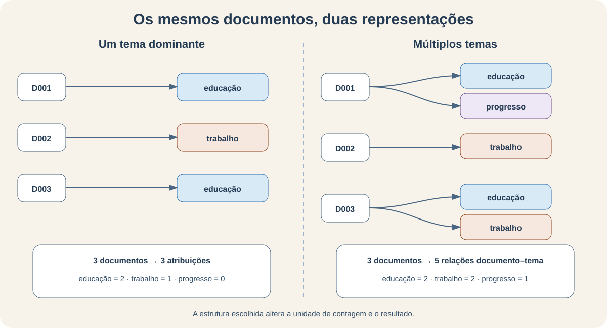

Se um documento tem 20 parágrafos e 5 discutem educação:

$$
p_{\mathrm{educacao}}=\frac{x}{n}=\frac{5}{20}=0{,}25=25\%
$$

- $x$: parágrafos classificados como discussão de educação;
- $n$: total de parágrafos do documento;
- $p$: proporção de extensão ocupada pelo tema.

**Interpretação:** 25% dos parágrafos, segundo a regra adotada, discutem o tema.
Isso não prova que ele seja o tema “mais importante”.

---

# Da observação ao registro

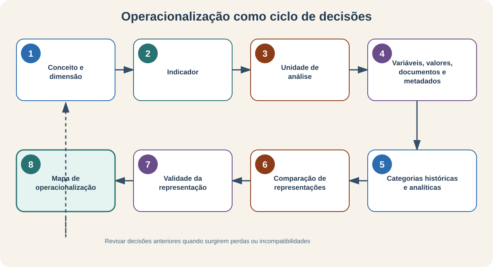

Cada seta exige uma justificativa. A validação pode nos levar de volta a uma
decisão anterior.

---

# Unidade de análise: sobre o que afirmamos?

| Pergunta | Unidade possível |
|---|---|
| quais temas aparecem em cada editorial? | documento |
| quanto do texto discute educação? | parágrafo ou trecho |
| quais autores ocupam posições centrais? | autor |
| como jornais diferem em suas agendas? | jornal |

Mudar a unidade pode mudar a medida, a variabilidade e o alcance da conclusão.

<p class="fonte">Krippendorff (2019, cap. 5).</p>

---

# Campo, valor e papel

| Campo | Valor de exemplo | Papel |
|---|---|---|
| `id` | `DOC007` | identificador |
| `texto` | conteúdo transcrito | documento/conteúdo |
| `ano` | `1898` | metadado e possível variável |
| `tema` | `educação` | variável analítica |
| `arquivo_origem` | `periodico_1898_07.jpg` | proveniência |

O papel depende da pergunta: `ano` pode apenas descrever o documento ou integrar
uma comparação temporal.

---

# Categorias históricas e analíticas

<div class="duas-colunas">

<div class="cartao">

### Histórica

Usada pelos atores, documentos ou instituições do período.

Ex.: uma ocupação registrada em um censo.

</div>

<div class="cartao">

### Analítica

Construída pelo pesquisador para comparar e interpretar.

Ex.: agrupar ocupações em setores econômicos.

</div>

</div>

Uma categoria histórica também resulta de relações e instituições; não é uma
janela transparente para a experiência vivida.

<p class="fonte">Bowker e Star (1999); Rodrigues (2020).</p>

---

# Uma decisão altera o resultado


<p class="pergunta">Qual representação preserva coexistência? Qual facilita uma tabela? O que cada uma apaga?</p>

---

<!-- _class: atividade -->

# U01-A08 · Mapa de operacionalização

**Modalidade:** individual, com comparação em dupla · **Tempo:** 25 minutos  
**Produto:** duas alternativas para representar o mesmo conceito

| Conceito | Dimensão | Indicador | Unidade | Variável | Regra | Limite |
|---|---|---|---|---|---|---|
| centralidade | extensão | proporção de parágrafos | documento | `prop_tema` | classificar parágrafos | extensão ≠ importância |

Depois, proponha uma segunda dimensão e explique qual se ajusta melhor à sua
pergunta.

---

<!-- _class: divisor -->

# 4 · Que conjunto sustenta a análise?

## Da fonte preservada ao corpus efetivamente analisado

---

<!-- _class: exemplo -->

# Exemplo: o que sobreviveu?

Uma hemeroteca contém jornais que:

- foram publicados;
- sobreviveram ao tempo;
- chegaram a uma instituição;
- foram catalogados;
- foram selecionados e digitalizados;
- puderam ser localizados pela pesquisadora.

<p class="pergunta">A coleção digital representa toda a imprensa?</p>

---

# População, amostra e corpus

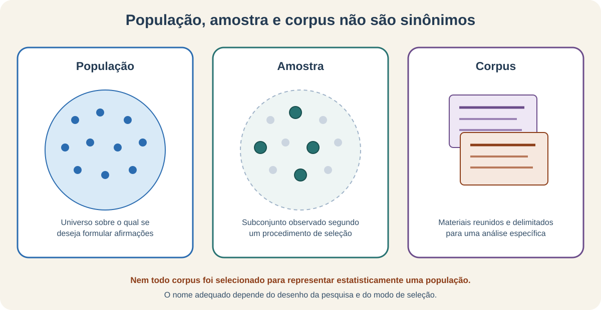

Um corpus delimitado não é automaticamente uma amostra representativa.

---

# Inclusão e exclusão são argumentos

Critérios possíveis:

- período e lugar;
- gênero documental;
- idioma;
- estado de preservação;
- disponibilidade de metadados;
- qualidade mínima de transcrição;
- pertinência à pergunta.

Documente também **quem ou o que desaparece** quando o critério é aplicado.

---

# Um documento não é apenas texto

<div class="duas-colunas">

<div>

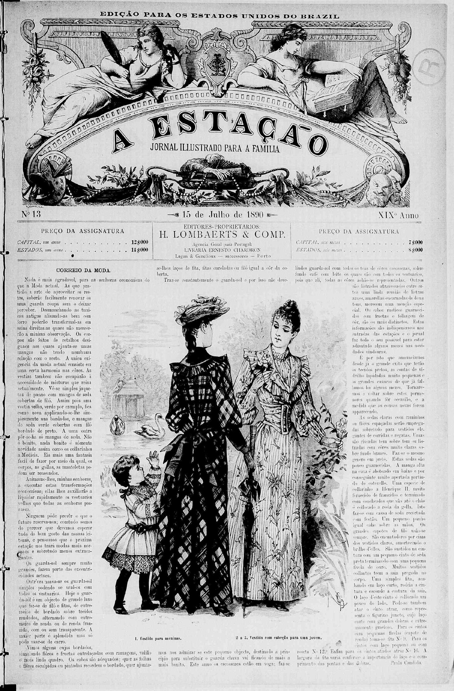

</div>

<div>

- disposição na página;
- tipografia e ilustrações;
- seções e gêneros;
- número, data e paginação;
- marcas de circulação;
- contexto de produção.

**Pergunta:** o que uma transcrição em TXT preserva? O que perde?

<p class="fonte">Acervo da Fundação Biblioteca Nacional — Brasil; domínio público.</p>

</div>

</div>

---

# Estruturado, semiestruturado, não estruturado

| Arquivo | Classificação didática | Por quê? |
|---|---|---|
| `documentos_exemplo.csv` | estruturado | linhas e colunas regulares |
| `metadados_exemplo.json` | semiestruturado | chaves e hierarquia flexíveis |
| `texto_exemplo.txt` | não estruturado | conteúdo não dividido em campos regulares |

“Não estruturado” não significa sem forma, linguagem ou sentido. Significa que
a estrutura relevante não está previamente expressa como campos regulares.

---

# Documento, variável ou metadado?

O mesmo elemento pode assumir papéis diferentes:

| Elemento | Papel possível |
|---|---|
| texto integral | documento analisado |
| ano de publicação | metadado descritivo |
| ano usado para comparar períodos | variável analítica |
| caminho do arquivo | metadado de proveniência |
| `DOC007` | identificador |

Metadados tornam o dado localizável, interpretável e auditável.

<p class="fonte">Riley (2017).</p>

---

<!-- _class: atividade -->

# U01-A11 · Ficha do corpus

**Modalidade:** individual + revisão em dupla · **Tempo:** 30 + 15 minutos  
**Produto:** delimitação do corpus e uma revisão justificada

Registre: universo, tipo do conjunto, unidade, inclusão/exclusão, formatos,
metadados, ausências, alcance das conclusões e autoridade sobre os dados.

O revisor procura:

1. um critério impreciso;
2. uma ausência pouco discutida;
3. uma conclusão que excede o corpus.

---

<!-- _class: divisor -->

# 5 · Quando um resultado vira evidência?

## A operação é apenas uma etapa

---

<!-- _class: exemplo -->

# Uma saída simples

| Categoria `local` | Número de registros |
|---|---:|
| Capital | 6 |
| Interior | 6 |

Qual afirmação é sustentada?

A. A produção jornalística era igualmente distribuída.  
B. A sociedade se dividia igualmente entre Capital e Interior.  
C. **Nesta coleção**, há seis registros em cada categoria.  
D. O local explica as diferenças entre os documentos.

---

# Da fonte à interpretação

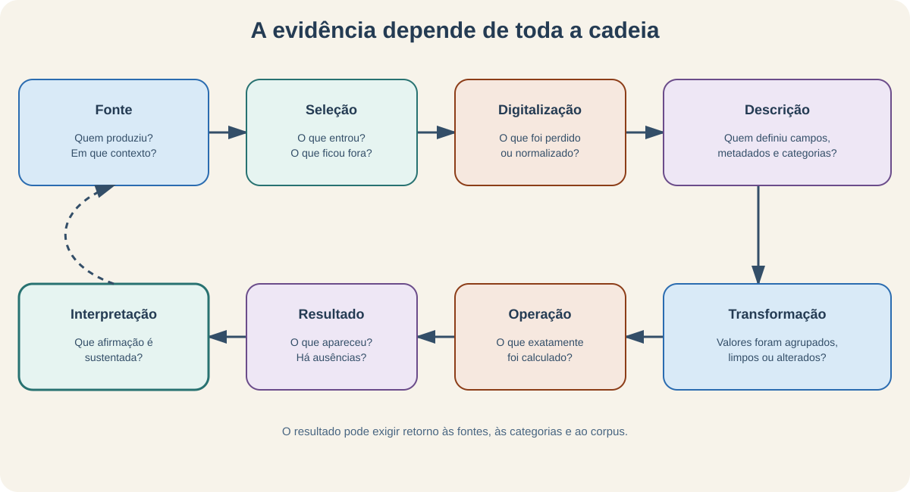

Uma contagem pode estar correta para a tabela e ser inadequada para uma
afirmação histórica ampla.

---

# O código conhece a regra, não o contexto

```python
documentos["local"].value_counts()
```

O código:

- seleciona uma coluna;
- agrupa rótulos iguais;
- conta linhas em cada grupo.

Ele não sabe quem criou `local`, como o corpus foi formado nem o que “Capital”
significa historicamente.

---

<!-- _class: atividade -->

# U01-A10 · Prever, executar, interpretar

**Modalidade:** demonstração dialogada · **Tempo:** 10 minutos  
**Produto:** previsão e duas afirmações com alcances diferentes

1. observe a tabela antes do código;
2. preveja a saída;
3. execute no Notebook 03;
4. escreva uma afirmação sustentada;
5. escreva uma afirmação tentadora, mas não sustentada.

> A aprendizagem está na distinção entre resultado e interpretação, não na
> memorização de `value_counts()`.

---

# Resultado ≠ evidência ≠ interpretação

| Nível | Pergunta de controle |
|---|---|
| dado registrado | o que o campo significa? |
| operação | qual regra foi aplicada? |
| resultado | está correto para esta tabela? |
| evidência | responde à pergunta delimitada? |
| interpretação | qual contexto e bibliografia dão sentido? |

Uma evidência é uma relação argumentada entre resultado, pergunta e condições
de produção.

---

<!-- _class: alerta -->

# O perigo da falsa precisão

`25,0000%` parece exato. Mas a precisão numérica não resolve:

- parágrafos ambíguos;
- categorias contestáveis;
- documentos ausentes;
- erros de transcrição;
- mudanças históricas de sentido;
- seleção não representativa.

Automatizar uma regra aumenta sua velocidade e alcance — **não sua validade**.

---

# O que a quantificação pode fazer

<div class="duas-colunas">

<div class="cartao">

### Pode ajudar a

- comparar padrões;
- encontrar exceções;
- localizar lacunas;
- trabalhar em escala;
- formular novas perguntas.

</div>

<div class="cartao">

### Pode também

- estabilizar categorias;
- apagar ambiguidade;
- amplificar vieses;
- privilegiar o preservado;
- induzir generalizações.

</div>

</div>

<p class="fonte">D'Ignazio e Klein (2020); Rawson e Muñoz (2019).</p>

---

<!-- _class: divisor -->

# 6 · Oficina: construir uma proposta coerente

## As decisões anteriores agora precisam conversar

---

# A oficina não começa do zero

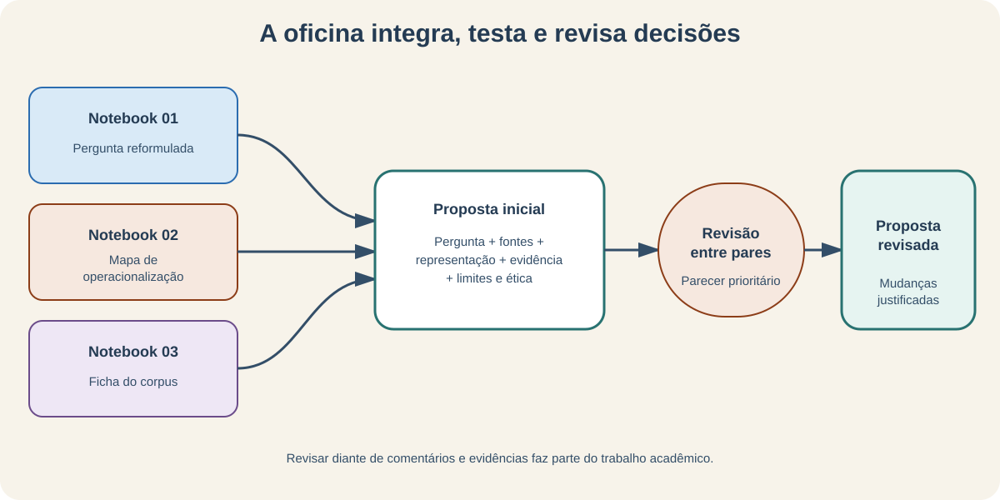

Revisar uma decisão diante de nova evidência é parte do trabalho acadêmico.

---

<!-- _class: atividade -->

# U01-A12 · Produto da oficina

**Modalidade:** individual + revisão em pares · **Tempo:** 60 + 30 minutos  
**Produto:** proposta inicial completa no Notebook 04

A proposta integra:

- motivação, pergunta e referências;
- unidade, população e corpus;
- mapa de operacionalização;
- dados e metadados necessários;
- cadeia de evidência;
- limites, vieses e ética.

Não há código: o trabalho central é **formular e justificar**.

---

# Teste de coerência

> Quero compreender **X**, observando **Y**, em unidades **Z**.

Para que isso funcione:

- o corpus precisa conter as unidades $Z$;
- o indicador deve observar uma dimensão de $X$;
- a operação deve produzir um resultado pertinente;
- a interpretação deve permanecer dentro do alcance do corpus;
- as perdas e alternativas devem ser explicitadas.

Se uma peça muda, verifique as demais.

---

# Critérios de avaliação

| Critério | Pergunta |
|---|---|
| relevância | há um problema humanístico significativo? |
| delimitação | fenômeno, contexto e recorte estão claros? |
| coerência | pergunta, dados, método e evidência se conectam? |
| fundamentação | decisões dialogam com referências? |
| reflexividade | limites, vieses e ética são reconhecidos? |
| viabilidade | o projeto cabe nos dados, tempo e recursos? |

Uma pergunta modesta e bem justificada é preferível a uma promessa grandiosa.

---

<!-- _class: atividade -->

# U01-A13 · Revisão entre pares

**Modalidade:** duplas, com dois turnos · **Tempo:** 15 minutos por proposta  
**Produto:** parecer recebido e mudanças justificadas

O revisor pergunta:

1. consigo identificar exatamente o que será observado?
2. os dados propostos podem responder à pergunta?
3. conceito e indicador estão diferenciados?
4. o alcance da conclusão está claro?
5. qual escolha precisa de maior justificativa?

---

# Retorno ao exemplo inicial

Para estudar “progresso” na imprensa, não basta contar uma palavra.

Agora podemos justificar:

- **pergunta:** qual aspecto e em qual contexto?
- **representação:** presença, extensão, posição, conexão ou valência?
- **unidade:** documento, parágrafo, jornal ou período?
- **corpus:** quais periódicos chegaram à análise e por quê?
- **operação:** o que será calculado?
- **interpretação:** qual afirmação cabe — e qual não cabe?

---

# Síntese do percurso

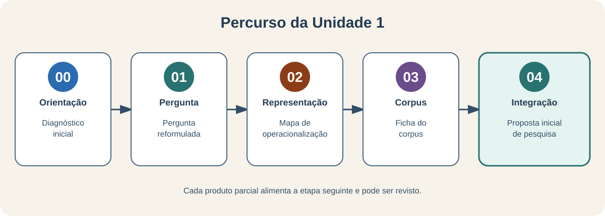

O projeto continua aberto: as próximas unidades testarão e revisarão essas
decisões.

---

# Conexão com o projeto cumulativo

Ao final da Unidade 1, registre no relatório-notebook:

1. problema e pergunta provisória;
2. finalidade e estrutura analítica;
3. unidade e corpus possíveis;
4. duas operacionalizações do conceito central;
5. evidência esperada e interpretações alternativas;
6. limites, vieses e próxima decisão necessária.

Na Unidade 2, essa formulação orientará o **protocolo de construção da base**.

---

# Bilhete de saída

Complete individualmente:

> Minha pergunta provisória é…

> A decisão que mais pode alterar meu resultado é…

> Ainda preciso definir ou descobrir…

**Produto:** três frases registradas para orientar a próxima unidade.

---

<!-- _class: referencias -->

# Referências — 1/2

- ADCOCK, R.; COLLIER, D. Measurement Validity: A Shared Standard for Qualitative and Quantitative Research. *American Political Science Review*, v. 95, n. 3, p. 529–546, 2001. https://escholarship.org/uc/item/945280s6.
- ALVES, D. As Humanidades Digitais como uma comunidade de práticas dentro do formalismo académico: dos exemplos internacionais ao caso português. *Ler História*, n. 69, p. 91–103, 2016. https://doi.org/10.4000/lerhistoria.2496.
- BABBIE, E. R. *The Practice of Social Research*. 15. ed. Boston: Cengage, 2021.
- BOWKER, G. C.; STAR, S. L. *Sorting Things Out: Classification and Its Consequences*. Cambridge: MIT Press, 1999.
- BURDICK, A. et al. *Digital_Humanities*. Cambridge: MIT Press, 2012.
- D'IGNAZIO, C.; KLEIN, L. F. *Data Feminism*. Cambridge: MIT Press, 2020. https://data-feminism.mitpress.mit.edu/.
- DRUCKER, J. Humanities Approaches to Graphical Display. *Digital Humanities Quarterly*, v. 5, n. 1, 2011. https://www.digitalhumanities.org/dhq/vol/5/1/000091/000091.html.

---

<!-- _class: referencias -->
<!-- _paginate: false -->

# Referências — 2/2

- FERLA, L. A. C.; LIMA, L. F. S.; FEITLER, B. Novidades no front: experiências com Humanidades Digitais em um curso de História na periferia da Grande São Paulo. *Estudos Históricos*, v. 33, n. 69, p. 111–132, 2020. https://doi.org/10.1590/S2178-14942020000100007.
- KRIPPENDORFF, K. *Content Analysis: An Introduction to Its Methodology*. 4. ed. Thousand Oaks: SAGE, 2019.
- LAVIN, M. Why Digital Humanists Should Emphasize Situated Data over Capta. *Digital Humanities Quarterly*, v. 15, n. 2, 2021. https://www.digitalhumanities.org/dhq/vol/15/2/000556/000556.html.
- RAWSON, K.; MUÑOZ, T. Against Cleaning. In: GOLD, M. K.; KLEIN, L. F. (org.). *Debates in the Digital Humanities 2019*. Minneapolis: University of Minnesota Press, 2019.
- RILEY, J. *Understanding Metadata: What Is Metadata, and What Is It For? A Primer*. Baltimore: NISO Press, 2017.
- RODRIGUES, A. Humanidades digitais e diáspora africana: questões éticas e metodológicas na elaboração de uma base de dados sobre a população escravizada de Mariana (século XVIII). *Estudos Históricos*, v. 33, n. 69, p. 64–87, 2020. https://doi.org/10.1590/S2178-14942020000100005.
- SHMUELI, G. To Explain or to Predict? *Statistical Science*, v. 25, n. 3, p. 289–310, 2010. https://doi.org/10.1214/10-STS330.

