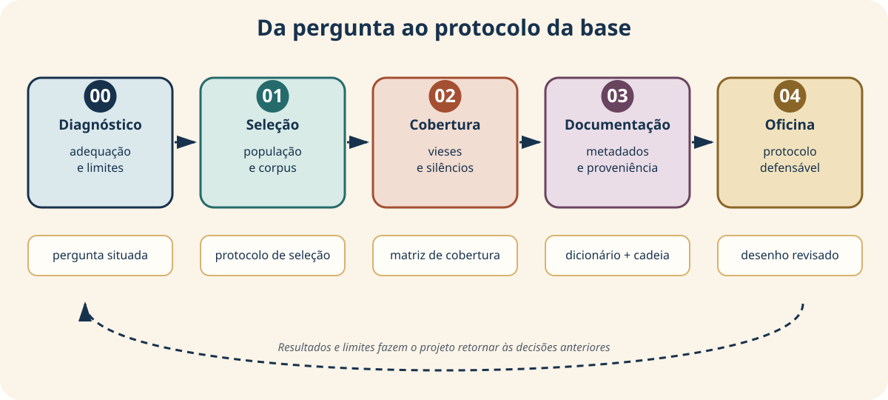
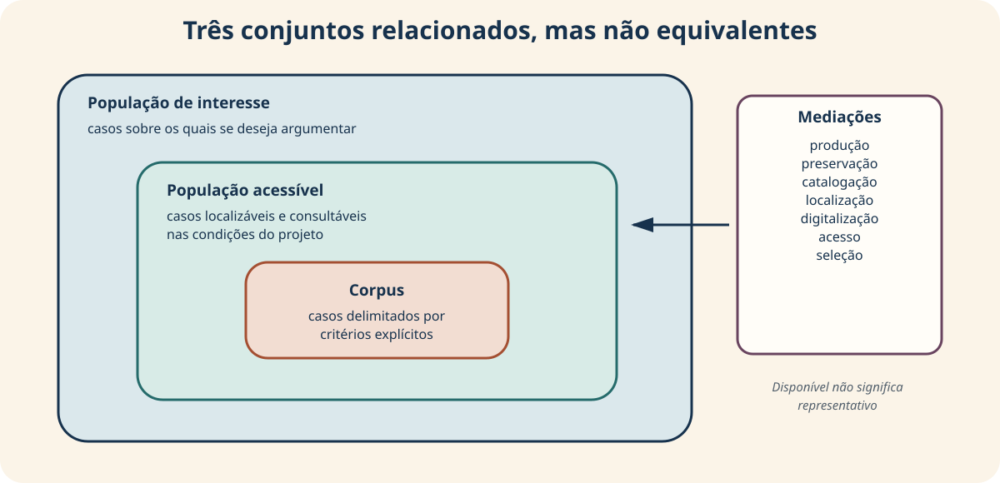
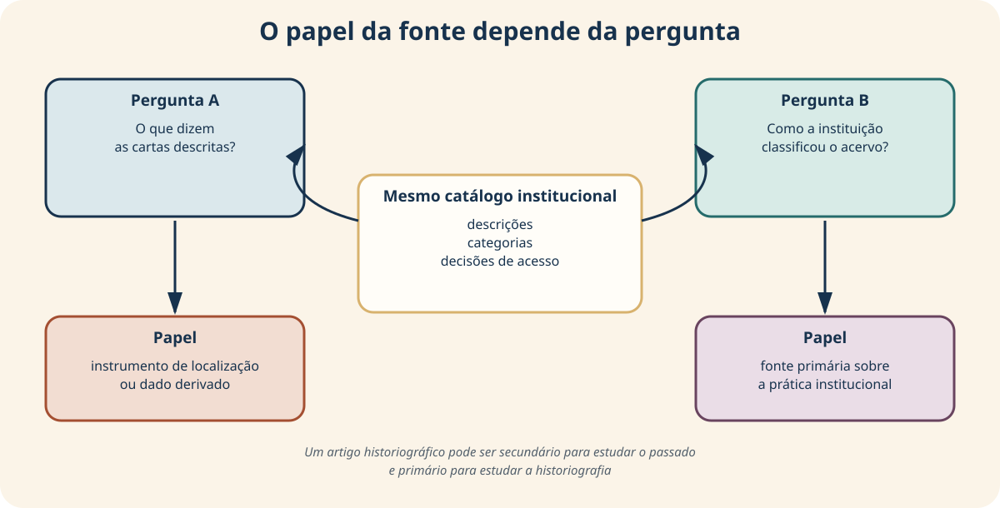
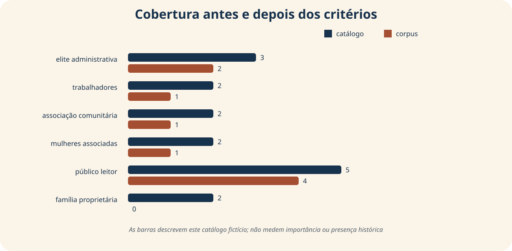
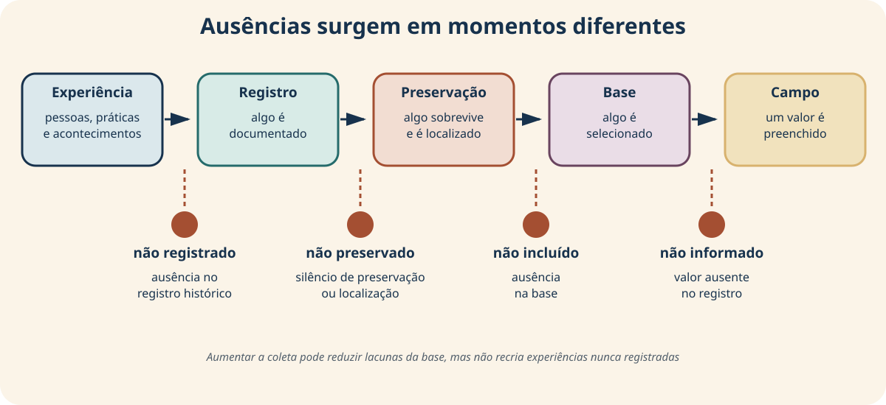
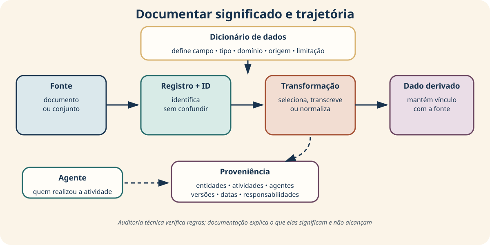
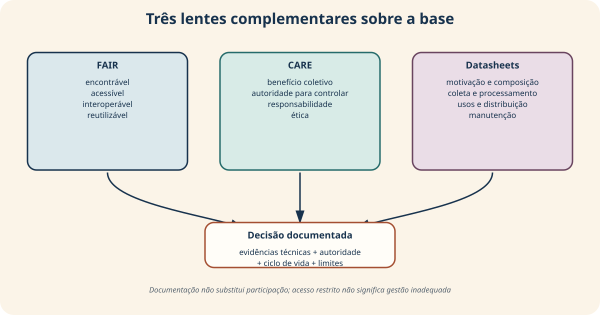
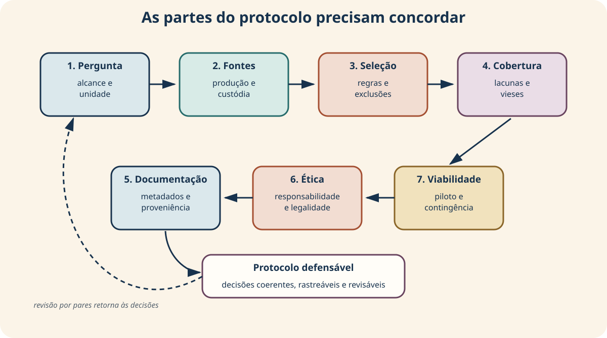

<!-- _class: capa -->
<!-- _paginate: false -->
<!-- _footer: "" -->

# Unidade 2

## Construção e documentação da base

**Problema orientador:** quais dados são necessários e como saber se eles
representam adequadamente o fenômeno investigado?

---

# Agenda

1. Delimitar população, fontes e corpus
2. Tornar a seleção explícita e reproduzível
3. Examinar cobertura, vieses e silêncios
4. Documentar campos, identificadores e proveniência
5. Relacionar FAIR, CARE e *datasheets*
6. Construir o protocolo da base do projeto

---

# Ao final, você deverá conseguir…

- distinguir população de interesse, população acessível e corpus;
- classificar fontes em relação à pergunta;
- justificar inclusão, exclusão e casos limítrofes;
- avaliar cobertura sem prometer representatividade automática;
- documentar metadados, identificadores e proveniência;
- discutir acesso, autoridade, benefício e responsabilidade;
- produzir um protocolo de base auditável e viável.

---

# Um percurso cumulativo



Uma lacuna percebida adiante pode exigir retorno às fontes ou aos critérios de
seleção.

---

<!-- _class: exemplo -->

# Catálogo fictício usado na unidade

- **Unidade de observação:** 16 fontes catalogadas entre 1890 e 1904.
- **Cobertura:** quatro instituições, seis tipos documentais, Capital e Interior.
- **Campos principais:** localização, digitalização, acesso e qualidade dos metadados.
- **Arquivos de apoio:** dicionário de dados e registro de proveniência.

A distribuição foi construída para discutir seleção, ausências e cobertura. Não
representa acervos ou instituições reais.

---

<!-- _class: exemplo -->

# Catálogo e dicionário: duas unidades distintas

<div class="duas-colunas">

<div>

### `catalogo_fontes.csv`

| id | instituição | tipo | ano | acesso |
|---|---|---|---:|---|
| A001 | Arquivo Municipal | ata | 1890 | público |
| A002 | Arquivo Municipal | ata | 1891 | público |
| A003 | Arquivo Municipal | requerimento | 1892 | restrito |

Cada linha representa uma fonte catalogada; cinco de dez campos são mostrados.

</div>

<div>

### `dicionario_dados.csv`

| campo | tipo | regra |
|---|---|---|
| id_fonte | texto | único e não vazio |
| instituicao | categoria | quatro valores previstos |
| tipo_documental | categoria | vocabulário controlado |

Cada linha descreve um campo do catálogo.

</div>

</div>

---

<!-- _class: exemplo -->

# A proveniência também possui registros

### `proveniencia_catalogo.json`

| Campo lógico | Valor de exemplo |
|---|---|
| título | Catálogo didático de fontes |
| natureza | dados inteiramente fictícios |
| responsável | equipe docente |
| finalidade | demonstrar seleção, cobertura, metadados e proveniência |
| transformação[0] | atribuição manual de identificadores |

O JSON não é uma planilha: a tabela apresenta uma visão lógica de alguns campos e
de um item da lista de transformações.

---

<!-- _class: exemplo -->

# Antes da teoria: duas bases plausíveis

<div class="duas-colunas">

<div class="cartao">

### Base A

10.000 jornais digitalizados, concentrados em duas capitais e disponíveis para
download.

</div>

<div class="cartao">

### Base B

800 jornais de seis localidades, consultados em formatos e condições de acesso
diferentes.

</div>

</div>

<br>

> Qual base é “melhor” para estudar a circulação regional de ideias?

---

# O tamanho não decide sozinho

<div class="duas-colunas">

<div>


<p class="fonte">Ilustração conceitual; não representa um acervo histórico real.</p>

</div>

<div>

Antes de escolher, precisamos saber:

- qual é a pergunta e a unidade de análise;
- quais lugares, períodos e grupos estão cobertos;
- como a seleção e as transformações foram feitas;
- quem pode autorizar acesso e reutilização.

</div>

</div>

<p class="pergunta">Uma base é adequada em relação a uma pergunta e a condições de uso.</p>

---

<!-- _class: atividade -->

# U02-A01 · Diagnóstico inicial

**Modalidade:** individual · **Tempo:** 10 minutos  
**Produto:** quatro respostas breves e uma dúvida

1. Coleção digitalizada é necessariamente representativa?
2. Não localizar uma fonte equivale a encontrar uma célula vazia?
3. O que você precisaria saber para reutilizar uma base?
4. Dados públicos dispensam avaliação ética ou legal?

> Guarde as respostas: elas serão revisitadas ao final da unidade.

---

<!-- _class: divisor -->

# 1 · De onde vêm os registros?

## A base começa antes da planilha

---

<!-- _class: exemplo -->

# O catálogo tem 16 registros. O corpus terá 9.

Os critérios do exemplo exigem:

- ano entre 1890 e 1900;
- item localizado;
- representação digital disponível;
- acesso público ou mediante autorização.

Sete registros ficam de fora. Isso é apenas uma operação técnica?

<!--
Peça previsões: quais instituições, grupos ou tipos documentais podem perder
presença? Só depois mostre o diagrama dos conjuntos.
-->

---

# Três conjuntos diferentes



Um corpus grande ainda pode resultar de acesso profundamente desigual.

---

# População, acesso e corpus

| Conjunto | Pergunta |
|---|---|
| população de interesse | sobre quais casos queremos argumentar? |
| população acessível | quais casos conseguimos localizar e consultar? |
| corpus | quais casos foram efetivamente selecionados? |

Entre eles existem mediações: produção, preservação, catalogação,
digitalização, localização, acesso e escolhas da pesquisa.

---

<!-- _class: exemplo -->

# O mesmo catálogo, dois papéis



O papel não é uma propriedade eterna do arquivo: depende da pergunta e do uso
analítico.

---

# Fonte primária, secundária e dado derivado

| Papel na pesquisa | Definição operacional |
|---|---|
| fonte primária | vestígio mobilizado como evidência sobre o contexto investigado |
| fonte secundária | interpretação posterior baseada em fontes e outras interpretações |
| dado derivado | representação produzida por transcrição, OCR, anotação ou transformação |

Uma planilha derivada não substitui o documento: precisa permanecer ligada à
fonte e às decisões que a produziram.

<p class="fonte">American Historical Association (2023).</p>

---

# Primária não significa “mais verdadeira”

Toda fonte exige crítica:

- quem a produziu e para quem?
- com qual finalidade?
- por quais categorias e convenções?
- o que pôde ou não ser registrado?
- como foi preservada e mediada?
- por que está acessível hoje?

A classificação organiza a relação com a pergunta; não cria uma hierarquia
automática de confiabilidade.

---

# Antes de filtrar, escreva a regra

| Elemento | Exemplo |
|---|---|
| campo | `ano` |
| regra | entre 1890 e 1900, inclusive |
| justificativa | corresponde ao recorte da pergunta |
| evidência | valor registrado no catálogo |
| caso limítrofe | data aproximada ou intervalo |
| tratamento | manter separado até verificação |

Uma regra reproduzível pode continuar substantivamente inadequada. Por isso,
ela precisa de justificativa.

---

# A lógica da seleção

```python
corpus = catalogo[
    periodo & localizado & digitalizado & acesso
]
```

O código aplica quatro condições. Ele não decide:

- se o recorte responde à pergunta;
- se “digitalizado” deve ser obrigatório;
- se uma consulta presencial seria viável;
- se a condição de acesso permite reutilização.

---

# Excluir também produz dados

| ID | fora do período | não localizado | sem digitalização | acesso incompatível |
|---|:---:|:---:|:---:|:---:|
| A003 | não | não | sim | sim |
| A005 | sim | não | não | não |
| D001 | não | sim | sim | sim |

Um registro pode ter mais de um motivo. Guardar apenas o corpus final apaga o
processo que o produziu.

---

<!-- _class: atividade -->

# U02-A02 · Interpretar a filtragem

**Modalidade:** pequenos grupos · **Tempo:** 15 minutos  
**Produto:** leitura dos motivos de exclusão

1. Quantos registros foram excluídos por cada regra?
2. Quais acumulam mais de um motivo?
3. “Não digitalizado” pertence ao fenômeno ou à infraestrutura?
4. Que alternativa permitiria consultar parte do material excluído?

> A contagem mostra o efeito da regra; não explica a origem da perda.

---

<!-- _class: atividade -->

# U02-A03 · Protocolo de seleção

**Modalidade:** individual · **Tempo:** 25 minutos  
**Produto:** primeira seção do protocolo da base

Registre população de interesse, população acessível, unidade, fontes,
critérios, justificativas, casos limítrofes e forma de registrar exclusões.

**Teste de auditabilidade:** outra pessoa conseguiria reconstruir sua decisão
sem adivinhar regras?

---

<!-- _class: divisor -->

# 2 · Quem e o que permanece visível?

## Cobertura, vieses e silêncios

---

<!-- _class: atividade -->

# U02-A04 · Leia a comparação antes da definição



**Modalidade:** discussão guiada · **Tempo:** 10 minutos  
**Produto:** grupos que desaparecem, diminuem ou permanecem e sua relação com a seleção

Família proprietária desaparece; trabalhadores diminuem; público leitor
permanece majoritário. O gráfico descreve o quê — e não descreve o quê?

---

# Cobertura não é representatividade

- **Cobertura:** quais períodos, lugares, instituições, tipos ou grupos aparecem
  na base.
- **Representatividade:** em que condições o conjunto sustenta inferências sobre
  uma população.

Um corpus pode cobrir muitos anos e excluir sistematicamente certas
experiências. Também pode ser valioso sem representar estatisticamente uma
população, desde que seu alcance seja explicitado.

---

# Uma razão de cobertura local


Para um grupo $g$, podemos comparar catálogo e corpus:

$$
C_g=\frac{n_{g,\,\mathrm{corpus}}}{n_{g,\,\mathrm{catalogo}}}
$$

Exemplo para “trabalhadores”:

$$
C_{\mathrm{trab}}=\frac{1}{2}=0{,}5=50\%
$$

Isto mede retenção **neste catálogo fictício**. Não mede importância social nem
representatividade da população histórica.

---

# Três ausências que exigem respostas diferentes



Preencher uma célula não recupera uma experiência que nunca foi registrada.

---

# Diagnosticar a ausência

| Situação | Exemplo | Resposta possível |
|---|---|---|
| ausência no registro histórico | experiência não documentada | discutir silêncio e buscar outras fontes |
| ausência na base | fonte existente não localizada ou selecionada | rever busca, acesso ou recorte |
| valor ausente | campo vazio em registro incluído | diagnosticar e definir tratamento |

Confundir essas situações transforma um problema histórico em uma falsa tarefa
de “limpeza”.

---

# Silêncios são produzidos

Pergunte quem pôde:

- participar do acontecimento registrado;
- produzir o relato;
- preservar o documento;
- classificá-lo e descrevê-lo;
- autorizar seu acesso;
- narrá-lo como história.

Arquivos e bases não apenas guardam memória: também participam de sua produção.

<p class="fonte">Trouillot (1995); Schwartz e Cook (2002).</p>

---

# Quando a seleção produz viés?

Há **viés de seleção** quando a probabilidade de inclusão se relaciona
sistematicamente a características relevantes para a pergunta.

Exemplo: exigir digitalização pode favorecer:

- instituições com mais recursos;
- materiais em melhor estado;
- gêneros mais fáceis de digitalizar;
- coleções com acesso menos restrito.

Uma associação observada é sinal para investigar o mecanismo — não sua prova
histórica definitiva.

---

<!-- _class: atividade -->

# U02-A05 · Matriz de cobertura

**Modalidade:** individual + discussão · **Tempo:** 30 minutos  
**Produto:** matriz incorporada ao protocolo

| Dimensão | Desejada | Acessível | Lacuna | Consequência | Mitigação |
|---|---|---|---|---|---|
| temporal | … | … | … | … | … |
| geográfica | … | … | … | … | … |
| social | … | … | … | … | … |
| documental | … | … | … | … | … |

Inclua silêncios que uma coleta maior talvez não resolva.

---

<!-- _class: alerta -->

# Mais dados nem sempre são a resposta

Ampliar o corpus pode reduzir uma lacuna, mas também pode:

- contrariar direitos e protocolos de acesso;
- aumentar risco de reidentificação;
- retirar materiais de seus contextos de governança;
- impor categorias externas;
- ampliar danos junto com a escala.

Da cobertura passamos, portanto, à documentação e à governança.

---

<!-- _class: divisor -->

# 3 · Como tornar a base auditável?

## Metadados, identificadores e proveniência

---

<!-- _class: exemplo -->

# Uma linha sem documentação

| id | tipo | ano | grupo | acesso |
|---|---|---:|---|---|
| B002 | carta | 1893 | mulheres associadas | autorização |

Ainda precisamos saber:

- quem atribuiu `grupo` e segundo qual regra;
- o que “autorização” permite;
- qual instituição custodia a fonte;
- quando o registro foi obtido;
- que transformação o produziu.

---

# Quatro funções dos metadados

| Tipo | Exemplos | Para quê? |
|---|---|---|
| descritivo | título, autoria, data, assunto | compreender e localizar |
| administrativo | direitos, acesso, formato | gerir e usar |
| estrutural | página, parte, versão | relacionar componentes |
| proveniência | origem, agente, data, transformação | reconstruir trajetória |

As categorias podem se sobrepor. Elas funcionam aqui como roteiro de inspeção.

<p class="fonte">Riley (2017), retomado da Unidade 1; W3C PROV-O (2013).</p>

---

# Três arquivos, três perguntas

| Arquivo | Responde principalmente… |
|---|---|
| `catalogo_fontes.csv` | quais registros e atributos temos? |
| `dicionario_dados.csv` | o que cada campo quer dizer? |
| `proveniencia_catalogo.json` | como e por que a base foi produzida? |

Nenhum deles documenta sozinho a base inteira.

---

# O dicionário especifica o campo

| Elemento | Exemplo para `condicao_acesso` |
|---|---|
| definição | condição informada pelo custodiante |
| tipo | categoria |
| domínio/regra | público, restrito, mediante autorização… |
| origem | catálogo simulado |
| limitação | não equivale a licença de reutilização |

O dicionário registra o significado esperado; não garante que todos os valores
estejam corretos.

---

# Um bom identificador

Deve ser:

- **único** no escopo declarado;
- não vazio;
- estável o suficiente para manter relações;
- independente de atributos que podem mudar;
- documentado e, quando pertinente, persistente institucionalmente.

Título e número da linha são candidatos frágeis. Testar duplicatas verifica
unicidade atual, não persistência futura.

---

# Auditoria técnica responde perguntas estreitas

```python
catalogo["id_fonte"].is_unique
```

Pode verificar:

- IDs ausentes ou repetidos;
- campos sem documentação;
- valores fora de um domínio esperado.

Não pode garantir:

- definição conceitual adequada;
- origem legítima;
- persistência institucional;
- autorização para reutilizar.

---

# Proveniência reconstrói a trajetória



Um endereço eletrônico sozinho não documenta versão, data de acesso, autoria e
transformações.

---

# Entidade, atividade e agente

<div class="tres-colunas">

<div class="cartao">

### Entidade

Fonte, arquivo, registro, versão ou base.

</div>

<div class="cartao">

### Atividade

Digitalização, transcrição, seleção ou normalização.

</div>

<div class="cartao">

### Agente

Pessoa, equipe, instituição ou sistema responsável.

</div>

</div>

<p class="fonte">W3C, PROV-O (2013). O modelo não substitui padrões arquivísticos específicos.</p>

---

<!-- _class: atividade -->

# U02-A06 · Documentação do projeto

**Modalidade:** individual · **Tempo:** 30 minutos  
**Produto:** estratégia de documentação e proveniência

Defina identificadores, metadados mínimos, campos e domínios, origem,
custodiante, versão, data de acesso, transformações e ligação com a fonte.

**Teste:** uma pessoa externa conseguiria interpretar os campos e reconstruir a
trajetória de um registro?

---

<!-- _class: divisor -->

# 4 · Reutilizável por quem?

## Condições técnicas não encerram a governança

---

<!-- _class: exemplo -->

# Dois casos que desafiam “quanto mais aberto, melhor”

<div class="duas-colunas">

<div class="cartao">

### Caso 1

Imagens e API abertas de coleção indígena, publicadas sem participação do povo
relacionado.

</div>

<div class="cartao">

### Caso 2

Registros restritos por decisão comunitária, com metadados e procedimento de
acesso documentados.

</div>

</div>

<p class="pergunta">Qual caso está melhor governado? Quem pode responder?</p>

---

# Três lentes complementares



As lentes não formam uma escala e não produzem automaticamente um selo de
qualidade.

---

# Três perguntas diferentes

| Lente | Pergunta central |
|---|---|
| FAIR | objetos podem ser encontrados, acessados, combinados e reutilizados? |
| CARE | quem se beneficia, quem controla e quais responsabilidades existem? |
| *Datasheets* | como e por que a base foi criada, distribuída e mantida? |

Uma decisão defensável registra evidências e também aquilo que depende de
consulta, negociação ou avaliação institucional.

---

# FAIR: condições de reuso

| Princípio | Sentido | Evidência possível |
|---|---|---|
| F — *Findable* | encontrável | identificador e metadados ricos |
| A — *Accessible* | acessível | protocolo e condições explícitas |
| I — *Interoperable* | interoperável | formatos e vocabulários documentados |
| R — *Reusable* | reutilizável | proveniência, termos e limitações |

FAIR orienta objetos digitais para pessoas e máquinas; não garante justiça,
autorização comunitária ou ausência de dano.

<p class="fonte">Wilkinson et al. (2016).</p>

---

# Acessível não significa aberto

Uma base pode exigir autenticação ou autorização e continuar acessível segundo
um protocolo claro.

Perguntas úteis:

- os metadados podem ser encontrados?
- as condições de acesso estão descritas?
- existe procedimento de solicitação?
- o protocolo pode ser aplicado?
- as restrições possuem justificativa e autoridade?

“Consigo baixar?” é uma pergunta insuficiente.

---

<!-- _class: atividade -->

# U02-A07 · Auditoria de evidências FAIR

**Modalidade:** previsão + experimento guiado · **Tempo:** 20 minutos  
**Produto:** lista de evidências, lacunas e limites da auditoria

O código verifica IDs, campos documentados, acesso, formato, proveniência e
licença. Antes de executar, preveja quais itens falharão.

> Não some os resultados para criar uma “nota FAIR”: presença técnica não mede
> qualidade semântica, estabilidade ou legitimidade.

---

# CARE: pessoas e propósitos no centro

| Princípio | Pergunta situada |
|---|---|
| C — benefício coletivo | prioridades e benefícios são definidos pelos povos? |
| A — autoridade para controlar | quem decide coleta, acesso, uso e reuso? |
| R — responsabilidade | quais relações e deveres de cuidado permanecem? |
| E — ética | como minimizar danos e promover justiça? |

CARE nasce da soberania de dados indígenas e não deve ser convertido em uma
lista ética genérica.

<p class="fonte">Carroll et al. (2020).</p>

---

<!-- _class: alerta -->

# Aplicar CARE exige relação e autoridade reais

Quando houver dados, conhecimentos, territórios ou patrimônio de povos
indígenas:

- participação não é apenas consulta simbólica;
- preencher um formulário individualmente não demonstra conformidade;
- abertura técnica não supera autoridade comunitária;
- benefícios e riscos precisam ser definidos com os povos envolvidos.

Em outros contextos, CARE pode provocar perguntas úteis, mas o projeto não deve
alegar adesão sem justificar âmbito e governança.

---

<!-- _class: atividade -->

# U02-A08 · Abrir, restringir ou negociar?

**Modalidade:** duplas · **Tempo:** 25 minutos  
**Produto:** decisão provisória e condição que poderia alterá-la

1. escolha um dos dois casos;
2. use ao menos uma evidência FAIR;
3. formule duas questões CARE;
4. identifique quem pode decidir;
5. declare que informação ainda falta.

Não procure uma regra universal: explicite autoridade, benefício, risco e
condições.

---

# *Datasheets*: documentar o ciclo de vida

| Parte | O que registrar nas Humanidades Digitais |
|---|---|
| motivação | pergunta, equipe, instituição, financiamento |
| composição | unidade, corpus, campos, lacunas, grupos representados |
| coleta | fontes, custodiantes, seleção e autorizações |
| processamento | OCR, transcrição, classificação, exclusões, versões |
| usos | aplicações previstas, inadequadas, riscos e limites |
| distribuição | acesso, licença, termos e documentação |
| manutenção | responsável, correções, versões e descontinuação |

<p class="fonte">Gebru et al. (2021), adaptado criticamente para bases de Humanidades Digitais.</p>

---

# O documento não resolve tudo

Um *datasheet*:

- favorece reflexão e comunicação;
- ajuda produtores e usuários a avaliar usos;
- preserva decisões ao longo do ciclo de vida.

Mas não substitui:

- descrição arquivística;
- plano de gestão;
- avaliação ética ou jurídica;
- consulta e decisão comunitária;
- análise substantiva da qualidade.

Seu valor está na reflexão — não em preenchimento totalmente automático.

---

<!-- _class: atividade -->

# U02-A09 · Ficha integrada

**Modalidade:** 20 min individual + 15 min em dupla + 10 min de revisão  
**Produto:** ficha de uma a duas páginas para o protocolo

1. evidência, lacuna e ação para cada princípio FAIR;
2. questões de autoridade, benefício, responsabilidade e ética;
3. minidatasheet do ciclo de vida;
4. parecer sobre afirmação sem evidência, acesso, pessoas ausentes e uso futuro.

---

# Dados pessoais: acesso público não encerra a análise

Antes de coletar ou republicar, examine:

- finalidade e necessidade;
- minimização dos dados;
- pessoas e grupos potencialmente afetados;
- segurança e controle de acesso;
- risco de reidentificação;
- direitos autorais, licença e termos de uso;
- necessidade de avaliação ética e orientação institucional.

<p class="fonte">LGPD, Lei nº 13.709/2018; guia orientativo da ANPD (2023, portal atualizado em 2025).</p>

---

<!-- _class: divisor -->

# 5 · Oficina: protocolo da base

## Transformar decisões dispersas em um desenho defensável

---

# As seções precisam sustentar umas às outras



Se a pergunta mudar, revise unidade, fontes, critérios, cobertura e riscos.

---

<!-- _class: atividade -->

# U02-A10 · Produto da oficina

**Modalidade:** elaboração individual · **Tempo:** 60 minutos  
**Produto:** protocolo da base do projeto cumulativo

O protocolo reúne:

- alinhamento entre pergunta e observações;
- fontes e cadeia de produção;
- população, corpus e seleção;
- cobertura, vieses e silêncios;
- metadados, identificadores e proveniência;
- governança, reuso, ética e questões legais;
- viabilidade e plano de contingência.

---

# Um protocolo não inventa certezas

Se uma informação ainda não foi confirmada, registre:

1. o que está incerto;
2. por que isso importa;
3. qual evidência seria necessária;
4. onde procurá-la;
5. quem precisa ser consultado;
6. qual decisão provisória será adotada.

Incerteza documentada é metodologicamente superior a uma resposta inventada.

---

# Teste de coerência

| Se você afirma… | então mostre… |
|---|---|
| “o corpus responde à pergunta” | correspondência entre unidade, fonte e observação |
| “a seleção é reproduzível” | regras, evidências e casos limítrofes |
| “a lacuna é limitada” | comparação de cobertura e alcance da conclusão |
| “a base é auditável” | dicionário, IDs, versões e proveniência |
| “o reuso é responsável” | condições, autoridade, riscos e manutenção |

---

# Viabilidade também é método

Declare:

- volume e trabalho esperado;
- amostra piloto;
- autorizações e infraestrutura necessárias;
- plano B se a fonte principal falhar;
- o que ficará deliberadamente de fora.

Reduzir o escopo de modo explícito pode tornar a pesquisa mais defensável.

---

<!-- _class: atividade -->

# U02-A11 · Revisão por pares

**Modalidade:** duplas · **Tempo:** 20 minutos por protocolo  
**Produto:** parecer recebido e mudanças justificadas

Localize:

1. uma escolha bem fundamentada;
2. uma exclusão que pode alterar conclusões;
3. um campo ou metadado ambíguo;
4. um risco ético ou legal a verificar;
5. uma afirmação que excede a cobertura.

---

# Retorno às duas bases iniciais

Não podemos escolher A ou B apenas pelo número de registros.

Precisamos comparar:

- aderência à pergunta e à unidade;
- cadeia de produção e seleção;
- cobertura e mecanismos de ausência;
- documentação e proveniência;
- acesso, autorização e formas de reuso;
- viabilidade e consequências das lacunas.

Uma terceira decisão também é possível: reformular a pergunta.

---

# Síntese do percurso

> Construir uma base é construir o alcance possível do argumento.

- selecionar produz inclusões e exclusões;
- cobertura não equivale automaticamente a representatividade;
- ausências têm origens e consequências diferentes;
- documentação conecta campos, fontes, agentes e transformações;
- FAIR, CARE e *datasheets* tornam visíveis perguntas complementares;
- protocolo é documento vivo, não selo definitivo de qualidade.

---

# Conexão com o projeto cumulativo

Na Unidade 2, o relatório-notebook recebe:

1. protocolo de seleção;
2. matriz de cobertura e limites das afirmações;
3. esquema de metadados e identificadores;
4. registro de proveniência;
5. ficha de governança e ciclo de vida;
6. plano de viabilidade e contingência.

Na Unidade 3, esse protocolo orientará importação, estruturação, limpeza e
integração — sem confundir problema documental com problema técnico.

---

# Bilhete de saída

Complete individualmente:

> Minha base será adequada se…

> A exclusão que mais pode afetar minhas conclusões é…

> Antes de coletar, ainda preciso consultar ou verificar…

**Produto:** três frases para orientar a revisão do protocolo.

---

<!-- _class: referencias -->

# Referências — 1/2

- AMERICAN HISTORICAL ASSOCIATION. *Statement on Standards of Professional Conduct*. Washington, DC: AHA, 2023. https://www.historians.org/resource/statement-on-standards-of-professional-conduct/.
- BRASIL. Lei nº 13.709, de 14 de agosto de 2018. *Lei Geral de Proteção de Dados Pessoais*. https://www.planalto.gov.br/ccivil_03/_ato2015-2018/2018/lei/l13709compilado.htm.
- CARROLL, S. R. et al. The CARE Principles for Indigenous Data Governance. *Data Science Journal*, v. 19, art. 43, 2020. https://doi.org/10.5334/dsj-2020-043.
- GEBRU, T. et al. Datasheets for Datasets. *Communications of the ACM*, v. 64, n. 12, p. 86–92, 2021. https://doi.org/10.1145/3458723.
- RODRIGUES, A. Humanidades digitais e diáspora africana: questões éticas e metodológicas na elaboração de uma base de dados sobre a população escravizada de Mariana (século XVIII). *Estudos Históricos*, v. 33, n. 69, p. 64–87, 2020. https://doi.org/10.1590/S2178-14942020000100005.

---

<!-- _class: referencias -->
<!-- _paginate: false -->

# Referências — 2/2

- AUTORIDADE NACIONAL DE PROTEÇÃO DE DADOS. *Tratamento de dados pessoais para fins acadêmicos e para a realização de estudos e pesquisas: guia orientativo*. Brasília: ANPD, 2023; portal atualizado em 2025. https://www.gov.br/anpd/pt-br/centrais-de-conteudo/materiais-educativos-e-publicacoes/guia-orientativo-tratamento-de-dados-pessoais-para-fins-academicos-e-para-a-realizacao-de-estudos-e-pesquisas.
- SCHWARTZ, J. M.; COOK, T. Archives, Records, and Power: The Making of Modern Memory. *Archival Science*, v. 2, p. 1–19, 2002. https://doi.org/10.1007/BF02435628.
- TROUILLOT, M.-R. *Silencing the Past: Power and the Production of History*. Boston: Beacon Press, 1995.
- WORLD WIDE WEB CONSORTIUM. *PROV-O: The PROV Ontology*. W3C Recommendation, 2013. https://www.w3.org/TR/prov-o/.
- WILKINSON, M. D. et al. The FAIR Guiding Principles for Scientific Data Management and Stewardship. *Scientific Data*, v. 3, art. 160018, 2016. https://doi.org/10.1038/sdata.2016.18.

