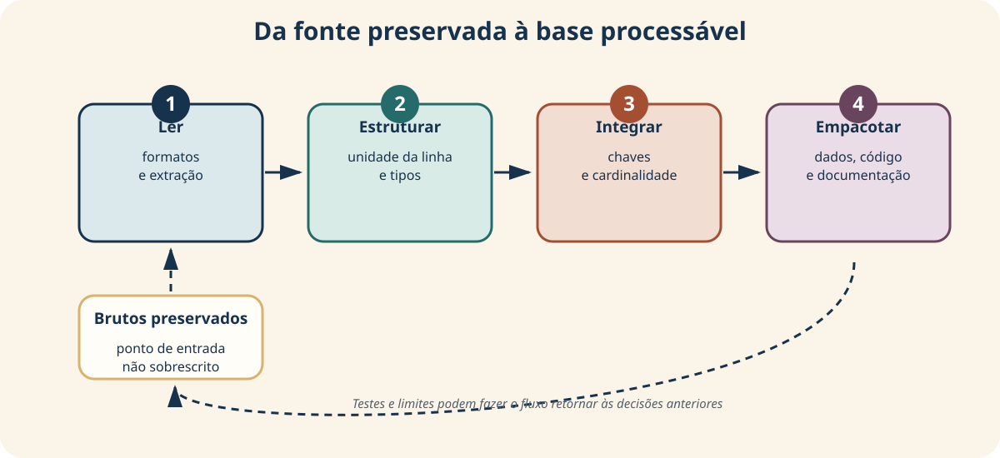
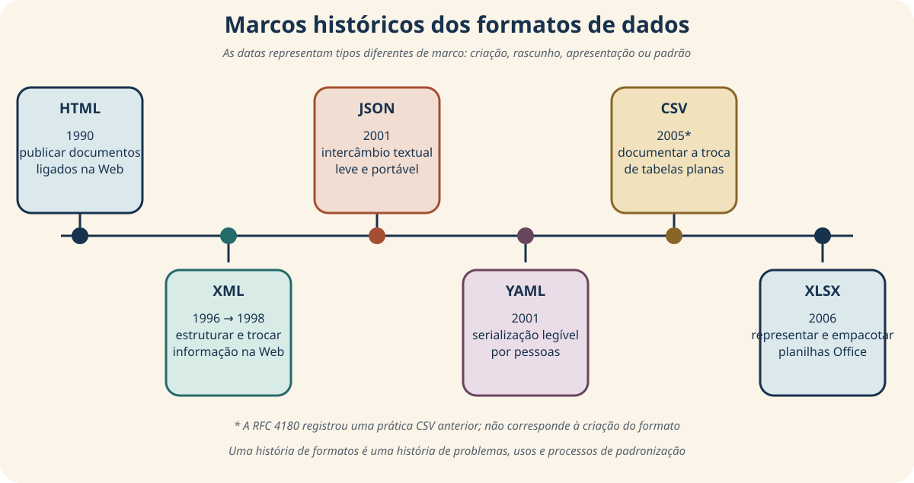
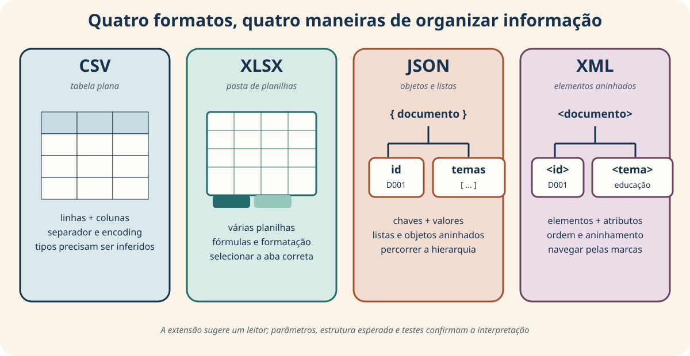
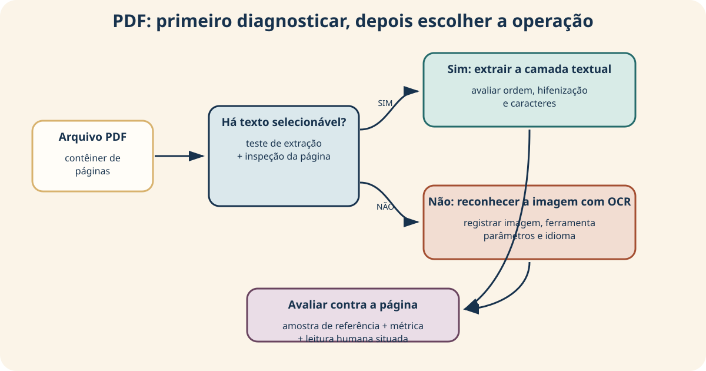
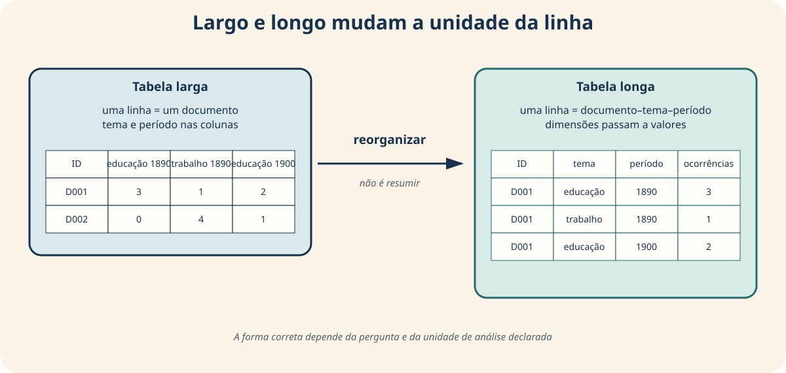
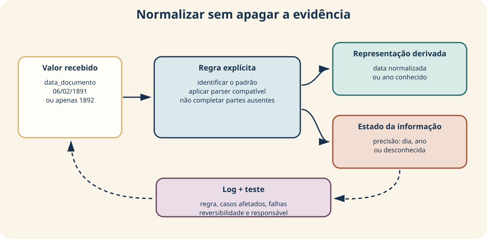
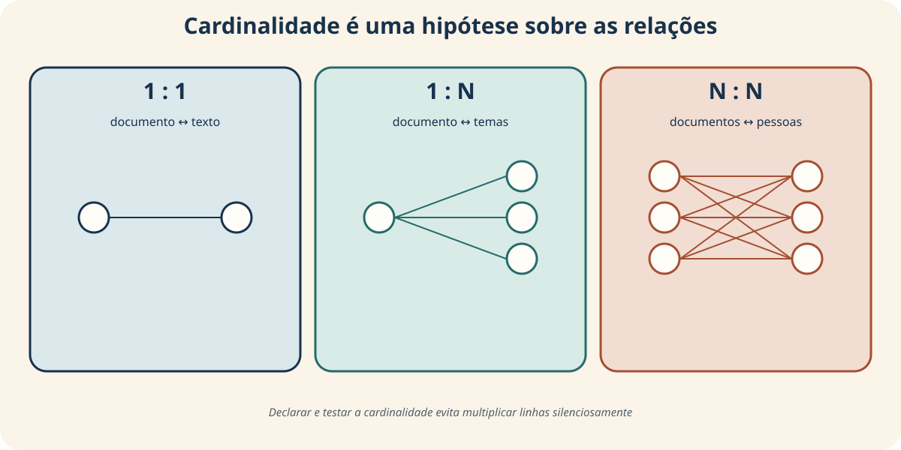
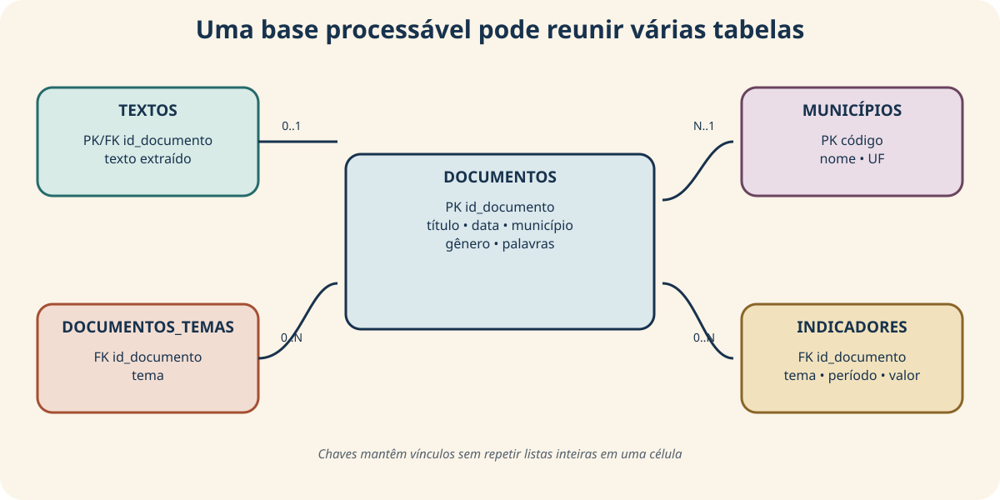
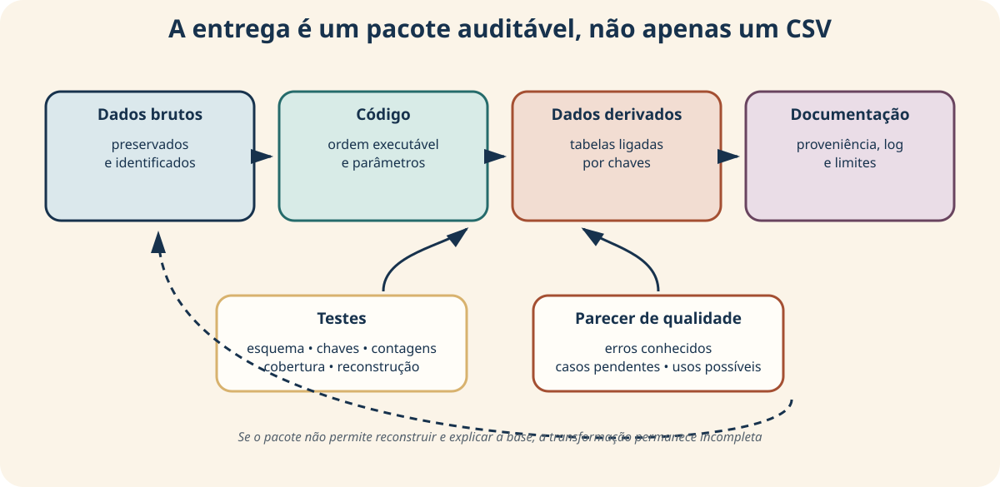

<!-- _class: capa -->
<!-- _paginate: false -->
<!-- _footer: "" -->

# Unidade 3

## Transformação de fontes em dados analisáveis

**Problema orientador:** como preparar documentos e registros produzidos em
formatos diferentes sem apagar sua origem, incerteza e estrutura?

---

# Agenda

1. Reconhecer formatos e possibilidades de ação
2. Distinguir extração textual e OCR
3. Organizar unidades, tabelas e representações
4. Normalizar sem sobrescrever os originais
5. Integrar tabelas com chaves e cardinalidades
6. Produzir uma base processável e reproduzível

---

# Ao final, você deverá conseguir…

- inventariar formato, estrutura, versão e proveniência;
- importar CSV, XLSX, JSON, XML, TXT e PDF de modo consciente;
- avaliar OCR em relação a uma finalidade;
- distinguir tabelas largas e longas;
- representar datas, códigos, ausências e duplicatas;
- declarar e auditar chaves, junções e cardinalidades;
- entregar uma base processável ligada aos dados brutos.

---

# O percurso da unidade



Auditar pode obrigar a retornar à importação, à regra ou até à fonte.

---

<!-- _class: exemplo -->

# Conjunto fictício: fontes e formatos

- **Oito registros documentais** aparecem em CSV, XLSX, JSON e XML.
- Dois textos, um PDF textual e páginas digitalizadas permitem experimentar OCR.
- Uma tabela larga contém indicadores por tema e período.
- Um extrato didático de códigos municipais apoia a integração de tabelas.

Os conteúdos documentais são simulados. Os formatos e problemas técnicos são reais;
os casos não constituem evidência histórica.

---

# Como os arquivos se relacionam

```text
dados/brutos → dados/intermediarios → dados/derivados
```

- `catalogo_messy.*`: entrada deliberadamente inconsistente;
- `catalogo_normalizado.csv`: limpeza preservando valores originais;
- `documentos_processaveis.csv`: oito registros integrados;
- `documentos_temas.csv` e `indicadores_longos.csv`: tabelas derivadas.

Cada transformação deve permitir retorno ao arquivo e ao valor de origem.

---

<!-- _class: exemplo -->

# Entradas brutas: catálogo e texto

<div class="duas-colunas">

<div>

### `catalogo_messy.csv` / `.xlsx`

| id | título | data | gênero |
|---|---|---|---|
| D001 | ` Jornal Aurora ` | 1890-01-05 | Editorial |
| D002 | gazeta popular | 06/02/1891 | notícia |
| D003 | Correio do Vale | 1892 | Carta |

Cada linha é um documento; quatro das sete colunas são mostradas. CSV e XLSX
contêm o mesmo catálogo inconsistente.

</div>

<div>

### `D001.txt`

| Unidade | Conteúdo |
|---|---|
| documento D001 | “A escola noturna foi apresentada como sinal de progresso.” |

O TXT não possui campos tabulares: o quadro explicita sua unidade de conteúdo.

</div>

</div>

---

<!-- _class: exemplo -->

# Da tabela intermediária à processável

<div class="duas-colunas">

<div>

### `catalogo_normalizado.csv`

| id | município_chave | gênero_padronizado | ano |
|---|---|---|---:|
| D001 | sao paulo | editorial | 1890 |
| D002 | sao paulo | notícia | 1891 |
| D003 | belo horizonte | carta | 1892 |

É uma tabela intermediária: preserva valores originais e acrescenta campos
normalizados.

</div>

<div>

### `documentos_processaveis.csv`

| id | município IBGE | UF | texto abreviado |
|---|---|---|---|
| D001 | São Paulo | SP | “A escola noturna…” |
| D002 | São Paulo | SP | “O jornal discutiu…” |
| D003 | Belo Horizonte | MG | — |

É um derivado integrado; quatro das 21 colunas são mostradas.

</div>

</div>

---

<!-- _class: exemplo -->

# Dois derivados, duas unidades de observação

<div class="duas-colunas">

<div>

### `documentos_temas.csv`

| id_documento | tema |
|---|---|
| D001 | educação |
| D001 | progresso |
| D002 | trabalho |

Cada linha representa uma relação documento–tema.

</div>

<div>

### `indicadores_longos.csv`

| id_documento | tema | período | ocorrências |
|---|---|---:|---:|
| D001 | educacao | 1890 | 3 |
| D002 | educacao | 1890 | 0 |
| D003 | educacao | 1890 | 2 |

Cada linha representa um indicador de tema em um documento e período.

</div>

</div>

---

<!-- _class: exemplo -->

# Antes da teoria: a mesma informação?

<div class="tres-colunas">

<div class="cartao">

### CSV

`D001;1890;Editorial`

</div>

<div class="cartao">

### JSON

`{"id":"D001",`  
`"temas":[...]}`

</div>

<div class="cartao">

### PDF

Uma página com título, colunas, imagem e camada textual.

</div>

</div>

<br>

> Ler os três arquivos exige a mesma operação? O que cada formato preserva?

---

# Transformar não é apagar a fonte

<div class="duas-colunas">

<div>


<p class="fonte">Ilustração conceitual; não representa um acervo real.</p>

</div>

<div>

Precisamos:

- reconhecer a estrutura de cada entrada;
- escolher leitores e parâmetros;
- preservar os arquivos recebidos;
- registrar regras e incertezas;
- testar transformações e relações;
- produzir derivados reconstruíveis.

</div>

</div>

---

<!-- _class: atividade -->

# U03-A01 · Diagnóstico

**Modalidade:** individual · **Tempo:** 10 minutos  
**Produto:** hipóteses iniciais registradas no Notebook 00

Para uma fonte do seu projeto, responda:

1. qual é o formato do arquivo?
2. o que uma linha, página ou objeto representa?
3. o original será preservado onde?
4. que transformação parece necessária?
5. como você verificaria se ela funcionou?

---

<!-- _class: divisor -->

# 1 · Formatos não são recipientes neutros

## Estrutura e possibilidades de ação

---

<!-- _class: exemplo -->

# O que você consegue fazer facilmente?

| Objeto recebido | Ação simples | Ação difícil ou arriscada |
|---|---|---|
| CSV | filtrar linhas e colunas | preservar fórmulas e múltiplas tabelas |
| JSON | navegar objetos e listas | tratar tudo como tabela plana |
| PDF | ver a página como publicada | recuperar ordem lógica e estrutura |
| imagem | inspecionar visualmente | pesquisar palavras sem transcrição |

<p class="pergunta">O formato condiciona o método antes mesmo da análise.</p>

---

# *Affordance*: possibilidades de ação

Neste contexto, *affordance* designa as ações que um formato **facilita,
dificulta ou condiciona**.

- CSV favorece intercâmbio de tabelas planas;
- XLSX comporta abas, fórmulas e formatação;
- JSON e XML expressam hierarquias;
- TXT não declara como interpretar seu conteúdo;
- PDF privilegia apresentação de página.

A extensão orienta o leitor inicial, mas não garante conteúdo ou qualidade.

---

# Formatos surgem para problemas diferentes



O marco de 2005 documenta convenções já usadas no CSV; não é sua “data de
nascimento”.

---

# Estruturas predominantes



Não existe uma escala universal do formato “pior” ao “melhor”: existe adequação
à informação, ao intercâmbio e ao uso pretendido.

---

# Comparação rápida

| Formato | Estrutura predominante | Uso frequente | Atenção |
|---|---|---|---|
| CSV | tabela plana | intercâmbio e análise | separador, encoding, tipos |
| XLSX | pasta de planilhas | trabalho de escritório | aba, fórmulas, formatação |
| JSON | objetos e listas | APIs e dados hierárquicos | níveis e listas aninhadas |
| XML | elementos em árvore | intercâmbio e validação | namespaces e esquema |
| TXT | sequência de caracteres | texto simples | encoding e convenção externa |
| PDF | páginas | distribuição visual | texto, imagem e ordem de leitura |

---

<!-- _class: alerta -->

# “Abriu sem erro” não basta

Uma importação pode executar e ainda interpretar incorretamente:

- o separador;
- o encoding;
- a planilha do XLSX;
- os níveis de JSON ou XML;
- códigos como números;
- datas incompletas como datas exatas.

Compare a saída com a estrutura esperada e registre os parâmetros usados.

---

# Leitores diferentes, objetos diferentes

```python
csv_df = pd.read_csv(arquivo, sep=";")
xlsx_df = pd.read_excel(arquivo, sheet_name="documentos")
json_data = json.loads(texto)
xml_raiz = ET.parse(arquivo).getroot()
```

Pergunte após a leitura: quantos registros? quais campos? quais tipos? qual
hierarquia? quais valores inesperados?

---

<!-- _class: exemplo -->

# Base pública sem depender da rede

O material preserva localmente um pequeno extrato dos códigos municipais do
IBGE e, em outro arquivo, registra:

- fonte e endereço de origem;
- data de acesso;
- recorte conservado;
- ressalvas de reutilização.

A cópia permite repetir a aula; a proveniência permite compreender e atualizar
a cópia.

<p class="fonte">IBGE, Códigos dos Municípios.</p>

---

<!-- _class: exemplo -->

# Como é o extrato local do IBGE?

### `extrato_codigos_municipios_ibge.csv`

| codigo_municipio | nome_municipio_ibge | UF |
|---|---|---|
| 3550308 | São Paulo | SP |
| 3106200 | Belo Horizonte | MG |
| 3304557 | Rio de Janeiro | RJ |

Cada linha representa um município. O código parece número, mas funciona como
**identificador** e deve ser lido como texto.

---

# Código municipal não é quantidade

```python
pd.read_csv(
    "extrato_codigos_municipios_ibge.csv",
    dtype={"codigo_municipio": "string"},
)
```

`3550308` identifica São Paulo. Somar, calcular média ou retirar zeros de um
identificador não produz uma interpretação substantiva.

O tipo técnico deve expressar o papel semântico do campo.

---

<!-- _class: exemplo -->

# PDF: texto ou imagem?



OCR não é sinônimo de “abrir PDF”. Primeiro diagnosticamos o objeto.

---

# Extração textual não é OCR

<div class="duas-colunas">

<div class="cartao">

### Extração

Recupera caracteres já codificados no PDF. Pode preservar texto, mas errar
ordem, colunas e hifenização.

</div>

<div class="cartao">

### OCR

Estima caracteres a partir dos pixels. Depende de resolução, ruído, inclinação,
layout, fonte e idioma.

</div>

</div>

Nos dois casos, compare a saída com a página.

---

# O mesmo texto em duas condições

<div class="duas-colunas">

<div>


**Imagem limpa**

</div>

<div>


**Imagem degradada**

</div>

</div>

<p class="fonte">Entradas sintéticas didáticas; não são documentos históricos.</p>

---

# OCR é uma hipótese de transcrição

| Condição | Saída |
|---|---|
| referência | `ESCOLA NOTURNA E TRABALHO — 1890` |
| imagem limpa | `ESCOLA NOTURNA E TRABALHO — 1890` |
| imagem degradada | `ESC0LA NOTURNA E TRABALH0 — 189O` |

Trocas entre `O` e `0` podem alterar busca, frequências, nomes e datas. A saída
precisa estar ligada à imagem, ferramenta, parâmetros e avaliação.

<p class="fonte">Tesseract User Manual; Hill e Hengchen (2019).</p>

---

# Como quantificar o erro de OCR?


$$
\mathrm{CER}=\frac{S_c+D_c+I_c}{N_c}
\qquad
\mathrm{WER}=\frac{S_w+D_w+I_w}{N_w}
$$

- $S$: substituições; $D$: exclusões; $I$: inserções;
- $N$: caracteres ou palavras na transcrição de referência;
- zero significa coincidência com a referência avaliada.

No exemplo degradado há três palavras afetadas em seis: $\mathrm{WER}=3/6=0{,}5$.

---

# A métrica não decide a finalidade

Uma taxa de erro pode ser tolerável para:

- localizar páginas candidatas para leitura;

e inadequada para:

- citar uma passagem;
- contar grafias raras;
- identificar nomes próprios;
- comparar vocabulário em corpora pequenos.

A própria transcrição de referência pode conter erro humano. Métrica, página e
protocolo precisam ser lidos juntos.

---

<!-- _class: atividade -->

# U03-A02 · Inventário técnico

**Modalidade:** individual + comparação em dupla · **Tempo:** 30 minutos  
**Produto:** inventário das entradas do projeto

Para cada fonte, registre: formato, estrutura, leitor, parâmetros, presença de
texto, necessidade de OCR, risco, teste e saída prevista.

> Diferencie dado recebido, texto extraído e texto reconhecido.

---

<!-- _class: divisor -->

# 2 · Organizar sem apagar

## Estrutura tabular, limpeza e qualidade

---

<!-- _class: exemplo -->

# Uma tabela que “parece” organizada

| ID | título | data | município | gênero |
|---|---|---|---|---|
| D001 | ` Jornal Aurora ` | `1890-01-05` | São Paulo | Editorial |
| D004 | `JORNAL AURORA` | `1893-03-12` | São  Paulo | `editorial ` |
| D005 | Gazeta Popular | `data desconhecida` | Rio de Janeiro | Noticia |

Que diferenças são variação gráfica? Quais podem ser historicamente
significativas? Que regra permitiria decidir?

---

# Linha e coluna expressam um modelo

Princípio inicial:

- uma variável por coluna;
- uma observação por linha;
- um tipo de unidade por tabela;
- um valor por célula, quando possível.

Isso facilita seleção e junção, mas não determina sozinho a ontologia correta.
Documentos, pessoas, lugares e relações podem exigir tabelas diferentes.

<p class="fonte">Wickham (2014).</p>

---

# Separar tabelas pode preservar relações

<div class="tres-colunas">

<div class="cartao">

### Documentos

Uma linha por documento.

</div>

<div class="cartao">

### Pessoas

Uma linha por pessoa identificada.

</div>

<div class="cartao">

### Participações

Uma linha por relação pessoa–documento.

</div>

</div>

Separar não significa desconectar: chaves mantêm as relações sem repetir todos
os atributos.

---

<!-- _class: exemplo -->

# Largo e longo mudam a unidade da linha



`melt` não muda apenas a aparência. A linha deixa de ser “um documento” e passa
a ser “uma combinação documento–tema–período”.

---

# O mesmo valor, outra organização

**Largo**

| ID | educação_1890 | trabalho_1890 |
|---|---:|---:|
| D001 | 3 | 1 |

**Longo**

| ID | tema | período | ocorrências |
|---|---|---:|---:|
| D001 | educação | 1890 | 3 |
| D001 | trabalho | 1890 | 1 |

Nenhum novo indicador foi calculado; a unidade da linha foi explicitada.

---

# Preserve o original; crie uma chave de comparação

| Campo original | Chave normalizada |
|---|---|
| ` Jornal Aurora ` | `jornal aurora` |
| `JORNAL AURORA` | `jornal aurora` |
| `São  Paulo` | `sao paulo` |

A chave normalizada facilita comparação de grafias. Ela não é necessariamente a
chave identificadora de uma tabela e não deve substituir automaticamente o valor
original nem apagar distinções relevantes.

<p class="fonte">Rawson e Muñoz (2019); Van Hooland, Verborgh e De Wilde (2013).</p>

---

<!-- _class: alerta -->

# “Limpar” pode apagar informação

Antes de normalizar, pergunte:

- a diferença é erro, variante ou evidência histórica?
- quem definiu a forma “correta”?
- a regra pode ser revertida?
- o valor recebido ficará preservado?
- quantos casos serão afetados?
- como casos ambíguos serão revistos?

Transformação responsável acrescenta rastreabilidade.

---

# Data parcial não é data exata

| Valor recebido | Representação derivada | Precisão | Razão |
|---|---|---|---|
| `1890-01-05` | 5 jan. 1890 | dia | — |
| `1892` | ano = 1892 | ano | dia e mês não informados |
| `data desconhecida` | ausente | desconhecida | data não informada |
| `31/02/1890` | ausente | inválida | data impossível |

Inventar `01/01` cria falsa precisão e pode produzir padrões temporais falsos.

---

# Códigos, ausências e tipos

- código municipal deve ser texto, não número para cálculo;
- `0` não é sinônimo de ausência;
- vazio pode significar “não contado”, “não aplicável” ou “desconhecido”;
- a razão da ausência deve ser registrada quando possível;
- conversões que falham precisam ser contadas e examinadas.

O tipo de dado é também uma afirmação sobre o significado do campo.

---

<!-- _class: exemplo -->

# Duplicata ou nova edição?

| ID | título | data | município | palavras |
|---|---|---|---|---:|
| D006 | Correio do Vale | 1900-08-20 | Belo Horizonte | 420 |
| D006-copia | Correio do Vale | 20/08/1900 | Belo horizonte | 420 |

A semelhança produz um **candidato**. A revisão documental decide se devemos
manter, relacionar, fundir ou excluir.

Remover por título isolado poderia apagar edições legítimas.

---

# Toda transformação precisa de retorno



O derivado é útil porque continua ligado ao original, à regra e ao teste.

---

# Relatório antes e depois

Um relatório de qualidade deve contar, por exemplo:

- linhas recebidas e produzidas;
- datas parciais, desconhecidas e inválidas;
- valores numéricos que falharam;
- categorias sem mapeamento;
- candidatos a duplicata;
- regras aplicadas e casos pendentes.

Contar efeitos não substitui justificar decisões.

---

<!-- _class: atividade -->

# U03-A03 · Log de transformação

**Modalidade:** individual · **Tempo:** 30 minutos  
**Produto:** log vinculado à tabela intermediária

| Campo | Problema | Regra | Justificativa | Afetados | Teste | Reversível? |
|---|---|---|---|---:|---|---|
| … | … | … | … | … | … | … |

Explique também qual distinção cada regra pode apagar e quem responde pela
decisão.

---

<!-- _class: divisor -->

# 3 · Integrar sem fabricar casos

## Chaves, cardinalidades e auditoria

---

# Antes de juntar: o que é uma tabela?

Uma tabela organiza observações segundo um modelo explícito:

| `id_documento` | `titulo` | `codigo_municipio` |
|---|---|---|
| D001 | Jornal Aurora | 3550308 |
| D002 | Gazeta Popular | 3304557 |
| D003 | Correio do Vale | 9999999 |

- cada **linha** representa um documento;
- cada **coluna** representa uma característica;
- cada **célula** associa um documento a um valor.

Antes de juntar, complete: “uma linha desta tabela representa…”.

---

# Uma chave identifica uma linha

Na tabela de documentos, `id_documento` é uma **chave primária** quando:

- cada documento possui um valor;
- o valor não se repete;
- o identificador permanece estável;
- duas pessoas não recebem o mesmo código por engano.

| `id_documento` | Situação |
|---|---|
| D001 | identificador válido |
| D002 | identificador válido |
| D002 | duplicação: exige investigação |

Título ou nome raramente é uma boa chave: pode variar, repetir ou mudar.

---

# “Chave” pode nomear funções diferentes

| Tipo | Exemplo | Função |
|---|---|---|
| chave de comparação | `jornal aurora` | aproximar grafias normalizadas |
| chave primária | `D001` | identificar uma linha da tabela |
| chave estrangeira | `3550308` | apontar para uma linha em outra tabela |
| chave composta | `D001` + `educação` | identificar uma relação documento–tema |

Uma forma textual normalizada pode ajudar a encontrar candidatos, mas não deve ser
tratada automaticamente como identidade histórica.

---

# A chave estrangeira cria a ligação

**Documentos** — uma linha por documento

| `id_documento` | `codigo_municipio` |
|---|---|
| D001 | 3550308 |
| D002 | 3304557 |
| D003 | 9999999 |

**Municípios** — uma linha por município

| `codigo_municipio` | `nome_oficial` |
|---|---|
| 3550308 | São Paulo |
| 3304557 | Rio de Janeiro |

`codigo_municipio` liga as tabelas sem transformar município em atributo repetido.

---

<!-- _class: exemplo -->

# Junção: procurar a chave e acrescentar colunas

Uma junção à esquerda parte de cada documento, procura o mesmo código na tabela de
municípios e acrescenta o nome encontrado:

| `id_documento` | `codigo_municipio` | `nome_oficial` | resultado |
|---|---|---|---|
| D001 | 3550308 | São Paulo | correspondência |
| D002 | 3304557 | Rio de Janeiro | correspondência |
| D003 | 9999999 | ausente | sem correspondência |

D003 permanece porque a tabela da esquerda define as unidades preservadas. A
ausência torna-se uma questão para auditoria, não uma linha descartada em silêncio.

---

# A junção não descobre identidades

O procedimento compara valores de chave; a pesquisa sustenta seu significado.

```text
documentos.codigo_municipio = municipios.codigo_municipio
                3550308     =     3550308
```

Antes da operação, precisamos afirmar:

- os dois campos usam o mesmo sistema de códigos;
- o código possui a mesma granularidade e período;
- cada código da referência identifica um município;
- uma ausência será preservada e examinada.

---

# O tipo de junção responde “o que preservar?”

| Tipo | Mantém | No exemplo |
|---|---|---|
| `left` | todas as linhas de documentos | mantém D003 sem nome |
| `inner` | somente chaves presentes nos dois lados | remove D003 |
| `right` | todas as linhas de municípios | pode incluir município sem documento |
| `outer` | todas as linhas dos dois lados | explicita todas as não correspondências |

Não escolha pelo resultado mais “limpo”. Escolha pelas unidades que a pergunta e o
desenho exigem preservar.

---

<!-- _class: exemplo -->

# Uma junção pode multiplicar documentos

Se D001 aparece duas vezes na tabela de temas e duas vezes em outra tabela de
relações, uma junção muitos-para-muitos pode produzir quatro linhas.

| Documento | Tema | Relação |
|---|---|---|
| D001 | educação | A |
| D001 | educação | B |
| D001 | progresso | A |
| D001 | progresso | B |

Uma soma posterior pode dar peso quatro a um único documento.

---

# Declare a cardinalidade antes da junção



Cardinalidade é uma hipótese sobre entidades e relações, não apenas uma opção
de software.

---

# Chave e unidade precisam combinar

| Tabela | Unidade da linha | Chave |
|---|---|---|
| catálogo | um documento | `id_documento` |
| municípios | um município | `codigo_municipio` |
| textos | um texto disponível | `id_documento` |
| temas | uma relação documento–tema | `id_documento` + `tema` |
| indicadores | documento–tema–período | três campos combinados |

Uma chave duplicada onde se esperava unicidade pode fabricar casos.

---

<!-- _class: exemplo -->

# Acrescentar o nome oficial do município

Vários documentos podem compartilhar um município; cada código deve aparecer
uma vez na referência. Relação esperada: **muitos para um**.

```python
catalogo.merge(
    municipios,
    on="codigo_municipio",
    how="left",
    validate="many_to_one",
    indicator=True,
)
```

---

# Leia os argumentos como método

- `on`: qual identidade liga as tabelas?
- `how="left"`: quais unidades devem ser preservadas?
- `validate`: qual cardinalidade é permitida?
- `indicator=True`: quais linhas encontraram correspondência?

O código torna testável uma expectativa formulada antes da execução.

---

# Audite antes e depois

| Verificação | Problema detectável |
|---|---|
| linhas antes × depois | multiplicação ou remoção |
| IDs únicos antes × depois | perda da identidade dos casos |
| `left_only` | chaves sem correspondência |
| `right_only` | referência não utilizada |
| duplicação na chave | cardinalidade incompatível |

Não descarte automaticamente uma não correspondência: ela pode indicar código
inválido, cobertura incompleta ou mudança histórica.

---

# A base processável pode ser plural



Não é necessário colocar tudo em uma única planilha.

---

# Separar evita repetir entidades

| Tabela | Uma linha representa… |
|---|---|
| documentos | um documento |
| textos | o texto disponível de um documento |
| documento–tema | uma atribuição temática |
| indicadores | uma medida para documento, tema e período |

D001 associado a educação e progresso continua sendo **um documento**, com duas
relações temáticas.

---

# O JSON orienta a integração

```json
{
  "id_documento": "D001",
  "arquivo_texto": "D001.txt",
  "temas": ["educação", "progresso"]
}
```

Antes de juntar, o registro informa qual texto procurar e quantas relações
temáticas produzir. `id_documento` preserva o vínculo comum.

---

# De lista a tabela de relações

```python
for item in metadados:
    for tema in item["temas"]:
        linhas_temas.append({
            "id_documento": item["id_documento"],
            "tema": tema,
        })
```

O primeiro percurso visita documentos; o segundo cria uma linha para cada tema.
Ele não duplica a entidade documento na tabela central.

---

# Ausência de texto não apaga o documento

A tabela central tem oito documentos. Nesta versão, apenas D001 e D002 possuem
arquivo textual.

Uma junção `left`:

- mantém os oito documentos;
- acrescenta texto quando disponível;
- registra ausência nos demais;
- permite medir cobertura textual.

Excluir automaticamente seis linhas confundiria “documento sem texto nesta
versão” com “documento inexistente”.

---

# Indicadores também possuem relações

`educacao_1890` mistura tema e período no nome da coluna. Ao reorganizar:

| ID | tema | período | ocorrências |
|---|---|---:|---:|
| D001 | educacao | 1890 | 3 |
| D001 | trabalho | 1890 | 1 |

A regra depende da convenção documentada: todo nome termina em sublinhado e
quatro dígitos de ano.

---

# Produtos derivados distintos

O exemplo exporta:

1. `documentos_processaveis.csv` — documentos, municípios e textos disponíveis;
2. `documentos_temas.csv` — relações documento–tema;
3. `indicadores_longos.csv` — relações documento–tema–período.

Cada produto tem unidade, chave e finalidade próprias. Todos devem ser
reconstruíveis a partir dos brutos e das regras.

---

# Testes traduzidos em perguntas

| Teste | Pergunta em linguagem comum |
|---|---|
| IDs únicos | cada linha central é um documento diferente? |
| linhas preservadas | alguma junção fabricou ou removeu documentos? |
| integridade referencial | todo tema aponta para documento existente? |
| arquivos esperados | os três produtos foram gravados? |

Teste automatizado verifica uma condição declarada; não substitui revisão
substantiva.

---

<!-- _class: atividade -->

# U03-A04 · Plano de integração

**Modalidade:** individual + revisão em dupla · **Tempo:** 30 minutos  
**Produto:** desenho das tabelas e relações do projeto

Declare unidades, chaves, cardinalidades, campos compartilhados, validações,
tratamento de não correspondências e saídas.

Inclua o caminho de retorno: como um resultado será rastreado até a fonte?

---

<!-- _class: divisor -->

# 4 · Oficina: primeira base processável

## Um pacote, não apenas um CSV

---

# Componentes da entrega



Um arquivo isolado não demonstra como a base foi produzida, testada ou
delimitada.

---

<!-- _class: atividade -->

# U03-A05 · Produto da oficina

**Modalidade:** desenvolvimento individual · **Tempo:** 70 minutos  
**Produto:** primeira base processável do projeto

Entregue:

- inventário das entradas e ambiente;
- código de importação e transformação;
- base e tabelas relacionais derivadas;
- log e relatório de qualidade;
- testes e ficha de proveniência;
- erros conhecidos e casos pendentes.

Nunca altere os arquivos brutos.

---

# A oficina segue uma cadeia

1. **Inventariar:** pergunta, unidade, arquivo, versão e origem
2. **Importar:** leitor, parâmetros, estrutura e teste
3. **Transformar:** original, regra, justificativa e perda possível
4. **Diagnosticar:** ausências e candidatos a duplicata
5. **Integrar:** chave, cardinalidade e não correspondências
6. **Testar:** esquema, domínios, relações e produtos

Cada etapa fornece evidência para avaliar a seguinte.

---

# Critérios de qualidade do pacote

| Critério | Evidência esperada |
|---|---|
| preservação | brutos imutáveis e proveniência |
| importação | parâmetros e estrutura testados |
| transformação | original + regra + saída + teste |
| ausências/duplicatas | diagnóstico e decisão justificada |
| junções | chave e cardinalidade auditadas |
| integração | relações e chaves verificadas |
| reprodutibilidade | reconstrução desde os brutos |

---

<!-- _class: atividade -->

# U03-A06 · Entrega e revisão por pares

**Modalidade:** pares · **Tempo:** 25 minutos por pacote  
**Produto:** parecer recebido e mudanças registradas

O colega tenta localizar:

1. uma regra não reversível;
2. uma junção perigosa;
3. um limite não documentado;
4. um produto que não pode ser reconstruído;
5. uma conclusão que a base ainda não sustenta.

---

# Retorno ao exemplo inicial

CSV, JSON e PDF não são três recipientes equivalentes.

Agora sabemos perguntar:

- que estrutura e possibilidade de ação cada um oferece?
- qual leitor e quais parâmetros preservam essa estrutura?
- o texto foi extraído ou reconhecido por OCR?
- qual unidade cada tabela representa?
- que transformação e relação produziram o derivado?
- como retornar do resultado à fonte?

---

# Síntese do percurso

> Preparar dados é construir uma representação testável — não higienizar a
> fonte até que ela pareça regular.

- formatos condicionam operações;
- OCR e extração textual são processos distintos;
- normalização deve preservar original e incerteza;
- duplicatas são hipóteses para revisão;
- junções afirmam identidades e relações;
- derivados precisam ser reconstruíveis e rastreáveis.

---

# Conexão com o projeto cumulativo

Na Unidade 3, o relatório-notebook recebe:

1. inventário dos arquivos e versões;
2. descrição do ambiente e dos leitores;
3. regras de estruturação e normalização;
4. diagnóstico de ausências e duplicatas;
5. modelo de tabelas, chaves e cardinalidades;
6. testes, log e relatório de qualidade;
7. base processável e limites conhecidos.

Na Unidade 4, esse pacote será explorado — não tratado como verdade pronta.

---

# Bilhete de saída

Complete individualmente:

> A transformação mais arriscada do meu projeto é…

> O teste que pode revelar esse risco é…

> Para retornar do derivado à fonte, preciso preservar…

**Produto:** três frases para acompanhar a base processável.

---

<!-- _class: referencias -->

# Referências — 1/2

- HILL, M. J.; HENGCHEN, S. Quantifying the Impact of Dirty OCR on Historical Text Analysis. *Digital Scholarship in the Humanities*, v. 34, n. 4, p. 825–843, 2019. https://doi.org/10.1093/llc/fqz024.
- RAWSON, K.; MUÑOZ, T. Against Cleaning. In: GOLD, M. K.; KLEIN, L. F. (org.). *Debates in the Digital Humanities 2019*. University of Minnesota Press, 2019. https://dhdebates.gc.cuny.edu/read/untitled-f2acf72c-a469-49d8-be35-67f9ac1e3a60/section/07154de9-4903-428e-9c61-7a92a6f22e51.
- VAN HOOLAND, S.; VERBORGH, R.; DE WILDE, M. Cleaning Data with OpenRefine. *Programming Historian*, n. 2, 2013. https://doi.org/10.46430/phen0023.
- WICKHAM, H. Tidy Data. *Journal of Statistical Software*, v. 59, n. 10, p. 1–23, 2014. https://doi.org/10.18637/jss.v059.i10.
- IBGE. *Códigos dos Municípios*. https://www.ibge.gov.br/explica/codigos-dos-municipios.php.

---

<!-- _class: referencias -->
<!-- _paginate: false -->

# Referências — 2/2

- ECMA INTERNATIONAL. *ECMA-404: The JSON Data Interchange Syntax*. 2013; e *ECMA-376: Office Open XML File Formats*. 2006.
- IETF. *RFC 4180: Common Format and MIME Type for CSV Files*. 2005. https://www.rfc-editor.org/rfc/rfc4180.
- LIBRARY OF CONGRESS. *Sustainability of Digital Formats*. https://www.loc.gov/preservation/digital/formats/.
- PANDAS DEVELOPMENT TEAM. *User Guide: IO tools, missing data, merge and reshaping*. https://pandas.pydata.org/docs/user_guide/.
- PYPDF. *Extract Text from a PDF*. https://pypdf.readthedocs.io/en/stable/user/extract-text.html.
- TESSERACT OCR. *Tesseract User Manual*; *Improving the Quality of the Output*. https://tesseract-ocr.github.io/tessdoc/.
- W3C. *HTML 2.0 — Acknowledgments*; *XML 1.0 Recommendation*. https://www.w3.org/.
- YAML. *YAML 1.0 Working Draft*. 2001. https://yaml.org/spec/history/2001-06-16.html.

