<!-- _class: capa -->
<!-- _paginate: false -->
<!-- _footer: "" -->

# Unidade 4

## Exploração quantitativa, textual e visual

**Problema orientador:** como conhecer padrões, diferenças, erros e limites de
uma base antes de aplicar modelos?

---

<!-- _class: exemplo -->

# Antes da teoria: a mesma média

### Coleção A

4 · 4 · 4 · 4 · 4

**Média:** 4

### Coleção B

0 · 2 · 4 · 6 · 8

**Média:** 4

 

> Se o centro é igual, as coleções podem ser descritas da mesma maneira?

---

# Um resumo nunca é a distribuição inteira

A média não mostra:

- concentração ou dispersão;
- assimetria;
- valores extremos;
- composição dos grupos;
- contexto dos documentos;
- escolhas que produziram a medida.

Explorar é combinar resumos, visualizações e retorno aos casos.

---

# Exploração como movimento de ida e volta

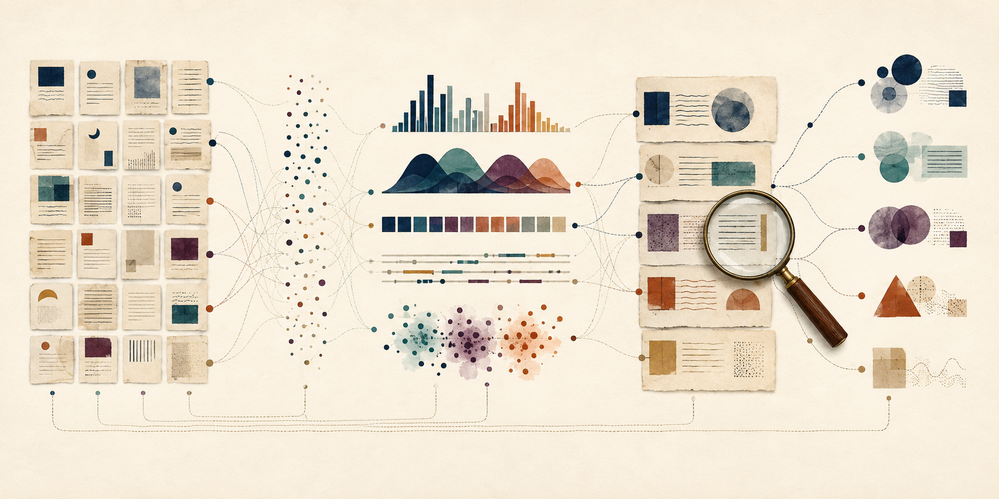

Ilustração conceitual; não representa evidência histórica.

- calcular padrões;
- visualizar distribuições;
- localizar casos;
- reler documentos;
- revisar categorias;
- formular novas perguntas.

---

# Agenda

1. Classificar variáveis e denominadores
2. Descrever centro, dispersão e distribuição
3. Explorar frequências e contextos textuais
4. Escolher gráficos segundo a pergunta
5. Retornar dos agregados aos documentos
6. Produzir um relatório exploratório auditável

---

# Ao final, você deverá conseguir…

- distinguir variáveis categóricas, numéricas e temporais;
- calcular e interpretar frequências, centro e dispersão;
- inspecionar distribuições sem excluir casos automaticamente;
- documentar tokenização, concordâncias, colocações e diversidade;
- escolher visualizações coerentes e acessíveis;
- separar descrição, interpretação, hipótese e limite;
- produzir um relatório que prepare comparações futuras.

---

# O percurso da unidade

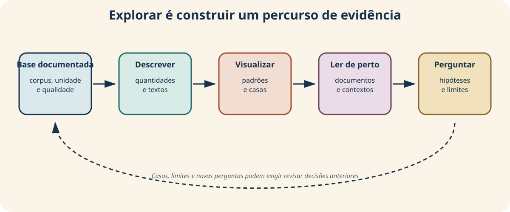

Explorar formula hipóteses; não confirma retrospectivamente o que foi encontrado.

Tukey (1977); Arnold e Tilton (2019).

---

<!-- _class: atividade -->

# U04-A01 · Diagnóstico

**Modalidade:** individual · **Tempo:** 10 minutos  
**Produto:** previsão e teste esperado

Escolha uma variável da sua base e responda:

1. que padrão você espera observar?
2. por que espera esse padrão?
3. que saída poderia contradizer sua expectativa?
4. que resultado indicaria erro ou problema de qualidade?

> Registrar a previsão ajuda a distinguir descoberta de expectativa posterior.

---

<!-- _class: divisor -->

# 1 · O que cada variável permite dizer?

## Escala conceitual antes do cálculo

---

<!-- _class: exemplo -->

# Três números com papéis diferentes

| Valor registrado | Papel | Operação defensável? |
|---|---|---|
| `D023` | identificador | localizar e relacionar |
| `1900` | ano no calendário | ordenar e calcular durações com cautela |
| `2100` | número de palavras | somar, comparar e calcular proporções |

Todos podem aparecer como números no arquivo. Isso não os torna a mesma espécie
de variável.

---

# Hierarquia adotada na unidade

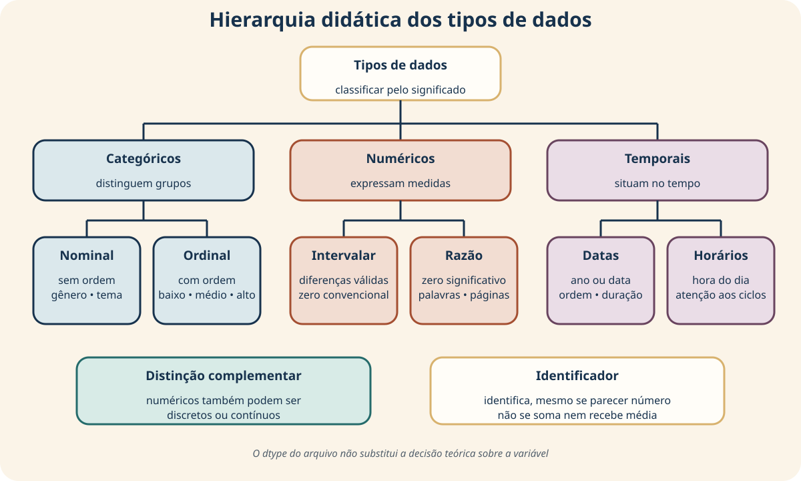

O tipo armazenado pelo software não determina sozinho o significado conceitual.

---

# Categóricos

| Subtipo | O que permite afirmar | Exemplo |
|---|---|---|
| nominal | valores distinguem categorias sem ordem | gênero, local, tema |
| ordinal | categorias possuem ordem, mas distância desconhecida | conservação: baixa, média, alta |

Para nominais, frequências, proporções e moda podem fazer sentido. Média de
rótulos codificados como `1`, `2`, `3` não cria distância substantiva.

Stevens (1946).

---

# Numéricos

| Subtipo | Propriedade | Exemplo didático |
|---|---|---|
| intervalar | diferenças comparáveis; zero convencional | escore padronizado |
| razão | diferenças e proporções interpretáveis; zero significativo | palavras, pessoas, páginas |

“Discreto ou contínuo” é uma distinção complementar. `palavras` é contagem
discreta e variável de razão.

---

# Temporais e identificadores

- **datas:** posições no calendário; permitem ordem e durações com cautela;
- **horários:** posições em um ciclo; 23h e 0h estão próximos;
- **identificadores:** distinguem unidades, mesmo quando armazenados como números.

O ano zero do calendário não transforma `ano` em variável de razão. E calcular a
média de códigos de documento continua sem sentido.

---

<!-- _class: exemplo -->

# Primeiro descreva as categorias

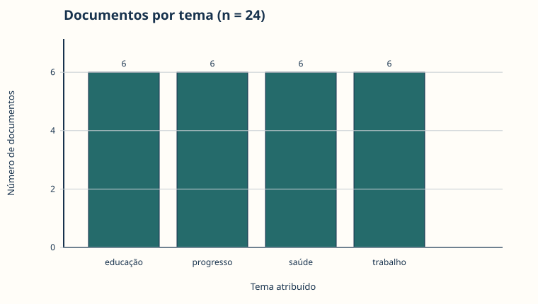

Cada tema possui 6 dos 24 documentos porque a base foi construída assim. A
igualdade não demonstra equilíbrio histórico.

---

# Frequência e proporção

Se $x_i$ é a categoria do documento $i$:

$$
f_k=\sum_{i=1}^{n}\mathbf{1}(x_i=k),
\qquad
p_k=\frac{f_k}{n}
$$

Para o tema educação:

$$
f_{\mathrm{educacao}}=6,
\qquad
p_{\mathrm{educacao}}=\frac{6}{24}=0{,}25
$$

Declare sempre o denominador: aqui contamos **documentos**, não menções ou
importância histórica.

---

<!-- _class: exemplo -->

# Onde está o centro desta distribuição?

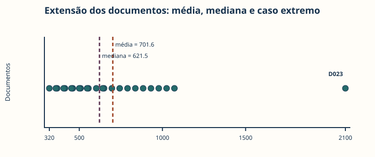

D023 desloca a média para a direita. A mediana responde menos ao caso extremo.

---

# Média: equilíbrio do total

$$
\bar{x}=\frac{1}{n}\sum_{i=1}^{n}x_i
$$

Na base:

- $n=24$ documentos;
- $\bar{x}\approx701{,}6$ palavras;
- todos os valores participam do cálculo;
- um caso muito extenso altera o resultado.

A média faz sentido quando somar e redistribuir igualmente possui interpretação.

**Exemplo menor:** $(500+700+900)/3=700$ palavras.

---

# Mediana: centro da ordenação

$$
\widetilde{x}=
\begin{cases}
x_{((n+1)/2)}, & n\ \mathrm{impar},\\[4pt]
\dfrac{x_{(n/2)}+x_{(n/2+1)}}{2}, & n\ \mathrm{par}
\end{cases}
$$

Na base, $\widetilde{x}=621{,}5$ palavras. A mediana depende da posição ordenada,
não da distância de todos os valores ao centro.

**Exemplo:** em 300, 600 e 1.500, a mediana é 600.

---

# Moda: o valor mais frequente

A moda pode ser usada com categorias e quantidades.

Nesta variável `palavras`, todos os 24 valores aparecem uma vez. Portanto:

- o software pode devolver todos os valores;
- escolher apenas o primeiro fabricaria uma moda única;
- a resposta adequada é **“não há moda informativa”**.

Uma distribuição pode ser unimodal, multimodal ou não ter repetição útil.

---

# Tendência central: perguntas diferentes

| Medida | Pergunta | Limite principal |
|---|---|---|
| média | qual seria a parcela igual do total? | sensível a extremos |
| mediana | qual valor ocupa o centro? | não usa todas as distâncias |
| moda | qual valor/categoria ocorre mais? | pode ser múltipla ou não informativa |

Uma medida central não descreve sozinha forma e dispersão.

---

<!-- _class: exemplo -->

# Mesmo centro, dispersões diferentes

Retome as coleções:

- A: 4, 4, 4, 4, 4 — amplitude 0;
- B: 0, 2, 4, 6, 8 — amplitude 8.

Ambas têm média e mediana iguais a 4. Para distingui-las, precisamos medir o
afastamento entre os valores.

---

# Amplitude e intervalo interquartil

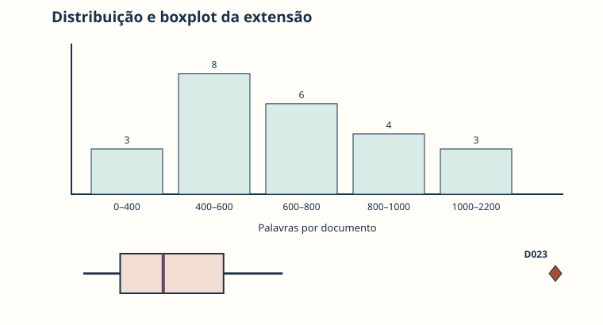

$$
A=x_{\max}-x_{\min}
$$

$$
IQR=Q_3-Q_1
$$

- amplitude usa somente mínimo e máximo;
- $Q_1$ e $Q_3$ delimitam a metade central;
- IQR é mais resistente a extremos;
- convenções de quartis podem produzir resultados diferentes.

**Exemplo da base:** $A=2100-320=1780$ e
$IQR=848{,}75-459=389{,}75$ palavras.

---

# Variância e desvio-padrão amostrais

$$
s^2=\frac{1}{n-1}\sum_{i=1}^{n}(x_i-\bar{x})^2,
\qquad
s=\sqrt{s^2}
$$

- variância fica em unidades ao quadrado;
- desvio-padrão retorna à unidade original;
- ambos respondem fortemente a extremos;
- $n-1$ corresponde a `ddof=1` no pandas.

**Exemplo da base:** $s=372{,}54$ palavras; a variância correspondente é
$s^2\approx138.787$ palavras².

---

# O resumo da extensão

| Medida | Valor |
|---|---:|
| mínimo / máximo | 320 / 2.100 palavras |
| média / mediana | 701,6 / 621,5 |
| $Q_1$ / $Q_3$ | 459 / 848,75 |
| $IQR$ | 389,75 |
| desvio-padrão amostral | 372,54 palavras |

A diferença entre média e mediana e o desvio elevado motivam inspecionar a
distribuição e os casos.

---

# Um boxplot sinaliza; não condena

$$
L_{\mathrm{inf}}=Q_1-1{,}5\,IQR,
\qquad
L_{\mathrm{sup}}=Q_3+1{,}5\,IQR
$$

Na base, $L_{\mathrm{sup}}=1433{,}375$. D023 possui 2.100 palavras e deve ser
inspecionado.

“Fora do limite” não significa automaticamente erro, fraude ou caso descartável.

---

# Distribuição e caso extremo

A proveniência informa que D023 foi criado deliberadamente para fins didáticos.
Sem esse contexto, poderíamos interpretar incorretamente sua origem.

---

# Duas categóricas: contingência

Se $A$ é gênero e $B$ é tema:

$$
n_{ij}=\sum_{r=1}^{n}\mathbf{1}(A_r=i\land B_r=j),
\qquad
p_{j\mid i}=\frac{n_{ij}}{\sum_j n_{ij}}
$$

- $n_{ij}$ conta documentos na combinação;
- $p_{j\mid i}$ divide pelo total do gênero $i$;
- contagem e proporção por linha respondem perguntas diferentes;
- padrão descritivo não é teste ou explicação causal.

**Exemplo:** 2 das 8 cartas tratam de educação; logo, $p=2/8=25\%$.

---

<!-- _class: atividade -->

# U04-A02 · Exploração quantitativa

**Modalidade:** individual + discussão · **Tempo:** 40 minutos  
**Produto:** perfil quantitativo interpretado

Classifique variáveis; escolha uma medida de centro e uma de dispersão; declare
denominadores; examine um extremo e uma contingência.

Para cada resultado, separe: **descrição, interpretação, hipótese e limite**.

---

<!-- _class: divisor -->

# 2 · O que as contagens textuais deixam de fora?

## Do token ao contexto e de volta ao documento

---

<!-- _class: exemplo -->

# A palavra “trabalho” ocorre em dois trechos

> “O trabalho nas oficinas reúne jornada, salário e associação.”

> “Este trabalho de memória organiza os documentos do arquivo.”

Uma única contagem reúne usos substantivamente diferentes. Antes de interpretar a
frequência, precisamos conhecer regras de segmentação e retornar aos contextos.

---

# Texto preservado → unidades contáveis

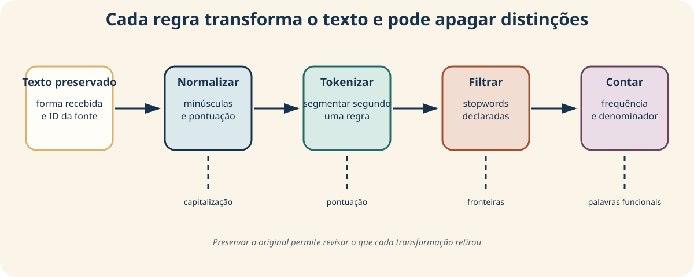

Calcule tokens por documento para não criar bigramas entre o fim de um texto e o
início do seguinte.

---

# Cada regra altera o resultado

Perguntas de documentação:

- maiúsculas e minúsculas serão unificadas?
- hífen, apóstrofo e pontuação delimitam tokens?
- números e datas serão mantidos?
- acentos serão preservados?
- quais stopwords serão retiradas — e por quê?
- as fronteiras documentais serão mantidas?

Preserve o texto original e registre a transformação.

---

# Frequência absoluta e relativa

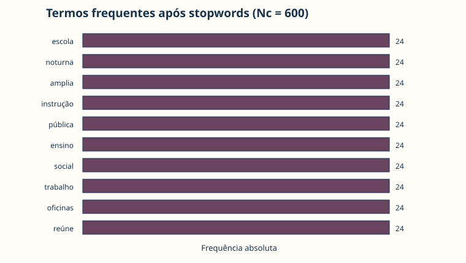

$$
f(w)=\sum_{i=1}^{N}\mathbf{1}(t_i=w),
\qquad
p(w)=\frac{f(w)}{N}
$$

O denominador pode ser:

- $N$: todos os tokens antes de retirar stopwords;
- $N_c$: tokens de conteúdo depois da filtragem.

Retirar termos do numerador e manter o denominador responde a outra pergunta que
recalcular a proporção no vocabulário filtrado.

**Exemplo:** se “escola” aparece 24 vezes em 912 tokens, $p\approx2{,}6\%$.

---

# Concordância devolve contexto ao agregado

Uma concordância registra:

- documento de origem;
- janela à esquerda;
- termo-alvo;
- janela à direita.

Ela permite verificar polissemia, fórmulas recorrentes, negações e usos
inesperados. Não precisa ser reduzida a uma única métrica.

---

# N-gramas respeitam fronteiras

Um bigrama é um par adjacente $(t_i,t_{i+1})$ dentro de um documento.

Contar n-gramas pode revelar expressões como:

- “escola noturna”;
- “instrução pública”;
- “trabalho nas oficinas”.

Frequência conjunta, porém, pode apenas refletir palavras muito frequentes. Uma
medida de associação compara a coocorrência com suas marginais.

---

# Anatomia da PMI

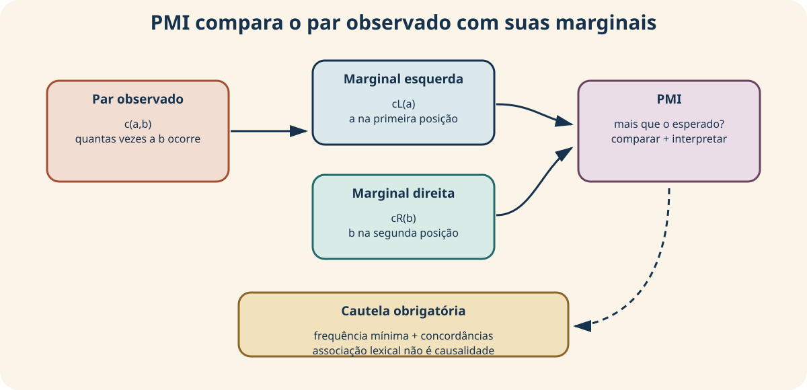

PMI alto indica ocorrência conjunta acima do esperado pelas marginais — não
causalidade ou importância histórica.

---

# Informação mútua pontual

$$
PMI(a,b)=\log_2\!\left(\frac{P(a,b)}{P_L(a)P_R(b)}\right)
=\log_2\!\left(\frac{c(a,b)N_b}{c_L(a)c_R(b)}\right)
$$

- $c(a,b)$: frequência do bigrama;
- $N_b$: total de bigramas;
- $c_L(a)$ e $c_R(b)$: frequências nas posições esquerda e direita.

A medida favorece eventos raros. Exija frequência mínima e examine concordâncias.

**Exemplo didático:** com $c(a,b)=3$, $N_b=10$ e marginais 3 e 3,
$PMI=\log_2(30/9)\approx1{,}74$.

---

<!-- _class: exemplo -->

# Diversidade depende do tamanho

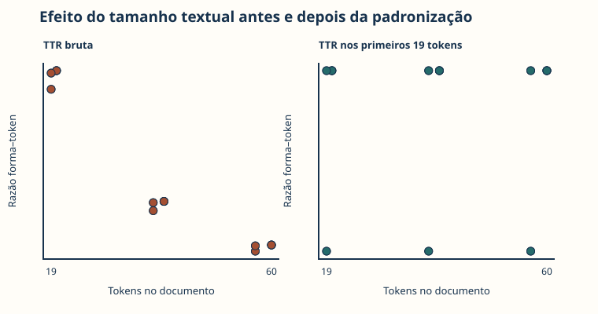

$$
TTR(d)=\frac{V_d}{N_d}
$$

- $V_d$: formas distintas no documento;
- $N_d$: total de tokens.

Textos maiores tendem a repetir palavras e apresentar TTR menor. Comparar valores
brutos pode confundir diversidade com extensão.

**Exemplo:** 5 formas distintas em 8 tokens produzem $TTR=5/8=0{,}625$.

---

# Um controle simples de tamanho

$$
TTR_m(d)=\frac{\left|\{t_1,\ldots,t_m\}\right|}{m},
\qquad N_d\ge m
$$

Usar os primeiros $m$ tokens controla tamanho, mas pode depender da posição do
trecho. O protocolo deve declarar a amostragem.

**Exemplo:** em um trecho de $m=100$ tokens com 70 formas distintas,
$TTR_{100}=70/100=0{,}70$.

---

<!-- _class: atividade -->

# U04-A03 · Exploração textual

**Modalidade:** individual + leitura em dupla · **Tempo:** 40 minutos  
**Produto:** perfil textual com retorno aos trechos

Documente tokenização, frequências e denominadores, uma concordância, n-gramas,
PMI com frequência mínima e TTR controlada por tamanho.

Selecione apenas resultados que mereçam seguir para visualização e interpretação.

---

<!-- _class: divisor -->

# 3 · O gráfico responde a qual pergunta?

## Visualização exploratória como argumento

---

<!-- _class: exemplo -->

# O mesmo resultado pode parecer diferente

Uma barra com eixo iniciando em 5,8 faz valores 6 e 6,2 parecerem muito distantes.
Uma linha ligando categorias nominais sugere continuidade inexistente.

Antes de desenhar, pergunte:

- o que está sendo comparado?
- qual é a escala da variável?
- qual denominador sustenta a altura?
- que caso precisa permanecer visível?

---

# Escolha pela pergunta e pela variável

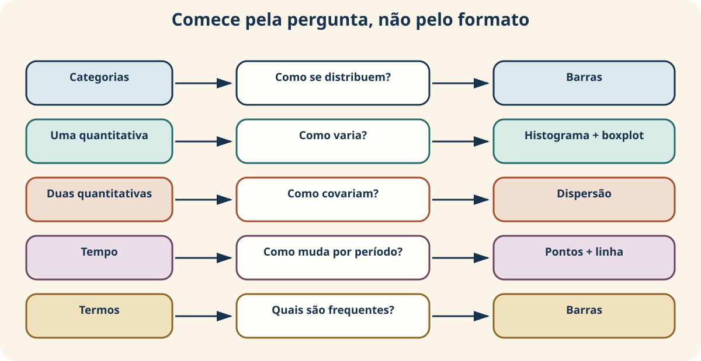

Gráficos incorporam decisões sobre seleção, agregação, escala e incerteza.

Drucker (2011).

---

# Barras: comparar categorias

Use quando a pergunta envolve contagens ou proporções por categoria.

Inclua:

- categorias e ordem justificadas;
- eixo começando em zero, salvo motivo explícito;
- contagem ou proporção;
- denominador;
- tabela equivalente;
- observação sobre categorias ausentes ou agregadas.

Na base fictícia, quatro barras iguais são uma propriedade construída.

---

# Histograma: a forma depende dos intervalos

$$
h_j=\sum_{i=1}^{n}\mathbf{1}(b_{j-1}<x_i\le b_j)
$$

Alterar os limites $b_j$ muda a forma visível sem mudar os documentos.

**Exemplo:** no intervalo $300<x\leq500$, a base contém 8 documentos.

O histograma mostra concentração e caudas; o boxplot resume quartis e sinaliza
casos. Juntos, eles ajudam a selecionar documentos para inspeção.

---

# Dispersão: duas quantidades por documento

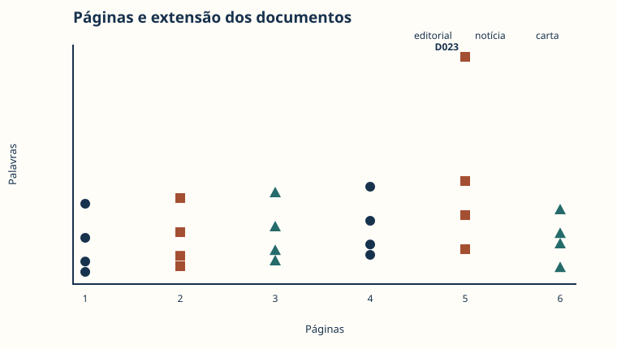

Cada ponto é um documento. O padrão visual não demonstra que páginas causam mais
palavras nem que todos os gêneros seguem a mesma relação.

---

# Tempo: agregação pode fabricar continuidade

$$
\bar{x}_t=\frac{1}{n_t}\sum_{i:\,\mathrm{ano}_i=t}x_i
$$

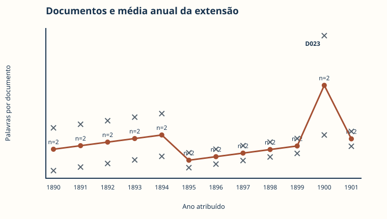

Cada ano contém apenas dois documentos. A linha representa a composição do corpus,
não uma mudança histórica contínua comprovada.

**Exemplo:** em 1900, D011 e D023 têm 790 e 2.100 palavras;
$\bar{x}_{1900}=(790+2100)/2=1445$.

---

# Frequências textuais: barras, não decoração

A figura precisa ser lida com tokenização, stopwords e denominador. Nuvem de
palavras costuma ocultar valores e dificultar comparação precisa.

---

# Toda figura precisa de uma tabela equivalente

Uma visualização auditável inclui:

- pergunta respondida;
- título informativo;
- eixos, escalas e unidades;
- denominador e agregação;
- tabela dos valores representados;
- descrição alternativa;
- padrão, caso, interpretação e limite.

Cor não pode ser o único meio de distinguir grupos.

---

<!-- _class: atividade -->

# U04-A04 · Visualização exploratória

**Modalidade:** produção individual + teste com colega · **Tempo:** 45 minutos  
**Produto:** conjunto de figuras justificadas

Para cada figura, entregue tabela, descrição alternativa, escala, padrão, caso,
limite e hipótese. Explique por que a família gráfica responde à pergunta.

Selecione quatro figuras complementares — não quatro versões da mesma informação.

---

<!-- _class: divisor -->

# 4 · Oficina: relatório exploratório

## De resultados isolados a uma cadeia de evidência

---

# Cinco camadas da escrita

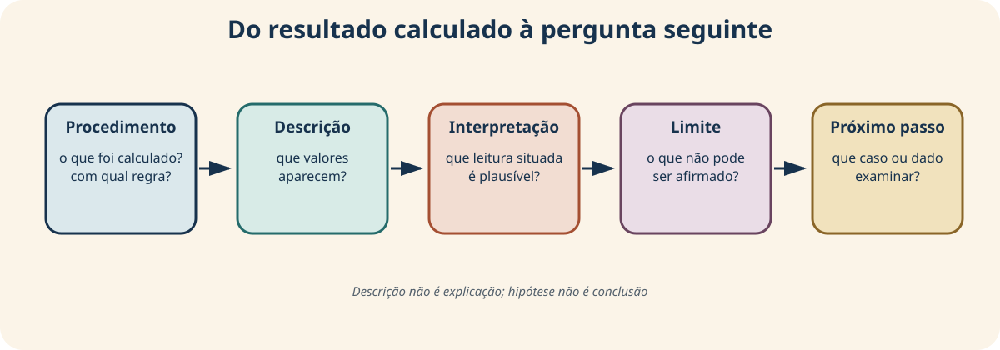

Evite “o gráfico prova”. Prefira “nesta base”, “o padrão observado” e “uma
hipótese a investigar”.

---

# Cada resultado forma uma cadeia

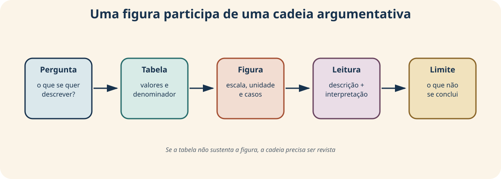

Se tabela e gráfico parecem divergir, não escolha o que confirma a expectativa:
revise cálculo, escala e descrição.

---

<!-- _class: atividade -->

# U04-A05 · Produto da oficina

**Modalidade:** elaboração individual · **Tempo:** primeira versão em 3 horas  
**Produto:** relatório exploratório curto e auditável

Inclua:

- escopo e qualidade da base;
- perfil quantitativo e textual;
- quatro figuras com tabelas equivalentes;
- retorno a três casos;
- até três hipóteses alternativas;
- limites e instruções de reprodução.

Não inclua testes de significância: eles pertencem à Unidade 5.

---

# Comece pelo escopo

Declare antes dos resultados:

| Elemento | Pergunta de controle |
|---|---|
| pergunta | é exploratória e compatível com a base? |
| corpus | quais casos e período estão incluídos? |
| unidade | o que cada linha representa? |
| variáveis | quais escalas serão usadas? |
| qualidade | quais ausências e erros são conhecidos? |
| adequação | o que a base permite e não permite investigar? |

---

# Perfil quantitativo: evidência mínima

Para cada medida, registre:

- variável e unidade;
- denominador ou convenção;
- valor observado;
- distribuição e casos relevantes;
- interpretação situada;
- limite da afirmação.

Exemplo: D023 está acima do limite de 1,5 IQR; isso exige conferência, não
exclusão automática.

---

# Perfil textual: evidência mínima

Documente:

- tokenização e normalização;
- stopwords e denominadores;
- termo e janela da concordância;
- frequência mínima da colocação;
- segmento usado para diversidade;
- IDs e trechos que qualificam os agregados.

Uma lista de palavras não constitui interpretação.

---

# Quatro figuras, quatro funções

Uma combinação possível:

1. barras para composição categórica;
2. histograma/boxplot para distribuição;
3. dispersão ou tempo para relação;
4. barras de termos para resultado textual.

Escolha em função da pergunta. Se duas figuras dizem a mesma coisa, substitua uma
por evidência complementar.

---

# Retorne deliberadamente aos casos

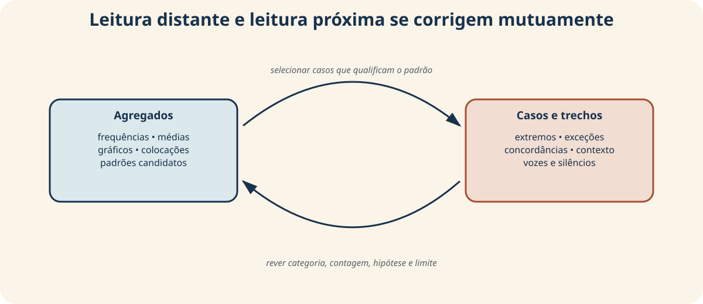

Escolha um caso típico, um contraditório e um extremo ou inesperado. Não selecione
apenas exemplos confirmatórios.

---

# Hipóteses permanecem provisórias

| Hipótese | Evidência exploratória | Alternativa | Dado necessário | Método futuro |
|---|---|---|---|---|
| “A diferença pode estar associada a…” | padrão observado | composição do corpus | ampliar/verificar casos | comparação futura |

Evite “comprovamos”, “é significativo” e linguagem causal sem desenho adequado.

---

# Reprodutibilidade do relatório

Outra pessoa precisa localizar:

- arquivo e versão da entrada;
- ambiente e dependências;
- ordem de execução;
- parâmetros: stopwords, janelas, frequência mínima e bins;
- tabela que sustenta cada gráfico;
- caminho entre agregado, ID e documento.

Reprodução técnica não elimina limites da cobertura ou das categorias.

---

<!-- _class: atividade -->

# U04-A06 · Revisão por pares

**Modalidade:** pares · **Tempo:** 20 minutos + revisão  
**Produto:** parecer e mudanças registradas

O colega deve responder:

1. qual é a unidade de análise?
2. qual denominador sustenta cada medida?
3. que caso confirma ou contradiz a leitura?
4. cada gráfico possui tabela e descrição?
5. a hipótese está formulada como provisória?

---

# Critérios da entrega

| Critério | Evidência de qualidade |
|---|---|
| escopo | pergunta, unidade, cobertura e limite coerentes |
| quantitativo | medidas, denominadores e extremos verificados |
| textual | regras, métricas e concordâncias documentadas |
| visual | quatro figuras acessíveis com tabelas |
| casos | três casos que qualificam agregados |
| hipóteses | alternativas e limites específicos |
| reprodução | entradas, parâmetros e ordem reconstruíveis |

---

# Retorno às duas coleções iniciais

A média 4 escondia estruturas diferentes.

Agora sabemos complementar o centro com:

- amplitude, IQR e desvio-padrão;
- histograma, boxplot e casos individuais;
- composição e denominadores;
- contexto textual;
- hipóteses alternativas;
- limites da base e das representações.

Explorar não é acumular gráficos: é aprender a fazer perguntas melhores.

---

# Síntese do percurso

- escala conceitual orienta cálculo e visualização;
- centro e dispersão respondem perguntas diferentes;
- extremo é convite à inspeção, não ordem de exclusão;
- texto contado precisa retornar ao contexto;
- gráfico é argumento com escolhas e limites;
- agregado e leitura próxima se corrigem mutuamente;
- hipótese exploratória prepara, mas não substitui, a inferência.

---

# Conexão com o projeto cumulativo

Na Unidade 4, o relatório-notebook recebe:

1. diagnóstico da base processável;
2. perfil quantitativo e textual;
3. quatro visualizações com tabelas;
4. leitura de três casos;
5. hipóteses e explicações alternativas;
6. limites e instruções de reprodução.

Na Unidade 5, uma comparação selecionada será examinada com tamanho de efeito,
incerteza e relevância substantiva.

---

# Bilhete de saída

Complete individualmente:

> O padrão mais interessante que observei foi…

> O caso que mais mudou minha leitura foi…

> Antes de comparar grupos, ainda preciso verificar…

**Produto:** três frases para orientar a próxima etapa do projeto.

---

<!-- _class: referencias -->

# Referências — 1/2

- ARNOLD, T.; TILTON, L. New Data? The Role of Statistics in DH. In: GOLD, M. K.; KLEIN, L. F. (org.). *Debates in the Digital Humanities 2019*. University of Minnesota Press, 2019. https://doi.org/10.5749/j.ctvg251hk.26.
- DRUCKER, J. Humanities Approaches to Graphical Display. *Digital Humanities Quarterly*, v. 5, n. 1, 2011. https://www.digitalhumanities.org/dhq/vol/5/1/000091/000091.html.
- MANNING, C. D.; RAGHAVAN, P.; SCHÜTZE, H. *Introduction to Information Retrieval*. Cambridge University Press, 2008. https://nlp.stanford.edu/IR-book/.
- SINCLAIR, S.; ROCKWELL, G. Text Analysis and Visualization: Making Meaning Count. In: *A New Companion to Digital Humanities*. Wiley, 2015. https://doi.org/10.1002/9781118680605.ch19.

---

<!-- _class: referencias -->
<!-- _paginate: false -->

# Referências — 2/2

- STEVENS, S. S. On the Theory of Scales of Measurement. *Science*, v. 103, n. 2684, p. 677–680, 1946. https://doi.org/10.1126/science.103.2684.677.
- TUKEY, J. W. *Exploratory Data Analysis*. Reading: Addison-Wesley, 1977.
- PANDAS DEVELOPMENT TEAM. *pandas User Guide*: estatística descritiva, categóricas, agrupamento e tabelas cruzadas. https://pandas.pydata.org/docs/user_guide/.

**Documentação dos recursos visuais:** os gráficos foram reconstruídos a partir
da base fictícia por `scripts/construir_graficos_slides_unidade_04.py`; diagramas
e proveniência estão descritos em `unidade_04/imagens/README.md`.

