<!-- _class: capa -->
<!-- _paginate: false -->
<!-- _footer: "" -->

# Unidade 5

## Comparação quantitativa e textual

**Problema orientador:** como verificar se grupos, períodos ou documentos
apresentam diferenças relevantes?

---

<!-- _class: exemplo -->

# Antes da teoria: a diferença mudou

Na base fictícia, a extensão média dos documentos é:

| Especificação | Capital − Interior |
|---|---:|
| todos os 24 documentos | −203,17 palavras |
| sem o caso extremo D023 | −85,27 palavras |

> Qual das duas diferenças representa melhor a comparação?

Não podemos responder apenas escolhendo o número que mais nos agrada.

---

# Comparar exige retornar aos casos

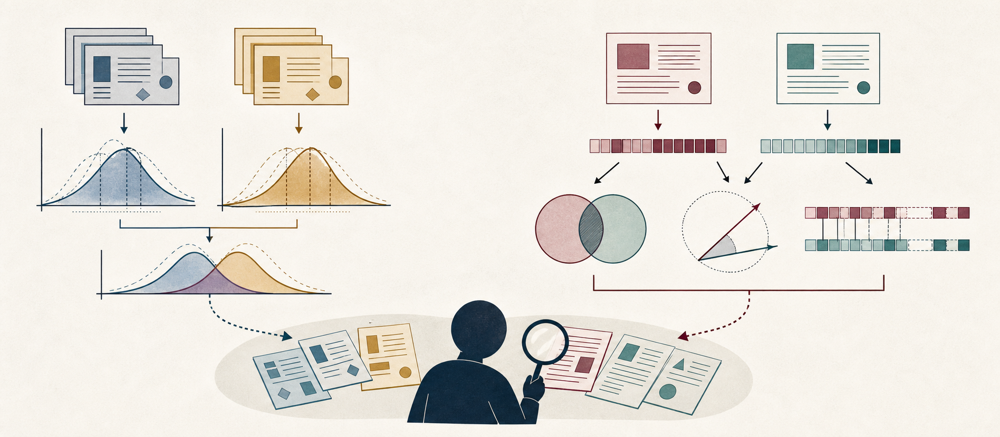

Ilustração conceitual; não constitui evidência histórica.

Precisamos saber:

- o que está sendo comparado;
- como a diferença foi medida;
- quão sensível ela é;
- que incerteza é pertinente;
- quais documentos a produziram;
- por que ela importa.

---

# A pergunta da unidade

Comparar não é apenas:

- subtrair duas médias;
- procurar `p < 0,05`;
- ordenar textos por similaridade;
- escolher a métrica que confirma uma expectativa.

Como construir uma comparação que conecte medida, pressuposto, caso e argumento?

---

# Agenda

1. Estimar magnitude e tamanho de efeito
2. Avaliar sensibilidade e relevância
3. Situar bootstrap, intervalos e permutação
4. Representar documentos como vetores
5. Comparar vocabulário, perfis e versões
6. Construir uma análise comparativa defensável

---

# Ao final, você deverá conseguir…

- declarar unidades, grupos e quantidade de interesse;
- distinguir diferença bruta, relativa e padronizada;
- interpretar intervalo e valor de *p* sem atalhos binários;
- construir matriz documento-termo e TF-IDF;
- comparar Jaccard, cosseno e distância de edição;
- realizar análise de sensibilidade;
- retornar aos documentos e limitar a conclusão.

---

# Dois percursos, a mesma exigência

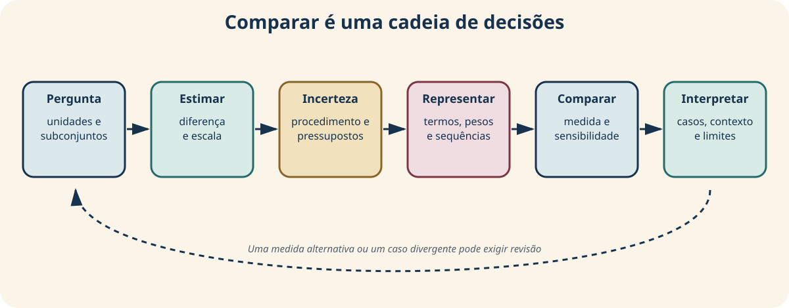

Toda medida precisa retornar aos casos e ao contexto.

---

<!-- _class: atividade -->

# U05-A01 · Diagnóstico inicial

**Modalidade:** individual · **Tempo:** 10 minutos  
**Produto:** cinco respostas para revisão ao final

- Quando uma diferença de médias é historicamente importante?
- Um intervalo de confiança contém 95% dos dados?
- O valor de *p* é a probabilidade de a hipótese nula ser verdadeira?
- Textos com as mesmas palavras são equivalentes?
- Que hipótese exploratória da Unidade 4 você compararia?

---

<!-- _class: divisor -->

# 1 · Quanto os grupos diferem?

## Estimativa antes de teste

---

<!-- _class: exemplo -->

# Compare somente unidades compatíveis

Nesta base:

- cada linha representa um documento;
- `local` define Capital e Interior;
- `palavras` representa extensão simulada;
- `tema == educação` define uma condição documental.

Média de palavras, mediana de palavras e proporção de documentos com tema
educação respondem a perguntas diferentes.

---

# Três perguntas que não devem ser fundidas

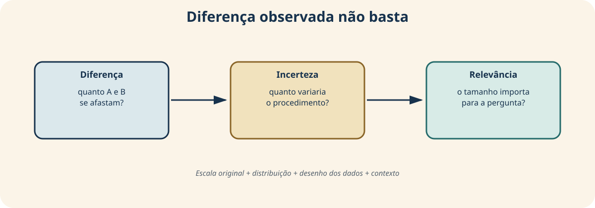

Magnitude não é incerteza; incerteza não é importância histórica.

---

# Observe as distribuições

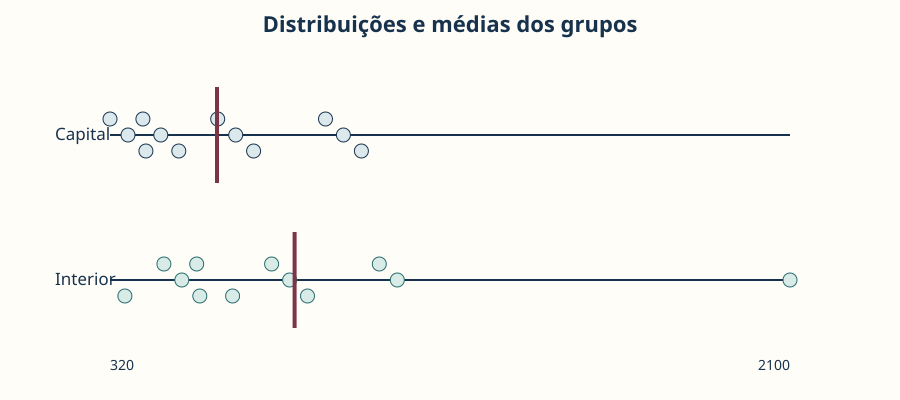

Capital tem média 600; Interior, 803,17. A sobreposição e D023 não aparecem em
uma simples tabela de médias.

---

# Defina a quantidade antes de calcular

Se $\hat{\theta}_A$ e $\hat{\theta}_B$ estimam a mesma quantidade nos grupos:

$$
\Delta=\hat{\theta}_A-\hat{\theta}_B
$$

Para Capital − Interior:

$$
\Delta_{\mathrm{media}}=600-803{,}17=-203{,}17
$$

O sinal depende da ordem declarada. A unidade permanece “palavras por documento”.

---

# Média, mediana e proporção

| Medida | Pergunta |
|---|---|
| diferença de médias | quanto diferem as extensões médias? |
| diferença de medianas | quanto diferem as posições centrais resistentes? |
| diferença de proporções | quantos pontos percentuais separam as condições? |

“Proporção de documentos com tema educação” não mede a extensão dedicada à
educação em cada texto.

---

# Diferença absoluta e relativa

Tomando $B$ como referência:

$$
\Delta_{rel}=\frac{\hat{\theta}_A-\hat{\theta}_B}{\hat{\theta}_B}
$$

A diferença relativa:

- muda se a referência for invertida;
- torna-se instável perto de zero;
- pode esconder a unidade substantiva;
- deve acompanhar, não substituir, a diferença absoluta.

---

# Uma diferença padronizada

$$
d=\frac{\bar{x}_A-\bar{x}_B}{s_p}
$$

$$
s_p=\sqrt{\frac{(n_A-1)s_A^2+(n_B-1)s_B^2}{n_A+n_B-2}}
$$

Na base, $d\approx-0{,}555$: a diferença equivale a pouco mais de meio
desvio-padrão combinado, no sentido Capital − Interior.

Rótulos universais de “pequeno” ou “grande” não substituem contexto.

---

<!-- _class: exemplo -->

# Sensibilidade ao caso D023

| Especificação | Diferença média |
|---|---:|
| principal: todos os registros | −203,17 |
| alternativa: sem D023 | −85,27 |

A direção permanece, mas a magnitude cai aproximadamente 58%.

Isso não autoriza excluir D023. Obriga a verificar sua origem, sua pertinência e
o significado de `palavras`.

---

# Relevância substantiva não vem da fórmula

Pergunte:

- 203 palavras alteram que interpretação?
- a diferença decorre de gênero, período ou seleção?
- D023 é erro, documento legítimo ou construção pedagógica?
- extensão textual representa o fenômeno de interesse?
- a literatura considera essa escala relevante?

O campo é fictício; o exercício avalia o raciocínio, não produz história.

---

<!-- _class: atividade -->

# U05-A02 · Quadro de estimativas

**Modalidade:** individual + revisão em dupla · **Tempo:** 25 + 10 minutos  
**Produto:** comparação descritiva argumentada

Escolha grupos e quantidade; apresente distribuição e duas medidas; calcule
diferença absoluta e, se defensável, relativa ou padronizada; inspecione dois
casos; escreva significado, relevância e limite.

---

<!-- _class: divisor -->

# 2 · Que incerteza acompanha a estimativa?

## O desenho vem antes do intervalo

---

<!-- _class: exemplo -->

# Três bases, três interpretações

| Origem dos dados | O que a incerteza amostral alcança? |
|---|---|
| amostra probabilística | pode quantificar parte da variação para a população |
| corpus completo da pergunta | a diferença do corpus já foi observada |
| coleção de conveniência | reamostragem herda a seleção disponível |

Intervalo não corrige erro de medição, cobertura desigual ou categorias ruins.

---

# Variabilidade amostral não é toda incerteza

Distinga:

- variação entre amostras do mesmo procedimento;
- erro de mensuração ou transcrição;
- sensibilidade a casos influentes;
- escolhas de limpeza e representação;
- lacunas de cobertura;
- mudança histórica real.

Uma única faixa numérica não incorpora automaticamente todas essas fontes.

---

# Bootstrap: reamostrar o observado

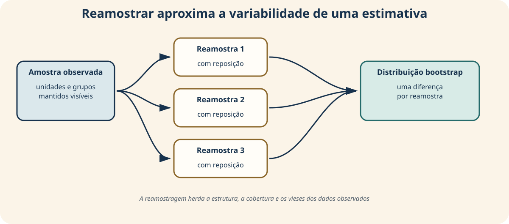

Em cada repetição $b$, sorteamos dentro dos grupos e recalculamos:

$$
\Delta_b=\bar{x}_{A,b}-\bar{x}_{B,b}
$$

Efron e Tibshirani (1993).

---

# Distribuição bootstrap

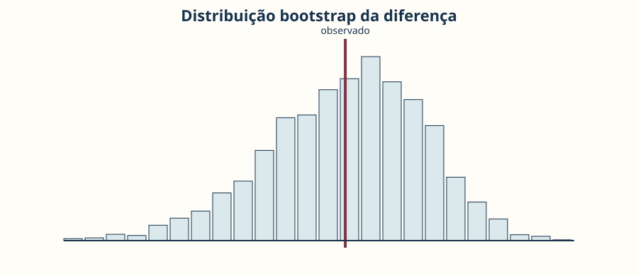

Não são 4.000 novos passados. São variações produzidas pela regra de reamostragem
sobre os dados observados.

---

# Intervalo percentil introdutório

$$
IC_{95\%}=\left[Q_{0{,}025}(\Delta_b),Q_{0{,}975}(\Delta_b)\right]
$$

No exemplo, aproximadamente:

$$
IC_{95\%}=[-505{,}13;\ 49{,}00]
$$

Valores negativos e positivos são compatíveis com o procedimento. O intervalo é
amplo em relação à estimativa.

---

<!-- _class: alerta -->

# O intervalo não contém 95% dos documentos

Na interpretação frequentista, em repetições do procedimento, cerca de 95% dos
intervalos construídos dessa maneira cobririam o parâmetro-alvo, sob as condições
do método.

Depois de calculado, não afirmamos que:

- há 95% de probabilidade de o parâmetro fixo estar nele;
- 95% dos documentos estão dentro da faixa;
- seleção e medição foram corrigidas.

---

# Permutação: um modelo nulo explícito

Hipótese didática: sob $H_0$, os rótulos Capital e Interior são intercambiáveis.

Procedimento:

1. manter os valores e tamanhos dos grupos;
2. embaralhar os rótulos;
3. recalcular a diferença;
4. repetir muitas vezes;
5. localizar o observado na distribuição nula.

A intercambiabilidade precisa ser defensável no desenho, não apenas programável.

---

# Distribuição nula conceitual

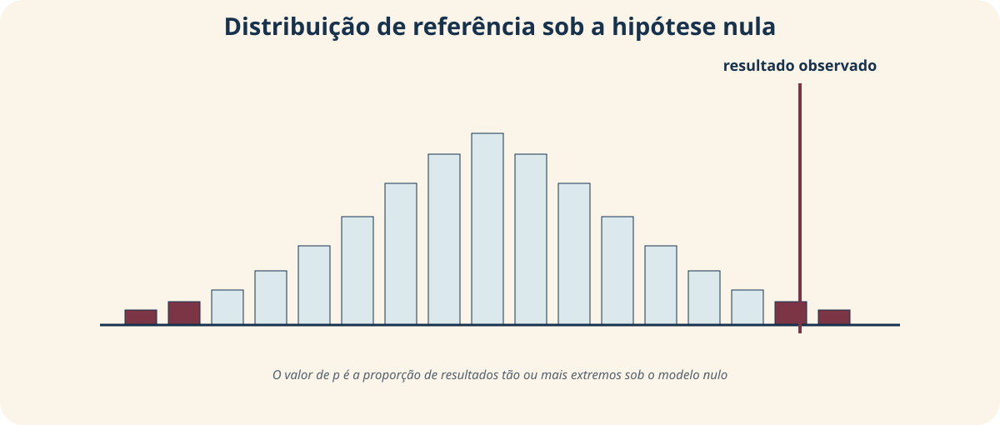

O teste pergunta quão extremo é o resultado sob o modelo nulo especificado.

---

# Resultado da permutação

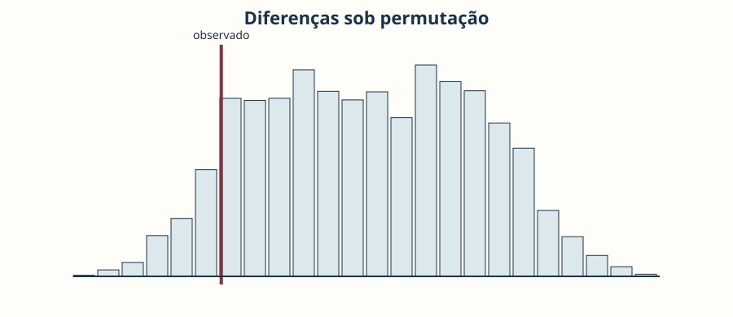

Com 5.000 permutações, obtemos $p\approx0{,}1982$ para o teste bilateral.

---

# Valor de *p* com correção finita

$$
p=\frac{1+\sum_{m=1}^{M}\mathbf{1}(|T_m|\ge|T_{obs}|)}{M+1}
$$

O valor informa a proporção de resultados simulados tão ou mais extremos que o
observado, sob $H_0$ e o procedimento especificado.

Ele não informa a probabilidade de $H_0$ ser verdadeira.

---

# Quatro peças da interpretação

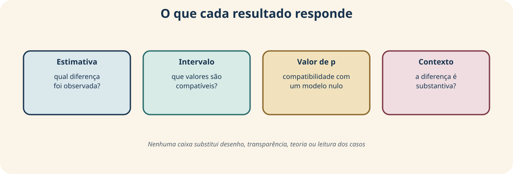

Wasserstein e Lazar (2016); Wasserstein, Schirm e Lazar (2019).

---

# Significância não é relevância

- efeito mínimo pode produzir *p* baixo em amostra enorme;
- efeito importante pode permanecer impreciso em amostra pequena;
- *p* não mede importância, qualidade ou probabilidade de replicação;
- atravessar 0,05 não transforma um resultado em verdade;
- não atravessar 0,05 não demonstra equivalência.

Relate estimativa, intervalo, efeito, desenho, decisões e contexto.

---

<!-- _class: atividade -->

# U05-A03 · Ficha inferencial

**Modalidade:** duplas · **Tempo:** 30 minutos  
**Produto:** interpretação inferencial limitada

Declare população-alvo e seleção; informe estimativa, intervalo e efeito;
formule $H_0$; interprete *p* sem decisão binária; indique duas incertezas não
representadas; escreva quando não aplicaria inferência amostral.

---

<!-- _class: divisor -->

# 3 · Como um documento se torna comparável?

## Representação vetorial e suas perdas

---

<!-- _class: exemplo -->

# Mesmas palavras, sentidos diferentes

> trabalho não é progresso

> progresso não é trabalho

Sob *Bag of Words*, os dois textos recebem as mesmas contagens.

Isso não é erro de código. É uma perda deliberada da representação: ordem,
sintaxe, escopo da negação, ironia e voz não são preservados.

---

# Do documento à matriz

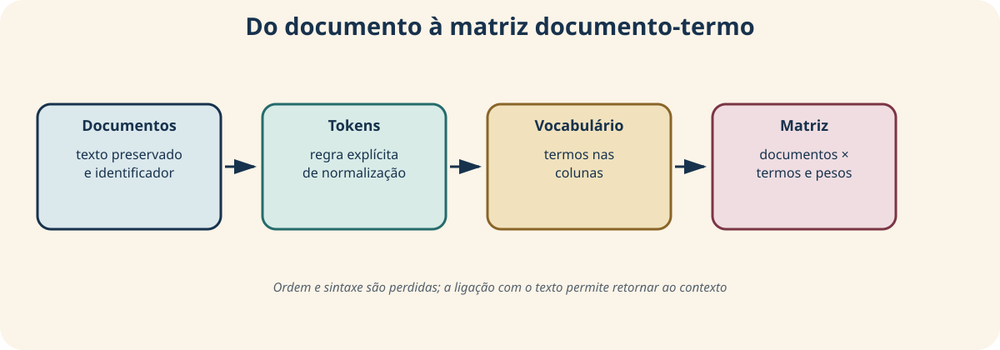

Preserve texto e identificador para poder retornar à fonte.

---

# Matriz documento-termo

Se $c(t,d)$ é a contagem do termo $t$ no documento $d$:

$$
X_{d,t}=c(t,d)
$$

- linhas: documentos;
- colunas: termos do vocabulário;
- células: frequências;
- zero: ausência segundo as regras adotadas.

Zero não significa irrelevância histórica.

---

# Um recorte da matriz

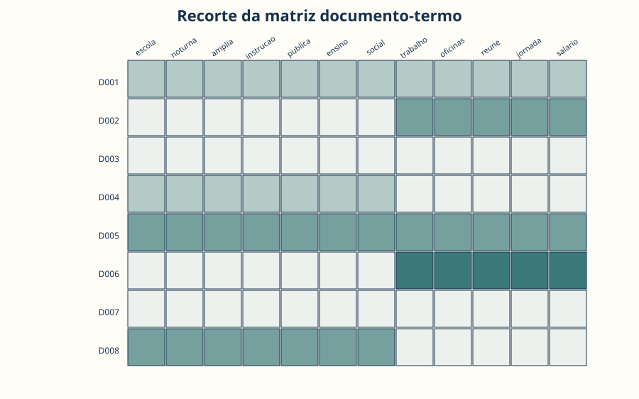

A figura revela padrões de presença e repetição, mas os valores exatos precisam
continuar disponíveis em tabela.

---

# Frequência documental e IDF

$$
df(t)=\sum_{d=1}^{N}\mathbf{1}(X_{d,t}>0)
$$

Convenção suavizada usada na unidade:

$$
idf(t)=\log\!\left(\frac{N+1}{df(t)+1}\right)+1
$$

Termos presentes em muitos documentos recebem IDF menor.

---

# TF-IDF combina frequência e raridade

$$
tfidf(t,d)=X_{d,t}\times idf(t)
$$

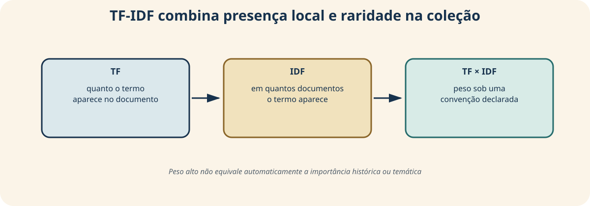

Peso alto não prova centralidade temática ou importância histórica.

Manning, Raghavan e Schütze (2008).

---

# Convenções mudam o vetor

Documente:

- tokenização e normalização;
- stopwords e acentos;
- vocabulário mínimo;
- TF bruto ou normalizado;
- suavização e base do logaritmo;
- normalização final do vetor.

Outra convenção pode mudar pesos, distâncias e ranking de vizinhos.

---

# Comparar períodos exige definir o agregado

Nesta unidade, comparamos médias de TF-IDF entre 1890–1895 e 1896–1901.

Um termo distintivo significa que seu peso médio difere sob essa representação.
Não explica por que aparece nem demonstra mudança histórica.

Unir todos os textos em um megadocumento responderia a outra pergunta e daria
mais peso a subconjuntos maiores.

---

<!-- _class: atividade -->

# U05-A04 · Matriz documentada

**Modalidade:** duplas · **Tempo:** 35 minutos  
**Produto:** matriz, termos distintivos e perdas registradas

Documente regras; construa a matriz; compare contagem e TF-IDF; identifique dois
termos distintivos; leia seus trechos; registre uma interpretação e uma perda do
modelo.

---

<!-- _class: divisor -->

# 4 · Em que sentido dois textos são semelhantes?

## A métrica responde à representação escolhida

---

<!-- _class: exemplo -->

# “Semelhante” pode significar quatro coisas

Dois documentos podem:

- compartilhar muitos termos diferentes;
- repetir termos nas mesmas proporções;
- compartilhar termos raros na coleção;
- exigir poucas edições para virar uma versão do outro.

Esses critérios podem ordenar os mesmos pares de maneiras diferentes.

---

# Escolha a métrica pela pergunta

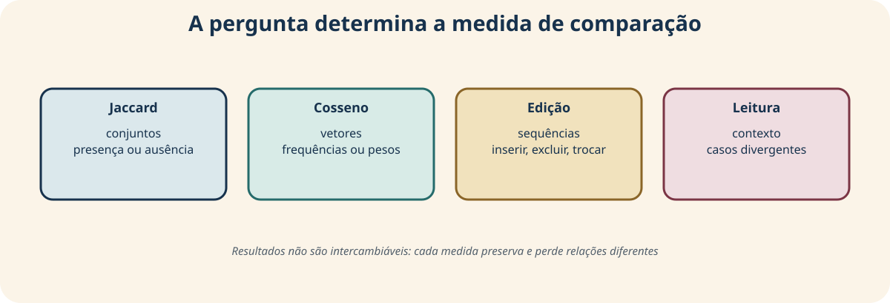

Não existe “a” similaridade do texto.

---

# Jaccard: vocabulário compartilhado

$$
J(A,B)=\frac{|A\cap B|}{|A\cup B|}
$$

Se $A=\{escola,trabalho\}$ e $B=\{escola,progresso\}$:

$$
J(A,B)=\frac{1}{3}\approx0{,}333
$$

Repetir `escola` dez vezes não muda Jaccard nesta definição.

---

# Cosseno: direção dos vetores

$$
\cos(\mathbf{x},\mathbf{y})=
\frac{\mathbf{x}\cdot\mathbf{y}}
{\|\mathbf{x}\|_2\,\|\mathbf{y}\|_2}
$$

Em vetores não negativos:

- 1 indica mesma direção;
- 0 indica ausência de componentes compartilhados;
- magnitude total tem efeito reduzido;
- vocabulário, pesos e pré-processamento continuam decisivos.

---

# Rankings divergentes são informação

| Métrica | Valoriza |
|---|---|
| Jaccard | presença de termos compartilhados |
| cosseno de contagens | perfil de repetição |
| cosseno TF-IDF | perfil ponderado por raridade |

Se um par sobe apenas com TF-IDF, inspecione quais termos raros produzem a
aproximação. Não esconda a divergência escolhendo uma única classificação.

---

# Vizinhos precisam ser lidos

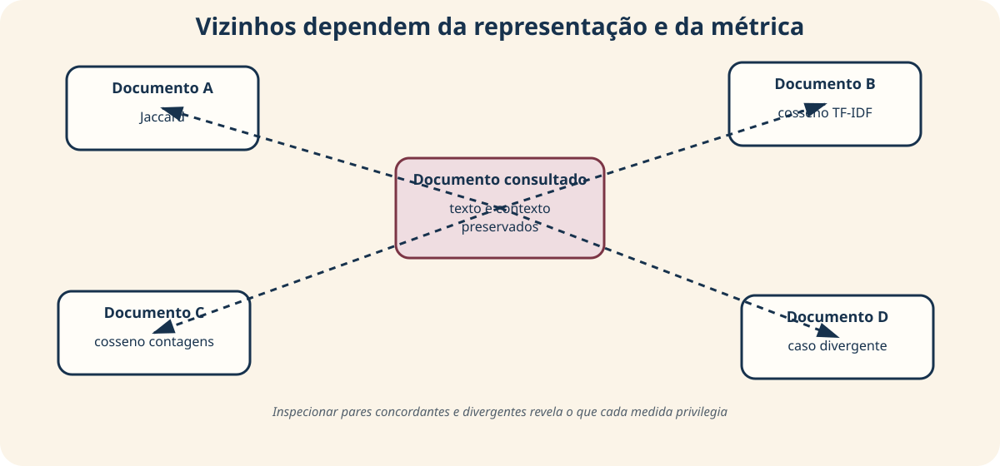

Leia texto, gênero, período, extensão e origem antes de chamar documentos de
semelhantes.

---

# Para versões, ordem importa

A distância de Levenshtein calcula o menor número de operações:

$$
D_{i,j}=\min\begin{cases}
D_{i-1,j}+1 & \mathrm{del}\\
D_{i,j-1}+1 & \mathrm{ins}\\
D_{i-1,j-1}+\mathbf{1}(a_i\neq b_j) & \mathrm{sub}
\end{cases}
$$

A unidade pode ser caractere ou token. Declare também qualquer normalização por
comprimento.

---

# Uma edição mínima não mede o sentido

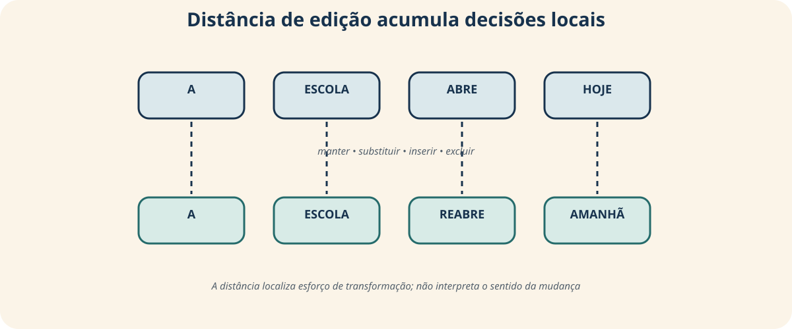

Corrigir um único nome próprio custa uma substituição e pode alterar
substantivamente a interpretação histórica.

Levenshtein (1966).

---

<!-- _class: exemplo -->

# Comparar duas transcrições

| Versão | Texto |
|---|---|
| A | “A escola noturna amplia **a** instrução pública.” |
| B | “A escola noturna amplia instrução pública.” |

Distância pequena descreve esforço de transformação. Para decidir se a omissão é
irrelevante, editorial ou interpretativamente importante, volte à imagem e ao
protocolo de transcrição.

---

# Agregar documentos muda a unidade

- média dos vetores por autor: perfil médio de documentos atribuídos;
- megadocumento por autor: perfil com maior peso para quem escreveu mais;
- média por período: documento médio sob a ponderação escolhida;
- união de vocabulários: presença agregada sem frequência.

Autoria não é essência estilística. Gênero, período, transcrição e composição
podem explicar proximidades.

---

<!-- _class: atividade -->

# U05-A05 · Relatório de pares

**Modalidade:** trios · **Tempo:** 35 minutos  
**Produto:** comparação métrica acompanhada de leitura próxima

Escolha consulta e candidatos; calcule Jaccard e dois cossenos; identifique uma
concordância e uma divergência entre rankings; leia documentos e metadados;
compare versões por edição; justifique a métrica principal.

---

<!-- _class: divisor -->

# 5 · Oficina: análise comparativa

## Um resultado principal, uma alternativa e casos

---

# A cadeia do argumento comparativo

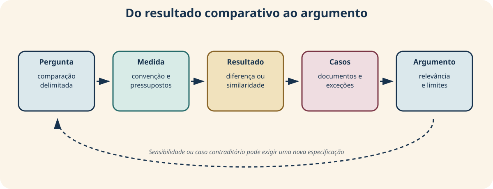

Sensibilidade ou caso contraditório pode exigir revisão da medida — não seu
apagamento.

---

<!-- _class: atividade -->

# U05-A06 · Produto da oficina

**Modalidade:** individual + pares + revisão · **Tempo:** 60 + 25 + 20 minutos  
**Produto:** análise comparativa curta

Inclua pergunta e contexto, comparabilidade, especificação principal, resultado,
alternativa de sensibilidade, três casos, relevância, limites e reprodução.

O percurso pode ser quantitativo, textual ou combinado.

---

# Comece pela comparabilidade

Declare:

- unidade de análise;
- grupos, períodos ou documentos;
- população-alvo, corpus ou conveniência;
- critérios e tamanhos;
- cobertura e assimetrias;
- diferenças de produção, preservação e acesso.

Uma técnica correta não torna comparáveis conjuntos formados de modos incompatíveis.

---

# Fixe a especificação principal

Antes de observar todos os resultados, registre:

- quantidade ou representação;
- medida principal;
- fórmula ou convenção;
- pré-processamento;
- parâmetros;
- razão substantiva da escolha.

Isso reduz a tentação de selecionar a especificação mais conveniente.

---

# Relate o resultado principal

Se quantitativo:

- estimativa, unidade, efeito, intervalo e *p* quando pertinentes.

Se textual:

- documentos, representação, métrica e valores.

Nos dois casos:

- tabela, visualização acessível, descrição estrita e notebook de origem.

---

# Sensibilidade pergunta “depende de quê?”

Compare uma alternativa plausível:

- média × mediana;
- todos os casos × exclusão substantivamente justificada;
- diferença bruta × padronizada;
- Jaccard × cosseno;
- contagens × TF-IDF;
- caracteres × tokens.

Registre o que permanece, o que muda e se a conclusão depende da escolha.

---

# Três casos para qualificar o agregado

Selecione:

1. um caso típico;
2. um caso extremo ou influente;
3. um caso que desafie a leitura inicial.

Para cada um, mostre evidência documental e explique o efeito sobre a
interpretação. Não use casos apenas como ilustração confirmatória.

---

# Afirmação, hipótese e limite

Separe:

- **sustentado:** o que a medida mostra na base;
- **relevante:** por que a magnitude ou semelhança importa;
- **contextual:** como literatura e documentos permitem interpretar;
- **alternativo:** que outra explicação é plausível;
- **não concluído:** causalidade, generalização ou identidade não demonstradas.

---

# Autoavaliação

| Critério | Pergunta |
|---|---|
| pergunta | a comparação é substantivamente pertinente? |
| cobertura | os grupos são comparáveis? |
| medida | convenção e representação estão explícitas? |
| robustez | há incerteza ou sensibilidade adequada? |
| casos | documentos qualificam o resultado? |
| limites | alcance e alternativas estão claros? |
| reprodução | o percurso pode ser reconstruído? |

---

<!-- _class: atividade -->

# U05-A07 · Revisão por pares

**Modalidade:** dois turnos · **Tempo:** 25 minutos por trabalho  
**Produto:** parecer e resposta justificada

Localize escolha bem fundada, assimetria, medida alternativa, caso a reler,
frase que confunda significância/semelhança/importância e conclusão que exceda a
cobertura.

---

# Retorno ao exemplo inicial

A diferença de −203,17 não era “falsa”; era sensível a D023.

Uma leitura defensável relata:

- a diferença observada e sua unidade;
- a queda para −85,27 sem o caso;
- o motivo para manter e examinar D023;
- o intervalo amplo e o desenho didático;
- a relevância — ou irrelevância — substantiva de extensão textual;
- limites da coleção fictícia.

---

# Síntese do percurso

- magnitude, incerteza e relevância são perguntas diferentes;
- intervalo e *p* dependem do desenho;
- `p < 0,05` não é critério automático de verdade;
- representação textual define a semelhança possível;
- rankings divergentes revelam efeitos das métricas;
- sensibilidade e casos fortalecem a interpretação;
- comparação não demonstra causalidade.

---

# Conexão com o projeto cumulativo

Na Unidade 5, o relatório-notebook recebe:

1. pergunta e comparabilidade dos subconjuntos;
2. medida principal e convenções;
3. estimativa ou similaridade observada;
4. incerteza pertinente ou justificativa para não aplicá-la;
5. especificação alternativa;
6. leitura de três casos;
7. conclusão limitada e reproduzível.

Na Unidade 6, passaremos de diferenças entre subconjuntos a associações,
coocorrências e redes.

---

# Bilhete de saída

Complete individualmente:

> Minha comparação principal responde…

> O resultado mais sensível à escolha de método é…

> O caso que preciso reler antes de concluir é…

**Produto:** três frases para orientar a revisão da análise comparativa.

---

<!-- _class: referencias -->

# Referências — 1/2

- EFRON, B.; TIBSHIRANI, R. J. *An Introduction to the Bootstrap*. Chapman & Hall/CRC, 1993. https://doi.org/10.1201/9780429246593.
- LEVENSHTEIN, V. I. Binary Codes Capable of Correcting Deletions, Insertions and Reversals. *Soviet Physics Doklady*, v. 10, n. 8, p. 707–710, 1966.
- MANNING, C. D.; RAGHAVAN, P.; SCHÜTZE, H. *Introduction to Information Retrieval*. Cambridge University Press, 2008. https://nlp.stanford.edu/IR-book/.
- WASSERSTEIN, R. L.; LAZAR, N. A. The ASA Statement on p-Values: Context, Process, and Purpose. *The American Statistician*, v. 70, n. 2, p. 129–133, 2016. https://doi.org/10.1080/00031305.2016.1154108.
- WASSERSTEIN, R. L.; SCHIRM, A. L.; LAZAR, N. A. Moving to a World Beyond “p < 0.05”. *The American Statistician*, v. 73, supl. 1, p. 1–19, 2019. https://doi.org/10.1080/00031305.2019.1583913.

---

<!-- _class: referencias -->
<!-- _paginate: false -->

# Referências — 2/2

- D'IGNAZIO, C.; KLEIN, L. F. *Data Feminism*. MIT Press, 2020. https://data-feminism.mitpress.mit.edu/.
- DRUCKER, J. Humanities Approaches to Graphical Display. *Digital Humanities Quarterly*, v. 5, n. 1, 2011. https://digitalhumanities.org/dhq/vol/5/1/000091/000091.html.
- JOCKERS, M. L. *Macroanalysis: Digital Methods and Literary History*. University of Illinois Press, 2013.
- UNDERWOOD, T. *Distant Horizons: Digital Evidence and Literary Change*. University of Chicago Press, 2019.
- AMERICAN STATISTICAL ASSOCIATION. *Task Force Statement on Statistical Significance and Replicability*. 2021. https://magazine.amstat.org/blog/2021/08/01/task-force-statement-p-value/.

**Gráficos calculados:** reconstruídos por
`scripts/construir_graficos_slides_unidade_05.py` a partir dos dados fictícios.

