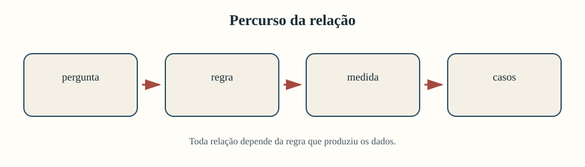
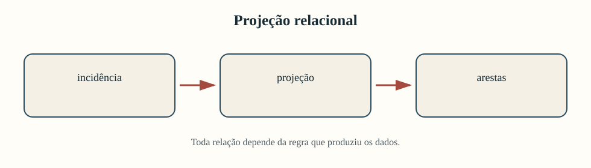
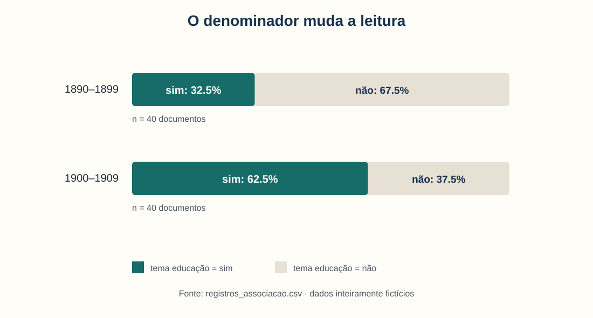
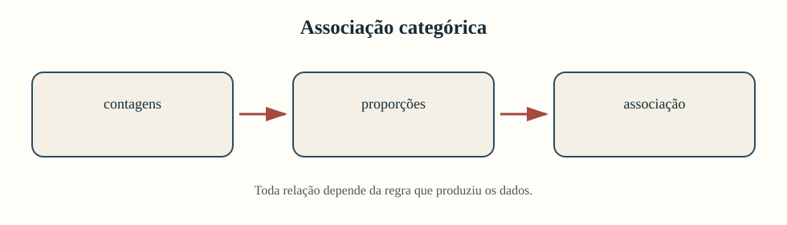
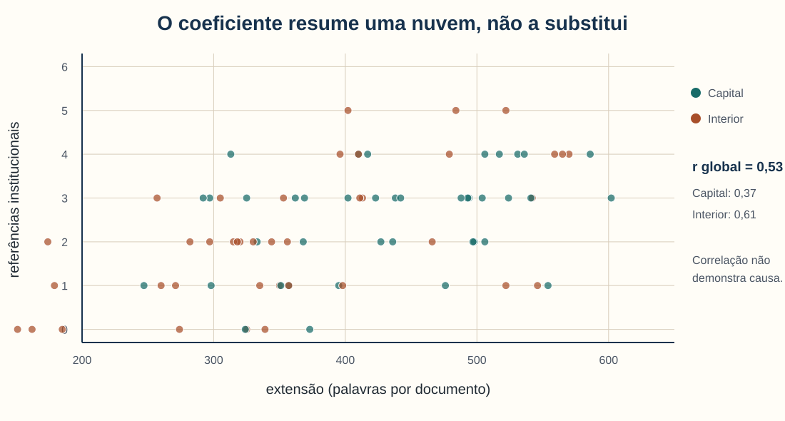
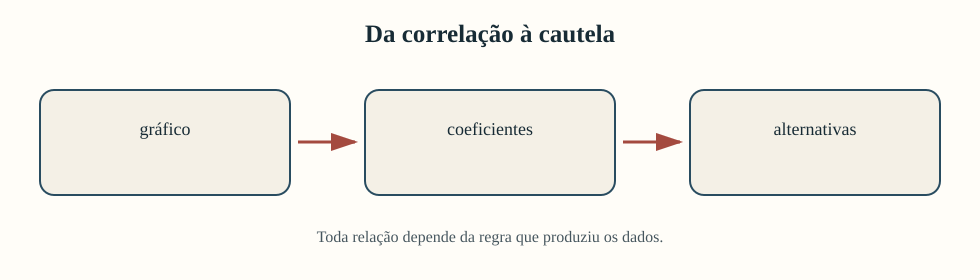
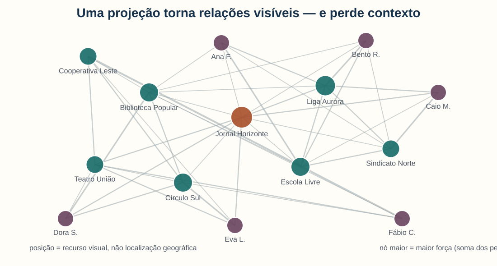
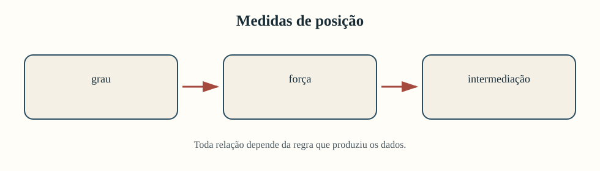
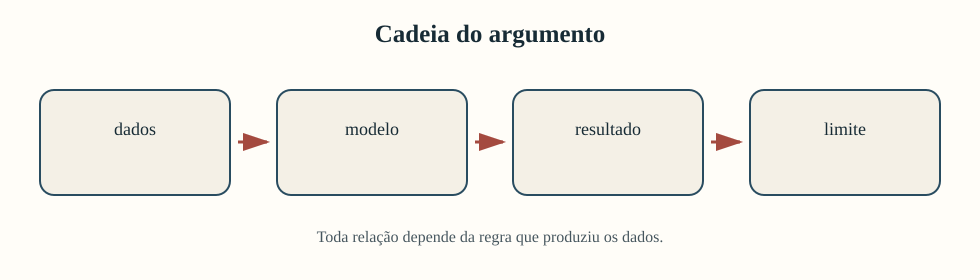

<!-- _class: capa -->
<!-- _paginate: false -->
<!-- _footer: "" -->

# Unidade 6

## Associações e grafos

**Problema orientador:** quando um padrão entre dados sustenta uma relação — e
quando ele é apenas efeito da forma de observar?

---

# Agenda

1. Distinguir associação, correlação, coocorrência e grafo
2. Comparar categorias com denominadores explícitos
3. Investigar correlações e explicações alternativas
4. Transformar documentos em matrizes relacionais
5. Interpretar centralidade, comunidades e direção
6. Construir uma análise defensável para o projeto

---

# Ao final, você deverá conseguir…

- formular uma pergunta relacional com unidade definida;
- construir e interpretar uma tabela de contingência;
- ler correlações sem convertê-las em causalidade;
- explicar a projeção de uma matriz bipartida;
- distinguir grau, força e intermediação;
- testar sensibilidade e retornar às fontes;
- justificar o uso — ou a não adoção — de um grafo.

---

# O percurso da unidade

O método muda; a obrigação de documentar unidades, regras e limites permanece.

---

# A unidade estudará três sentidos de “relação”

| Tipo | Exemplo na unidade | Pergunta em linguagem comum |
|---|---|---|
| associação categórica | período × tema educação | a proporção muda entre os períodos? |
| correlação numérica | extensão × circulação | valores altos de uma tendem a acompanhar valores altos da outra? |
| coocorrência | entidade × entidade | as duas são mencionadas nos mesmos documentos? |

São relações diferentes e exigem evidências diferentes. Em todas, precisamos
declarar a **unidade observada**, a **regra de construção** e o **limite da conclusão**.

---

<!-- _class: exemplo -->

# Base fictícia: registros e documentos

- `registros_associacao.csv`: 80 registros, 1890–1909, em dois períodos e locais.
- `documentos_entidades.csv`: 24 documentos com listas de entidades mencionadas.
- Variáveis permitem estudar tema, ilustração, extensão, circulação e OCR.

Os padrões foram construídos para demonstrar associação e confundimento. Não
descrevem periódicos, entidades ou relações históricas reais.

---

<!-- _class: exemplo -->

# Como são os dois arquivos de origem?

### `registros_associacao.csv`

| id | período | local | tema | extensão |
|---|---|---|---|---:|
| R001 | 1890–1899 | Capital | não | 506 |
| R002 | 1890–1899 | Capital | sim | 438 |
| R003 | 1890–1899 | Interior | não | 356 |

Cada linha é um **registro documental** usado para comparar variáveis. A tabela
mostra apenas cinco das onze colunas.

### `documentos_entidades.csv`

| id | ano | local | entidades mencionadas |
|---|---:|---|---|
| D001 | 1895 | Capital | Ana F.; Liga Aurora; Escola Livre |
| D002 | 1896 | Interior | Bento R.; Liga Aurora; Sindicato Norte |
| D003 | 1897 | Capital | Ana F.; Jornal Horizonte; Escola Livre |

Cada linha é um **documento** com a lista de entidades que servirá para construir
as coocorrências.

---

# Tabelas derivadas para os grafos

- `arestas_coocorrencia.csv`: 42 pares formados por menções no mesmo documento.
- `correspondencia_direta.csv`: 12 relações remetente–destinatário.
- **Unidade da coocorrência:** par de entidades dentro de uma janela documental.
- **Unidade da correspondência:** fluxo explicitamente registrado entre dois atores.

As duas tabelas não são equivalentes: proximidade textual não prova vínculo social.

---

<!-- _class: exemplo -->

# Como são as duas tabelas?

### `arestas_coocorrencia.csv`

| origem | destino | peso |
|---|---|---:|
| Ana F. | Escola Livre | 3 |
| Bento R. | Liga Aurora | 3 |
| Ana F. | Liga Aurora | 2 |

O peso conta documentos compartilhados. A ordem das duas entidades **não indica
direção**.

### `correspondencia_direta.csv`

| remetente | destinatário | ano | cartas |
|---|---|---:|---:|
| Ana F. | Bento R. | 1895 | 1 |
| Bento R. | Dora S. | 1896 | 2 |
| Caio M. | Fábio C. | 1897 | 3 |

Remetente e destinatário definem uma relação **direcionada**, registrada pela
correspondência.

---

<!-- _class: exemplo -->

# Antes da teoria: de uma linha à coocorrência

Veja uma linha de `documentos_entidades.csv`:

| Documento | Ano | Local | Entidades mencionadas |
|---|---:|---|---|
| D001 | 1895 | Capital | Ana F.; Liga Aurora; Escola Livre |

Aqui, **entidade** é uma pessoa, organização ou lugar identificado no documento.
O arquivo registra três menções; ele ainda **não contém relações entre elas**.

Ao escolher o documento inteiro como janela, o método cria três pares:

- Ana F. — Liga Aurora;
- Ana F. — Escola Livre;
- Liga Aurora — Escola Livre.

O que esses pares permitem afirmar — e o que acrescentamos por interpretação?

---

# Fonte, operação e interpretação não são a mesma coisa

| Nível | O que sabemos? |
|---|---|
| fonte | D001 menciona as três entidades |
| operação | o método forma pares porque a janela é o documento |
| resultado | cada par compartilha um contexto documental |

**Ainda não sabemos** se houve filiação, colaboração, contato ou qualquer outro
vínculo social.

---

<!-- _class: exemplo -->

# Da incidência às arestas: um exemplo completo

### 1 · Incidência

| doc. | Ana | Liga | Escola |
|---|---:|---:|---:|
| D001 | 1 | 1 | 1 |
| D003 | 1 | 0 | 1 |
| D011 | 1 | 1 | 0 |

`1` significa que a entidade foi mencionada no documento.

### 2 · Projeção

| par | documentos compartilhados |
|---|---|
| Ana–Liga | D001, D011 |
| Ana–Escola | D001, D003 |
| Liga–Escola | D001 |

Comparamos as colunas e contamos os documentos em comum.

### 3 · Arestas

| origem | destino | peso |
|---|---|---:|
| Ana | Liga | 2 |
| Ana | Escola | 2 |
| Liga | Escola | 1 |

Cada par vira uma ligação; o peso guarda a contagem.

Recorte didático de D001, D003 e D011; “Liga” e “Escola” abreviam Liga Aurora e Escola Livre.

---

<!-- _class: atividade -->

# U06-A01 · Que relação está sendo afirmada?

**Modalidade:** duplas · **Tempo:** 12 minutos  
**Produto:** quadro com hipótese, unidade e limite

**Exemplo resolvido:** “tema associado ao período”.

| Item | Resposta possível |
|---|---|
| unidade | documento |
| evidência | comparar a proporção do tema em cada período |
| limite | a diferença não prova que o período causou o tema |

Agora escolham “circulação correlacionada à extensão” ou “entidades conectadas” e
registrem:

1. a unidade observada;
2. a evidência necessária;
3. uma conclusão permitida;
4. uma conclusão ainda excessiva.

---

<!-- _class: divisor -->

# 1 · Categorias aparecem juntas?

## Contagens, proporções e associação

---

<!-- _class: exemplo -->

# Primeiro, compare proporções

Na base fictícia, cada período possui 40 documentos:

| Período | Educação: sim | Educação: não | % “sim” |
|---|---:|---:|---:|
| 1890–1899 | 13 | 27 | 32,5% |
| 1900–1909 | 25 | 15 | 62,5% |

O segundo período tem **30 pontos percentuais** a mais de documentos classificados
com o tema educação.

---

# O denominador faz parte do resultado

Aqui os grupos têm o mesmo tamanho. Se fossem diferentes, comparar somente 13 e
25 poderia induzir uma leitura errada.

---

# Uma tabela condicional responde “dentro de quê?”

“62,5%” significa: entre os documentos de 1900–1909, 62,5% foram classificados
com o tema — não 62,5% de todos os documentos.

---

# Associação categórica

Duas variáveis categóricas estão associadas quando a distribuição de uma varia
entre as categorias da outra.

Neste exemplo:

- variável 1: período;
- variável 2: presença do tema educação;
- unidade: documento;
- evidência descritiva: diferença entre proporções condicionais.

Associação não explica por que a distribuição mudou.

---

# O que esperaríamos sem associação?

Se período e tema fossem independentes, a frequência esperada na célula $(i,j)$
seria:

$$
E_{ij}=\frac{n_{i\cdot}n_{\cdot j}}{n}
$$

- $n_{i\cdot}$: total da linha;
- $n_{\cdot j}$: total da coluna;
- $n$: total de documentos.

Para “1890–1899 × sim”: $E=(40\times38)/80=19$.

---

# Observado e esperado

| Célula | Observado $O$ | Esperado $E$ | Diferença |
|---|---:|---:|---:|
| 1890–1899 × não | 27 | 21 | +6 |
| 1890–1899 × sim | 13 | 19 | −6 |
| 1900–1909 × não | 15 | 21 | −6 |
| 1900–1909 × sim | 25 | 19 | +6 |

O padrão é simétrico porque os dois períodos têm o mesmo tamanho nesta base.

---

# Qui-quadrado reúne os desvios

$$
\chi^2=\sum_{i,j}\frac{(O_{ij}-E_{ij})^2}{E_{ij}}
$$

Na base fictícia:

$$
\chi^2\approx 7{,}22
$$

**Uma célula:** $(27-21)^2/21\approx1{,}71$; a soma das quatro contribuições
produz 7,22.

A estatística cresce quando observado e esperado se afastam, mas também depende
do tamanho da base. Ela não informa sozinha a importância histórica da diferença.

---

# V de Cramér expressa a intensidade

$$
V=\sqrt{\frac{\chi^2}{n(k-1)}}
$$

- $n$: número de observações;
- $k$: menor número de categorias entre linhas e colunas;
- $0\leq V\leq1$.

Aqui, $V\approx0{,}30$. A interpretação deve considerar categorias, qualidade da
codificação e problema substantivo — não apenas um rótulo de intensidade.

**Substituição:** $V=\sqrt{7{,}22/[80(2-1)]}\approx0{,}30$.

---

<!-- _class: alerta -->

# A associação pode ser produzida pela base

Pergunte antes de interpretar:

- “educação” foi classificada da mesma forma nos dois períodos?
- a preservação documental mudou?
- os gêneros textuais têm composições diferentes?
- o OCR prejudicou um subconjunto?
- cada documento é uma observação comparável?

Um cálculo correto não repara categorias instáveis ou corpus enviesado.

---

<!-- _class: atividade -->

# U06-A02 · Associação categórica documentada

**Modalidade:** grupos de 3 · **Tempo:** 20 minutos  
**Produto:** tabela, medida e parágrafo interpretativo

1. Escolham duas variáveis categóricas da base.
2. Declarem unidade e denominador.
3. Construam contagens e proporções condicionais.
4. Calculem $\chi^2$ e $V$ quando pertinente.
5. Escrevam uma conclusão limitada e um risco de viés.

---

<!-- _class: divisor -->

# 2 · Duas medidas variam juntas?

## Correlação, forma e explicações alternativas

---

<!-- _class: exemplo -->

# Veja a nuvem antes do coeficiente

Há tendência positiva, dispersão e diferenças entre estratos. Um único número
resume esses aspectos de maneira incompleta.

---

# Correlação de Pearson

$$
r=\frac{\sum_i(x_i-\bar{x})(y_i-\bar{y})}
{\sqrt{\sum_i(x_i-\bar{x})^2\sum_i(y_i-\bar{y})^2}}
$$

$r$ mede direção e intensidade da associação **linear** entre duas variáveis
numéricas. Nesta base, extensão e referências têm $r\approx0{,}53$.

**Exemplo:** os 80 pares `(extensão, referências)` da figura produzem 0,53.

Ele não mede tamanho de efeito em unidades originais nem prova causalidade.

---

# O sinal e a magnitude dizem coisas distintas

| Característica | Leitura |
|---|---|
| $r>0$ | valores maiores tendem a acompanhar valores maiores |
| $r<0$ | valores maiores tendem a acompanhar valores menores |
| $r\approx0$ | pouca associação linear |
| $|r|$ próximo de 1 | pontos próximos de uma linha |

$r=0$ ainda pode coexistir com relação curva ou estrutura por subgrupos.

---

# Spearman observa a ordem

A correlação de Spearman é a correlação de Pearson aplicada aos **postos**:

$$
\rho_s=\operatorname{corr}(R_x,R_y)
$$

Ela é útil quando a relação é monotônica, mas não necessariamente linear, ou
quando valores extremos afetam a escala. Aqui, $\rho_s\approx0{,}51$.

Pearson e Spearman próximos não eliminam a necessidade de olhar o gráfico.

**Exemplo pequeno:** postos $(1,2,3)$ e $(1,3,2)$ produzem $\rho_s=0{,}50$.

---

# A associação muda entre estratos

| Recorte | $n$ | Pearson $r$ | Spearman $\rho_s$ |
|---|---:|---:|---:|
| conjunto | 80 | 0,53 | 0,51 |
| Capital | 40 | 0,37 | 0,35 |
| Interior | 40 | 0,61 | 0,59 |

A estratificação por local não “corrige” automaticamente o resultado. Ela revela
que contexto e composição podem participar do padrão.

---

# Sensibilidade pergunta “e se?”

Para extensão e circulação estimada:

| Especificação | Pearson $r$ |
|---|---:|
| todos os 80 documentos | 0,745 |
| sem o maior valor de circulação | 0,733 |

O resultado pouco muda nessa decisão específica. Isso fortalece a descrição da
estabilidade, mas ainda não transforma associação em causa.

---

# Correlação não identifica o mecanismo

O coeficiente responde “como variam juntas nesta base?”, não “o que produziu a
variação?”.

---

# Escreva explicações rivais

Se documentos mais extensos têm maior circulação, considere:

- extensão pode favorecer circulação;
- circulação pode incentivar formatos extensos;
- gênero editorial pode afetar ambos;
- preservação pode selecionar exemplares específicos;
- tendência temporal pode elevar ambas as medidas;
- o padrão pode depender de poucos casos.

Essas alternativas orientam novas evidências e análises.

---

<!-- _class: alerta -->

# Muitos testes produzem achados ocasionais

Se examinarmos dezenas de pares e divulgarmos somente a maior correlação:

- a seleção ocorreu depois de observar os resultados;
- o achado parece mais estável do que realmente é;
- hipóteses exploratórias são apresentadas como confirmatórias.

Registre quais relações foram tentadas e separe exploração de confirmação.

---

<!-- _class: atividade -->

# U06-A03 · Correlação com auditoria

**Modalidade:** duplas · **Tempo:** 25 minutos  
**Produto:** gráfico, dois coeficientes e nota de sensibilidade

1. Escolham duas variáveis numéricas e justifiquem a pergunta.
2. Inspecionem o diagrama de dispersão.
3. Calculem Pearson e Spearman.
4. Estratifiquem ou removam justificadamente um caso influente.
5. Formulem uma conclusão e duas explicações alternativas.

---

<!-- _class: divisor -->

# 3 · Como documentos viram relações?

## Coocorrência, incidência e projeção

---

<!-- _class: exemplo -->

# Uma janela produz pares

Se um documento contém $m$ entidades distintas, ele pode gerar:

$$
\binom{m}{2}=\frac{m(m-1)}{2}
$$

Com Ana F., Liga Aurora e Escola Livre, $m=3$ e surgem três pares.

Com dez entidades, um único documento poderia gerar 45 pares. Documentos muito
densamente anotados podem dominar a projeção.

---

# Coocorrência depende de uma janela

“Ocorrer junto” pode significar:

- no mesmo documento;
- no mesmo parágrafo;
- na mesma frase;
- a até cinco palavras de distância;
- no mesmo evento ou carta.

Janelas amplas capturam mais contexto e mais ruído; janelas estreitas podem perder
relações discursivas distantes.

---

# A matriz de incidência conserva dois tipos de nó

Seja $B$ a matriz documento × entidade:

| Documento | Ana F. | Liga Aurora | Escola Livre |
|---|---:|---:|---:|
| D001 | 1 | 1 | 1 |
| D003 | 1 | 0 | 1 |
| D011 | 1 | 1 | 0 |

Cada célula informa se a entidade foi registrada naquele documento. As três linhas
foram retiradas da base fictícia; outras entidades desses documentos foram omitidas
apenas para simplificar o quadro.

---

# A projeção multiplica incidências

$$
W=B^{\mathsf T}B
$$

- $W_{ij}$: número de documentos compartilhados por $i$ e $j$;
- diagonal $W_{ii}$: frequência documental da entidade $i$;
- fora da diagonal: peso da coocorrência.

Para gerar arestas entre entidades, removemos a diagonal e registramos a regra.

**Exemplo:** no quadro anterior, Ana F. e Liga Aurora compartilham D001 e D011;
portanto, $W_{Ana,Liga}=2$ nesse recorte de três documentos.

---

# Bipartida ou projetada?

| Representação | Preserva | Facilita |
|---|---|---|
| documento–entidade | documentos que sustentam cada ligação | auditoria e retorno à fonte |
| entidade–entidade | intensidade resumida dos pares | comparação estrutural |

A projeção é útil, mas comprime os documentos intermediários. Conserve uma tabela
que relacione cada aresta às fontes que a produziram.

---

# Coocorrência não é correspondência

| Coocorrência | Correspondência |
|---|---|
| construída pelo analista | registrada por envio/recebimento |
| geralmente simétrica | naturalmente dirigida |
| “aparecem no mesmo contexto” | “A enviou carta a B” |
| depende da janela | depende do evento documentado |

As duas podem ser representadas como grafos, mas suas arestas possuem ontologias
diferentes.

---

<!-- _class: alerta -->

# O peso pode medir popularidade da fonte

Uma entidade muito frequente tende a coocorrer com muitas outras. Antes de chamar
um par de “forte”, considere:

- frequência individual de cada entidade;
- tamanho e gênero dos documentos;
- duplicatas ou republicações;
- ambiguidade e resolução de nomes;
- concentração em uma única fonte.

Peso alto não equivale automaticamente a vínculo social intenso.

---

<!-- _class: atividade -->

# U06-A04 · Matriz relacional auditável

**Modalidade:** grupos de 3 · **Tempo:** 25 minutos  
**Produto:** matriz, lista de arestas e trilha de fonte

1. Definam a unidade e a janela de coocorrência.
2. Construam uma pequena matriz documento–entidade.
3. Projetem $W=B^{\mathsf T}B$ e retirem a diagonal.
4. Escolham uma aresta e recuperem os documentos que a geraram.
5. Expliquem o que a aresta significa — e o que não significa.

---

<!-- _class: divisor -->

# 4 · O que a estrutura do grafo mostra?

## Nós, arestas, centralidades e comunidades

---

# Vocabulário mínimo de um grafo

Um grafo $G=(V,E)$ contém:

- $V$: conjunto de nós;
- $E$: conjunto de arestas;
- direção, quando A → B difere de B → A;
- peso, quando a intensidade registrada varia;
- atributos de nós ou arestas, quando documentados.

Antes de calcular, traduza cada elemento para o domínio histórico.

---

<!-- _class: exemplo -->

# Um grafo projetado da base fictícia

A posição organiza o desenho. O tamanho representa força; a espessura representa
coocorrências. Nenhuma coordenada equivale a lugar ou proximidade histórica.

---

# Visualização não é medida

Um algoritmo de layout aproxima nós conectados para reduzir sobreposição e tornar
o grafo legível. Alterar a inicialização pode mudar o desenho sem mudar uma aresta.

Não conclua que:

- distância na tela é distância social;
- centro geométrico é centralidade;
- aglomerado visual é comunidade histórica;
- nó isolado foi socialmente irrelevante.

---

# Grau: quantos vizinhos?

Para um grafo simples não dirigido:

$$
C_D(v)=\frac{\deg(v)}{n-1}
$$

Na projeção fictícia, Jornal Horizonte possui grau 11 entre 13 vizinhos possíveis.

**Exemplo:** $C_D=11/13\approx0{,}846$.

Grau alto significa muitos parceiros registrados segundo a regra de aresta — não
necessariamente influência ou prestígio.

---

# Força: quanto peso incidente?

$$
s(v)=\sum_u w_{vu}
$$

Jornal Horizonte tem força 16; Liga Aurora, 14. A força distingue um nó com muitas
ligações fracas de outro com ligações repetidas.

**Exemplo:** pesos 3, 2 e 1 produzem força $s(v)=3+2+1=6$.

Sua interpretação depende do peso: documentos compartilhados, cartas, citações ou
outra quantidade.

---

# Intermediação: quantos caminhos passam pelo nó?

$$
C_B(v)=\sum_{s\ne v\ne t}\frac{\sigma_{st}(v)}{\sigma_{st}}
$$

- $\sigma_{st}$: caminhos mínimos entre $s$ e $t$;
- $\sigma_{st}(v)$: aqueles que passam por $v$.

Intermediação alta indica posição estrutural de ponte no grafo modelado. Não prova
que a entidade controlava fluxos históricos reais.

**Exemplo da projeção:** Jornal Horizonte tem intermediação normalizada aproximada
de 0,311; o diagrama mostra a ideia de ponte que a medida resume.

---

# Medidas respondem a perguntas diferentes

Não procure “o nó mais importante” sem declarar qual conceito de importância e
qual evidência sustentam essa tradução.

---

# Grafos dirigidos preservam assimetria

Em correspondência:

- grau de saída: quantos destinatários distintos;
- grau de entrada: quantos remetentes distintos;
- força de saída: quantas cartas enviadas;
- força de entrada: quantas cartas recebidas.

Converter A → B em A — B apaga quem enviou, quem recebeu e possíveis assimetrias.

---

# Um autorremetimento exige retorno ao registro

A base fictícia contém “Fábio C. → Fábio C.”. Isso pode ser:

- erro de digitação;
- conflito na resolução de nomes;
- documento reflexivo ou cópia para si;
- convenção de catalogação não explicada.

Excluir automaticamente o laço oculta um problema de dados; mantê-lo sem exame
também pode distorcer medidas.

---

# Comunidades são partições algorítmicas

Algoritmos de comunidades procuram subconjuntos mais densamente conectados segundo
um critério. O resultado pode variar com:

- algoritmo e parâmetros;
- pesos e direção;
- resolução escolhida;
- nós ou arestas ausentes;
- regra que construiu o grafo.

“Comunidade detectada” não é sinônimo automático de grupo social autoconsciente.

---

<!-- _class: atividade -->

# U06-A05 · Estrutura e retorno aos casos

**Modalidade:** grupos de 3 · **Tempo:** 25 minutos  
**Produto:** duas medidas e auditoria de um nó

1. Escolham dois nós com perfis estruturais distintos.
2. Comparem grau, força ou intermediação.
3. Identifiquem as arestas que explicam a diferença.
4. Retornem a pelo menos dois documentos de origem.
5. Escrevam uma interpretação e uma ressalva.

---

<!-- _class: divisor -->

# 5 · Oficina

## Associação, grafo ou não adoção justificada

---

# Uma análise defensável forma uma cadeia

Se um elo não puder ser explicado, o resultado ainda não está pronto para compor
o argumento do projeto.

---

<!-- _class: atividade -->

# U06-A06 · Oficina de associação ou grafo

**Modalidade:** equipes do projeto · **Tempo:** 55 minutos  
**Produto:** nova seção no mesmo relatório-notebook cumulativo

Escolham uma trilha:

- **A — associação:** duas variáveis categóricas ou numéricas;
- **B — grafo:** relação documental com nós e arestas definidos;
- **C — não adoção:** demonstração de por que esses métodos não são pertinentes.

Não entreguem um notebook separado.

---

# Trilha A · Associação

Incluam no relatório:

1. pergunta e hipótese exploratória;
2. unidade, variáveis e denominadores;
3. tabela/gráfico antes da medida;
4. medida adequada e interpretação;
5. estratificação ou análise de sensibilidade;
6. explicação rival e limite da conclusão.

O coeficiente deve responder à pergunta, não apenas estar disponível na biblioteca.

---

# Trilha B · Grafo

Incluam no relatório:

1. significado histórico de nó e aresta;
2. direção, peso, janela e regra de projeção;
3. tabela de arestas com proveniência;
4. visualização com legenda;
5. uma ou duas medidas justificadas;
6. retorno a casos e limites documentais.

Uma imagem de grafo sem interpretação não constitui análise.

---

# Trilha C · Não adoção também é resultado

Uma decisão negativa pode ser metodologicamente forte quando demonstra que:

- a unidade relacional não é defensável;
- nomes não podem ser resolvidos com segurança;
- as ausências documentais dominam a estrutura;
- a pergunta exige sequência, espaço ou leitura qualitativa;
- o método comprimiria diferenças substantivas importantes.

Proponham uma alternativa coerente com o problema.

---

# Sensibilidade mínima

Testem pelo menos uma decisão que poderia mudar o resultado:

- outro denominador ou recorte;
- Pearson versus Spearman;
- inclusão ou exclusão de caso influente;
- janela de coocorrência;
- aresta binária versus ponderada;
- grafo bipartido versus projetado;
- inclusão de laços ou entidades muito frequentes.

Registrem o que mudou e por quê.

---

# O produto deve combinar evidências

| Elemento | Função |
|---|---|
| texto | formular pergunta e interpretar |
| código | tornar transformação reproduzível |
| tabela | mostrar valores e denominadores |
| gráfico/grafo | tornar padrão inspecionável |
| retorno à fonte | recuperar contexto e casos |
| limite | restringir o alcance da afirmação |

Código e imagem apoiam o argumento; não o substituem.

---

<!-- _class: atividade -->

# U06-A07 · Revisão por pares

**Modalidade:** troca entre equipes · **Tempo:** 18 minutos  
**Produto:** parecer curto com uma força e duas revisões

Verifiquem:

- unidade e denominador estão explícitos?
- relação observada e inferência estão separadas?
- gráfico ou grafo pode ser auditado nos dados?
- há análise de sensibilidade e retorno a casos?
- o limite modifica concretamente a conclusão?

---

# Retorno ao caso inicial

Ana F., Liga Aurora e Escola Livre no mesmo documento permitem afirmar:

> as três entidades compartilham um contexto documental segundo a janela definida.

Não permitem, sem leitura adicional, afirmar:

- filiação;
- contato direto;
- colaboração;
- influência;
- concordância política.

---

# O que entra no projeto cumulativo?

Ao fim da unidade, o relatório-notebook deve registrar:

- a pergunta relacional escolhida;
- a forma como a base produziu a relação;
- uma visualização ou tabela interpretada;
- uma medida pertinente;
- um teste de sensibilidade;
- casos documentais e limites;
- a decisão de manter, revisar ou abandonar o método.

---

# Síntese

1. Associação exige unidade e denominador.
2. Correlação descreve covariação, não mecanismo causal.
3. Coocorrência depende de uma janela construída.
4. Projeções facilitam a análise e perdem contexto.
5. Centralidades têm significados distintos.
6. Comunidades algorítmicas não são grupos sociais por definição.
7. Toda medida deve retornar aos documentos.

---

<!-- _class: atividade -->

# Saída · Complete três frases

**Modalidade:** individual · **Tempo:** 5 minutos  
**Produto:** registro no diário de pesquisa

1. “Minha unidade relacional é…”
2. “A decisão que mais pode alterar o resultado é…”
3. “Minha conclusão não pode ultrapassar…”

Use as respostas para abrir a seção da Unidade 6 no relatório-notebook.

---

<!-- _class: referencias -->

# Referências — 1/2

- Agresti, A. (2018). *An Introduction to Categorical Data Analysis*. Wiley.
- Cramér, H. (1946). *Mathematical Methods of Statistics*. Princeton University Press.
- Pearson, K. (1896). Mathematical contributions to the theory of evolution. III. *Philosophical Transactions of the Royal Society A*, 187, 253–318.
- Spearman, C. (1904). The proof and measurement of association between two things. *The American Journal of Psychology*, 15(1), 72–101.
- Pearl, J. (2009). *Causality: Models, Reasoning, and Inference*. Cambridge University Press.

---

<!-- _class: referencias -->

# Referências — 2/2

- Freeman, L. C. (1978/1979). Centrality in social networks: Conceptual clarification. *Social Networks*, 1(3), 215–239.
- Grandjean, M. (2016). A social network analysis of Twitter: Mapping the digital humanities community. *Cogent Arts & Humanities*, 3(1).
- Moretti, F. (2011). *Network Theory, Plot Analysis*. Stanford Literary Lab.
- Newman, M. (2010). *Networks: An Introduction*. Oxford University Press.
- Wasserman, S.; Faust, K. (1994). *Social Network Analysis: Methods and Applications*. Cambridge University Press.
- NetworkX Developers. *NetworkX documentation*. https://networkx.org/documentation/stable/
