<!-- _class: capa -->
<!-- _paginate: false -->
<!-- _footer: "" -->

# Unidade 7

## Modelos de associação condicionada

**Problema orientador:** quais características estão associadas a um resultado
quando outras diferenças observadas são consideradas?

---

<!-- _class: exemplo -->

# Base fictícia de municípios

- **Unidade de observação:** 150 municípios simulados, 30 por região.
- **Resultado principal:** equipamentos culturais por 100 mil habitantes.
- **Explicativas:** renda, urbanização, escolaridade, distância e população.
- **Outro resultado:** presença de biblioteca pública.

As associações e o caso atípico foram gerados para ensino. Os nomes, coeficientes e
distribuições não representam municípios brasileiros reais.

---

<!-- _class: exemplo -->

# Antes da teoria: a associação mudou

Na base de municípios fictícios, para cada **+500 unidades de renda**, a mudança
prevista em equipamentos culturais por 100 mil habitantes é:

| Modelo | Mudança prevista |
|---|---:|
| somente renda | +0,703 |
| renda + urbanização + escolaridade + distância | +0,574 |

Qual dos dois números é a “verdadeira influência” da renda?

---

# Nenhum coeficiente existe fora do modelo

O primeiro compara municípios que diferem em renda, misturando outras diferenças.

O segundo compara matematicamente municípios com os mesmos valores das demais
variáveis incluídas.

> O coeficiente não revela sozinho um mecanismo causal. Ele resume uma associação
> sob uma especificação declarada.

---

# O que precisamos examinar?

- Qual resultado está sendo modelado?
- Quais variáveis entraram e em que escala?
- Existem casos comparáveis para a condição imaginada?
- Que fatores relevantes ficaram de fora?
- Onde o modelo descreve mal os casos?
- A conclusão permanece quando uma decisão muda?

Modelar é explicitar comparações e também suas condições.

---

# Agenda

1. Construir e interpretar uma regressão linear simples
2. Condicionar associações e representar categorias
3. Investigar interações, resíduos e casos influentes
4. Modelar respostas binárias com regressão logística
5. Traduzir coeficientes em previsões compreensíveis
6. Integrar um modelo — ou sua não adoção — ao projeto

---

# Ao final, você deverá conseguir…

- definir resposta, explicativas e unidade de análise;
- interpretar inclinações em escala substantiva;
- explicar controle estatístico e categoria de referência;
- ler uma interação por previsões condicionais;
- usar resíduos para retornar aos casos;
- distinguir probabilidade, chance e razão de chances;
- limitar a linguagem causal em dados observacionais.

---

# O percurso da unidade

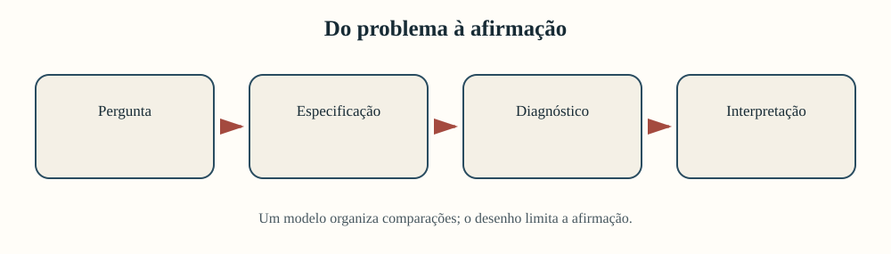

O modelo é uma compressão argumentativa. A crítica das fontes permanece antes,
durante e depois do cálculo.

---

<!-- _class: atividade -->

# U07-A01 · Graduar a afirmação

**Modalidade:** duplas · **Tempo:** 15 minutos  
**Produto:** três versões da mesma afirmação

Para “municípios com maior renda possuem mais equipamentos culturais”:

1. identifiquem resposta e explicativa;
2. proponham duas explicações alternativas;
3. reescrevam como descrição, associação condicionada e hipótese causal;
4. marquem qual nível os dados observacionais sustentam.

---

<!-- _class: divisor -->

# 1 · Uma resposta, uma explicativa

## Regressão linear simples

---

<!-- _class: exemplo -->

# Comece pelos casos

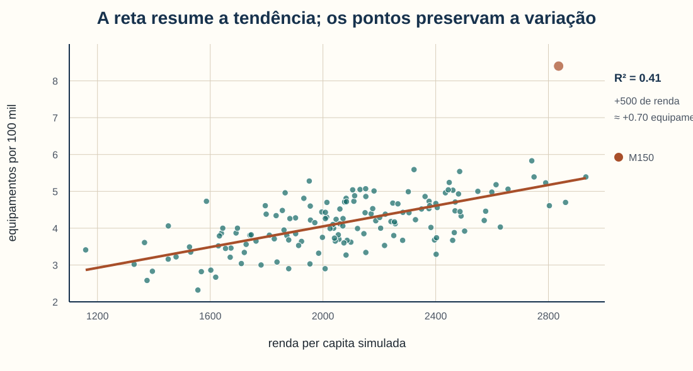

A tendência é positiva, mas os municípios não estão sobre a reta. M150 lembra que
o resumo e os casos precisam aparecer juntos.

---

# Da pergunta às variáveis

**Pergunta:** como a quantidade de equipamentos culturais por 100 mil habitantes
varia com a renda per capita nesta base fictícia?

- unidade de análise: município fictício;
- resposta $Y$: equipamentos por 100 mil habitantes;
- explicativa $X$: renda per capita simulada;
- alcance: 150 casos da base, sem inferência sobre municípios reais.

---

# A reta é uma hipótese de forma

$$
Y_i=\beta_0+\beta_1X_i+\varepsilon_i
$$

- $\beta_0$: valor previsto quando $X=0$;
- $\beta_1$: mudança média prevista em $Y$ por unidade de $X$;
- $\varepsilon_i$: diferença que a reta não descreve para o caso $i$.

Escolher uma reta supõe que uma inclinação constante é uma aproximação útil.

**Exemplo:** sem o resíduo, renda 2.000 produz
$\hat Y=1{,}238+0{,}001406(2000)\approx4{,}05$.

---

# O intercepto pode não ser substantivo

O modelo estimou intercepto de aproximadamente 1,24, isto é, a previsão para renda
igual a zero.

Mas a renda observada varia de 1.158 a 2.933 unidades. Logo:

- $X=0$ está muito fora da base;
- extrapolar até zero é arriscado;
- o intercepto é necessário à equação;
- sua interpretação histórica pode ser irrelevante.

---

# Reexpresse a inclinação

A inclinação por uma unidade monetária é aproximadamente 0,001406. Para uma escala
mais compreensível:

$$
500\times\hat\beta_1=500\times0{,}001406\approx0{,}703
$$

Na base, +500 unidades de renda estão associadas a +0,703 equipamento por 100 mil,
em média. A reexpressão muda a leitura, não o modelo.

---

# Resíduo devolve a reta ao caso

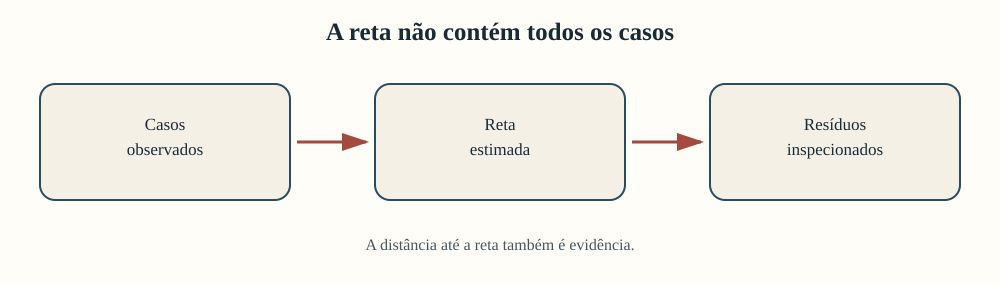

$$
e_i=y_i-\hat y_i
$$

Resíduo positivo: observado acima da previsão. Resíduo negativo: abaixo.

**Exemplo:** para M150, $e=8{,}40-4{,}357\approx4{,}043$.

---

# $R^2$ responde a uma pergunta limitada

$$
R^2=1-\frac{\sum_i(y_i-\hat y_i)^2}{\sum_i(y_i-\bar y)^2}
$$

Aqui, $R^2\approx0{,}412$: a reta resume cerca de 41,2% da variação observada na
resposta **nesta base**.

Isso não significa que renda “causa 41,2%” dos equipamentos.

**Leitura numérica:** a reta resume 41,2% da variação observada; 58,8% permanece
nos resíduos.

---

# Erro na unidade da resposta

| Medida | Pergunta | Resultado |
|---|---|---:|
| RMSE | qual erro típico, penalizando mais erros grandes? | 0,591 |
| MAE | qual distância absoluta média? | 0,443 |

Ambas estão em equipamentos por 100 mil habitantes. Nenhuma informa, sozinha, se
o modelo é historicamente pertinente ou se os dados são confiáveis.

---

<!-- _class: alerta -->

# Uma reta pode esconder estruturas

Antes de interpretar, procure:

- curvatura;
- grupos com inclinações diferentes;
- variância crescente;
- observações extremas;
- dependência temporal ou espacial;
- erros de mensuração.

O bom ajuste médio pode coexistir com falhas sistemáticas em partes do corpus.

---

<!-- _class: atividade -->

# U07-A02 · Ler uma regressão simples

**Modalidade:** individual e revisão em dupla · **Tempo:** 25 minutos  
**Produto:** conclusão de até 90 palavras

1. Declarem unidade, resposta e explicativa.
2. Interpretem a inclinação para +500 de renda e o $R^2$.
3. Inspecionem dois casos distantes da reta.
4. Incluam um limite causal.
5. Na troca, circulem palavras fortes demais: “causa”, “prova”, “determina”.

---

<!-- _class: divisor -->

# 2 · Condicionar uma associação

## Regressão múltipla e categorias

---

<!-- _class: exemplo -->

# A pergunta ficou mais específica

| Especificação | Renda: mudança para +500 | $R^2$ | RMSE |
|---|---:|---:|---:|
| simples | +0,703 | 0,412 | 0,591 |
| múltipla | +0,574 | 0,551 | 0,517 |

O modelo múltiplo descreve melhor esta base e atribui à renda uma associação menor.
Isso não torna a segunda especificação automaticamente correta ou causal.

---

# Várias explicativas na mesma expressão

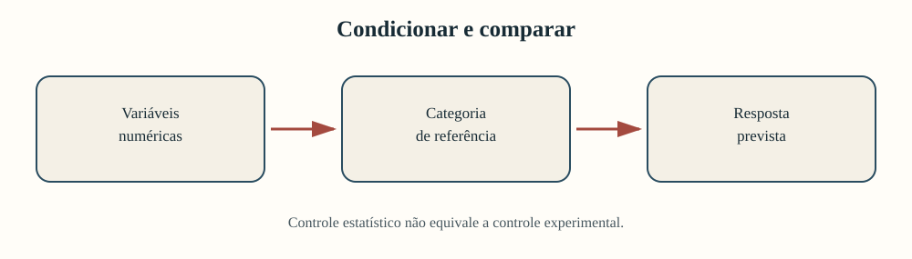

$$
Y_i=\beta_0+\beta_1R_i+\beta_2U_i+\beta_3E_i+\beta_4D_i+\varepsilon_i
$$

- $R$: renda;
- $U$: urbanização;
- $E$: escolaridade;
- $D$: distância da capital.

Cada coeficiente é interpretado mantendo matematicamente fixos os outros termos.

**Exemplo:** para renda, +500 unidades correspondem a
$500\times0{,}001148\approx+0{,}574$ equipamento, condicionadas aos demais termos.

---

# “Controlar” significa condicionar

Controle estatístico organiza comparações entre perfis definidos pelo modelo. Não
controla o processo histórico, a produção da fonte ou variáveis não observadas.

---

# “Iguais nos outros termos” é uma construção

Para interpretar renda, imaginamos dois municípios com os mesmos valores de:

- urbanização;
- escolaridade;
- distância da capital;

mas com rendas diferentes.

A comparação só é substantivamente plausível se a base contiver combinações
suficientemente semelhantes. A equação pode criar perfis raros ou inexistentes.

---

# Variável omitida pode alterar o coeficiente

Uma característica omitida é especialmente problemática quando:

1. está associada à explicativa de interesse;
2. também está associada à resposta;
3. não é consequência da própria explicativa no argumento causal proposto.

Adicionar muitas colunas sem teoria não resolve o problema e pode introduzir novos
vieses ou instabilidade.

---

# Categorias não são números ordenados

Codificar regiões como 1, 2, 3, 4 e 5 imporia distâncias e ordem inexistentes.
Usamos indicadores:

$$
I_{Sudeste,i}=\begin{cases}1,&\text{se o caso }i\text{ é Sudeste}\\0,&\text{caso contrário}\end{cases}
$$

Com cinco regiões e intercepto, entram quatro indicadores; uma região é referência.

**Exemplo:** para um caso do Sudeste, $I_{Sudeste}=1$; para um caso do Nordeste,
$I_{Sudeste}=0$.

---

# A referência não desapareceu

Neste modelo, Centro-Oeste é a referência. Mantidos os termos numéricos:

| Contraste com Centro-Oeste | Diferença prevista |
|---|---:|
| Nordeste | −0,234 |
| Norte | −0,172 |
| Sudeste | +0,346 |
| Sul | +0,469 |

Os casos do Centro-Oeste formam a base dos contrastes e continuam no ajuste.

---

# Trocar a referência muda a frase, não a previsão

Se Sul fosse a referência:

- o intercepto seria redefinido;
- cada coeficiente regional mostraria contraste com Sul;
- a previsão para qualquer município permaneceria a mesma;
- o conjunto dos contrastes conteria a mesma informação.

Escolha a referência por pertinência interpretativa, não para obter sinais desejados.

---

# Perfis tornam o modelo legível

Mantendo Centro-Oeste como referência:

| Perfil | Renda | Urbanização | Escolaridade | Distância | Previsão |
|---|---:|---:|---:|---:|---:|
| A | 1.500 | 60% | 9 anos | 250 km | 3,23 |
| B | 2.200 | 85% | 11 anos | 250 km | 4,45 |

A diferença prevista é 1,22 equipamento por 100 mil. Os perfis são cenários do
modelo, não trajetórias inevitáveis.

---

<!-- _class: alerta -->

# Coeficientes em escalas diferentes não competem

Um coeficiente por real, outro por quilômetro e outro por ano não podem ser
ordenados diretamente para decidir “o fator mais importante”.

Prefira:

- mudanças substantivamente comparáveis;
- previsões para perfis transparentes;
- intervalos de valores observados;
- conhecimento do processo histórico;
- incerteza estimada por ferramentas estatísticas adequadas.

---

<!-- _class: atividade -->

# U07-A03 · Controle e referência

**Modalidade:** grupos de 3 · **Tempo:** 30 minutos  
**Produto:** comparação de modelos e dois perfis previstos

1. Comparem o coeficiente da renda nos dois modelos.
2. Interpretem um termo numérico e um regional.
3. Expliquem por que a referência não desapareceu.
4. Criem dois perfis plausíveis e registrem cada valor.
5. Alternem execução, conferência de escalas e revisão da linguagem.

---

<!-- _class: divisor -->

# 3 · A inclinação depende do contexto?

## Interação, resíduos e sensibilidade

---

# Interação modifica a pergunta

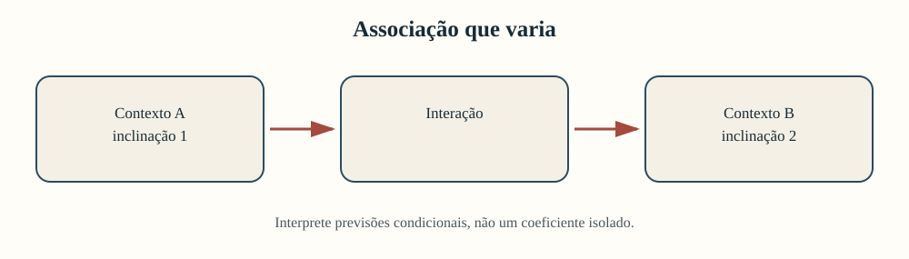

Em vez de perguntar apenas “urbanização está associada a equipamentos?”, perguntamos:

> a associação entre urbanização e equipamentos varia com a escolaridade?

---

# Centralizar torna o ponto de comparação legível

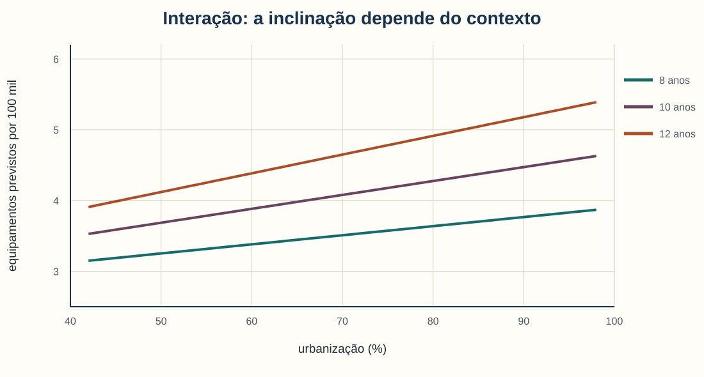

$$
U_c=U-\bar U \qquad E_c=E-\bar E
$$

Assim:

- $U_c=0$ representa urbanização média;
- $E_c=0$ representa escolaridade média;
- o intercepto descreve um perfil médio nas duas variáveis;
- o produto $U_cE_c$ representa a interação.

Centralizar muda a parametrização, não as previsões.

**Exemplo:** $U=80$ e $\bar U=74{,}16$ produzem $U_c=5{,}84$ pontos percentuais.

---

# O modelo de interação

$$
Y_i=\beta_0+\beta_1U_{ci}+\beta_2E_{ci}+\beta_3(U_{ci}E_{ci})+\varepsilon_i
$$

A inclinação de urbanização passa a ser:

$$
\frac{\partial\hat Y}{\partial U_c}=\beta_1+\beta_3E_c
$$

Não existe uma única inclinação de urbanização quando $\beta_3\neq0$.

**Exemplo:** em 12 anos de escolaridade, a inclinação estimada é
$0{,}0195+0{,}00340(12-9{,}96)\approx0{,}0264$.

---

# Leia previsões, não apenas o produto

O gráfico traduz a interação para três valores compreensíveis de escolaridade. As
linhas são cenários condicionais, não trajetórias causais.

---

# Diagnóstico pergunta onde o resumo falha

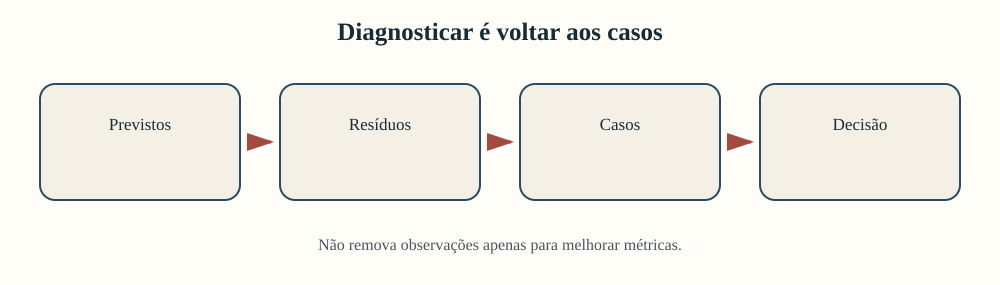

Diagnosticar não é procurar observações para apagar. É localizar casos que exigem
conferência documental, contextual e matemática.

---

# Resíduos revelam o caso M150

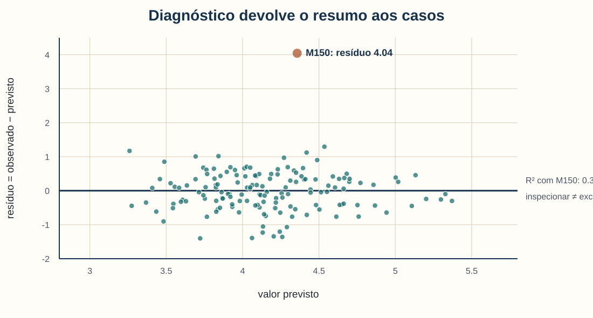

M150 tem 8,40 equipamentos observados e aproximadamente 4,36 previstos. A
proveniência declara que sua resposta foi alterada deliberadamente para o exercício.

---

# Alavancagem e resíduo não são a mesma coisa

- **resíduo grande:** resposta mal descrita pelo modelo;
- **alavancagem alta:** combinação incomum de explicativas;
- **influência:** quanto o ajuste muda por causa do caso.

M150 possui o maior resíduo, mas baixa alavancagem. M145 aparece com combinação
mais incomum de explicativas. Ambos merecem perguntas diferentes.

---

# Sensibilidade mantém as duas versões

| Especificação | $R^2$ | RMSE | Coef. da interação |
|---|---:|---:|---:|
| todos os casos | 0,314 | 0,639 | 0,00340 |
| sem M150 | 0,372 | 0,547 | 0,00427 |

O ajuste melhora e a interação muda. Como a exclusão é motivada pela proveniência,
relatamos ambas as versões e explicamos a decisão.

---

<!-- _class: alerta -->

# “Melhorar o ajuste” não justifica excluir

Um caso atípico pode ser:

- erro de entrada;
- unidade de outro universo;
- evento historicamente excepcional;
- evidência contra a especificação;
- observação válida e substantivamente importante.

A ação depende da fonte e do desenho, não apenas do efeito sobre $R^2$.

---

<!-- _class: atividade -->

# U07-A04 · Interação e diagnóstico

**Modalidade:** duplas · **Tempo:** 35 minutos  
**Produto:** figura comentada e parágrafo de cautela

1. Expliquem por que a inclinação depende da escolaridade.
2. Leiam as três linhas previstas.
3. Inspecionem o maior resíduo e a proveniência.
4. Comparem o modelo completo e a sensibilidade.
5. Preparem uma decisão que outra dupla consiga reconstruir.

---

<!-- _class: divisor -->

# 4 · Quando a resposta é sim ou não

## Introdução à regressão logística

---

<!-- _class: exemplo -->

# Uma reta não respeita probabilidades

Para `biblioteca_publica`, a resposta é 0 ou 1. Uma regressão linear poderia:

- prever valores menores que 0;
- prever valores maiores que 1;
- supor mudança constante na probabilidade;
- representar mal a variância de uma resposta binária.

A logística modela uma transformação da probabilidade entre 0 e 1.

---

# Probabilidade e chance

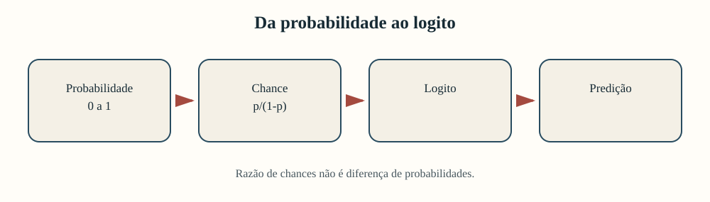

$$
\operatorname{chance}=\frac{p}{1-p}
$$

| Probabilidade $p$ | Chance | Leitura |
|---:|---:|---|
| 0,20 | 0,25 | 1 ocorrência para 4 não ocorrências |
| 0,50 | 1,00 | 1 para 1 |
| 0,75 | 3,00 | 3 para 1 |

Chance não é sinônimo de probabilidade.

---

# Do intervalo limitado à reta

O logaritmo da chance permite combinar explicativas numa escala linear sem produzir
probabilidades fora do intervalo válido.

---

# O modelo logístico

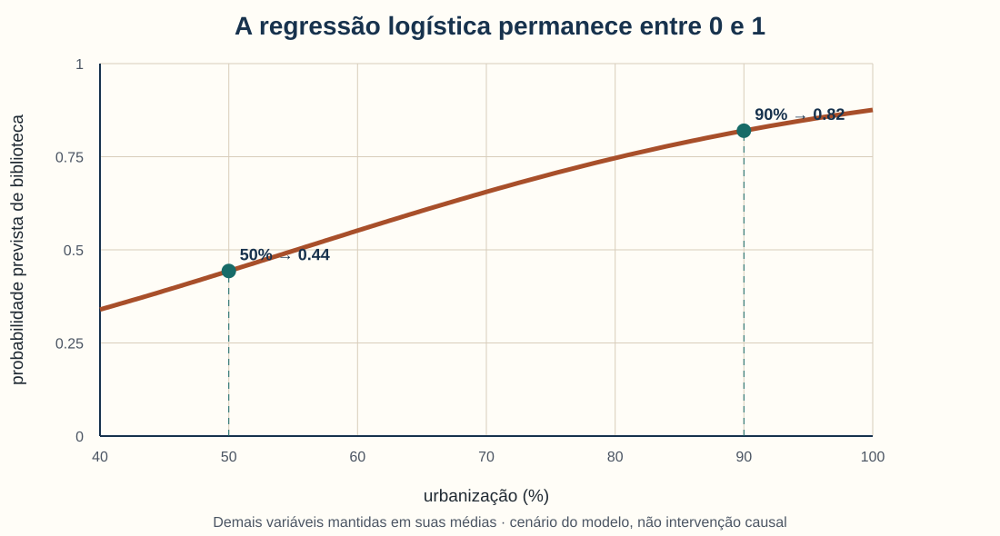

$$
\log\left(\frac{p_i}{1-p_i}\right)
=\beta_0+\beta_1X_{1i}+\cdots+\beta_kX_{ki}
$$

Voltando à probabilidade:

$$
p_i=\frac{1}{1+e^{-\eta_i}}
$$

em que $\eta_i$ é a combinação linear das explicativas.

**Exemplo:** se $\eta=0$, então $p=1/(1+e^0)=0{,}50$.

---

# Exponenciar produz razão de chances

Para uma mudança de uma unidade em $X_j$:

$$
OR=e^{\beta_j}
$$

- $OR>1$: chances maiores;
- $OR<1$: chances menores;
- $OR=1$: chances inalteradas;
- demais termos mantidos fixos.

Razão de chances 2 não significa “probabilidade duas vezes maior”.

**Exemplo:** para urbanização padronizada, $\beta=0{,}480$ e
$OR=e^{0{,}480}\approx1{,}62$.

---

# Por que padronizar?

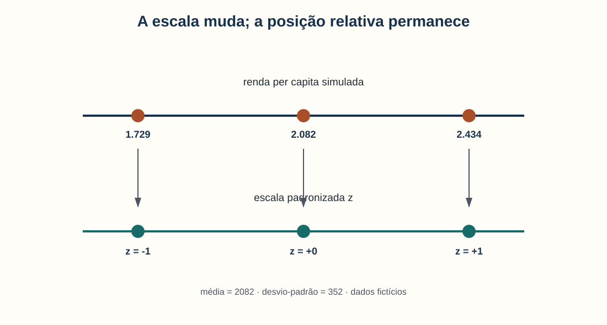

Renda, porcentagem, anos e quilômetros têm escalas muito diferentes. Nesta
demonstração, cada variável numérica foi transformada em:

$$
z=\frac{x-\bar x}{s}
$$

Cada razão de chances descreve então um aumento de **um desvio-padrão**. A
padronização também estabiliza a otimização didática usada no notebook.

**Exemplo:** com média 2.082 e desvio 352, renda 2.434 produz
$z=(2434-2082)/352=1$.

---

# Saída do modelo fictício

| Aumento de 1 desvio-padrão em… | Razão de chances |
|---|---:|
| renda | 2,182 |
| urbanização | 1,616 |
| escolaridade | 1,231 |
| distância da capital | 0,959 |

São associações condicionadas nesta especificação. O notebook didático não calcula
intervalos; pesquisa aplicada deve estimar e comunicar a incerteza.

---

# Volte das chances à probabilidade

A diferença prevista entre 50% e 90% de urbanização é cerca de 0,38, mantendo as
demais variáveis nas médias. Isso descreve cenários do modelo, não uma intervenção.

---

# A mesma razão não implica a mesma diferença

Multiplicar chances por um mesmo fator produz mudanças de probabilidade diferentes
conforme o ponto inicial:

- perto de 0,5, a curva pode mudar rapidamente;
- perto de 0 ou 1, a mesma mudança no logito move menos a probabilidade;
- por isso, previsões para perfis são frequentemente mais legíveis que $OR$ isoladas.

Sempre declare quais valores foram mantidos fixos.

---

# Ajuste interno não é desempenho futuro

Comparar probabilidades médias e proporções observadas por faixas é um diagnóstico
descritivo da própria base.

Isso não demonstra que o modelo:

- generaliza para outros municípios;
- prediz bem novos casos;
- está calibrado fora da amostra;
- é justo entre grupos.

Treino, teste e métricas preditivas pertencem à Unidade 8.

---

<!-- _class: atividade -->

# U07-A05 · Interpretar ocorrência

**Modalidade:** individual e revisão em dupla · **Tempo:** 30 minutos  
**Produto:** tradução de chances para probabilidades

1. Convertam 0,20 e 0,75 em chances.
2. Interpretem uma razão de chances, mencionando a padronização.
3. Comparem previsões em 50% e 90% de urbanização.
4. Substituam uma frase causal por uma formulação associativa.

---

<!-- _class: divisor -->

# 5 · Oficina

## Modelo associativo ou não adoção fundamentada

---

# O argumento precisa de todos os elos

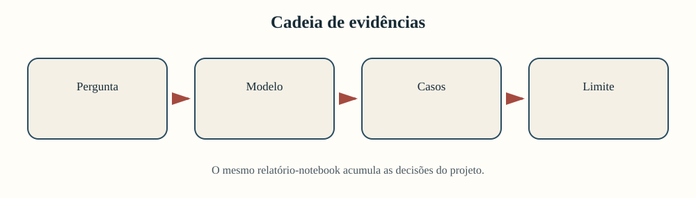

Uma tabela de coeficientes sem pergunta, diagnóstico e retorno aos casos não é um
resultado substantivo completo.

---

# Antes de modelar, verifique a pertinência

A regressão requer:

- resposta claramente definida;
- variação suficiente na resposta e explicativas;
- unidades comparáveis;
- número razoável de casos para a especificação;
- escalas e ausências documentadas;
- pergunta que realmente exija condicionamento.

Não fabrique observações apenas para usar a técnica.

---

<!-- _class: atividade -->

# U07-A06 · Incremento do relatório-notebook

**Modalidade:** equipes do projeto · **Tempo:** 70 minutos  
**Produto:** nova seção no mesmo relatório-notebook cumulativo

Incluam:

1. pertinência do modelo ou da não adoção;
2. unidade, resposta, explicativas, escalas e ausências;
3. fórmula conceitual antes do código;
4. resultado visual, diagnóstico, casos e interpretação;
5. limites e linguagem causal compatível com o desenho.

---

# Três caminhos legítimos

<strong>Linear</strong>  Resposta numérica e associação aproximadamente representável pela especificação.

<strong>Logístico</strong>  Resposta binária, probabilidades e perfis substantivamente interpretáveis.

<strong>Não adoção</strong>  Modelo inadequado, com justificativa e análise descritiva alternativa.

---

# Especifique antes do código

| Decisão | Registro necessário |
|---|---|
| resposta | conceito, operacionalização e unidade |
| explicativas | razão teórica e escala |
| categorias | referência e contraste |
| transformação | operação e efeito interpretativo |
| interação | qual associação pode variar |
| exclusão | regra anterior ao resultado ou sensibilidade |

Isso reduz escolhas oportunistas e torna o raciocínio auditável.

---

# Mostre resultado e interpretação juntos

Uma seção completa combina:

- código reproduzível junto da operação;
- tabela curta ou figura com legenda autônoma;
- resultado em escala compreensível;
- pelo menos um diagnóstico;
- inspeção de casos concretos;
- afirmação delimitada;
- explicação alternativa.

Um `DataFrame` não substitui a prosa argumentativa.

---

# Uma escada de linguagem

| Nível | Formulação |
|---|---|
| descrição | municípios com maior renda têm, em média, mais equipamentos nesta base |
| associação condicionada | renda permanece associada ao resultado ao considerar os termos incluídos |
| causalidade | aumentar renda produziria mais equipamentos |

O terceiro nível exige desenho e hipóteses causais que a regressão observacional,
sozinha, não oferece.

---

# Roteiro dos 70 minutos

| Tempo | Ação | Evidência no notebook |
|---:|---|---|
| 0–10 | recuperar pergunta e corpus | pertinência |
| 10–20 | definir resposta e explicativas | especificação |
| 20–40 | estimar ou justificar não adoção | código ou diagnóstico |
| 40–52 | produzir saída e voltar aos casos | figura/tabela comentada |
| 52–62 | interpretar e limitar | parágrafo substantivo |
| 62–70 | revisar em pares | mudança registrada |

---

<!-- _class: atividade -->

# U07-A07 · Afirmação, evidência e limite

**Modalidade:** revisão por pares · **Tempo:** 20 minutos  
**Produto:** um ponto claro, uma dúvida e uma mudança prioritária

Sem explicação oral, localizem no trabalho do colega:

- pergunta e unidade de análise;
- interpretação de um resultado;
- caso inspecionado;
- diagnóstico;
- limite causal.

O autor implementa a revisão ou justifica sua decisão.

---

# Retorno ao exemplo inicial

A associação da renda caiu de +0,703 para +0,574 equipamento por 100 mil a cada
+500 unidades quando outras características entraram.

Isso permite dizer:

> a associação estimada depende da especificação e permanece positiva no modelo
> múltiplo apresentado.

Não permite chamar 0,574 de “efeito verdadeiro” da renda.

---

# O que entra no projeto cumulativo?

Ao fim da unidade, o relatório-notebook registra:

- por que modelar é pertinente — ou não;
- como variáveis e categorias foram operacionalizadas;
- qual comparação cada coeficiente representa;
- previsões em escala substantiva;
- onde o modelo falha;
- qual sensibilidade foi testada;
- que linguagem a evidência autoriza.

---

# Síntese

1. Coeficientes pertencem a uma especificação.
2. Controle estatístico é condicionamento, não garantia causal.
3. Categorias exigem contrastes e referência.
4. Interações tornam inclinações dependentes do contexto.
5. Resíduos devolvem o modelo aos casos.
6. Razões de chances não são diferenças de probabilidade.
7. Diagnóstico e limites fazem parte do resultado.

---

<!-- _class: atividade -->

# Saída · Uma frase que você sustentaria

**Modalidade:** individual · **Tempo:** 5 minutos  
**Produto:** registro no diário de pesquisa

Complete:

> “Entre as unidades observadas, ______ está associado a ______, mantendo ______
> fixo no modelo; contudo, a conclusão é limitada por ______.”

Se seu projeto não admite esse tipo de frase, registre por que não adotará regressão.

---

<!-- _class: referencias -->

# Referências — 1/2

- Gelman, A.; Hill, J.; Vehtari, A. (2020). *Regression and Other Stories*. Cambridge University Press.
- Fox, J. (2016). *Applied Regression Analysis and Generalized Linear Models*. 3. ed. Sage.
- Hosmer, D. W.; Lemeshow, S.; Sturdivant, R. X. (2013). *Applied Logistic Regression*. 3. ed. Wiley.
- Hernán, M. A.; Robins, J. M. (2020). *Causal Inference: What If*. Chapman & Hall/CRC.
- Pearl, J. (2009). *Causality: Models, Reasoning, and Inference*. 2. ed. Cambridge University Press.

---

<!-- _class: referencias -->

# Referências — 2/2

- Underwood, T. (2019). *Distant Horizons: Digital Evidence and Literary Change*. University of Chicago Press.
- Drucker, J. (2011). Humanities approaches to graphical display. *Digital Humanities Quarterly*, 5(1).

**Dados da apresentação:** `municipios_culturais.csv`, base inteiramente fictícia,
gerada deterministicamente para ensino. O caso M150 recebeu alteração deliberada
na resposta contínua, conforme `proveniencia.json`.
