<!-- _class: capa -->
<!-- _paginate: false -->
<!-- _footer: "" -->

# Unidade 8

## Classificação supervisionada

**Problema orientador:** como atribuir categorias a novos documentos sem esconder
as decisões humanas, os erros e os limites da coleção?

---

<!-- _class: exemplo -->

# Antes da teoria: saúde é o assunto?

> “Jornal publica anúncio de remédio ao lado da programação cultural.”

Duas regras possíveis:

- contém vocabulário de saúde → **relevante**;
- saúde é o assunto central → **não relevante**.

<p class="pergunta">Qual rótulo deveria orientar o modelo?</p>

---

# A categoria depende do uso

Se a finalidade é **busca ampla**, talvez seja melhor incluir o documento para
leitura humana.

Se a finalidade é **publicação automática de um corpus temático**, a menção lateral
pode ser um falso positivo problemático.

> Antes de perguntar “qual modelo acerta mais?”, pergunte “qual decisão será tomada
> e quem arca com cada erro?”.

---

# Dois erros, consequências diferentes

| Resultado | Consequência possível |
|---|---|
| falso positivo | aumenta a leitura manual ou publica item inadequado |
| falso negativo | oculta uma fonte potencialmente relevante |

O custo não está dentro do algoritmo. Ele vem da finalidade da pesquisa, do acervo
e das pessoas afetadas pela decisão.

---

# A pergunta da unidade

Classificação supervisionada não descobre categorias naturais. Ela aprende a
reproduzir padrões presentes em exemplos anotados.

Precisamos tornar auditáveis:

- a definição da categoria;
- quem anotou e onde discordou;
- o que foi reservado para avaliação;
- quais erros o modelo comete;
- para quais grupos e contextos ele falha.

---

# Agenda

1. Transformar conceitos em guias de anotação
2. Medir concordância e revisar desacordos
3. Separar treino, teste e linha de base
4. Interpretar métricas e matrizes de confusão
5. Classificar textos com TF-IDF e discutir embeddings
6. Construir um protótipo — ou justificar a não adoção

---

# Ao final, você deverá conseguir…

- definir uma categoria com inclusões, exclusões e casos limítrofes;
- distinguir consistência entre anotadores de validade do construto;
- proteger o conjunto de teste contra vazamento;
- explicar acurácia, precisão, revocação e F1;
- analisar erros e diferenças entre grupos;
- inspecionar termos usados por um modelo textual;
- limitar a generalização do protótipo.

---

# O percurso da unidade

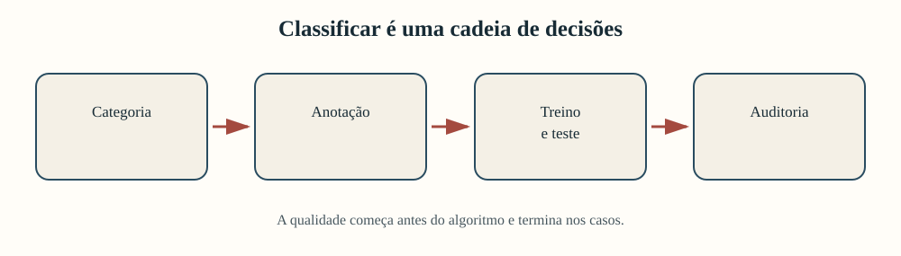

O retorno aos documentos não é uma etapa opcional depois da métrica: ele faz parte
da avaliação.

---

<!-- _class: atividade -->

# U08-A01 · Categoria ou descoberta?

**Modalidade:** duplas · **Tempo:** 15 minutos  
**Produto:** contrato classificatório inicial

Comparem “relevante para saúde pública” e “contém a palavra hospital”. Para cada
formulação, registrem:

1. unidade e regra;
2. caso limítrofe;
3. custo do falso positivo;
4. custo do falso negativo;
5. necessidade de interpretação humana.

---

<!-- _class: divisor -->

# 1 · Antes do modelo, a categoria

## Guia, anotação e concordância

---

# Classificar é aplicar uma regra

Uma tarefa supervisionada contém:

- **unidade:** o que recebe um rótulo;
- **categoria-alvo:** decisão que queremos reproduzir;
- **exemplos anotados:** casos em que a regra já foi aplicada;
- **representação:** características oferecidas ao modelo;
- **uso:** ação apoiada pela previsão.

Se o uso não está definido, “bom desempenho” não tem significado suficiente.

---

# Conceito e rótulo não são idênticos

“Relevância para saúde pública” é um conceito interpretativo. O rótulo
`relevante/não relevante` é uma operacionalização produzida por:

- definição;
- unidade de contexto;
- evidências observáveis;
- inclusões e exclusões;
- decisões sobre casos ambíguos.

O modelo aprende o rótulo operacionalizado, não a essência do conceito.

---

# Um guia mínimo de anotação

| Elemento | Pergunta |
|---|---|
| definição | o que conta como relevante? |
| inclusão | que evidência é suficiente? |
| exclusão | o que parece próximo, mas fica fora? |
| contexto | frase, parágrafo ou excerto inteiro? |
| caso limítrofe | que exemplo exige justificativa? |
| adjudicação | como resolver desacordo sem apagá-lo? |

---

<!-- _class: exemplo -->

# Guia aplicado ao exemplo

**Relevante:** saúde, doença, prevenção, cuidado ou instituição sanitária aparecem
como assunto do excerto.

**Não relevante:** saúde aparece apenas em anúncio ou menção lateral.

**Unidade de contexto:** excerto inteiro.

**Caso limítrofe:** concerto beneficente cuja renda compra medicamentos.

**Registro:** rótulo e justificativa de cada anotador são preservados.

---

# Dois anotadores tornam a regra testável

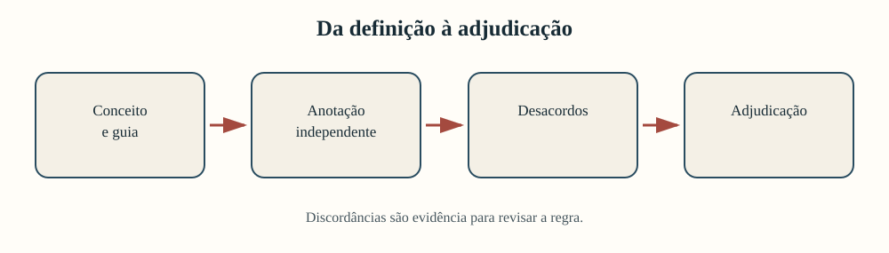

Independência significa que uma pessoa não vê o rótulo da outra antes de decidir.

---

# Acordo bruto conta coincidências

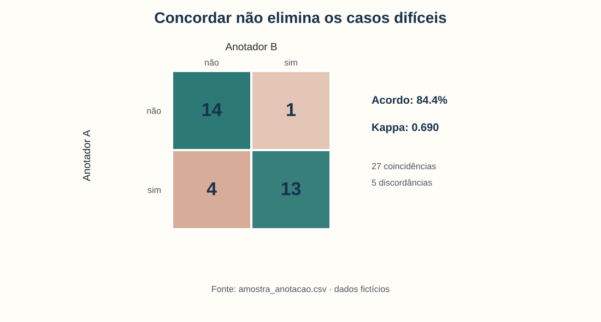

$$
p_o=\frac{\text{número de acordos}}{\text{total de casos}}
$$

**Exemplo:** $p_o=27/32=0{,}844$, ou 84,4%.

Leitura: em 27 dos 32 excertos, os dois rótulos coincidiram.

---

# Kappa desconta o acordo esperado


$$
\kappa=\frac{p_o-p_e}{1-p_e}
$$

**Exemplo:** $p_o=0{,}844$ e $p_e\approx0{,}496$ produzem
$\kappa\approx0{,}690$.

$p_e$ é calculado pelas proporções marginais de rótulos de cada pessoa.

---

# O número resume; os casos explicam


Cinco desacordos indicam onde definição, contexto ou atenção produziram decisões
diferentes. O próximo passo é reler esses excertos — não apenas celebrar 84,4%.

---

# Discordâncias revelam fronteiras

| Caso | Tensão interpretativa |
|---|---|
| D004 | concerto e exposição: há relação suficiente com saúde? |
| D006 | festa literária: uma pessoa incluiu sem evidência temática clara |
| D019 | vacinação: ambos excluíram, mas a adjudicação incluiu |
| D023 | higiene durante festa comunitária: central ou lateral? |
| D031 | prevenção: um anotador excluiu apesar do vocabulário substantivo |

A discordância pode revelar falha do guia ou erro de aplicação.

---

# Adjudicar não é apagar

Uma adjudicação responsável conserva:

- rótulo de A;
- rótulo de B;
- justificativas;
- decisão final;
- regra usada ou revisada;
- responsável e data da decisão.

O rótulo final serve ao treinamento; o desacordo serve à crítica do processo.

---

<!-- _class: alerta -->

# Concordância não prova validade

Duas pessoas podem aplicar de modo consistente uma categoria inadequada.

Perguntas distintas:

- **confiabilidade:** a regra produz decisões consistentes?
- **validade:** a regra representa o conceito necessário à pesquisa?
- **adequação:** a decisão serve ao uso pretendido?

Kappa responde apenas a uma parte da primeira pergunta.

---

<!-- _class: atividade -->

# U08-A02 · Revisar o guia pelos desacordos

**Modalidade:** grupos de 3 · **Tempo:** 30 minutos  
**Produto:** regra anterior, caso, adjudicação e regra revisada

Duas pessoas anotam independentemente os casos discordantes. A terceira:

1. registra justificativas;
2. conduz a adjudicação;
3. propõe uma alteração precisa no guia;
4. cria um novo caso capaz de testar a alteração.

---

<!-- _class: divisor -->

# 2 · Avaliar sem reutilizar o gabarito

## Treino, teste e linha de base

---

# Treino e teste têm papéis diferentes

- **treino:** ensina vocabulário, parâmetros e regras ao modelo;
- **teste:** estima desempenho em casos não usados nessas escolhas.

Se olharmos repetidamente os erros do teste e ajustarmos o sistema, o teste passa a
participar do treinamento. Sua estimativa fica otimista.

---

# Reserve o teste antes das escolhas

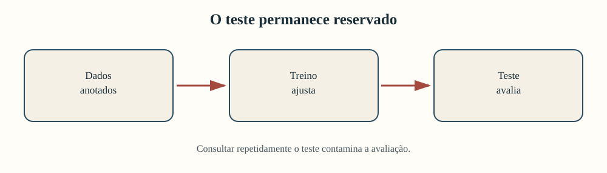

Documente semente, proporção, estratificação e quaisquer unidades relacionadas que
não podem ser separadas entre os conjuntos.

---

# A divisão usada na unidade

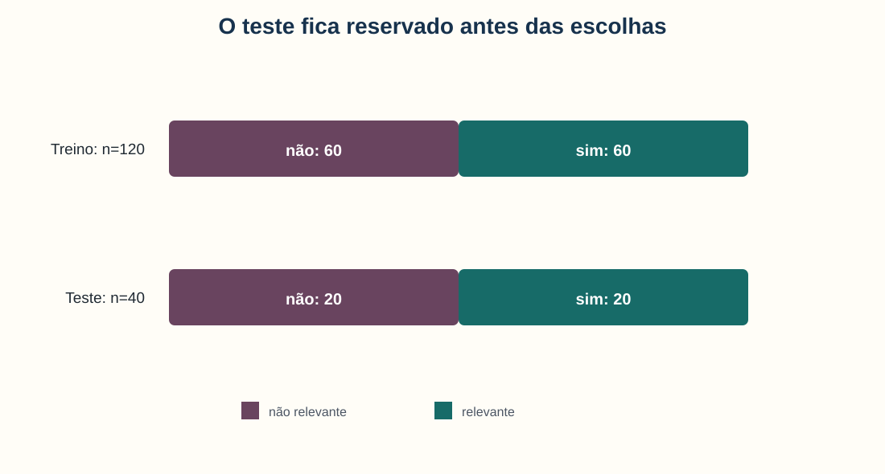

- treino: 60 relevantes e 60 não relevantes;
- teste: 20 relevantes e 20 não relevantes;
- semente: 42;
- estratificação pela categoria-alvo.

---

# Estratificar preserva proporções

Estratificação tenta manter em cada parte a proporção da classe-alvo.

Ela não garante equilíbrio de:

- período;
- origem;
- gênero documental;
- autor ou publicação;
- dificuldade dos casos.

Com poucos exemplos, uma única divisão continua instável.

---

<!-- _class: alerta -->

# Vazamento: o teste informa o modelo

Há vazamento quando informações do teste influenciam:

- o vocabulário;
- a normalização;
- a escolha de variáveis;
- os parâmetros;
- a seleção do melhor modelo;
- a reformulação da categoria.

Escolher a semente que produz a maior métrica também é vazamento decisório.

---

# Uma linha de base vem antes do modelo

Linha de base responde:

> o método supera uma regra simples e conhecida?

Nesta base equilibrada, a regra “prever sempre não relevante” produz:

| Acurácia | Precisão | Revocação | F1 |
|---:|---:|---:|---:|
| 0,50 | 0,00 | 0,00 | 0,00 |

Ela acerta metade dos casos e ignora todos os relevantes.

---

# Acurácia: quantos acertos no total?

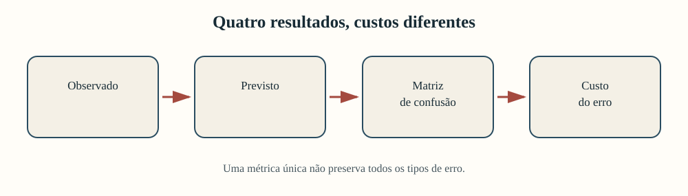

$$
\text{acurácia}=\frac{VP+VN}{VP+VN+FP+FN}
$$

**Exemplo da base:** $(0+20)/40=0{,}50$.

Uma acurácia de 50% parece neutra, mas aqui significa revocação zero.

VP/VN são acertos; FP/FN são erros.

---

# Acurácia pode esconder falha completa

Se 95% dos documentos forem não relevantes, prever sempre a maioria produz 95% de
acurácia e encontra **zero** documento relevante.

Por isso, sempre mostre:

- distribuição das classes;
- linha de base;
- matriz de confusão;
- métrica ligada ao custo do erro.

---

<!-- _class: atividade -->

# U08-A03 · Proteger o teste

**Modalidade:** individual e revisão em dupla · **Tempo:** 25 minutos  
**Produto:** protocolo de divisão preservado

1. Comparem divisão estratificada e não estratificada.
2. Registrem proporções, semente e unidades relacionadas.
3. Expliquem por que o teste não guia novas escolhas.
4. Não selecionem a divisão com a maior métrica.

---

<!-- _class: divisor -->

# 3 · Que modelo erra, onde e para quem?

## Métricas, matriz e análise de casos

---

# Dois modelos, regras diferentes

<div class="duas-colunas">

<div class="cartao"><strong>Regressão logística</strong><br><br>Combina evidências numa fronteira linear e produz probabilidades.</div>

<div class="cartao"><strong>Árvore de decisão</strong><br><br>Cria perguntas sucessivas sobre características e divide os casos.</div>

</div>

Nesta demonstração, ambos recebem apenas período e origem — não leem o texto.

---

# Metadados podem ser insuficientes

| Método | Acurácia | Precisão | Revocação | F1 |
|---|---:|---:|---:|---:|
| linha de base | 0,500 | 0,000 | 0,000 | 0,000 |
| logística | 0,475 | 0,400 | 0,100 | 0,160 |
| árvore | 0,475 | 0,476 | 0,500 | 0,488 |

A árvore encontra mais relevantes, mas produz muitos falsos positivos. Nenhum dos
dois modelos supera claramente a base em acurácia.

---

# A métrica escolhida muda a leitura

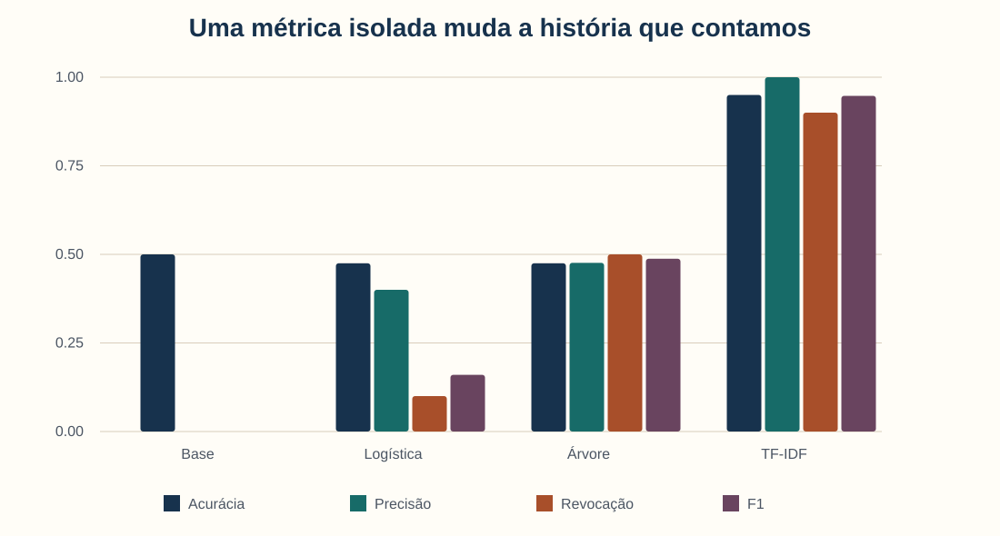

O modelo textual parece superior, mas precisa ser auditado por vocabulário, período
e casos ambíguos.

---

# A matriz conserva quatro resultados


- verdadeiro positivo: relevante encontrado;
- falso positivo: não relevante marcado como relevante;
- falso negativo: relevante perdido;
- verdadeiro negativo: não relevante corretamente excluído.

---

# A árvore no teste reservado

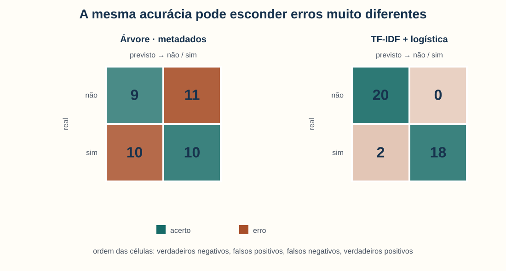

Para a árvore: $VN=9$, $FP=11$, $FN=10$ e $VP=10$. Usaremos os mesmos quatro
números para compreender cada métrica.

---

# Precisão: posso confiar nos positivos previstos?


$$
\text{precisão}=\frac{VP}{VP+FP}
$$

**Exemplo:** $10/(10+11)=0{,}476$.

Entre 21 documentos enviados para leitura como relevantes, 10 eram relevantes.

---

# Revocação: quantos relevantes foram encontrados?


$$
\text{revocação}=\frac{VP}{VP+FN}
$$

**Exemplo:** $10/(10+10)=0{,}50$.

O modelo encontrou 10 dos 20 documentos relevantes e perdeu os outros 10.

---

# F1 equilibra precisão e revocação


$$
F_1=2\frac{PR}{P+R}
$$

**Exemplo:** $2(0{,}476)(0{,}50)/(0{,}476+0{,}50)\approx0{,}488$.

$P$ representa precisão e $R$, revocação. F1 não incorpora automaticamente o
custo substantivo dos erros.

---

# A métrica segue a finalidade

| Uso | Erro mais preocupante | Ênfase possível |
|---|---|---|
| triagem ampla para leitura humana | falso negativo | revocação |
| publicação automática | falso positivo | precisão |
| comparação geral com classes equilibradas | ambos | F1 + matriz |
| decisão com custos muito assimétricos | custo específico | análise de decisão |

Não escolha a métrica depois de ver qual favorece seu modelo.

---

# Métrica não substitui leitura de erros

Para cada erro, pergunte:

- o rótulo está correto?
- a regra é ambígua?
- faltou contexto?
- o documento mistura assuntos?
- o modelo usou um atalho?
- há padrão por período, origem ou gênero?

Erros recorrentes podem exigir rever dados, guia ou uso — não só o algoritmo.

---

# Uma média pode esconder concentração

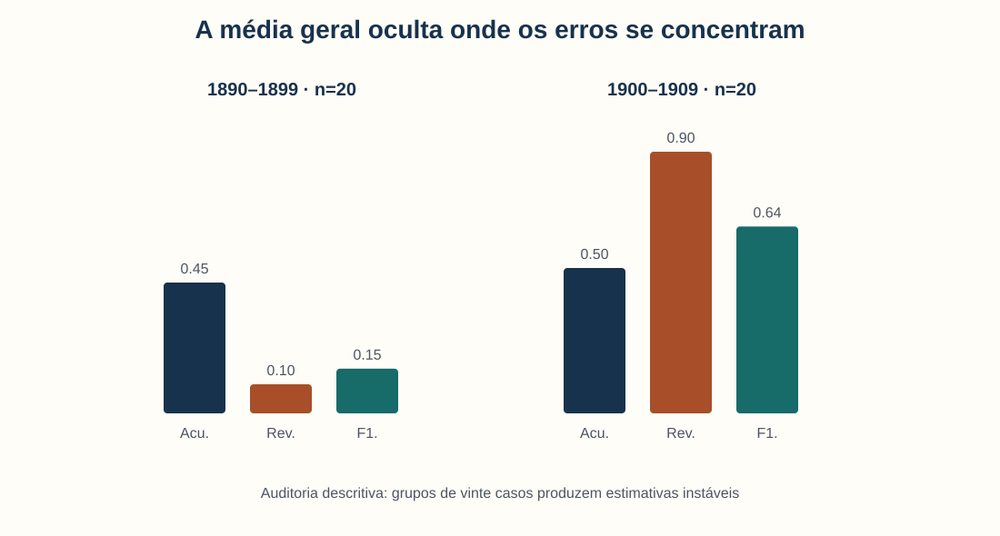

A revocação da árvore é 0,10 em 1890–1899 e 0,90 em 1900–1909. O desempenho geral
de 0,50 esconde essa assimetria.

---

<!-- _class: alerta -->

# Auditoria de grupo não é certificado de equidade

Cada período possui apenas 20 casos no teste. Uma alteração de dois documentos muda
a métrica em dez pontos percentuais.

Relate:

- tamanho de cada grupo;
- matriz ou contagens;
- incerteza e instabilidade;
- razão substantiva para o agrupamento;
- limites dos dados fictícios.

---

<!-- _class: atividade -->

# U08-A04 · Escolher pelo custo do erro

**Modalidade:** grupos de 3 · **Tempo:** 35 minutos  
**Produto:** escolha fundamentada e uma objeção

Assumam papéis de pesquisador, responsável pelo acervo e pessoa afetada. Comparem:

1. linha de base, logística e árvore;
2. quatro métricas e matriz;
3. cinco erros concretos;
4. desempenho entre períodos;
5. custo do erro para a pergunta humanística.

---

<!-- _class: divisor -->

# 4 · Quando o modelo recebe o texto

## TF-IDF, coeficientes e embeddings

---

# Representações diferentes tornam aspectos visíveis

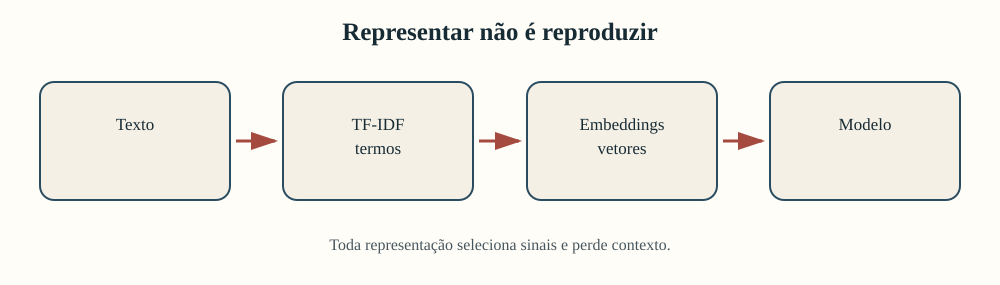

Nenhuma representação é o documento. Cada uma preserva alguns aspectos e comprime
outros.

---

# A cadeia textual precisa ficar dentro do treino

```text
texto de treino → vocabulário TF-IDF → vetores → regressão logística
texto de teste  → vocabulário já fixado → vetores → previsão
```

Se o vocabulário for ajustado antes da divisão, o teste informa quais termos existem.
O `Pipeline` do notebook evita esse vazamento.

---

# TF-IDF torna documentos comparáveis

Da Unidade 5, recuperamos a ideia:

- frequência indica presença no documento;
- raridade reduz o peso de termos comuns na coleção;
- cada documento vira um vetor esparso;
- o classificador combina pesos associados aos rótulos de treino.

Aqui usamos unigramas e bigramas presentes em pelo menos dois textos de treino.

---

# O modelo textual supera as bases — nesta divisão

| Método | Acurácia | Precisão | Revocação | F1 |
|---|---:|---:|---:|---:|
| linha de base | 0,500 | 0,000 | 0,000 | 0,000 |
| árvore de metadados | 0,475 | 0,476 | 0,500 | 0,488 |
| TF-IDF + logística | 0,950 | 1,000 | 0,900 | 0,947 |

O desempenho alto exige perguntar se o vocabulário continuará válido em outra
coleção ou período.

---

# A matriz mostra os dois erros restantes


Os falsos negativos são D001 e D133: anúncios de remédio ao lado de programação
cultural, rotulados como relevantes na base.

---

# Coeficientes revelam associações aprendidas

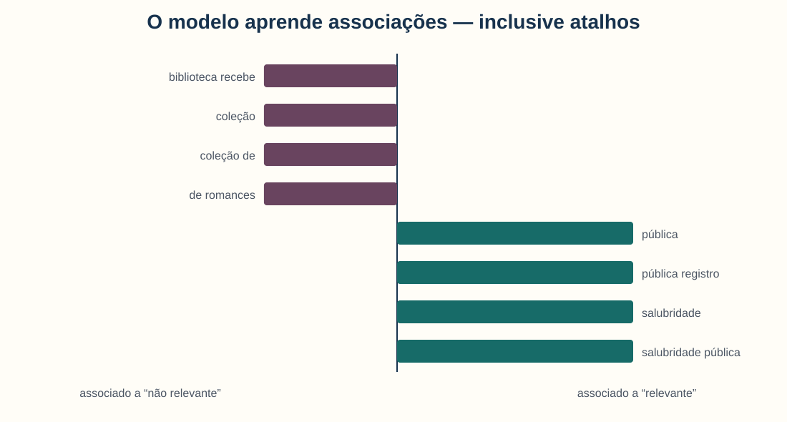

“Biblioteca recebe” se associa a não relevante; “serviço sanitário” e “salubridade
pública”, a relevante. Isso descreve o modelo, não importância histórica.

---

<!-- _class: alerta -->

# Um termo substantivo também pode ser atalho

`salubridade pública` e `serviço sanitário` foram inseridos deliberadamente por
período na base fictícia.

Um modelo pode obter alta métrica ao aprender:

- vocabulário temporal;
- nome de coleção;
- padrão de digitalização;
- marcador editorial;
- característica do processo de anotação.

Teste temporal ou externo pode revelar essa dependência.

---

# Os dois erros são conceitualmente úteis

D001 e D133 combinam:

- anúncio de remédio;
- programação cultural;
- marca vocabular de período;
- adjudicação como relevante.

Talvez o modelo tenha falhado. Talvez a categoria tenha uma fronteira instável.
Talvez contexto adicional seja necessário. A leitura qualitativa distingue hipóteses.

---

# Onde entram embeddings?

| TF-IDF | Embeddings |
|---|---|
| vetor esparso de termos | vetor denso aprendido |
| vocabulário mais inspecionável | proximidades semânticas mais indiretas |
| depende de coincidência lexical | pode aproximar paráfrases |
| treinável localmente nesta unidade | depende de modelo, domínio e versão |

Embeddings também carregam vieses da coleção de treinamento.

---

# Dependência externa também é decisão metodológica

Usar um serviço remoto pode implicar:

- enviar textos a terceiros;
- depender de rede e disponibilidade;
- usar versão que muda sem controle;
- limitar reprodutibilidade;
- introduzir custos e restrições de licença.

Por isso, a unidade apenas apresenta embeddings conceitualmente. A comparação
controlada ocorre na Unidade 12.

---

<!-- _class: atividade -->

# U08-A05 · Termos, atalhos e erros

**Modalidade:** duplas · **Tempo:** 30 minutos  
**Produto:** hipótese de atalho e novo teste

1. Identifiquem um termo substantivo e um possível atalho.
2. Leiam todos os erros textuais.
3. Escolham um caso ambíguo.
4. Proponham nova anotação ou teste temporal.
5. Troquem os papéis de leitura da tabela e retorno ao texto.

---

<!-- _class: divisor -->

# 5 · Oficina

## Protótipo de classificação e análise de erros

---

# A entrega conecta decisões

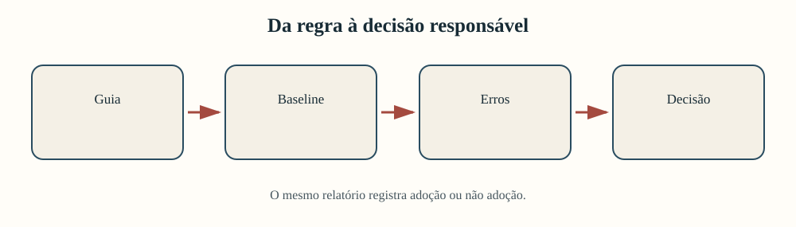

Um protótipo sem guia ou sem teste reservado é apenas uma demonstração técnica.

---

# Quando classificar é pertinente?

Verifique se o projeto possui:

- decisão repetível aplicada a novos casos;
- unidade e categoria defensáveis;
- exemplos suficientes para anotação e teste;
- custo dos erros compreensível;
- condições para leitura e adjudicação;
- uso que justifique automatização.

Caso contrário, a não adoção fundamentada é o resultado correto.

---

<!-- _class: atividade -->

# U08-A06 · Incremento do relatório-notebook

**Modalidade:** equipes do projeto · **Tempo:** 75 minutos  
**Produto:** nova seção no mesmo relatório-notebook cumulativo

Incluam:

1. finalidade, categoria e custo dos erros;
2. guia, exemplos e caso limítrofe;
3. divisão documentada e linha de base;
4. modelo, métricas e matriz;
5. erros, grupos, limites e decisão.

---

# Três caminhos legítimos

<div class="tres-colunas">

<div class="cartao"><strong>Metadados</strong><br><br>Classificação apoiada em características documentadas, sem conteúdo textual.</div>

<div class="cartao"><strong>Texto</strong><br><br>TF-IDF e modelo local, com inspeção de termos e atalhos.</div>

<div class="cartao"><strong>Não adoção</strong><br><br>Categoria ou dados insuficientes, com alternativa descritiva.</div>

</div>

---

# Roteiro dos 75 minutos

| Tempo | Ação | Evidência no notebook |
|---:|---|---|
| 0–12 | definir uso e custo | pergunta decisória |
| 12–25 | escrever e testar guia | exemplos e caso limítrofe |
| 25–38 | reservar teste e criar base | divisão documentada |
| 38–55 | comparar método à base | métricas e matriz |
| 55–65 | ler erros e grupos | tabela comentada |
| 65–75 | revisar decisão | limite e próximo teste |

---

# O produto deve ser reconstruível

| Elemento | Evidência |
|---|---|
| categoria | guia versionado e exemplos |
| dados | proveniência e divisão fixa |
| baseline | regra trivial declarada |
| modelo | representação e parâmetros |
| avaliação | métricas, matriz e casos |
| auditoria | grupos com respectivos tamanhos |
| decisão | uso, limite e próximo teste |

---

<!-- _class: atividade -->

# U08-A07 · Reconstruir a decisão

**Modalidade:** revisão por pares · **Tempo:** 20 minutos  
**Produto:** um ponto claro, uma dúvida e uma mudança prioritária

Sem explicação oral, o colega localiza:

- finalidade e regra;
- teste reservado e linha de base;
- custo do erro e métrica escolhida;
- três casos examinados;
- limite de generalização.

O autor implementa a mudança ou justifica sua decisão.

---

# Retorno ao exemplo inicial

O anúncio de remédio ao lado da programação cultural não possui rótulo natural.

Podemos agora perguntar:

- qual definição o incluiu?
- os anotadores concordaram?
- a adjudicação foi preservada?
- o modelo errou por vocabulário, contexto ou categoria?
- qual consequência esse erro teria no uso real?

---

# O que entra no projeto cumulativo?

Ao fim da unidade, o relatório-notebook registra:

- contrato classificatório;
- guia e evidências de consistência;
- divisão protegida e linha de base;
- representação e modelo;
- métricas ligadas ao custo;
- matriz, erros e grupos;
- decisão de usar, revisar ou abandonar o protótipo.

---

# Síntese

1. Categorias são operacionalizadas, não descobertas.
2. Concordância não garante validade.
3. O teste deve permanecer fora das escolhas.
4. Linha de base antecede modelos complexos.
5. Métricas respondem a custos diferentes.
6. Médias podem ocultar grupos prejudicados.
7. Alto desempenho pode depender de atalhos.
8. Erros precisam retornar aos documentos.

---

<!-- _class: atividade -->

# Saída · A decisão em quatro linhas

**Modalidade:** individual · **Tempo:** 5 minutos  
**Produto:** registro no diário de pesquisa

Complete:

1. “A categoria serve para…”
2. “O erro mais custoso é…”
3. “A evidência que ainda falta é…”
4. “Eu usaria / não usaria o protótipo porque…”

---

<!-- _class: referencias -->

# Referências — 1/2

- Artstein, R.; Poesio, M. (2008). Inter-coder agreement for computational linguistics. *Computational Linguistics*, 34(4).
- Jurafsky, D.; Martin, J. H. *Speech and Language Processing*. 3. ed., rascunho. Capítulos de classificação e avaliação.
- Pedregosa, F. et al. (2011). Scikit-learn: Machine Learning in Python. *Journal of Machine Learning Research*, 12.
- Salton, G.; Buckley, C. (1988). Term-weighting approaches in automatic text retrieval. *Information Processing & Management*, 24(5).

---

<!-- _class: referencias -->

# Referências — 2/2

- Bender, E. M. et al. (2021). On the dangers of stochastic parrots. *FAccT 2021*.
- Sculley, D. et al. (2015). Hidden technical debt in machine learning systems. *NeurIPS 2015*.
- Scikit-learn Developers. *User Guide*: model selection, metrics, `DummyClassifier`, TF-IDF, regressão logística e árvores.

**Dados:** inteiramente fictícios, gerados para ensino. Padrões vocabulares por
período foram inseridos deliberadamente para a auditoria; nenhuma métrica descreve
documentos ou sistemas históricos reais.
