<!-- _class: capa -->
<!-- _paginate: false -->
<!-- _footer: "" -->

# Unidade 9

## Agrupamentos e temas

**Problema orientador:** como explorar padrões sem transformar resultados
algorítmicos em grupos naturais ou temas autoevidentes?

---

<!-- _class: exemplo -->

# Base fictícia de instituições

- **Unidade de observação:** 120 instituições simuladas, 24 por região.
- **Variáveis:** acervo, eventos anuais, público e orçamento.
- **Estrutura didática:** três perfis deliberadamente separados, com variação interna.
- **Finalidade:** comparar escala, distância, K-means, hierarquia e estabilidade.

Os grupos foram construídos para ensino e não representam tipos naturais de
instituição cultural.

---

# Corpus textual fictício da unidade

- **Unidade de observação:** 180 documentos simulados em três períodos.
- **Conteúdo:** vocabulários associados a educação, saúde e cultura, com mistura.
- **Finalidade:** comparar agrupamento por TF-IDF e tópicos probabilísticos.
- **Ligação entre bases:** os documentos não são registros das 120 instituições.

Clusters, tópicos e evolução temporal são resultados didáticos; não descrevem
discursos ou mudanças históricas reais.

---

<!-- _class: exemplo -->

# Antes da teoria: os grupos mudaram

As mesmas 120 instituições fictícias foram agrupadas duas vezes:

- uma vez com os valores originais;
- outra após colocar as quatro variáveis em escalas comparáveis.

Depois de alinhar apenas os números arbitrários dos grupos, **18 instituições
mudaram de grupo**.

<p class="pergunta">Qual partição revela os grupos “verdadeiros”?</p>

---

# A escala altera quem parece próximo

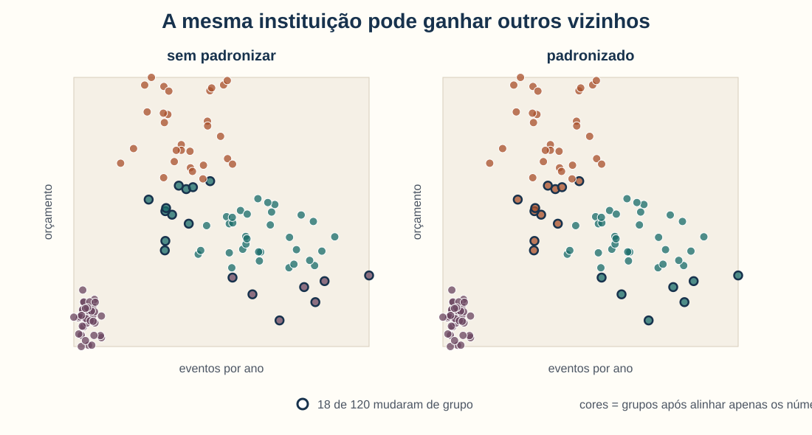

Nenhuma partição é neutra: cada uma responde a uma definição diferente de
semelhança.

---

# Entre casos e grupos há decisões

```text
casos → variáveis → escala → distância → algoritmo → número de grupos
      → caracterização → nomeação → interpretação histórica
```

O algoritmo organiza padrões segundo essa cadeia. Ele não elimina as escolhas
anteriores nem produz sozinho uma explicação.

---

# Agenda

1. Definir semelhança, escala e distância
2. Compreender K-means e escolher soluções plausíveis
3. Ler hierarquia, perfis e estabilidade
4. Agrupar documentos por vocabulário
5. Interpretar tópicos como misturas probabilísticas
6. Integrar uma exploração prudente ao projeto

---

# Ao final, você deverá conseguir…

- explicar por que escala e representação mudam vizinhanças;
- interpretar distância euclidiana e padronização;
- comparar inércia e silhueta sem procurar um número mágico;
- ler um dendrograma como sequência de fusões;
- caracterizar grupos por perfis e casos;
- distinguir cluster textual de tópico;
- tratar nomes e padrões como hipóteses revisáveis.

---

# O percurso da unidade

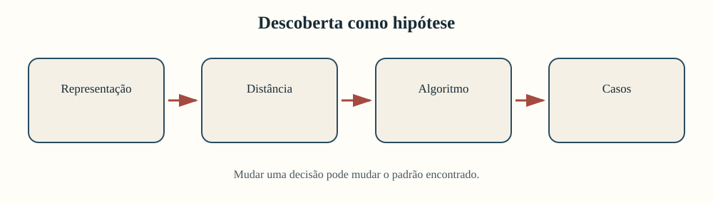

Descobrir, nesta unidade, significa organizar uma hipótese para retornar às fontes.

---

<!-- _class: atividade -->

# U09-A01 · Padrão, grupo ou hipótese?

**Modalidade:** duplas · **Tempo:** 15 minutos  
**Produto:** afirmação exploratória revisada

Comparem:

1. “o algoritmo formou três clusters”;
2. “existem três tipos naturais de instituição”.

Listem as decisões intermediárias e reescrevam a segunda frase como hipótese que
possa ser confrontada com casos e fontes.

---

<!-- _class: divisor -->

# 1 · O que significa estar perto?

## Escala, distância e K-means

---

# Distância é uma escolha teórica

Para duas instituições, “parecidas” pode significar proximidade em:

- tamanho do acervo;
- frequência de eventos;
- público anual;
- orçamento;
- combinação dessas dimensões.

Escolher variáveis e distância define quais diferenças serão visíveis.

---

<!-- _class: exemplo -->

# Os números têm escalas muito diferentes

| Variável | Mínimo | Máximo | Unidade |
|---|---:|---:|---|
| itens do acervo | 3.168 | 19.649 | itens |
| eventos anuais | 12,7 | 131,4 | eventos |
| público anual | 4.781 | 35.690 | pessoas |
| orçamento | 230.553 | 1.659.563 | unidades monetárias |

Sem ajuste, diferenças orçamentárias podem dominar a geometria.

---

# Padronizar muda a unidade de comparação

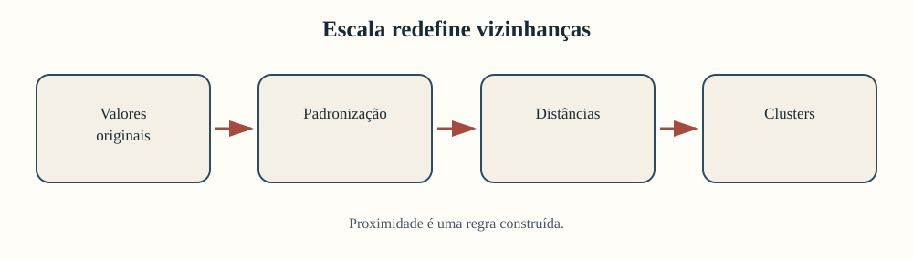

$$
z_i=\frac{x_i-\bar{x}}{s}
$$

**Exemplo simplificado:** orçamento 1.200.000, média 800.000 e desvio 400.000
produzem $z=(1.200.000-800.000)/400.000=1$.

Leitura: o caso está um desvio-padrão acima da média.

---

# Padronizar não torna a análise neutra

Depois da padronização:

- cada variável tem média 0 e desvio-padrão 1;
- uma diferença típica em eventos pesa como uma diferença típica em orçamento;
- extremos continuam influentes;
- variáveis redundantes ainda podem receber peso duplicado;
- o significado substantivo das dimensões não desaparece.

É uma nova pergunta, não uma correção universal.

---

# Distância euclidiana: uma linha reta


$$
d(\mathbf{x},\mathbf{y})=\sqrt{\sum_{j=1}^{p}(x_j-y_j)^2}
$$

**Exemplo:** para $A=(1,2)$ e $B=(4,6)$,
$d=\sqrt{(1-4)^2+(2-6)^2}=\sqrt{25}=5$.

Cada dimensão contribui pela diferença ao quadrado.

---

# Quadrados dão peso a diferenças grandes

Se uma dimensão difere 2 unidades, sua contribuição é $2^2=4$.

Se difere 10 unidades, contribui $10^2=100$.

Consequências:

- variáveis de grande escala dominam sem padronização;
- valores extremos podem deslocar distâncias;
- muitas variáveis pouco informativas podem diluir o padrão;
- distância geométrica não equivale automaticamente a proximidade histórica.

---

# Como o K-means organiza os casos

1. escolhe $k$ centros iniciais;
2. atribui cada caso ao centro mais próximo;
3. recalcula cada centro pela média dos casos;
4. repete atribuição e atualização;
5. para quando a solução deixa de mudar suficientemente.

O resultado favorece grupos compactos em torno de médias.

---

# O centro é um resumo matemático

Um centroide pode não corresponder a nenhuma instituição real.

Ele representa o perfil médio do grupo nas variáveis usadas. Por isso:

- não o trate como instituição “típica” sem verificar casos;
- examine distâncias ao centro;
- leia casos próximos e distantes;
- não atribua essência ao número do cluster.

Cluster 0 não vem “antes” do cluster 1.

---

# Mais grupos sempre reduzem a inércia

Inércia soma distâncias quadráticas dos casos aos respectivos centros.

- com mais centros, cada caso pode ficar mais perto de algum centro;
- quando $k$ chega ao número de casos, a inércia pode chegar a zero;
- portanto, o menor valor não escolhe sozinho o melhor $k$;
- procure mudança de ritmo e coerência substantiva.

---

# Silhueta compara coesão e separação

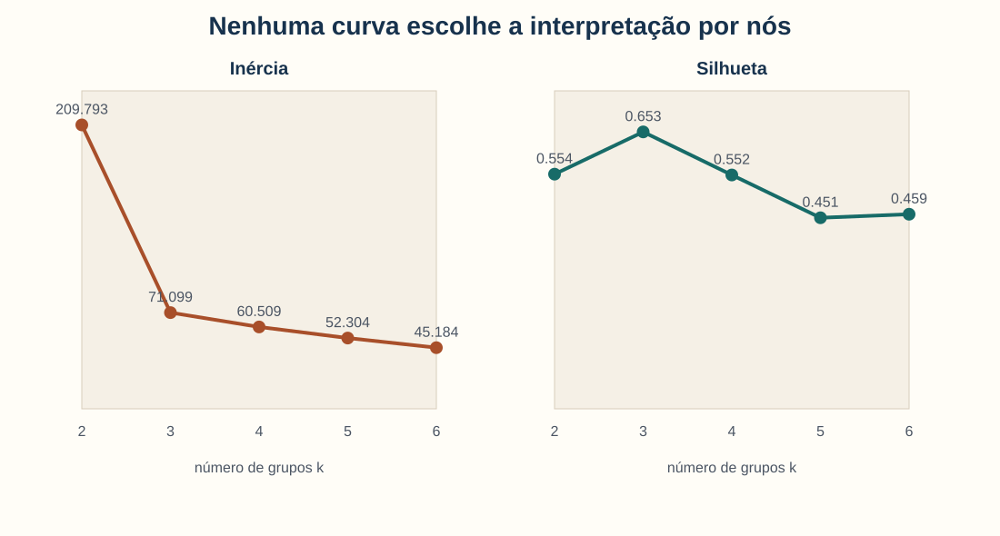

$$
s(i)=\frac{b(i)-a(i)}{\max\{a(i),b(i)\}}
$$

**Exemplo:** distância média interna $a=2$ e ao grupo vizinho $b=5$ produzem
$s=(5-2)/5=0{,}60$.

Valores próximos de 1 indicam caso coeso e separado nesta representação.

---

# As duas curvas contam histórias distintas


Entre $k=2$ e $k=6$, a maior silhueta ocorre em $k=3$. Isso justifica examinar três
grupos; não demonstra que existem três tipos naturais.

---

# Escolha soluções plausíveis, não um número mágico

Compare pelo menos duas possibilidades:

| Pergunta | Evidência |
|---|---|
| os casos ficam coesos? | silhueta e distâncias |
| os perfis diferem de modo legível? | médias, medianas e gráficos |
| a solução resiste a pequenas mudanças? | estabilidade |
| os nomes sobrevivem à leitura? | casos típicos e exceções |
| a divisão serve à pergunta? | argumento humanístico |

---

<!-- _class: atividade -->

# U09-A02 · Escala e número de grupos

**Modalidade:** individual e decisão em dupla · **Tempo:** 30 minutos  
**Produto:** duas soluções comparadas

1. Comparem rótulos com e sem padronização.
2. Examinem $k=2$ a $k=6$.
3. Escolham duas soluções plausíveis.
4. Expliquem o que cada métrica favorece.
5. Registrem a pergunta substantiva ainda sem resposta.

---

<!-- _class: divisor -->

# 2 · Uma partição é estável e interpretável?

## Hierarquia, perfis e sensibilidade

---

# A hierarquia começa com casos separados

O agrupamento aglomerativo:

1. inicia com um grupo por caso;
2. encontra os grupos mais próximos;
3. funde esse par;
4. recalcula as distâncias;
5. repete até formar uma única árvore.

O método de Ward busca limitar o aumento da variação interna a cada fusão.

---

# Dendrograma é uma história de fusões

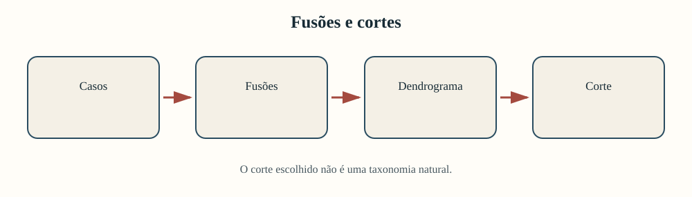

A altura representa distância de fusão. A ordem horizontal serve à visualização e
não é uma cronologia nem uma classificação histórica.

---

# Cortar a árvore é uma decisão

O dendrograma não chega com uma linha de corte obrigatória.

Um corte mais baixo produz mais grupos; um corte mais alto, menos grupos.

Pergunte:

- quais fusões parecem substantivamente heterogêneas?
- a solução é comparável ao K-means?
- casos próximos possuem fontes ou contextos compatíveis?
- o corte é estável a outras variáveis e distâncias?

---

# Caracterize antes de nomear

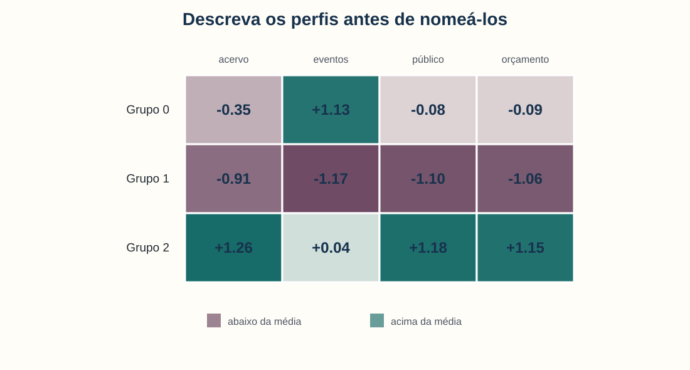

Comece com descrições: “acervo e orçamento acima da média” ou “eventos acima da
média”. Evite saltar diretamente para “modernas”, “precárias” ou “populares”.

---

# Perfis da base fictícia

| Grupo | Acervo médio | Eventos | Público | Orçamento médio |
|---:|---:|---:|---:|---:|
| 0 | 6.940 | 91 | 17.193 | 764.383 |
| 1 | 4.342 | 18 | 8.647 | 377.325 |
| 2 | 14.517 | 56 | 27.813 | 1.264.128 |

Os números descrevem dimensões simuladas. Nomes interpretativos exigiriam contexto
institucional e documentação externa.

---

# Casos próximos e distantes cumprem papéis distintos

- próximo do centro: exemplifica o perfil matemático médio;
- distante do centro: testa a capacidade do nome de acomodar exceções;
- entre grupos: revela fronteira sensível;
- extremo: pode deslocar o centro ou indicar outro processo;
- documentalmente semelhante, mas geometricamente distante: questiona a representação.

Não leia apenas os exemplares convenientes.

---

# Dois algoritmos coincidem nesta simulação

K-means com $k=3$ e hierarquia de Ward cortada em três grupos produzem a mesma
partição, medida por ARI igual a 1.

Isso ocorre porque a base foi construída com três perfis bem separados.

Em dados históricos reais, concordância entre algoritmos pode ser parcial — e a
discordância pode ser analiticamente informativa.

---

# Estabilidade pergunta “a solução resiste?”

Procedimento da unidade:

1. ajustar uma partição de referência;
2. retirar aleatoriamente 20% dos casos;
3. reagrupar os 80% restantes;
4. comparar rótulos dos casos comuns pelo ARI;
5. repetir vinte vezes.

ARI compara partições sem depender dos números atribuídos aos grupos.

---

# Estabilidade perfeita exige desconfiança produtiva

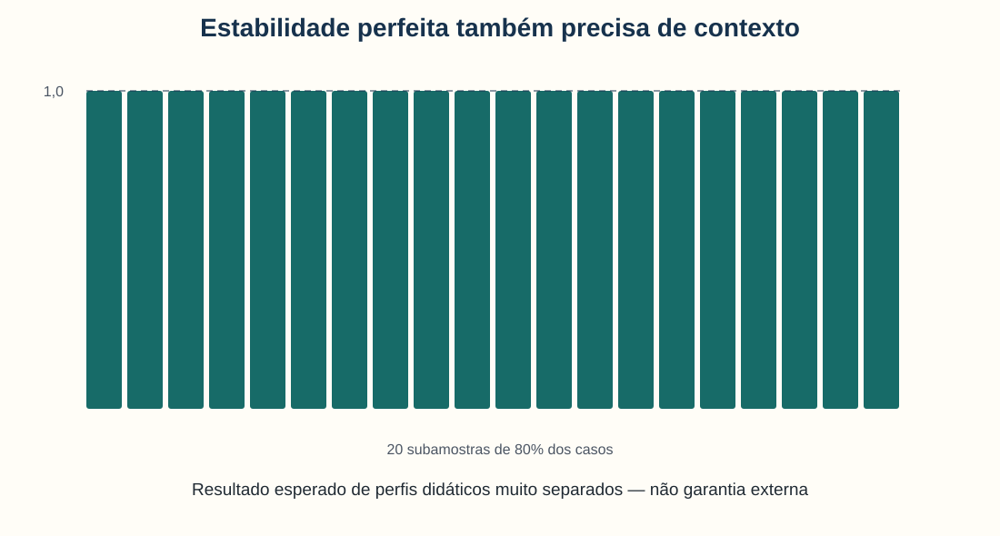

As vinte repetições tiveram ARI = 1. Isso confirma que os perfis simulados são muito
nítidos; não valida os nomes, as variáveis ou a generalização externa.

---

<!-- _class: alerta -->

# Estável não significa verdadeiro

Uma solução pode ser estável e ainda:

- usar variáveis inadequadas;
- reproduzir estrutura criada pela coleta;
- separar períodos ou acervos por artefatos;
- sustentar nomes normativos;
- não responder à pergunta humanística.

Estabilidade avalia dependência a perturbações específicas, não realidade ontológica.

---

<!-- _class: atividade -->

# U09-A03 · Perfil, casos e estabilidade

**Modalidade:** trios · **Tempo:** 35 minutos  
**Produto:** perfil neutro, casos e teste de estabilidade

1. Descrevam os três grupos sem adjetivos valorativos.
2. Leiam dois casos de cada grupo.
3. Comparem hierarquia e K-means.
4. Interpretem mínimo, mediana e máximo do ARI.
5. Proponham nomes somente ao final, marcados como hipóteses.

---

<!-- _class: divisor -->

# 3 · Como aproximar documentos?

## Agrupamento textual e retorno à leitura

---

# Em textos, a representação cria o espaço

Decisões que alteram vizinhanças:

- tokenização e caixa;
- stopwords;
- unigramas ou bigramas;
- frequência mínima;
- TF-IDF ou contagem;
- normalização;
- distância usada.

Os documentos não chegam naturalmente como pontos.

---

# Do texto ao grupo — e de volta ao texto

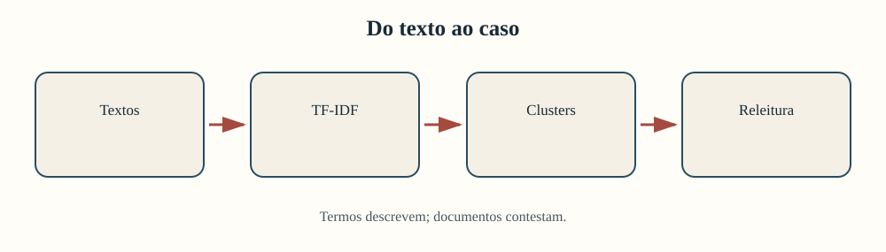

Uma projeção colorida pode ajudar, mas termos e documentos sustentam a interpretação.

---

# TF-IDF e cosseno retomam a Unidade 5

Nesta unidade:

- TF-IDF representa frequência e raridade lexical;
- vetores são normalizados;
- K-means organiza proximidade entre vetores;
- silhueta usa distância cosseno para avaliação;
- termos centrais e documentos permitem nomeação crítica.

Semelhança lexical não é equivalência de argumento ou contexto.

---

# Três padrões lexicais aparecem

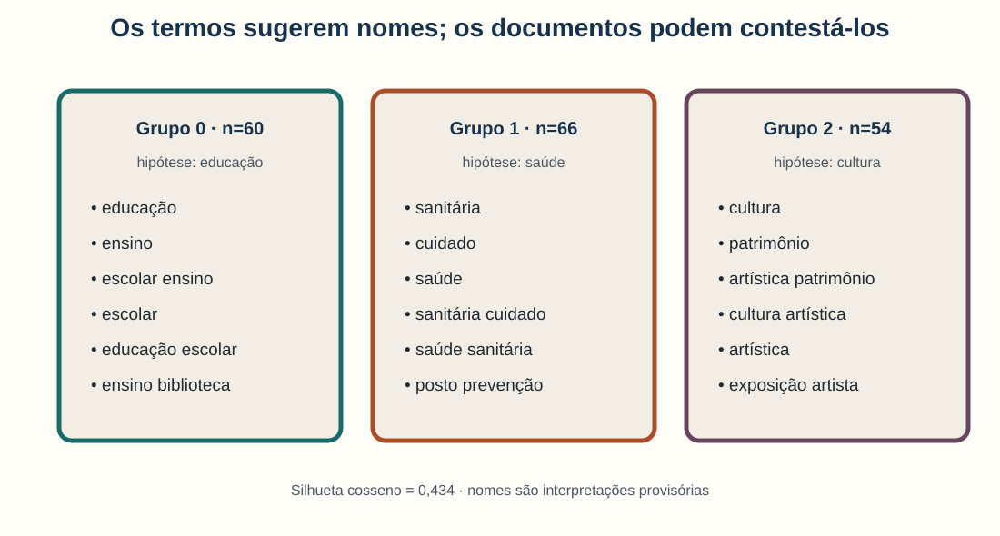

Os grupos têm 60, 66 e 54 documentos; a silhueta cosseno é 0,434. Os nomes são
hipóteses apoiadas em termos — ainda precisam sobreviver aos casos.

---

<!-- _class: exemplo -->

# Um documento próximo do centro

T005 está próximo do centro do grupo provisoriamente chamado “educação”:

> “educação escolar ensino biblioteca leitura curso matrícula educação…”

Ele exemplifica o vocabulário dominante, mas não é o documento historicamente mais
importante. “Representativo” significa apenas próximo do centro vetorial.

---

<!-- _class: exemplo -->

# Um documento distante testa o nome

T071 está mais distante do centro do mesmo grupo:

> “educação escolar ensino colégio livro infância aprendizagem formação teatro música…”

O vocabulário cultural torna o texto híbrido. O caso não precisa ser excluído: ele
mostra que a fronteira temática é graduada.

---

<!-- _class: alerta -->

# Projeção em duas dimensões pode enganar

Reduzir milhares de termos a dois eixos:

- perde informação;
- depende do método e dos parâmetros;
- pode ampliar ou comprimir separações;
- serve para explorar, não para provar grupos;
- não substitui métricas no espaço original nem leitura documental.

Posição no gráfico não é posição histórica.

---

# Período pode explicar o padrão lexical

Antes de afirmar que um cluster “cresceu”, examine:

- quantos documentos existem em cada período;
- se o vocabulário mudou;
- se gêneros e fontes têm composições diferentes;
- se OCR e transcrição variam;
- se documentos mistos foram distribuídos de outra forma.

Contagem de rótulos combina fenômeno, corpus e representação.

---

<!-- _class: atividade -->

# U09-A04 · Do vetor ao documento

**Modalidade:** duplas · **Tempo:** 30 minutos  
**Produto:** nome provisório, evidência e exceção

Para cada grupo:

1. proponham um nome apoiado em termos e dois documentos;
2. leiam dois documentos distantes do centro;
3. classifiquem-nos como híbridos, ruidosos ou mal representados;
4. comparem períodos sem afirmar crescimento automático;
5. tentem refutar o próprio nome.

---

<!-- _class: divisor -->

# 4 · Um documento pode misturar temas

## Modelagem de tópicos com LDA

---

# Cluster e tópico respondem diferente

| Cluster | Tópico |
|---|---|
| atribui grupo predominante | atribui mistura de componentes |
| centro resume documentos | distribuição resume palavras |
| fronteiras entre grupos | proporções dentro do documento |
| nomeia conjunto de casos | nomeia padrão vocabular latente |

Ambos dependem do número de componentes e do pré-processamento.

---

# A ideia central do LDA

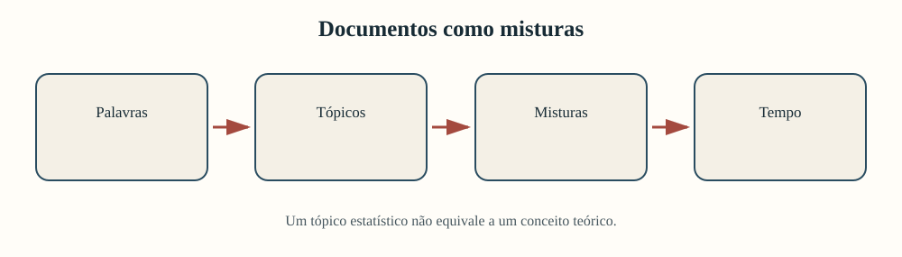

“Tópico” é um componente probabilístico. Transformá-lo em tema histórico exige
palavras, documentos, contexto e possibilidade de contestação.

---

# Cada documento possui uma mistura


$$
\sum_{k=1}^{K}\theta_{d,k}=1
$$

**Exemplo:** para um documento, saúde = 0,60, educação = 0,30 e cultura = 0,10;
$0{,}60+0{,}30+0{,}10=1$.

$\theta_{d,k}$ é a proporção do componente $k$ no documento $d$.

---

# As palavras sugerem, mas não nomeiam sozinhas

| Tópico | Palavras de maior peso |
|---:|---|
| 0 | sanitária, cuidado, saúde, médico, posto, remédio |
| 1 | ensino, professor, escola, patrimônio, música, teatro |
| 2 | educação, escolar, ensino, patrimônio, cultura, leitura |

Os tópicos 1 e 2 misturam vocabulários. Nomes excessivamente curtos apagariam essa
estrutura.

---

# Documentos de alta proporção podem surpreender

T099 recebe alta proporção no tópico 0, embora comece por cultura:

> “cultura artística patrimônio poesia espetáculo associação literária palco
> médico posto…”

As palavras “médico” e “posto” ajudam a explicar o resultado. O caso mostra por que
listas de palavras e documentos precisam ser lidos conjuntamente.

---

# Nomear é produzir uma hipótese interpretativa

Um bom registro preserva:

- palavras de maior peso;
- documentos de alta proporção;
- documentos mistos;
- nome provisório e alternativas;
- justificativa e discordâncias;
- parâmetros e versão da solução.

Outra pessoa deve conseguir discordar do nome sem perder o resultado estatístico.

---

# A média temporal descreve a composição

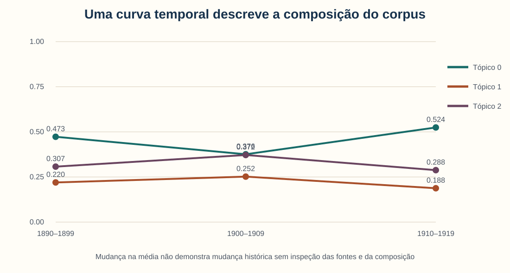

O tópico 0 vai de 0,473 para 0,376 e depois 0,524. A curva gera uma pergunta; não
explica sozinha mudança histórica.

---

# Duas explicações devem acompanhar a curva

**Hipótese substantiva:** instituições sanitárias ganharam centralidade no terceiro
período.

**Hipótese de corpus:** mudou a composição de documentos, fontes ou vocabulário.

Para distingui-las, precisamos retornar a documentos, metadados, critérios de
inclusão e estabilidade da solução.

---

# Como validar um tópico?

- palavras formam padrão interpretável?
- documentos de alta proporção sustentam o nome?
- documentos mistos revelam fronteiras coerentes?
- solução reaparece com outra semente ou número de tópicos?
- especialistas reconhecem utilidade sem reificar?
- o padrão ajuda a formular perguntas que retornam às fontes?

Coerência estatística não substitui validade interpretativa.

---

<!-- _class: atividade -->

# U09-A05 · Tópicos como hipóteses

**Modalidade:** grupos de 3 · **Tempo:** 35 minutos  
**Produto:** nomes concorrentes e explicações alternativas

1. Nomeiem cada tópico com palavras e três documentos.
2. Identifiquem ao menos um caso misto.
3. Escolham uma mudança temporal.
4. Formulem uma explicação substantiva e outra ligada ao corpus.
5. Preservem divergências entre os nomes propostos.

---

<!-- _class: divisor -->

# 5 · Oficina

## Perfis, agrupamentos, tópicos ou não adoção

---

# A entrega conecta escolhas e casos

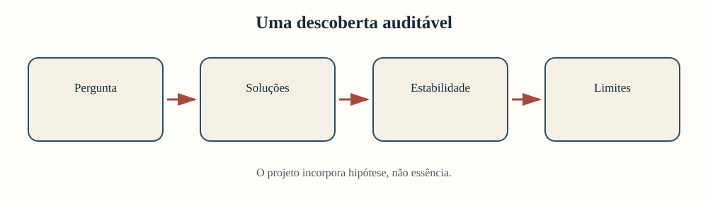

Mais algoritmos não produzem automaticamente mais evidência. Escolha um percurso
coerente e teste suas decisões.

---

# Escolha apenas um percurso principal

<div class="tres-colunas">

<div class="cartao"><strong>Perfis numéricos</strong><br><br>Variáveis, escala, distância, K-means ou hierarquia.</div>

<div class="cartao"><strong>Textos ou tópicos</strong><br><br>Representação lexical, clusters ou misturas de tópicos.</div>

<div class="cartao"><strong>Não adoção</strong><br><br>Padrão sem utilidade para a pergunta, com alternativa descritiva.</div>

</div>

---

# Antes de agrupar, verifique a pertinência

O projeto precisa de:

- pergunta exploratória aberta a padrões não previstos;
- unidades comparáveis;
- representação justificável;
- número de casos compatível;
- condições para leitura de perfis e exceções;
- benefício analítico que supere a complexidade adicionada.

Não crie grupos apenas porque o algoritmo está disponível.

---

<!-- _class: atividade -->

# U09-A06 · Incremento do relatório-notebook

**Modalidade:** equipes do projeto · **Tempo:** 75 minutos  
**Produto:** nova seção no mesmo relatório-notebook cumulativo

Incluam:

1. pergunta, unidade e pertinência;
2. representação, escala e distância;
3. duas especificações comparadas;
4. caracterização e estabilidade;
5. casos típicos, exceções, nomes provisórios e limites.

---

# Compare decisões que poderiam mudar o resultado

| Percurso | Comparação mínima |
|---|---|
| perfis numéricos | com/sem padronização ou dois valores de $k$ |
| hierarquia | dois cortes ou métodos de ligação |
| agrupamento textual | duas representações ou números de grupos |
| tópicos | dois números de tópicos ou sementes |
| não adoção | método proposto e alternativa mais coerente |

Registre o que permaneceu e o que mudou.

---

# Roteiro dos 75 minutos

| Tempo | Ação | Evidência |
|---:|---|---|
| 0–12 | justificar pergunta | pergunta e unidade |
| 12–25 | definir representação | quadro de decisões |
| 25–42 | comparar especificações | tabela ou gráfico |
| 42–55 | caracterizar e testar | perfis e estabilidade |
| 55–66 | retornar aos casos | amostra comentada |
| 66–75 | limitar e integrar | parágrafo no projeto |

---

# A linguagem precisa preservar a incerteza

| Evite | Prefira |
|---|---|
| “o algoritmo descobriu três tipos” | “a especificação produziu três grupos” |
| “o grupo 0 é moderno” | “o grupo 0 tem médias maiores nestas variáveis” |
| “o tópico saúde cresceu” | “a proporção média do componente aumentou” |
| “o padrão prova mudança” | “o padrão motiva inspeção documental” |

Nomear é argumentar, não apenas rotular.

---

<!-- _class: atividade -->

# U09-A07 · Desfazer a reificação

**Modalidade:** revisão por pares · **Tempo:** 20 minutos  
**Produto:** ponto claro, dúvida e mudança prioritária

O colega:

1. sublinha frases que naturalizam cluster ou tópico;
2. tenta reconstruir os nomes a partir dos casos;
3. propõe uma especificação alternativa;
4. identifica uma exceção omitida;
5. verifica se o limite modifica a conclusão.

---

# Retorno ao exemplo inicial

As 18 instituições que mudaram de grupo não demonstram que uma partição está
“errada”. Elas mostram que:

- escala participa da definição de semelhança;
- alguns casos estão em fronteiras sensíveis;
- nomes precisam declarar a especificação;
- conclusões robustas devem sobreviver a alternativas plausíveis;
- os casos são a evidência que permite interpretar a mudança.

---

# O que entra no projeto cumulativo?

Ao fim da unidade, o relatório-notebook registra:

- pergunta exploratória e unidade;
- representação e distância;
- especificações comparadas;
- diagnóstico de qualidade e estabilidade;
- perfis, termos ou palavras de tópicos;
- casos típicos, mistos e excepcionais;
- nomes provisórios e explicações alternativas;
- decisão de usar, revisar ou abandonar o percurso.

---

# Síntese

1. Semelhança depende da representação.
2. Padronizar muda o peso relativo das variáveis.
3. Inércia e silhueta não escolhem significado.
4. Dendrogramas exigem um corte interpretado.
5. Estabilidade não demonstra realidade natural.
6. Clusters textuais exigem retorno aos documentos.
7. Tópicos são misturas probabilísticas.
8. Nomes são hipóteses contestáveis.

---

<!-- _class: atividade -->

# Saída · Uma descoberta com condições

**Modalidade:** individual · **Tempo:** 5 minutos  
**Produto:** registro no diário de pesquisa

Complete:

> “Sob a representação ______, a distância ______ e a especificação ______,
> apareceu o padrão ______. Ele deve ser testado por ______ e não permite afirmar
> ______.”

---

<!-- _class: referencias -->

# Referências — 1/2

- Hastie, T.; Tibshirani, R.; Friedman, J. (2009). *The Elements of Statistical Learning*. 2. ed. Springer.
- Kaufman, L.; Rousseeuw, P. J. (1990). *Finding Groups in Data*. Wiley.
- Rousseeuw, P. J. (1987). Silhouettes: a graphical aid to interpretation and validation of cluster analysis. *Journal of Computational and Applied Mathematics*.
- Bishop, C. M. (2006). *Pattern Recognition and Machine Learning*. Springer.

---

<!-- _class: referencias -->

# Referências — 2/2

- Blei, D. M.; Ng, A. Y.; Jordan, M. I. (2003). Latent Dirichlet Allocation. *Journal of Machine Learning Research*, 3.
- Grimmer, J.; Stewart, B. M. (2013). Text as data. *Political Analysis*, 21(3).
- Baumer, E. P. S. et al. (2017). Comparing grounded theory and topic modeling. *ICML Workshop on Human Interpretability in Machine Learning*.
- Scikit-learn Developers. *User Guide*: clustering, K-means, silhueta, TF-IDF e LDA.

**Dados:** inteiramente fictícios, com três perfis e vocabulários inseridos para
ensino. Clusters e tópicos não representam instituições ou grupos sociais reais.
