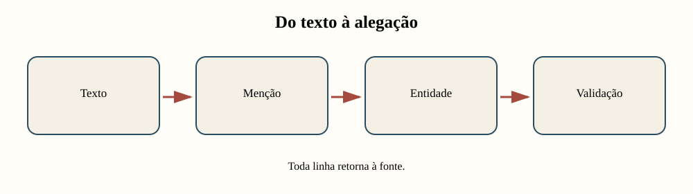
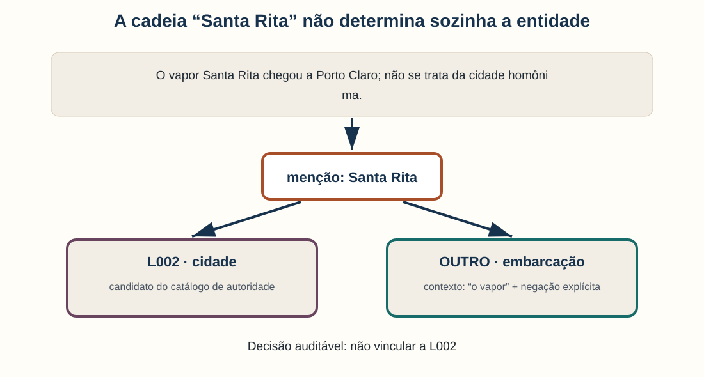
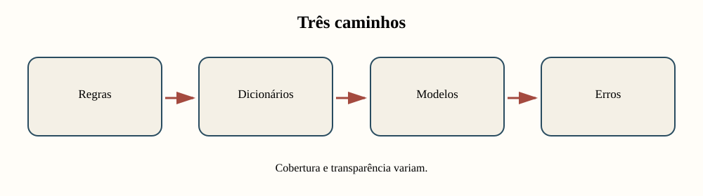
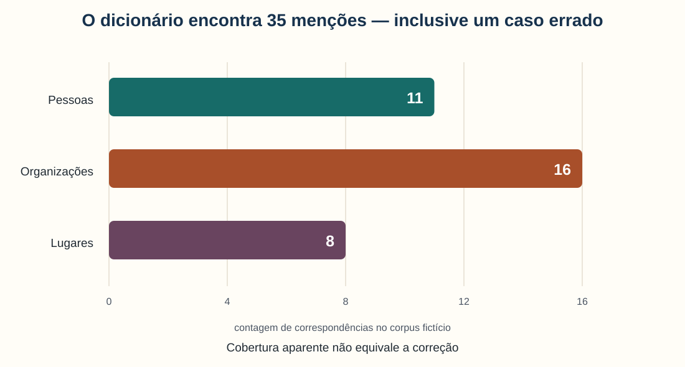
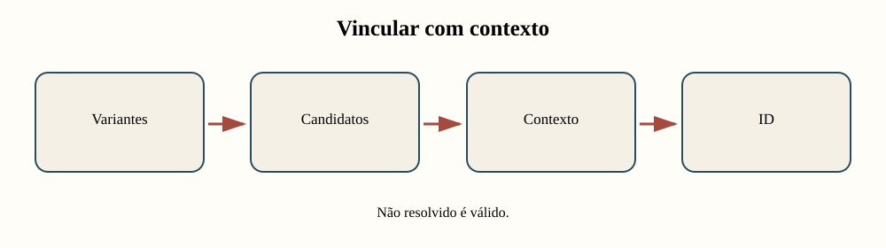
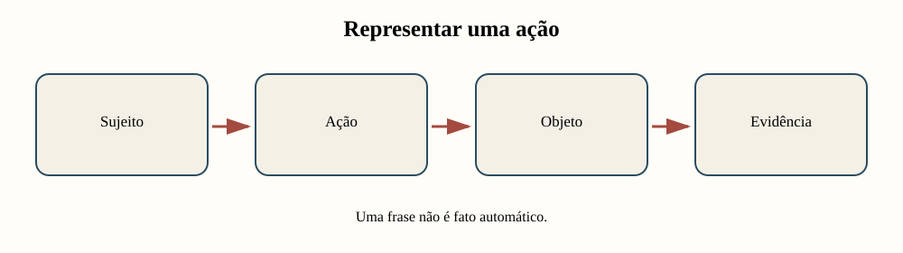
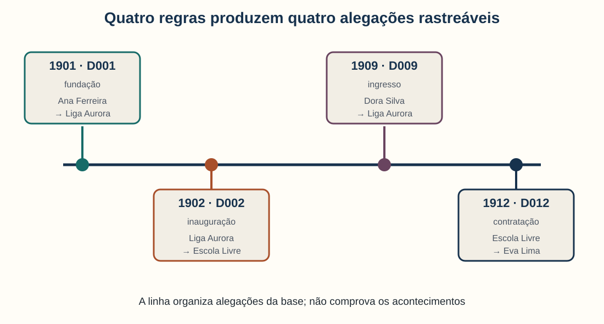
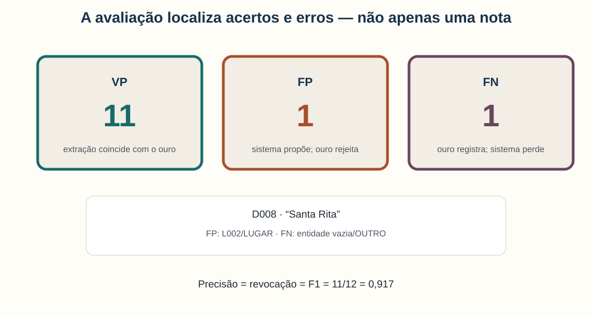
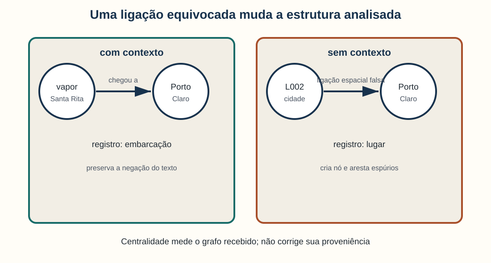
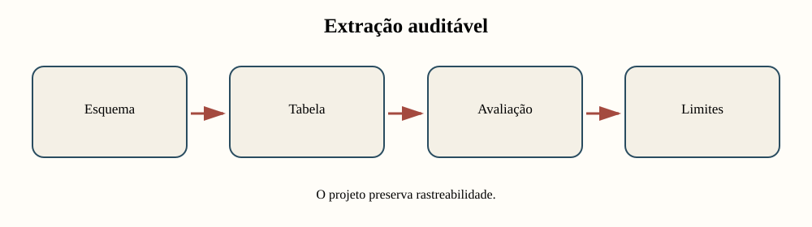

<!-- _class: capa -->
<!-- _paginate: false -->
<!-- _footer: "" -->

# Unidade 10

## Extração estruturada de textos

**Problema orientador:** como transformar passagens textuais em registros
analisáveis sem apagar ambiguidade, contexto e proveniência?

---

# Agenda

1. Localizar e tipificar menções
2. Normalizar, desambiguar e vincular entidades
3. Representar relações e eventos
4. Avaliar extrações e examinar erros
5. Observar a propagação de erros até um grafo
6. Integrar uma base derivada ao projeto

---

# Ao final, você deverá conseguir…

- distinguir menção, entidade, alegação e registro;
- comparar regras, dicionários e modelos de NER;
- justificar uma vinculação ou a decisão “não resolvido”;
- modelar relações e eventos com evidência textual;
- interpretar precisão, revocação e F1;
- rastrear erros de uma extração até o grafo derivado;
- decidir se o método é adequado ao próprio corpus.

---

# O percurso da unidade



Cada transformação deve conservar um caminho de volta ao documento.

---

<!-- _class: exemplo -->

# Corpus fictício de extração

- **Corpus:** 12 documentos simulados, de 1901 a 1912, em três jornais.
- **Catálogo de autoridade:** 12 pessoas, organizações e lugares com variantes.
- **Referência anotada:** 12 menções em quatro documentos para avaliação.
- **Finalidade:** praticar NER, vinculação, eventos e grafos derivados.

“Santa Rita” e todas as demais pessoas, instituições e ocorrências são didáticas.
Nenhuma linha sustenta afirmações históricas reais.

---

<!-- _class: exemplo -->

# Antes da teoria: quem é “Santa Rita”?

> “O vapor **Santa Rita** chegou a Porto Claro; não se trata da cidade
> homônima.” — D008, exemplo fictício

O catálogo contém uma cidade chamada Santa Rita, com identificador `L002`.

Uma busca por igualdade de texto propõe `Santa Rita → L002`.

<p class="pergunta">A correspondência entre nomes basta para identificar uma entidade?</p>

---

# A frase já contém a contestação



A decisão responsável é **não vincular a L002** e preservar a evidência que
permitiu rejeitar esse candidato.

---

# Três camadas não devem ser colapsadas

| Camada | Exemplo | O que representa |
|---|---|---|
| menção | `Santa Rita` | caracteres presentes em D008 |
| entidade proposta | embarcação não cadastrada | referente interpretado no contexto |
| registro | `D008`, posição, tipo `OUTRO` | representação criada pela pesquisa |

O texto não entrega uma tabela pronta. A tabela materializa decisões.

---

<!-- _class: atividade -->

# U10-A01 · Menção, entidade ou alegação?

**Modalidade:** duplas · **Tempo:** 15 minutos  
**Produto:** classificação acompanhada de evidência e incerteza

Classifiquem:

1. `Ana F.`;
2. `P001`;
3. “Ana fundou a Liga”.

Expliquem o que cada registro afirma e o que ainda precisa ser verificado.

---

<!-- _class: divisor -->

# 1 · O que o sistema localiza?

## Reconhecimento de entidades nomeadas

---

# NER marca sequências e atribui tipos

**Reconhecimento de entidades nomeadas (NER)** procura menções como:

- pessoas;
- organizações;
- lugares;
- datas;
- outros tipos definidos pelo projeto.

Ele localiza uma cadeia candidata; não resolve sozinho quem ou o que ela designa.

*(Jurafsky e Martin, 2026; Ehrmann et al., 2023)*

---

# Três famílias de método, três compromissos



Pergunta adequada não é “qual método é melhor?”, mas “qual combinação serve ao
corpus, ao tipo de entidade e ao custo do erro?”.

---

# Um dicionário reconhece o que conhece

| Forma encontrada | ID | Tipo | Nome canônico |
|---|---|---|---|
| Ana F. | P001 | pessoa | Ana Ferreira |
| Associação Aurora | O001 | organização | Liga Aurora |
| Porto Claro | L001 | lugar | Porto Claro |

**Vantagem:** regra transparente no domínio conhecido.  
**Limite:** variantes ausentes permanecem invisíveis.

---

# Posições tornam a extração verificável

```text
D001: Em 12 de março de 1901, Ana Ferreira fundou…
                              ^-----------^
                              início=24, fim=36
```

Guardar documento, início e fim permite:

- realçar a menção no texto;
- conferir a fronteira;
- comparar anotações;
- retornar à fonte após a análise.

---

# A saída é uma tabela de propostas

| documento | menção | início | fim | tipo | método |
|---|---|---:|---:|---|---|
| D001 | Ana Ferreira | 27 | 39 | PESSOA | dicionário |
| D001 | Liga Aurora | 49 | 60 | ORGANIZAÇÃO | dicionário |
| D001 | 12 de março de 1901 | 3 | 22 | DATA | regex |

As linhas são resultados de regras documentadas, não fatos automaticamente validados.

---

# Cobertura aparente pode esconder erro



Uma das oito correspondências de lugar é “Santa Rita” em D008: quantidade maior
não implica qualidade maior.

---

# Regex reconhece forma, não significado

```python
padrao_data = r"\b\d{1,2} de [a-zç]+ de \d{4}\b"
```

A regra encontra “12 de março de 1901” porque a cadeia segue um padrão.

Ela não sabe:

- se a data é do acontecimento ou da publicação;
- qual calendário está em uso;
- se houve erro de OCR;
- se a passagem nega ou cita a ocorrência.

---

# Fontes históricas desafiam o reconhecimento

- grafias e abreviações variam no tempo;
- OCR introduz caracteres e fronteiras incorretas;
- categorias atuais podem não corresponder às fontes;
- nomes mudam, coexistem ou permanecem incompletos;
- modelos treinados em outro domínio podem perder desempenho.

Por isso, uma amostra anotada no próprio corpus é indispensável.

*(Ehrmann et al., 2023)*

---

<!-- _class: atividade -->

# U10-A02 · Cobertura e falsos positivos

**Modalidade:** duplas com papéis adversariais · **Tempo:** 25 minutos  
**Produto:** uma revisão de regra e um caso que a desafia

1. Uma pessoa amplia a cobertura do dicionário ou da regex.
2. A outra procura um falso positivo criado pela mudança.
3. A dupla registra ganho, novo risco e evidência textual.

Use o notebook `01_reconhecimento_de_entidades.ipynb`.

---

# Localizar não é identificar

O reconhecimento responde:

> “onde há uma possível menção e de qual tipo?”

A etapa seguinte pergunta:

> “a qual referente essa forma corresponde neste contexto?”

Essa mudança exige separar semelhança gráfica de identidade.

---

<!-- _class: divisor -->

# 2 · De uma forma a um referente

## Normalização, desambiguação e vinculação

---

# Três operações cumprem papéis diferentes

| Operação | Pergunta | Exemplo |
|---|---|---|
| normalizar | como comparar grafias? | `Dra. Ana Ferreira` → forma comparável |
| vincular | qual ID representar? | `Ana F.` → `P001` |
| desambiguar | qual candidato cabe no contexto? | cidade ou embarcação? |

Normalização aproxima cadeias; não prova identidade.

---

# Um catálogo de autoridade preserva variantes

| ID | Nome canônico | Tipo | Variantes |
|---|---|---|---|
| P001 | Ana Ferreira | pessoa | Ana F.; Dra. Ana Ferreira |
| O001 | Liga Aurora | organização | Associação Aurora |
| L002 | Santa Rita | lugar | cidade de Santa Rita |

O identificador reúne formas, enquanto o catálogo registra por que elas foram
consideradas equivalentes.

---

# Vinculação é uma decisão contextual



O sistema precisa admitir três resultados: **vinculado**, **não vinculado** e
**não resolvido**.

---

# Compare duas ocorrências de “Santa Rita”

| Documento | Contexto | Decisão |
|---|---|---|
| D004 | “Hospital Central **de Santa Rita**” | candidato L002 plausível |
| D008 | “**vapor Santa Rita**… não se trata da cidade” | rejeitar L002 |

A mesma cadeia recebe decisões diferentes porque o contexto participa da evidência.

---

# Uma ficha torna a decisão auditável

| Campo | Exemplo para D008 |
|---|---|
| menção | Santa Rita |
| candidato | L002 — lugar |
| contexto | “vapor”; negação da cidade |
| decisão | não vincular a L002 |
| confiança | alta |
| justificativa | tipo incompatível e negação explícita |

Sem justificativa, confiança é apenas um número sem uso crítico.

---

# “Não resolvido” é um resultado informativo

Use-o quando:

- faltam elementos para escolher entre homônimos;
- o catálogo não contém o referente;
- a fonte está danificada;
- os anotadores discordam após revisar o contexto.

Forçar um ID melhora artificialmente a completude e pode fabricar conexões.

---

<!-- _class: atividade -->

# U10-A03 · Ficha de vinculação

**Modalidade:** decisão individual e adjudicação em trio · **Tempo:** 25 minutos  
**Produto:** quatro fichas com evidência, decisão e confiança

Incluam D008 e registrem explicitamente: `não vincular a L002`.

Na adjudicação, comparem a justificativa — não apenas o ID final.

Use o notebook `02_desambiguacao_e_vinculacao.ipynb`.

---

# Entidades vinculadas ainda não formam relações

Encontrar “Ana Ferreira” e “Liga Aurora” na mesma passagem demonstra
**coocorrência**.

Para representar “Ana fundou a Liga”, ainda precisamos identificar:

- ação ou vínculo;
- papéis dos participantes;
- tempo;
- polaridade e modalidade;
- trecho que sustenta a alegação.

---

<!-- _class: divisor -->

# 3 · Do trecho a uma alegação estruturada

## Relações, eventos e tabelas

---

# Relação e evento respondem a perguntas distintas

| Estrutura | Ênfase | Exemplo didático |
|---|---|---|
| relação | vínculo relativamente estável | organização localizada em lugar |
| evento | ocorrência situada | pessoa ingressou em organização em 1909 |

A fronteira depende do modelo de pesquisa. Ambos são alegações apoiadas por fontes.

---

# Uma frase distribui papéis



O esquema explicita o que o texto permite representar e quais detalhes ficam de fora.

---

# Esquema mínimo de evento

| Campo | Valor extraído de D001 |
|---|---|
| tipo | fundação |
| participante 1 | Ana Ferreira |
| participante 2 | Liga Aurora |
| tempo | 1901 |
| evidência | “Ana Ferreira fundou a Liga Aurora” |
| método | regra |

Documento e evidência não são metadados opcionais: sustentam a linha.

---

# O corpus produz uma cronologia de alegações



A visualização organiza o que as regras registraram; não comprova que os eventos
ocorreram como narrados.

---

# Negação, hipótese e citação mudam o registro

Compare:

- “Ana fundou a Liga.” — afirmação;
- “Ana **não** fundou a Liga.” — negação;
- “Ana **teria fundado** a Liga.” — modalidade;
- “Bento **afirmou que** Ana fundou a Liga.” — atribuição.

Uma regra que procura apenas `Ana + fundou + Liga` colapsa quatro situações.

---

# Proximidade não prova relação

> “Caio Martins falou com Dora Silva na Biblioteca Popular.”

A passagem sustenta um evento de fala, mas não permite concluir automaticamente:

- amizade;
- colaboração institucional;
- filiação de ambos à biblioteca;
- relação duradoura.

Modelar menos pode ser metodologicamente mais correto.

---

<!-- _class: atividade -->

# U10-A04 · Do trecho ao registro

**Modalidade:** trios — modelador, crítico e documentador · **Tempo:** 30 minutos  
**Produto:** tabela de eventos/relações e uma perda documentada

Modelem D003, D009 e D010. Para cada passagem, registrem papéis, tempo,
evidência e incerteza; depois comparem com a regra automática.

Use o notebook `03_relacoes_eventos_e_tabelas.ipynb`.

---

# Uma tabela legível ainda pode estar errada

Antes de produzir gráficos ou grafos, pergunte:

- quais menções foram perdidas?
- quais foram incluídas indevidamente?
- as fronteiras e os tipos coincidem?
- a identidade atribuída está correta?
- os erros se concentram em algum período ou fonte?

É hora de comparar o sistema a uma anotação de referência.

---

<!-- _class: divisor -->

# 4 · Como medir sem abandonar os casos?

## Avaliação e validação humana

---

# “Ouro” é referência, não verdade infalível

Uma amostra anotada permite comparar decisões sob um protocolo explícito.

Ela também pode conter:

- desacordo entre anotadores;
- categorias ambíguas;
- fronteiras inconsistentes;
- lacunas do próprio esquema.

Documente quem anotou, com quais instruções e como divergências foram adjudicadas.

---

# O critério de correspondência deve ser declarado

Uma previsão pode coincidir com a referência em diferentes níveis:

1. mesmo documento;
2. mesmos limites da menção;
3. mesmo tipo;
4. mesma identidade.

Nesta unidade, a avaliação exige os quatro. Um acerto parcial continua sendo um
caso importante para diagnóstico.

---

# A amostra contém três resultados



O falso positivo e o falso negativo vêm da mesma cadeia, mas de representações
incompatíveis para D008.

---

# Precisão pergunta: quanto do extraído está correto?


$$
\text{Precisão}=\frac{VP}{VP+FP}
$$

**Em linguagem comum:** entre as linhas propostas pelo sistema, qual parcela
coincide com a referência?

**Exemplo:** $11/(11+1)=0{,}917$, ou **91,7%**.

---

# Revocação pergunta: quanto do esperado foi encontrado?


$$
\text{Revocação}=\frac{VP}{VP+FN}
$$

**Em linguagem comum:** entre as menções da referência, qual parcela o sistema
recuperou corretamente?

**Exemplo:** $11/(11+1)=0{,}917$, ou **91,7%**.

---

# F1 equilibra precisão e revocação


$$
F_1=2\frac{\text{Precisão}\times\text{Revocação}}
{\text{Precisão}+\text{Revocação}}
$$

**Exemplo:** $2(0{,}917\times0{,}917)/(0{,}917+0{,}917)=0{,}917$.

Leitura: nesta amostra, as duas dimensões têm o mesmo desempenho.

---

# A nota não substitui a leitura do erro

| Caso | Sistema | Referência | Diagnóstico |
|---|---|---|---|
| D008 | Santa Rita → L002/LUGAR | Santa Rita → OUTRO, sem ID | homônimo mal vinculado |

O mesmo erro aparece como:

- falso positivo da representação `L002/LUGAR`;
- falso negativo da representação `OUTRO`.

Uma métrica agregada não mostra esse mecanismo.

---

# Avalie também por estratos

Uma média geral pode esconder diferenças por:

- tipo de entidade;
- fonte ou coleção;
- período histórico;
- qualidade do OCR;
- comprimento e gênero documental.

Se um grupo tem poucos casos, mostre também as contagens e os exemplos.

---

# Um erro percorre toda a cadeia



O grafo herda as decisões de reconhecimento, vinculação e extração de relações.

---

# Um grafo derivado precisa conservar proveniência

| Origem | Relação | Destino | Documento |
|---|---|---|---|
| Ana Ferreira | fundou | Liga Aurora | D001 |
| Liga Aurora | inaugurou | Escola Livre | D002 |
| Dora Silva | ingressou em | Liga Aurora | D009 |
| Escola Livre | contratou | Eva Lima | D012 |

Sem o documento e o trecho, a aresta fica difícil de contestar ou corrigir.

---

# Centralidade não corrige extração

Um nó pode parecer importante porque:

- seu nome é mais fácil de reconhecer;
- o catálogo tem mais variantes para ele;
- determinada fonte foi super-representada;
- homônimos foram indevidamente reunidos;
- relações incertas foram tratadas como confirmadas.

Antes da medida estrutural, audite a construção das arestas.

---

<!-- _class: atividade -->

# U10-A05 · Erro em cascata

**Modalidade:** duplas · **Tempo:** 30 minutos  
**Produto:** duas linhas de auditoria e comparação antes/depois

1. Expliquem um falso positivo e um falso negativo.
2. Mostrem como cada erro alteraria o grafo.
3. Proponham uma correção.
4. Reavaliem exatamente a mesma amostra.

Use o notebook `04_avaliacao_validacao_e_rede.ipynb`.

---

# Da avaliação ao projeto

A pergunta final não é apenas “a métrica é alta?”.

Pergunte também:

- os tipos extraídos respondem ao problema de pesquisa?
- os erros ameaçam a interpretação substantiva?
- há recursos para validar e corrigir?
- a tabela permanece ligada às fontes?
- uma solução manual seria mais adequada à escala do corpus?

---

<!-- _class: divisor -->

# 5 · Oficina

## Base estruturada derivada de textos

---

# Produto: uma seção no mesmo relatório-notebook



Não é um arquivo isolado: a seção deve continuar o problema, o corpus e as
decisões documentadas nas unidades anteriores.

---

# O incremento precisa mostrar processo e resultado

Inclua:

1. entidade, relação ou evento de interesse;
2. esquema e regras de representação;
3. amostra anotada e protocolo;
4. tabela extraída com ligação à fonte;
5. métricas, contagens e exemplos de erro;
6. interpretação e limites.

Código sem análise não constitui a entrega.

---

# Não adoção também pode ser o produto correto

Justifique não usar extração estruturada quando:

- o corpus é pequeno e a leitura manual é suficiente;
- as categorias destroem distinções relevantes;
- o OCR inviabiliza a localização confiável;
- a validação necessária excede os recursos;
- as entidades não respondem à pergunta do projeto.

Registre a alternativa metodológica escolhida.

---

# Roteiro dos 75 minutos

| Tempo | Ação | Evidência produzida |
|---:|---|---|
| 0–15 | definir entidade/relação/evento | esquema |
| 15–30 | criar amostra anotada | ouro local |
| 30–48 | extrair e vincular | tabela rastreável |
| 48–60 | calcular e ler erros | métricas + casos |
| 60–68 | revisar regras | antes/depois |
| 68–75 | integrar limites | conclusão |

---

<!-- _class: atividade -->

# U10-A06 · Incremento do relatório-notebook

**Modalidade:** projeto individual ou grupo do projeto · **Tempo:** 75 minutos  
**Produto:** seção cumulativa com esquema, extração e validação

Trabalhe no próprio corpus. Preserve texto original, identificadores, método,
incerteza e decisões de exclusão.

Se não adotar o método, apresente diagnóstico e alternativa.

---

<!-- _class: atividade -->

# U10-A07 · Rastrear até a fonte

**Modalidade:** revisão por pares · **Tempo:** 20 minutos  
**Produto:** parecer breve e decisão do autor

O colega deverá:

1. escolher três linhas da tabela;
2. retornar aos trechos originais;
3. questionar uma vinculação e um evento;
4. propor uma correção;
5. receber resposta fundamentada do autor.

---

# Checklist antes de concluir

- [ ] menção e entidade estão separadas;
- [ ] cada linha retorna ao documento e ao trecho;
- [ ] homônimos admitem “não resolvido”;
- [ ] negação, modalidade e citação foram consideradas;
- [ ] avaliação informa critério, contagens e amostra;
- [ ] erros foram lidos em contexto;
- [ ] gráficos ou grafos não excedem a evidência textual.

---

# A linguagem deve preservar o estatuto da evidência

| Evite | Prefira |
|---|---|
| “o texto prova que…” | “a passagem afirma que…” |
| “P001 é Ana F.” | “Ana F. foi vinculada a P001 porque…” |
| “o sistema descobriu fatos” | “as regras produziram alegações candidatas” |
| “a precisão é 91,7%” | “na amostra e no critério definidos, foi 91,7%” |
| “o grafo mostra a realidade” | “o grafo representa as extrações validadas” |

---

# Retorno ao exemplo inicial


O caso D008 ensina o percurso inteiro: reconhecer a menção, propor candidato,
ler o contexto, rejeitar a ligação inadequada e impedir um erro no grafo.

---

# O que entra no projeto cumulativo?

```text
problema + corpus + documentação + exploração + comparação
        + relações + modelos + padrões
        + extração rastreável e validada
```

A nova camada deve ampliar a resposta ao mesmo problema — não iniciar um projeto
desconectado.

---

# Síntese

- NER localiza e tipifica menções.
- Vinculação propõe referentes; contexto pode rejeitá-los.
- Relações e eventos são alegações estruturadas.
- Documento, posição e trecho preservam rastreabilidade.
- Precisão, revocação e F1 resumem uma amostra definida.
- Exemplos de erro explicam o mecanismo por trás da nota.
- Todo grafo derivado herda escolhas e falhas anteriores.

---

<!-- _class: atividade -->

# Saída · Uma linha, uma fonte, uma ressalva

**Modalidade:** individual · **Tempo:** 5 minutos  
**Produto:** três frases para o relatório-notebook

Escolha uma linha extraída e registre:

1. qual trecho a sustenta;
2. qual decisão transformou texto em campos;
3. qual incerteza deve acompanhar seu uso analítico.

---

# Referências — 1/2

- EHRMANN, M.; HAMDI, A.; LINHARES PONTES, E.; ROMANELLO, M.; DOUCET, A.
  Named Entity Recognition and Classification in Historical Documents: A
  Survey. *ACM Computing Surveys*, 56(2), art. 27, 2023.
  <https://doi.org/10.1145/3604931>
- JURAFSKY, D.; MARTIN, J. H. *Speech and Language Processing*. 3. ed.,
  manuscrito on-line, 2026. Capítulos 18, 21 e 24.
  <https://web.stanford.edu/~jurafsky/slp3/>

---

# Referências — 2/2

- VAN HOOLAND, S.; VERBORGH, R. *Linked Data for Libraries, Archives and
  Museums: How to Clean, Link and Publish Your Metadata*. Facet, 2014.
- HOGAN, A. et al. Knowledge Graphs. *ACM Computing Surveys*, 54(4), art. 71,
  2021. <https://doi.org/10.1145/3447772>
- Dados, documentos, personagens e instituições desta apresentação são
  **inteiramente fictícios** e foram criados para ensino. Não sustentam
  afirmações históricas reais.
