<!-- _class: capa -->
<!-- _paginate: false -->
<!-- _footer: "" -->

# Unidade 11

## Tempo e espaço

**Problema orientador:** como visualizar transformações temporais e distribuições
espaciais sem naturalizar períodos, denominadores e fronteiras?

---

<!-- _class: exemplo -->

# Séries fictícias usadas na unidade

- `serie_cultural.csv`: 61 anos, de 1960 a 2020, com população, eventos e taxa.
- Em 1990, a definição de evento é ampliada deliberadamente.
- `termos_por_ano.csv`: documentos e menções de “patrimônio” e “digital”.
- **Finalidade:** estudar crescimento, janelas, rupturas e normalização textual.

As curvas foram construídas para ensino e não descrevem transformação cultural real.

---

# Geografia fictícia usada nos mapas

- **Unidade de observação:** 16 territórios organizados em grade abstrata 4 × 4.
- **Campos:** população, composição etária, ocorrências e equipamentos.
- **Finalidade:** comparar contagem, taxa, padronização e agregações alternativas.
- **Limite:** códigos e posições não correspondem a nenhum território real.

As diferenças espaciais foram inseridas para discutir denominadores, falácia
ecológica e MAUP.

---

<!-- _class: exemplo -->

# Antes da teoria: houve uma transformação em 1990?

| Ano | Eventos | População | Taxa por 100 mil |
|---:|---:|---:|---:|
| 1989 | 35 | 70.459 | 49,67 |
| 1990 | 41 | 71.727 | 57,16 |
| 1991 | 48 | 73.018 | 65,74 |

Em 1990, a definição administrativa de “evento” foi ampliada.

<p class="pergunta">A curva mostra mudança cultural, mudança de registro ou ambas?</p>

---

# A ruptura aparece nas duas medidas

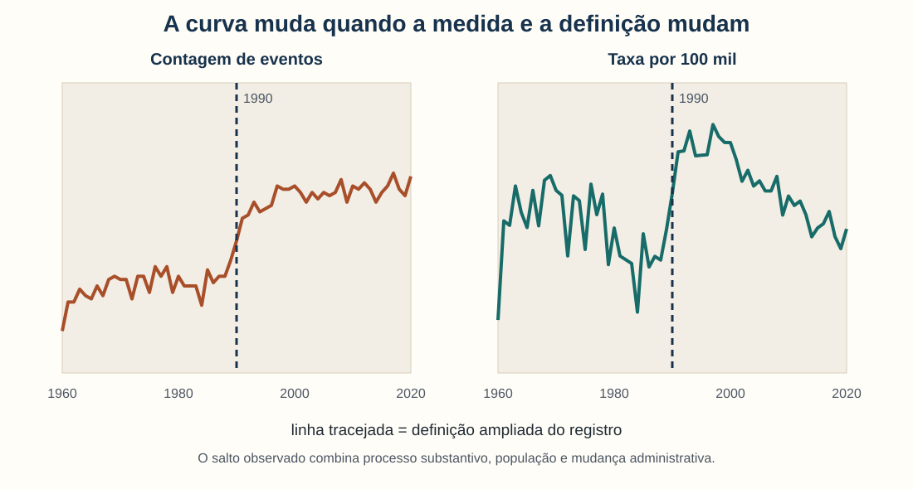

O gráfico torna o salto visível. Os metadados impedem atribuí-lo imediatamente a
uma causa substantiva.

---

# Tempo e espaço são construídos

Uma coluna `ano` depende de escolhas:

- data do acontecimento, documento ou publicação?
- calendário e precisão?
- ano, década ou período historiográfico?

Uma coluna `território` também:

- qual fronteira e versão?
- lugar mencionado, produzido ou arquivado?
- área administrativa ou recorte analítico?

---

# Agenda

1. Distinguir contagem, taxa e crescimento
2. Comparar tendência, médias móveis e rupturas
3. Acompanhar palavras e temas no tempo
4. Ler mapas com denominadores explícitos
5. Discutir falácia ecológica e MAUP
6. Integrar um percurso ao projeto cumulativo

---

# Ao final, você deverá conseguir…

- definir a unidade temporal ou territorial analisada;
- calcular e interpretar taxa e crescimento;
- explicar o efeito da janela de uma média móvel;
- marcar rupturas de cobertura ou definição;
- normalizar contagens textuais pelo tamanho do corpus;
- comparar contagens, taxas brutas e taxas padronizadas;
- reconhecer falácia ecológica e MAUP;
- produzir visualização autônoma, sensibilidade e limites.

---

# O percurso da unidade

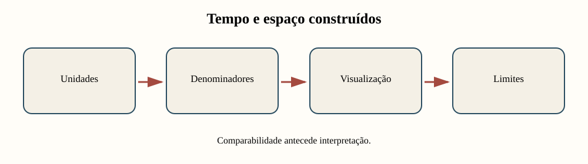

Comparabilidade vem antes de interpretação.

---

<!-- _class: atividade -->

# U11-A01 · Coluna ou construção?

**Modalidade:** duplas · **Tempo:** 15 minutos  
**Produto:** afirmação reescrita de modo testável

Para “eventos aumentaram após 1990”, identifiquem:

1. unidade temporal;
2. denominador;
3. cobertura documental;
4. ruptura de definição;
5. duas periodizações plausíveis.

---

<!-- _class: divisor -->

# 1 · Que mudança está sendo medida?

## Contagem, taxa e crescimento

---

# Três medidas respondem a três perguntas

| Medida | Pergunta | Comparação |
|---|---|---|
| contagem | quantos eventos foram registrados? | volume observado |
| taxa | quantos em relação à população exposta? | grupos de tamanhos distintos |
| crescimento | quanto mudou em relação ao período anterior? | ritmo da série |

Nenhuma delas corrige automaticamente uma mudança de definição.

---

# O denominador muda a pergunta

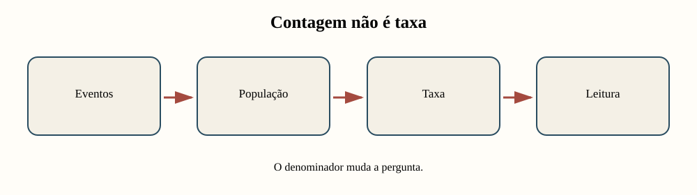

Uma contagem maior pode resultar de população maior, cobertura maior ou fenômeno
mais frequente.

---

# Taxa: ocorrências em relação à exposição


$$
r_t=\frac{y_t}{N_t}\times 100\,000
$$

**Em linguagem comum:** divida os eventos pela população do ano e expresse o
resultado por 100 mil habitantes.

**Exemplo de 1990:** $(41/71.727)\times100.000=57{,}16$.

---

# “Por 100 mil” é uma escala de comunicação

A taxa de 1990 não significa que existam exatamente 57,16 eventos.

Ela diz que a razão observada equivale a aproximadamente:

> 57 eventos para cada 100 mil habitantes.

O multiplicador facilita a leitura; o denominador real continua sendo 71.727.

---

# Crescimento compara dois momentos


$$
g_t=\frac{y_t-y_{t-1}}{y_{t-1}}\times100
$$

**Em linguagem comum:** compare a diferença com o valor do ano anterior.

**Exemplo:** $(41-35)/35\times100=17{,}14\%$ em 1990.

---

# Crescimento alto pode vir de uma base pequena

Passar de:

- 2 para 4 ocorrências = crescimento de 100%;
- 200 para 240 ocorrências = crescimento de 20%.

O primeiro percentual é maior, mas envolve apenas duas ocorrências adicionais.

Apresente crescimento junto com níveis absolutos e tamanho da base.

---

# Datas exigem precisão declarada

| Valor disponível | Representação prudente |
|---|---|
| 12/03/1901 | dia conhecido |
| março de 1901 | mês conhecido; dia ausente |
| 1901 | ano conhecido |
| cerca de 1900 | intervalo ou aproximação |
| sem data | ausente, não zero |

Inventar dia ou mês para completar o formato cria falsa precisão.

---

# O ano pode representar tempos diferentes

Para um jornal de 1901 que narra um evento de 1898:

- tempo do documento = 1901;
- tempo do acontecimento = 1898;
- tempo da digitalização = outro momento;
- tempo de entrada no corpus = ainda outro.

Escolha a coluna segundo a pergunta e preserve as demais quando relevantes.

---

<!-- _class: atividade -->

# U11-A02 · Três leituras da mudança

**Modalidade:** cálculo individual e crítica em dupla · **Tempo:** 25 minutos  
**Produto:** leitura de contagem, taxa, crescimento e ruptura

Escolha dois anos, interprete as três medidas e investigue 1990 no arquivo de
proveniência. Diga qual conclusão deixa de ser defensável após ler os metadados.

Use o notebook `01_datas_taxas_e_series.ipynb`.

---

# Oscilação não é o mesmo que tendência

A série anual contém:

- variação aleatória;
- efeitos de coleta;
- mudanças substantivas;
- alterações administrativas;
- possíveis ciclos.

Uma média móvel ajuda a ver padrões lentos, mas também remove detalhes.

---

<!-- _class: divisor -->

# 2 · O que a suavização revela — e apaga?

## Tendência, janelas e rupturas

---

# Suavizar é escolher uma vizinhança temporal

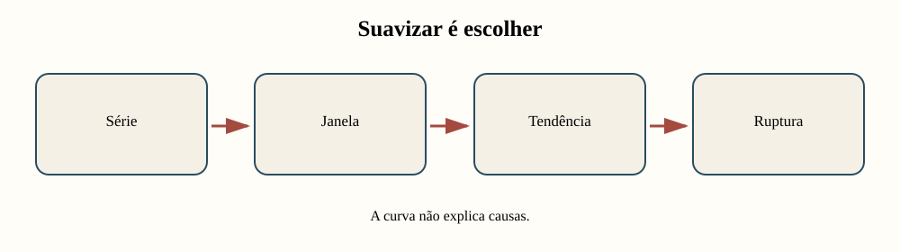

Uma janela curta acompanha oscilações; uma janela longa destaca mudanças lentas e
desloca a atenção dos episódios locais.

---

# Média móvel centrada de três anos

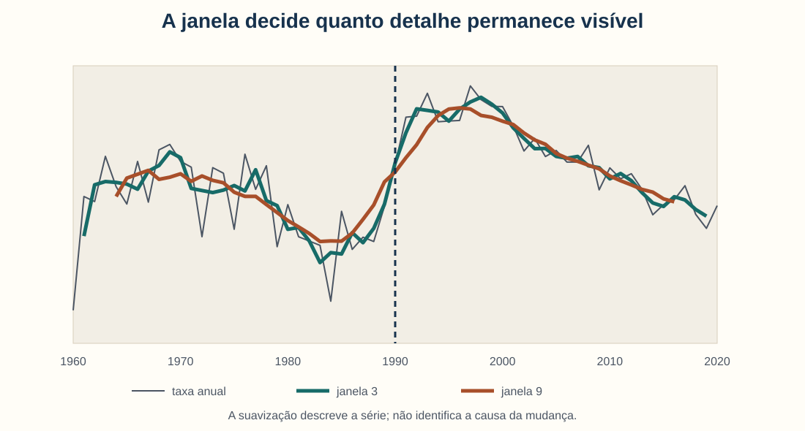

$$
\operatorname{MM}_3(t)=\frac{r_{t-1}+r_t+r_{t+1}}{3}
$$

**Em linguagem comum:** substitua o ano pela média dele com seus dois vizinhos.

**Exemplo de 1990:** $(49{,}67+57{,}16+65{,}74)/3=57{,}52$.

---

# Janelas 3 e 9 contam histórias distintas


A janela 9 incorpora quatro anos anteriores e quatro posteriores. Perto de 1990,
ela também mistura as duas definições administrativas.

---

# As bordas têm valores ausentes por construção

Uma média móvel centrada de nove anos exige:

- quatro anos anteriores;
- o ano central;
- quatro anos posteriores.

Assim, os quatro primeiros e quatro últimos anos não têm janela completa.

Não os converta em zero: zero seria uma observação, não ausência de cálculo.

---

# Uma linha de ruptura muda a leitura

Sem a marca de 1990, a curva sugere aceleração seguida de acomodação.

Com os metadados, surgem alternativas:

- restringir a série à definição comum;
- apresentar séries separadas;
- modelar um nível diferente após a ruptura;
- declarar incomparabilidade.

---

# Períodos também são hipóteses

| Período | Média da taxa |
|---|---:|
| 1960–1979 | 52,58 |
| 1980–1989 | 44,07 |
| 1990–2004 | 64,93 |
| 2005–2020 | 53,37 |

Os intervalos resumem a série, mas dois deles também coincidem com definições
diferentes. O recorte participa do argumento.

---

# Sensibilidade compara decisões plausíveis

Uma análise de sensibilidade pode variar:

- janela 3, 5 ou 9;
- média ou mediana por período;
- série completa ou definições separadas;
- ano, quinquênio ou década;
- inclusão ou exclusão de anos incompletos.

O objetivo é descobrir quais conclusões dependem da escolha.

---

<!-- _class: atividade -->

# U11-A03 · Janela e definição

**Modalidade:** trios com posições distintas · **Tempo:** 30 minutos  
**Produto:** comparação de janelas e decisão sobre 1990

Comparem janelas 3 e 9. Descrevam o que cada uma apaga. Proponham duas formas de
tratar a ruptura, defendam opções diferentes e registrem a divergência.

Use o notebook `02_tendencias_medias_moveis_e_rupturas.ipynb`.

---

# Em textos, o volume do corpus também muda

Se um ano contém o dobro de documentos, tende a conter mais palavras e menções.

Antes de interpretar uma curva lexical, precisamos distinguir:

- aumento de documentos;
- aumento proporcional do termo;
- mudança de gêneros ou fontes;
- mudança semântica;
- mudança no OCR ou na busca.

---

<!-- _class: divisor -->

# 3 · Palavras e temas no tempo

## Normalização e retorno aos textos

---

# Do corpus à releitura

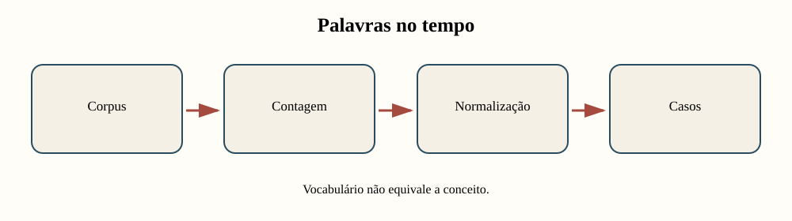

Uma palavra não equivale automaticamente a um tema; um tema não equivale a um
conceito historicamente estável.

---

# Normalize pela oportunidade de ocorrência

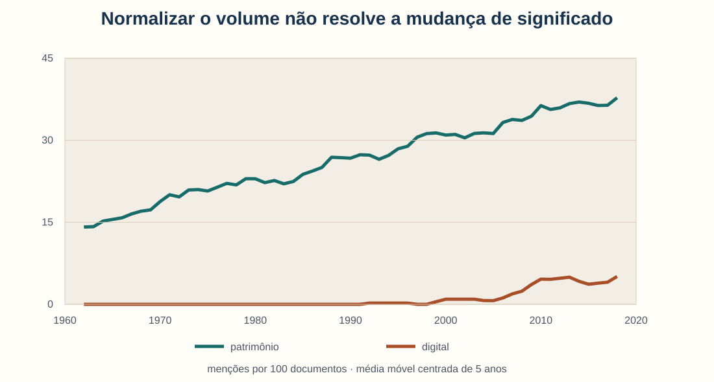

$$
r_{w,t}=\frac{m_{w,t}}{D_t}\times100
$$

**Em linguagem comum:** divida as menções da palavra pelo número de documentos.

**Exemplo:** em 2020, “digital” aparece 7 vezes em 80 documentos:
$7/80\times100=8{,}75$ menções por 100 documentos.

---

# As curvas sugerem perguntas, não causas


“Digital” pode crescer por fenômeno histórico, novo vocabulário, mudança de corpus,
OCR ou combinação desses processos.

---

# Leia concordâncias em anos contrastantes

Para um ano baixo e um ano alto, examine:

- frase e parágrafo ao redor do termo;
- gênero documental;
- autoria e instituição produtora;
- sentido empregado;
- erros de OCR;
- documentos repetidos ou excepcionalmente longos.

A curva escolhe casos para leitura; não a substitui.

---

# A unidade “documento” também pode ser desigual

Um documento pode ter uma página ou cem.

Alternativas de denominador:

- documentos disponíveis;
- páginas;
- palavras ou tokens;
- edições publicadas;
- unidades de amostragem equivalentes.

Escolha o denominador que representa a oportunidade relevante para a pergunta.

---

# Mudança lexical não garante mudança conceitual

O mesmo conceito pode receber novas palavras; a mesma palavra pode mudar de sentido.

Portanto:

1. explicite a expressão buscada;
2. procure variantes históricas;
3. examine concordâncias;
4. compare gêneros e períodos;
5. limite a conclusão ao que foi medido.

---

<!-- _class: atividade -->

# U11-A04 · Curva e corpus

**Modalidade:** duplas alternando gráfico e metadados · **Tempo:** 25 minutos  
**Produto:** duas explicações rivais e casos para leitura

Escolham uma curva, identifiquem denominador e bordas sem média, leiam anos
extremos e formulem duas explicações que exigem evidências diferentes.

Use o notebook `03_temas_e_palavras_no_tempo.ipynb`.

---

# A mesma lógica chega ao espaço

No tempo, perguntamos se períodos e cobertura são comparáveis.

No espaço, perguntaremos:

- as populações expostas são comparáveis?
- as fronteiras representam o fenômeno?
- taxas pequenas são estáveis?
- a associação entre áreas vale para indivíduos?

---

<!-- _class: divisor -->

# 4 · O que um mapa permite afirmar?

## Taxas, padronização e unidades geográficas

---

# Um mapa começa antes do desenho

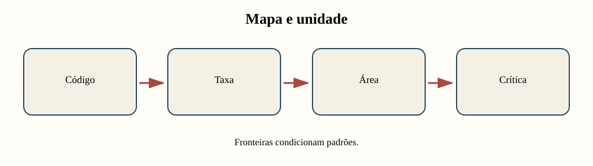

O código integra tabelas; o denominador torna valores comparáveis; a geometria
materializa uma divisão administrativa ou analítica.

---

# Contagem e taxa produzem hierarquias diferentes

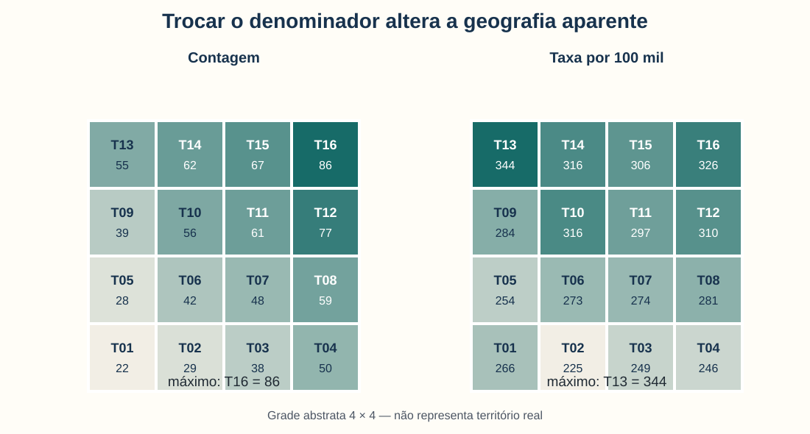

T16 registra 86 ocorrências. T13 registra apenas 55, mas sua população menor eleva
a taxa para 344 por 100 mil.

---

# Um mapa coroplético pede valores comparáveis

Em um mapa que colore áreas, prefira:

- taxas, proporções ou médias adequadas;
- legenda com unidade e intervalo;
- mesma definição em todas as áreas;
- indicação de dados ausentes;
- alerta para denominadores pequenos.

Contagem bruta tende a refletir também o tamanho da população.

---

# Taxas pequenas podem oscilar muito

Se uma área com 1.000 habitantes passa de 1 para 2 ocorrências:

- a contagem aumenta apenas uma unidade;
- a taxa dobra de 100 para 200 por 100 mil.

A instabilidade não torna a observação falsa, mas exige mostrar contagem e
denominador junto da taxa.

---

# Padronização direta compara composições


$$
r_{pad}=\sum_a w_a r_a
$$

**Em linguagem comum:** aplique a mesma composição de referência às taxas de cada
faixa $a$.

**Exemplo T01:** $0{,}7\times120+0{,}3\times650=279$ por 100 mil.

---

# Padronizar responde a uma pergunta específica

Na base didática, a população-padrão tem:

- 70% de peso para jovens;
- 30% para idosos.

A taxa padronizada pergunta como os territórios se comparariam sob essa mesma
composição. Ela não substitui a taxa bruta nem elimina todas as diferenças.

---

# Falácia ecológica troca o nível da afirmação

Se territórios com mais equipamentos têm taxas maiores, não podemos concluir que:

> indivíduos que usam equipamentos têm mais ocorrências.

O dado territorial descreve áreas. Uma afirmação individual exige dados e desenho
de pesquisa no nível individual.

*(Robinson, 1950)*

---

# MAUP: fronteiras alteram o padrão

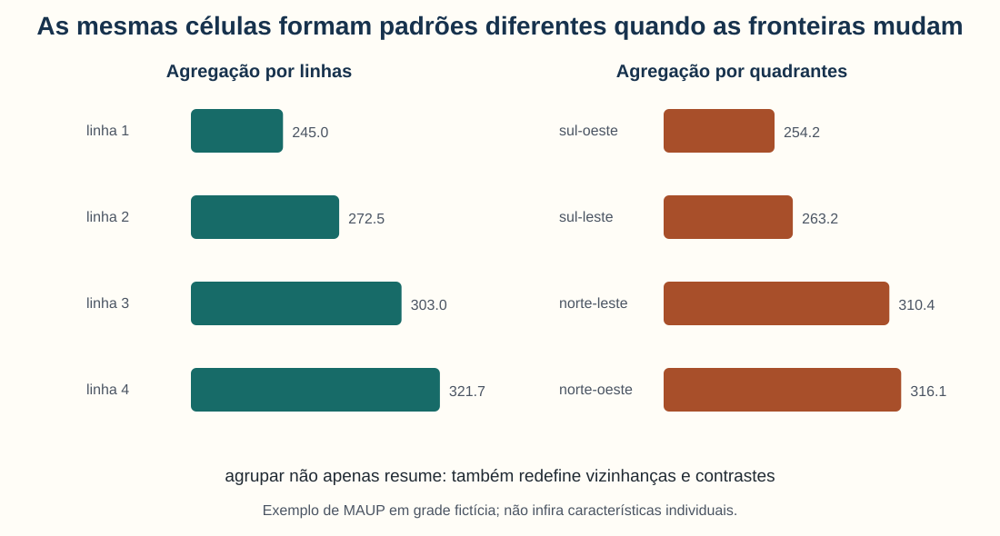

O **problema das unidades espaciais modificáveis (MAUP)** lembra que escala e
zoneamento condicionam estatísticas calculadas sobre áreas.

*(Openshaw, 1984)*

---

# Duas dimensões do MAUP

- **efeito de escala:** resultados mudam ao agregar células em áreas maiores;
- **efeito de zoneamento:** resultados mudam ao redesenhar áreas no mesmo nível.

Na grade fictícia:

- linhas sugerem gradiente contínuo de 245,0 a 321,7;
- quadrantes destacam contraste norte–sul de outra forma.

Nenhuma agregação é simplesmente “o espaço natural”.

---

# Um mapa também é um argumento gráfico

Classificação, cores e extensão territorial podem ampliar ou suavizar contrastes.

Verifique:

- método e número de classes;
- paleta e acessibilidade;
- legenda e unidades;
- projeção e geometria;
- fonte e data das fronteiras;
- áreas sem observação.

*(Monmonier, 2018)*

---

<!-- _class: atividade -->

# U11-A05 · Dois mapas, duas histórias

**Modalidade:** trios — cartógrafo, demógrafo e crítico · **Tempo:** 35 minutos  
**Produto:** comparação de dois territórios e conclusão revisada

Comparem contagem e taxa, expliquem por que T16 e T13 trocam a liderança e
reagrupem mentalmente a grade. Redijam uma conclusão sem falácia ecológica.

Use o notebook `04_distribuicao_espacial_e_taxas.ipynb`.

---

# Tempo e espaço compartilham um princípio

| Tempo | Espaço |
|---|---|
| período | território |
| população do ano | população da área |
| ruptura de definição | mudança de fronteira |
| janela temporal | escala/zoneamento |
| ano extremo | território extremo |

Em ambos, compare decisões e retorne aos casos.

---

<!-- _class: divisor -->

# 5 · Oficina

## Transformação temporal ou distribuição espacial

---

# Escolha um percurso pertinente

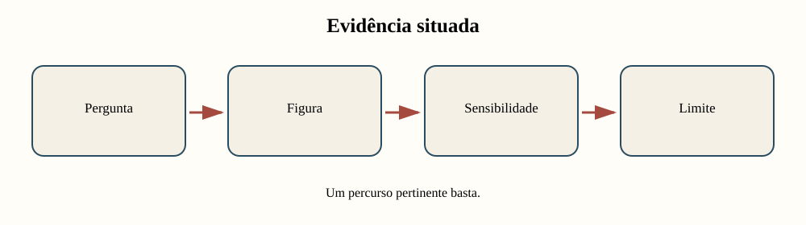

Não é obrigatório produzir série e mapa. Escolha **tempo**, **espaço** ou uma
**não adoção fundamentada**, conforme o problema e o corpus.

---

# Produto: seção no mesmo relatório-notebook

Inclua:

1. pergunta e unidade analítica;
2. cobertura, definição e denominador;
3. transformação reproduzível;
4. visualização autônoma;
5. comparação de uma decisão plausível;
6. casos ou fontes inspecionados;
7. conclusão com limites.

---

# Uma figura autônoma informa como foi construída

Ela precisa apresentar:

- título que expresse a pergunta;
- eixos ou legenda com unidades;
- denominador;
- período ou versão territorial;
- marca de ruptura ou ausência;
- fonte e natureza dos dados;
- nota sobre transformação relevante.

O leitor não deveria depender do código para compreender a medida.

---

# Roteiro dos 75 minutos

| Tempo | Ação | Evidência |
|---:|---|---|
| 0–15 | definir unidade e pergunta | contrato |
| 15–30 | auditar cobertura e definições | diagnóstico |
| 30–48 | calcular e visualizar | código + figura |
| 48–60 | variar janela/recorte/agregação | sensibilidade |
| 60–68 | inspecionar casos/fontes | notas qualitativas |
| 68–75 | redigir limites | conclusão |

---

<!-- _class: atividade -->

# U11-A06 · Incremento cumulativo

**Modalidade:** projeto individual ou grupo do projeto · **Tempo:** 75 minutos  
**Produto:** seção temporal, espacial ou não adoção fundamentada

Atualize o mesmo relatório-notebook. Inclua decisões, figura, sensibilidade,
casos e limites; mantenha a ligação com problema e corpus das unidades anteriores.

---

<!-- _class: atividade -->

# U11-A07 · Reconstruir tempo ou espaço

**Modalidade:** revisão por pares · **Tempo:** 20 minutos  
**Produto:** um ponto claro, uma dúvida e uma mudança proposta

O colega deverá localizar:

- unidade e denominador;
- cobertura;
- ruptura ou fronteira;
- caso examinado;
- limite da conclusão.

---

# Não adoção é adequada quando…

- datas são imprecisas demais para a granularidade desejada;
- cobertura varia sem documentação suficiente;
- códigos territoriais não podem ser harmonizados;
- denominadores relevantes não existem;
- mapear exporia pessoas ou comunidades;
- a visualização não responde à pergunta.

Registre a alternativa analítica escolhida.

---

# Checklist de interpretação temporal

- [ ] qual tempo está representado?
- [ ] a granularidade respeita a fonte?
- [ ] o denominador permanece comparável?
- [ ] rupturas estão visíveis?
- [ ] a janela e as bordas foram explicadas?
- [ ] períodos alternativos foram comparados?
- [ ] anos extremos retornaram às fontes?

---

# Checklist de interpretação espacial

- [ ] qual versão da fronteira foi usada?
- [ ] o código territorial integra corretamente as tabelas?
- [ ] contagem e população acompanham a taxa?
- [ ] denominadores pequenos estão sinalizados?
- [ ] outra agregação foi considerada?
- [ ] a conclusão permanece no nível territorial?
- [ ] riscos éticos e de exposição foram avaliados?

---

# Linguagem que preserva as condições

| Evite | Prefira |
|---|---|
| “os eventos cresceram em 1990” | “a série registrada aumenta quando a definição é ampliada” |
| “a tendência prova…” | “a suavização descreve…” |
| “o tema digital surgiu” | “as menções buscadas tornam-se mais frequentes…” |
| “T13 tem mais ocorrências” | “T13 tem maior taxa; T16, maior contagem” |
| “as pessoas do norte…” | “os territórios agregados ao norte…” |

---

# Retorno ao exemplo inicial


Podemos descrever a elevação registrada e comparar alternativas. Não podemos
separar sua causa cultural da causa administrativa apenas com esta série.

---

# O que entra no projeto cumulativo?

```text
problema + corpus + documentação + exploração + comparação
        + relações + modelos + padrões + extração
        + transformação temporal ou distribuição espacial situada
```

A figura deve ampliar a mesma investigação, preservando as condições de comparação.

---

# Síntese

- Contagem, taxa e crescimento respondem a perguntas diferentes.
- Janelas suavizam e também apagam.
- Rupturas documentais precisam aparecer na figura e na conclusão.
- Frequência lexical depende do volume e da composição do corpus.
- Mapas de áreas exigem denominadores e fronteiras documentados.
- Falácia ecológica troca indevidamente o nível de análise.
- MAUP torna a agregação parte do argumento.

---

<!-- _class: atividade -->

# Saída · O que permaneceu comparável?

**Modalidade:** individual · **Tempo:** 5 minutos  
**Produto:** uma afirmação e sua condição

Escreva:

1. uma transformação temporal ou distribuição espacial observada;
2. o denominador usado;
3. a decisão de recorte que mais altera a leitura;
4. o limite que deve acompanhar a afirmação.

---

# Referências — 1/2

- HYNDMAN, R. J.; ATHANASOPOULOS, G. *Forecasting: Principles and Practice*.
  3. ed. OTexts, 2021. <https://otexts.com/fpp3/>
- ROBINSON, W. S. Ecological Correlations and the Behavior of Individuals.
  *American Sociological Review*, 15(3), p. 351–357, 1950.
- OPENSHAW, S. *The Modifiable Areal Unit Problem*. Norwich: Geo Books, 1984.

---

# Referências — 2/2

- CLIFF, A. D.; ORD, J. K. *Spatial Processes: Models & Applications*.
  London: Pion, 1981.
- GREGORY, I. N.; GEDDES, A. *Toward Spatial Humanities: Historical GIS and
  Spatial History*. Indiana University Press, 2014.
- MONMONIER, M. *How to Lie with Maps*. 3. ed. University of Chicago Press, 2018.
- Dados temporais e espaciais desta apresentação são **inteiramente fictícios**.
  A grade 4 × 4 não corresponde a nenhum território real.
