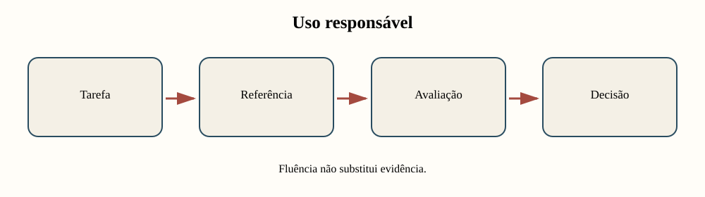
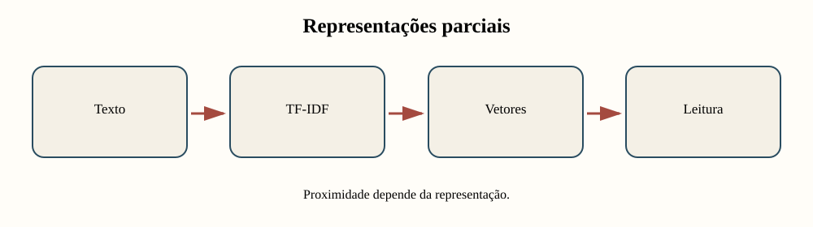
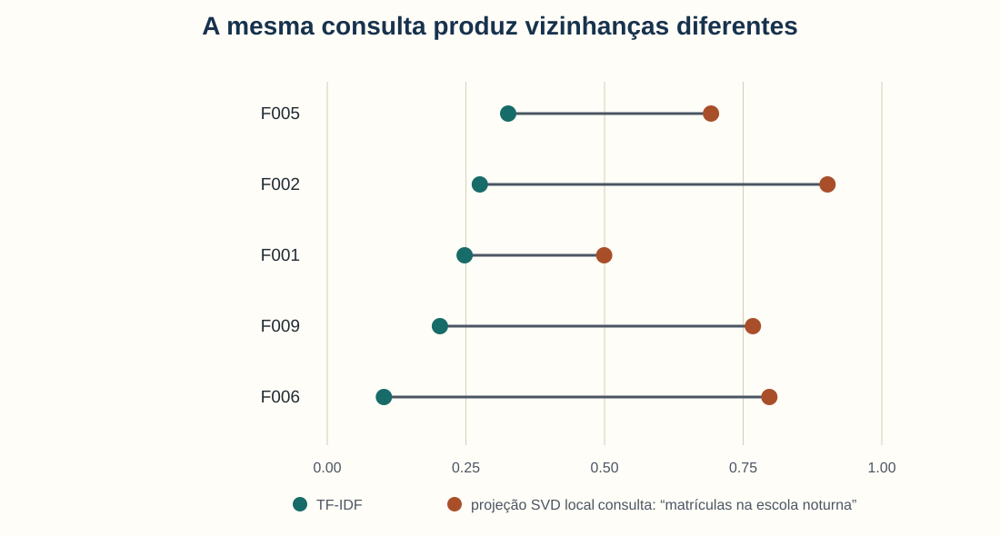
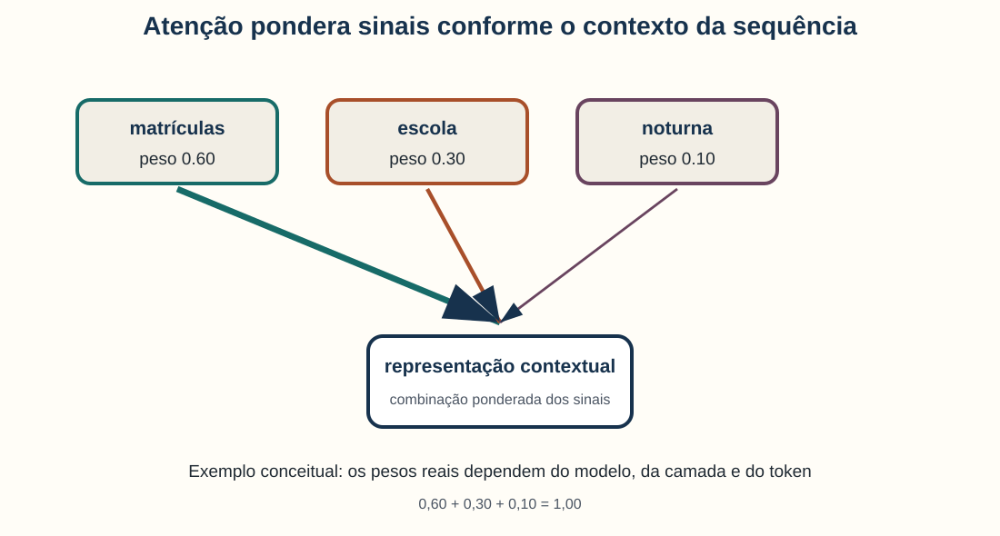
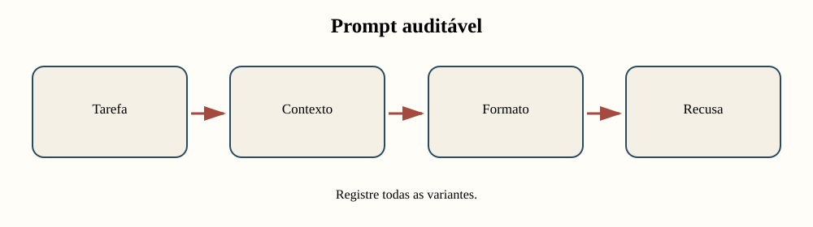
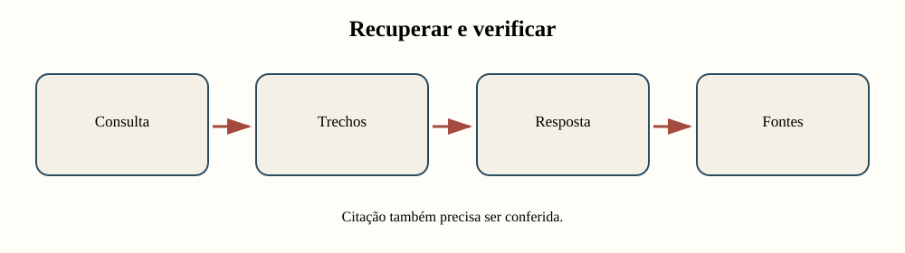
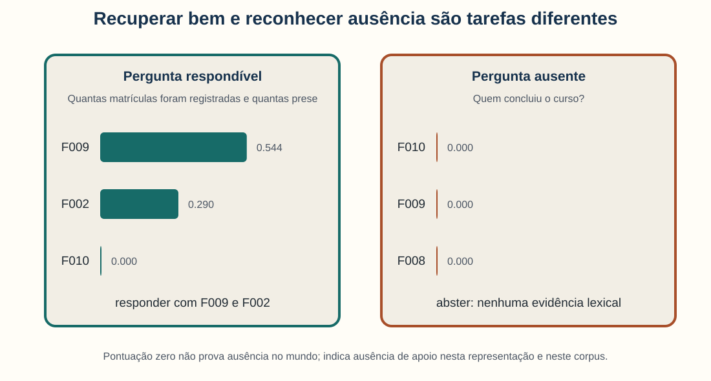
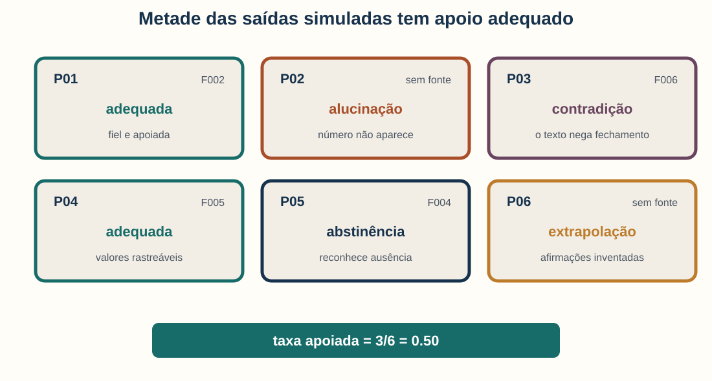
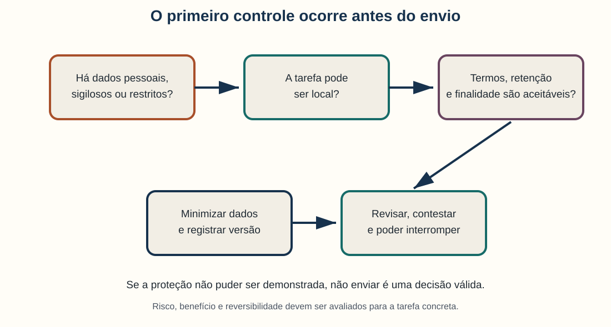
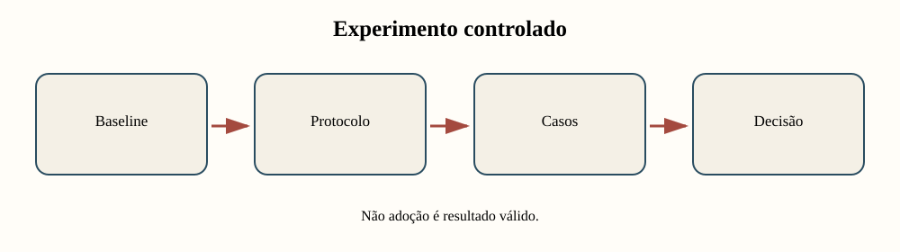

<!-- _class: capa -->
<!-- _paginate: false -->
<!-- _footer: "" -->

# Unidade 12

## Modelos de linguagem responsáveis

**Problema orientador:** como usar modelos de linguagem como instrumentos de
pesquisa sem confundir fluência com evidência, fidelidade ou decisão ética?

---

# Agenda

1. Compreender representações e atenção
2. Transformar tarefas em protocolos de prompt
3. Separar recuperação, geração e verificação
4. Auditar erros, citações e abstinência
5. Avaliar privacidade, risco e baselines
6. Realizar um experimento controlado

---

# Ao final, você deverá conseguir…

- distinguir TF-IDF, projeção densa e embedding contextual;
- explicar atenção sem atribuir compreensão garantida ao modelo;
- registrar tarefa, prompt, configuração, versão e saída;
- avaliar recuperação separadamente da resposta;
- identificar alucinação, contradição e extrapolação;
- projetar rubrica e baseline para uma tarefa concreta;
- decidir adoção, uso condicionado ou recusa.

---

# O percurso da unidade



O modelo é apenas uma parte do sistema de pesquisa.

---

<!-- _class: exemplo -->

# Ambiente fictício e controlado

- **Corpus local:** dez documentos simulados, de 1901 a 1910.
- **Saídas:** seis respostas atribuídas a um modelo hipotético.
- **Rótulos:** adequada, abstinência, alucinação, contradição e extrapolação.
- **Privacidade:** nenhum dado pessoal real e nenhuma chamada a serviço externo.

Os exemplos servem para desenhar avaliação e auditoria. Não comparam produtos,
fornecedores ou modelos reais.

---

<!-- _class: exemplo -->

# Antes da teoria: uma resposta convincente

**Pergunta:** A escola fechou por falta de luz?

**Resposta simulada:**

> “Sim, a escola foi fechada.”

A frase é curta, clara e gramaticalmente correta.

<p class="pergunta">Que evidência seria necessária para aceitá-la?</p>

---

# A fonte diz o contrário

> “Bento criticou a falta de iluminação, **mas não pediu o fechamento da
> escola**.” — F006, documento fictício

| Dimensão | Julgamento |
|---|---|
| fluência | alta |
| citação declarada | F006 |
| fidelidade à fonte | baixa |
| tipo de erro | contradição |

Uma citação presente pode não sustentar a afirmação.

---

# Ambiente controlado da unidade

- corpus com dez documentos inteiramente fictícios;
- seis respostas atribuídas a um modelo hipotético;
- nenhuma chamada a API;
- nenhum documento enviado a serviço externo;
- nenhum resultado usado para comparar modelos ou fornecedores reais.

O objetivo é aprender a desenhar e auditar experimentos.

---

<!-- _class: atividade -->

# U12-A01 · Assistência ou delegação?

**Modalidade:** duplas · **Tempo:** 15 minutos  
**Produto:** classificação com evidência e revisão humana

Classifiquem como assistência possível, tarefa condicionada ou delegação
inadequada:

1. busca;
2. resumo;
3. interpretação histórica;
4. decisão ética.

---

<!-- _class: divisor -->

# 1 · Como o texto se torna representação?

## TF-IDF, vetores e transformers

---

# Representação não é o texto completo

Uma representação seleciona sinais para uma operação.

| Representação | Preserva melhor | Perde ou transforma |
|---|---|---|
| TF-IDF | termos distintivos | ordem e parte do contexto |
| projeção SVD | padrões de coocorrência | detalhes das dimensões originais |
| embedding contextual | uso no contexto aprendido | proveniência e contexto histórico total |

Toda proximidade depende da representação escolhida.

---

# TF-IDF e vetores densos preservam sinais distintos



Um vetor permite comparar documentos matematicamente; não transforma similaridade em
equivalência semântica.

---

# A mesma consulta muda de vizinhos



No TF-IDF, F005 fica em primeiro porque contém “escola noturna”; na projeção local,
F002 e F006 ganham proximidade por padrões compartilhados.

---

# O primeiro resultado pode ser enganoso

**Consulta:** “matrículas na escola noturna”

**F005:** orçamento da biblioteca e da escola noturna — sem matrículas.  
**F002:** 84 matrículas, 31 de trabalhadoras — responde parcialmente.

O ranking mede correspondência segundo a representação. A leitura decide a utilidade
para a pergunta.

---

# Projeção densa local não é embedding de transformer

Nesta unidade, o SVD:

- reduz a matriz TF-IDF a quatro dimensões;
- cria uma analogia didática de representação densa;
- usa apenas o pequeno corpus local;
- não contextualiza cada ocorrência de palavra;
- não foi pré-treinado em grande corpus.

Nomear corretamente o método faz parte da documentação.

---

# Transformers contextualizam uma sequência

Um transformer processa tokens em camadas e usa atenção para combinar informações
de diferentes posições.

Isso permite que a representação de uma palavra varie conforme o entorno.

Não implica, por si só:

- compreensão histórica;
- conhecimento verdadeiro;
- fonte recuperável;
- neutralidade cultural.

*(Vaswani et al., 2017; Devlin et al., 2019)*

---

# Atenção como combinação ponderada



$$
\mathbf{c}=\sum_i \alpha_i\mathbf{v}_i,\qquad \sum_i\alpha_i=1
$$

**Em linguagem comum:** combine sinais dando pesos diferentes a cada um.

**Exemplo didático:** $0{,}60+0{,}30+0{,}10=1$; “matrículas” recebe o maior peso.

---

# O exemplo simplifica, não reproduz uma camada real


Em um modelo real, pesos variam por cabeça, camada, token e entrada. Atenção também
não deve ser tratada automaticamente como explicação causal da saída.

---

# Versão e domínio importam

Ao usar representação pré-treinada, registre:

- nome e versão exatos;
- data de acesso;
- idioma e domínio esperados;
- licença e condições de uso;
- transformação aplicada ao texto;
- dados enviados e local de processamento.

Sem esse contexto, o experimento não é reproduzível.

---

<!-- _class: atividade -->

# U12-A02 · Proximidade não é resposta

**Modalidade:** duplas alternando ranking e leitura · **Tempo:** 25 minutos  
**Produto:** um acerto e um vizinho enganoso explicados

Altere a consulta, compare TF-IDF e projeção SVD, leia os documentos recuperados e
explique por que proximidade não garante resposta.

Use o notebook `01_representacoes_e_transformers.ipynb`.

---

# Representação seleciona contexto; prompt seleciona tarefa

O vetor ajuda a localizar textos próximos.

O prompt especifica o que fazer com eles:

- resumir;
- classificar;
- extrair;
- comparar;
- responder;
- reconhecer ausência.

Uma tarefa vaga dificulta tanto a execução quanto a avaliação.

---

<!-- _class: divisor -->

# 2 · Como tornar uma instrução auditável?

## Tarefa, prompt e sensibilidade

---

# Defina a tarefa antes de escrever o prompt

| Tarefa | Unidade de saída | Critério principal |
|---|---|---|
| classificação | rótulo por documento | concordância com protocolo |
| extração | campos + trecho | fidelidade e cobertura |
| resumo | proposições condensadas | apoio e relevância |
| pergunta-resposta | afirmações + fontes | correção e citação |

Uma rubrica comum não serve igualmente a todas as tarefas.

---

# Um prompt auditável contém condições



Além do texto do prompt, registre configuração, versão, data e todas as saídas.

---

# Compare uma pergunta vaga e um protocolo

**Vaga:**

> Quantos estudantes concluíram o curso?

**Auditável:**

> Responda apenas com os documentos fornecidos. Cite o ID após cada afirmação. Se
> o número de concluintes não constar, responda “não consta no corpus”.

A segunda formulação torna uma abstinência observável e avaliável.

---

# Formato reduz ambiguidade operacional

```text
resposta: <afirmação ou “não consta”>
fontes: <IDs dos documentos>
evidência: <trecho exato>
confiança: <alta, média ou baixa>
```

O formato não garante fidelidade. Ele torna mais fácil conferir onde ela falhou.

---

# Ausência precisa virar instrução

Sem regra de recusa, uma pergunta pressupõe que a resposta exista.

Inclua:

- corpus permitido;
- condição de “não consta”;
- proibição de completar com conhecimento externo;
- exigência de evidência;
- tratamento de conflito entre fontes.

Abster-se adequadamente é desempenho, não fracasso.

---

# Pequenas mudanças podem alterar a resposta

Teste variantes pré-definidas:

- ordem das instruções;
- presença de exemplo;
- quantidade de contexto;
- formato aberto ou estruturado;
- regra de citação;
- regra de abstinência.

Não escolha apenas a tentativa mais favorável depois de observar as saídas.

---

# Comparação justa congela o que não está em teste

Se o objetivo é comparar dois prompts, mantenha constantes:

- amostra;
- modelo e versão;
- configuração;
- contexto recuperado;
- rubrica;
- avaliadores, quando possível.

Mude uma dimensão principal por vez.

---

<!-- _class: atividade -->

# U12-A03 · Protocolo de prompt

**Modalidade:** trio — autor, adversário e avaliador cego · **Tempo:** 30 minutos  
**Produto:** prompt revisado e rubrica

Reescreva P02 com corpus permitido, citação e “se ausente, diga não consta”. Crie
critérios separados de fidelidade, cobertura, citação e abstinência.

Use o notebook `02_tarefas_prompting_e_sensibilidade.ipynb`.

---

# Fornecer fontes reduz um risco, não todos

Mesmo com documentos no contexto, o sistema pode:

- recuperar o trecho errado;
- ignorar o trecho relevante;
- combinar documentos indevidamente;
- citar uma fonte que não sustenta a frase;
- extrapolar além do corpus.

Por isso, separar recuperação e resposta melhora o diagnóstico.

---

<!-- _class: divisor -->

# 3 · Recuperar, responder e verificar

## RAG local simplificado

---

# RAG combina dois sistemas



**RAG** — geração aumentada por recuperação — usa documentos recuperados para
condicionar uma resposta. A qualidade depende das duas etapas.

*(Lewis et al., 2020)*

---

# Avalie recuperação e geração separadamente

| Etapa | Pergunta de avaliação |
|---|---|
| recuperação | os documentos necessários aparecem entre os primeiros? |
| seleção de evidência | os trechos relevantes foram destacados? |
| geração | as afirmações se limitam ao contexto? |
| citação | cada fonte sustenta a afirmação associada? |
| abstinência | o sistema recusa quando falta evidência? |

Uma resposta errada pode nascer em qualquer etapa.

---

# Pergunta respondível e pergunta ausente



Pontuação zero indica ausência de apoio nesta representação e neste corpus — não
ausência universal do fato.

---

# Exemplo de resposta extrativa verificável

**Pergunta:** Quantas matrículas foram registradas e quantas presenças eram regulares?

**Resposta de referência:**

> F002 registra 84 matrículas. F009 registra 97 matrículas e 68 presenças
> regulares.

Cada número pode ser reencontrado em um documento identificado.

---

# Uma citação deve sustentar uma afirmação específica

“A escola fechou por falta de luz (F006)” tem citação, mas contradiz a fonte.

Verifique afirmação por afirmação:

1. qual proposição está sendo feita?
2. qual trecho é citado?
3. o trecho confirma, contradiz ou não aborda a proposição?
4. há qualificador ou negação omitida?

---

# Três tipos de pergunta testam o sistema

- **respondível:** evidência suficiente no corpus;
- **ambígua:** documentos sustentam leituras ou referentes distintos;
- **ausente:** corpus não oferece apoio.

Uma avaliação só com perguntas respondíveis não testa a capacidade de recusa.

---

# Onde o RAG pode falhar?

```text
consulta → representação → ranking → corte k → trechos
        → instrução → resposta → citação → verificação
```

Documente cada etapa. “Usamos RAG” não identifica o mecanismo nem permite reproduzir
o resultado.

---

<!-- _class: atividade -->

# U12-A04 · Falhas do RAG

**Modalidade:** dupla — recuperador e verificador · **Tempo:** 30 minutos  
**Produto:** três consultas, evidências e decisões

Teste uma pergunta respondível, uma ambígua e uma ausente. Escreva resposta
extrativa ou abstinência e confira cada afirmação contra os trechos.

Use o notebook `03_recuperacao_aumentada_por_documentos.ipynb`.

---

# Rastreabilidade não elimina outros riscos

Uma saída citada ainda pode:

- contradizer a fonte;
- retirar uma frase do contexto;
- reproduzir viés do corpus;
- revelar conteúdo sensível;
- ser instável a pequenas mudanças;
- custar mais do que um método simples.

É hora de auditar casos, riscos e alternativas.

---

<!-- _class: divisor -->

# 4 · Avaliação responsável

## Erros, baselines e privacidade

---

# Erros diferentes pedem correções diferentes

| Rótulo | Definição | Exemplo simulado |
|---|---|---|
| alucinação | conteúdo sem apoio | “60 concluíram” |
| contradição | conflito com a fonte | “a escola fechou” |
| extrapolação | vai além da evidência | “perseguição política” |
| abstinência adequada | reconhece ausência | “não informa público” |

Não agrupe tudo sob “resposta ruim”.

---

# Seis saídas, cinco situações



A amostra é pequena e didática. Ela serve para praticar auditoria, não para estimar
desempenho de um modelo real.

---

# Taxa apoiada resume um critério explícito


$$
\text{Taxa apoiada}=\frac{\text{adequadas + abstinências adequadas}}{n}
$$

**Em linguagem comum:** conte respostas sustentadas ou recusas corretas e divida
pelo total avaliado.

**Exemplo:** $(2+1)/6=0{,}50$, ou **50%**.

---

# A média não substitui os casos

Uma taxa de 50% não informa:

- se o erro inventou um número ou pessoa;
- se contradisse uma negação;
- se ocorreu em tarefa de baixo ou alto risco;
- se afetou grupos de forma desigual;
- se uma revisão humana o detectaria.

Sempre associe resumo agregado a exemplos e gravidade.

---

# A unidade de avaliação pode ser a afirmação

Uma resposta longa contém várias proposições.

Para cada afirmação, registre:

- texto da afirmação;
- fonte declarada;
- trecho de apoio;
- julgamento;
- tipo e gravidade do erro;
- decisão do revisor.

Avaliar apenas a resposta inteira pode ocultar mistura de acertos e invenções.

---

# Uma rubrica separa dimensões

| Dimensão | Pergunta |
|---|---|
| fidelidade | todas as afirmações têm apoio? |
| cobertura | pontos necessários foram incluídos? |
| citação | o ID e o trecho estão corretos? |
| abstinência | ausência foi reconhecida? |
| utilidade | a saída auxilia a tarefa definida? |
| dano | qual consequência teria o erro? |

Evite uma única nota de “qualidade”.

---

# Baseline simples torna o ganho demonstrável

Compare com uma alternativa apropriada:

- busca lexical;
- regra ou dicionário;
- TF-IDF;
- resposta extrativa;
- amostra de trabalho humano;
- não realizar a tarefa.

Uma solução mais complexa precisa justificar ganho, custo e risco adicionais.

---

# Privacidade começa antes do envio



Se proteção, finalidade e autorização não puderem ser demonstradas, não enviar é
uma decisão válida.

---

# Minimização reduz exposição

Pergunte se é possível:

- processar localmente;
- enviar apenas o trecho necessário;
- remover identificadores;
- substituir dados reais por exemplos sintéticos;
- agregar ou mascarar campos;
- limitar retenção e acesso;
- registrar exatamente o que foi transmitido.

Anonimização não é automática nem garantia absoluta.

---

# Risco vai além de alucinação

Inclua no protocolo:

- privacidade e confidencialidade;
- direitos autorais e licenças;
- vieses e desempenho desigual;
- dependência de fornecedor;
- custo e impacto ambiental;
- possibilidade de contestação;
- reversibilidade da adoção.

*(Bender et al., 2021; NIST, 2024)*

---

# Documentação acompanha o sistema

Registre, quando aplicável:

- finalidade e usos fora de escopo;
- versão e data;
- dados e configuração;
- grupos, idiomas e domínios avaliados;
- métricas e exemplos de falha;
- supervisão humana;
- limitações conhecidas.

Model cards são uma referência para estruturar esse relato. *(Mitchell et al., 2019)*

---

<!-- _class: atividade -->

# U12-A05 · Auditoria de seis saídas

**Modalidade:** avaliação independente e adjudicação em trio · **Tempo:** 35 minutos  
**Produto:** rótulos revisados, taxa apoiada e matriz de risco

Confiram cada saída no corpus, identifiquem o erro de maior dano e preencham a
matriz de risco antes de qualquer envio.

Use o notebook `04_avaliacao_alucinacao_e_privacidade.ipynb`.

---

# Do diagnóstico à decisão

O resultado do experimento pode ser:

- adoção para tarefa delimitada;
- uso apenas como triagem;
- uso com revisão obrigatória;
- nova rodada após correções;
- preferência pelo baseline;
- não adoção.

A decisão deve ser comparativa, documentada e revogável.

---

<!-- _class: divisor -->

# 5 · Oficina

## Experimento controlado com modelo de linguagem

---

# Produto: seção no mesmo relatório-notebook



Serviço externo não é obrigatório. É possível trabalhar apenas com as saídas
simuladas ou justificar que o corpus não pode ser enviado.

---

# Congele o experimento antes de ver as saídas

| Elemento | Registro mínimo |
|---|---|
| tarefa | entrada, unidade e saída esperada |
| amostra | casos e forma de seleção |
| baseline | método simples comparável |
| protocolo | prompt, contexto e configuração |
| avaliação | rubrica, avaliador e adjudicação |
| risco | dados enviados e consequência do erro |

Pré-registro reduz a tentação de escolher apenas bons exemplos.

---

# Resultado simulado não avalia fornecedor real

Os arquivos desta unidade permitem aprender a:

- aplicar uma rubrica;
- separar tipos de erro;
- calcular uma taxa;
- comparar com fonte;
- decidir com base em risco.

Eles não permitem concluir que um produto comercial tem 50% de desempenho.

---

# Roteiro dos 75 minutos

| Tempo | Ação | Evidência |
|---:|---|---|
| 0–12 | definir tarefa e risco | contrato |
| 12–25 | criar referência simples | baseline |
| 25–38 | congelar prompts e amostra | protocolo |
| 38–55 | produzir/importar saídas autorizadas | registro |
| 55–67 | avaliar afirmações e casos | rubrica |
| 67–75 | decidir adoção, revisão ou recusa | conclusão |

---

<!-- _class: atividade -->

# U12-A06 · Incremento cumulativo

**Modalidade:** projeto individual ou grupo do projeto · **Tempo:** 75 minutos  
**Produto:** seção de experimento ou não adoção fundamentada

Registre modelo e versão quando houver, prompts, dados enviados, baseline, amostra,
erros, custos e decisão. Atualize o mesmo relatório-notebook.

---

<!-- _class: atividade -->

# U12-A07 · Reproduzir e contestar

**Modalidade:** revisão por pares · **Tempo:** 20 minutos  
**Produto:** ponto claro, dúvida e mudança proposta

O colega reconstrói tarefa, dados, prompt, fonte e julgamento de três respostas.
Qualquer elemento ausente torna-se uma limitação explícita.

---

# Não adoção pode ser o resultado responsável

Considere não usar quando:

- o corpus é sigiloso ou restrito;
- não há base ou autorização para envio;
- a tarefa exige precisão incompatível com os erros;
- o baseline simples é suficiente;
- não há capacidade de revisão;
- custo e dependência excedem o benefício.

Registre a alternativa adotada.

---

# Checklist antes de concluir

- [ ] tarefa e população de casos estão definidas;
- [ ] baseline e protocolo foram congelados;
- [ ] versão, data e configuração estão registradas;
- [ ] toda afirmação retorna a uma fonte;
- [ ] perguntas ausentes testam abstinência;
- [ ] tipos e gravidades de erro foram examinados;
- [ ] dados enviados e riscos estão documentados;
- [ ] a decisão pode ser revista.

---

# Linguagem que não exagera a evidência

| Evite | Prefira |
|---|---|
| “o modelo compreendeu o documento” | “a saída correspondeu à referência neste caso” |
| “a citação prova a resposta” | “o trecho citado sustenta esta afirmação” |
| “RAG eliminou alucinações” | “a recuperação aumentou rastreabilidade, mas houve…” |
| “o modelo tem 50% de acerto” | “3 de 6 saídas simuladas atenderam ao critério” |
| “a IA decidiu” | “a equipe decidiu após avaliar…” |

---

# Retorno ao exemplo inicial

**Saída simulada:** “a escola foi fechada.”  
**Fonte F006:** “não pediu o fechamento.”

O caso passa por todo o protocolo:

1. isolar a afirmação;
2. conferir a citação;
3. rotular contradição;
4. avaliar gravidade;
5. corrigir tarefa e regra de evidência;
6. decidir se o uso permanece aceitável.

---

# O que entra no projeto cumulativo?

```text
problema + corpus + documentação + exploração + comparação
        + relações + modelos + padrões + extração + tempo/espaço
        + experimento controlado ou não adoção fundamentada
```

O modelo deve servir à investigação já construída, não redefini-la por conveniência.

---

# Síntese

- Representações preservam sinais diferentes.
- Atenção combina contexto, mas não garante compreensão ou verdade.
- Prompt é parte de um protocolo reproduzível.
- RAG separa recuperação, resposta e verificação.
- Citação precisa sustentar cada afirmação.
- Métricas agregadas precisam de casos e gravidade.
- Baseline, privacidade e reversibilidade participam da decisão.

---

<!-- _class: atividade -->

# Saída · Uma condição de uso

**Modalidade:** individual · **Tempo:** 5 minutos  
**Produto:** decisão provisória em quatro linhas

Para uma tarefa do seu projeto, registre:

1. o benefício esperado;
2. o baseline de comparação;
3. o erro inaceitável;
4. a condição que faria você interromper o uso.

---

# Referências — 1/2

- VASWANI, A. et al. Attention Is All You Need. *NeurIPS*, 2017.
  <https://arxiv.org/abs/1706.03762>
- DEVLIN, J. et al. BERT: Pre-training of Deep Bidirectional Transformers for
  Language Understanding. *NAACL-HLT*, 2019. <https://aclanthology.org/N19-1423/>
- LEWIS, P. et al. Retrieval-Augmented Generation for Knowledge-Intensive NLP
  Tasks. *NeurIPS*, 2020. <https://arxiv.org/abs/2005.11401>
- BENDER, E. M. et al. On the Dangers of Stochastic Parrots. *FAccT*, 2021.
  <https://doi.org/10.1145/3442188.3445922>

---

# Referências — 2/2

- LIANG, P. et al. Holistic Evaluation of Language Models. *TMLR*, 2023.
  <https://openreview.net/forum?id=iO4LZibEqW>
- MITCHELL, M. et al. Model Cards for Model Reporting. *FAT\**, 2019.
  <https://doi.org/10.1145/3287560.3287596>
- NIST. *Artificial Intelligence Risk Management Framework: Generative AI
  Profile*. NIST AI 600-1, 2024. <https://doi.org/10.6028/NIST.AI.600-1>
- Corpus e saídas desta apresentação são **inteiramente fictícios**. Nenhuma
  figura avalia modelo, serviço ou fornecedor real.
