<!-- _class: capa -->
<!-- _paginate: false -->
<!-- _footer: "" -->

# Unidade 13

## Validade, robustez e vieses

**Problema orientador:** que evidências permitem sustentar uma conclusão — e como
seu alcance muda diante de outras medidas, especificações, grupos e contextos?

---

<!-- _class: exemplo -->

# Base fictícia de auditoria

- **Predições:** 240 casos; períodos antigo/recente e origens Capital/Interior.
- **Referência:** classes balanceadas, 205 casos claros e 35 ambíguos.
- **Sensibilidade:** cinco especificações com representação, semente e F1.
- **Casos qualitativos:** quatro erros com hipóteses de mecanismo.

Quedas no período antigo e no Interior foram inseridas deliberadamente. Os dados não
descrevem pessoas, grupos, contextos ou sistemas reais.

---

<!-- _class: exemplo -->

# Antes da teoria: 0,742 parece um bom resultado?

A especificação principal de um classificador fictício obteve:

> **F1 = 0,742**

Outra especificação, treinada no período antigo e testada no recente, obteve:

> **F1 = 0,648**

<p class="pergunta">Qual número representa o desempenho “verdadeiro”?</p>

---

# Os dois números respondem a condições diferentes

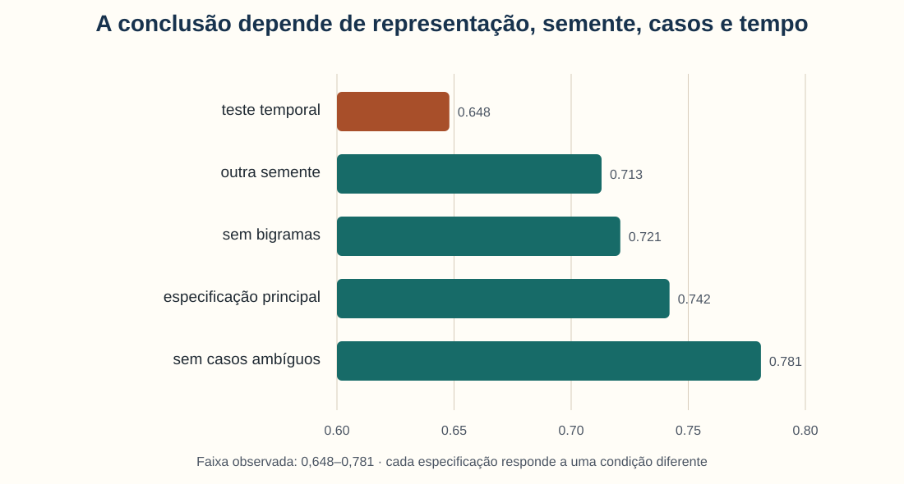

A pergunta adequada não é qual valor esconder, mas quais condições cada resultado
representa e se a conclusão substantiva resiste a elas.

---

# Validade pertence ao argumento

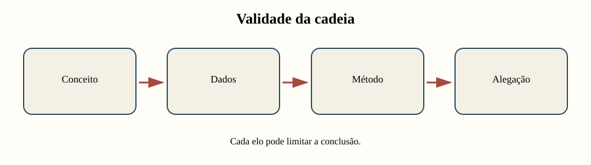

Um método ou conjunto de dados não recebe um selo universal de “válido”. Avaliamos
uma inferência específica, apoiada por evidências específicas.

---

# Agenda

1. Auditar validade de construto, interna e externa
2. Combinar baseline, métricas e leitura de casos
3. Examinar robustez, sensibilidade e incerteza
4. Investigar diferenças entre grupos e contextos
5. Transformar ameaças em verificações e ações
6. Reescrever o alcance das conclusões

---

# Ao final, você deverá conseguir…

- mapear conceito, indicador, transformação e inferência;
- distinguir validade de construto, interna e externa;
- comparar um modelo a um baseline informativo;
- interpretar matriz de confusão e amostra qualitativa;
- planejar uma análise de sensibilidade;
- separar incerteza amostral de viés de seleção;
- investigar lacunas por grupo sem atribuir causa automaticamente;
- priorizar ameaças e revisar conclusões.

---

# Vocabulário da unidade

| Termo | Pergunta central |
|---|---|
| validade | a evidência sustenta esta inferência? |
| robustez | a conclusão muda sob escolhas defensáveis? |
| incerteza | quais valores ou decisões seguem compatíveis? |
| generalização | até onde a conclusão pode ser transportada? |
| viés | há desvio sistemático na produção do resultado? |

---

<!-- _class: atividade -->

# U13-A01 · Localizar a ameaça

**Modalidade:** duplas · **Tempo:** 15 minutos  
**Produto:** três ameaças e uma evidência para cada uma

Para “o classificador mostra que o discurso cresceu”, identifiquem ameaças de:

1. construto;
2. inferência dentro do estudo;
3. alcance fora do corpus.

---

<!-- _class: divisor -->

# 1 · O que exatamente está sendo validado?

## Construto, inferência e alcance

---

# Uma conclusão percorre vários elos

```text
conceito → indicador → dados → transformação → resultado → inferência
```

Exemplo:

```text
“presença de discurso X” → rótulo textual → jornais disponíveis
→ classificador → proporção anual → “o discurso cresceu”
```

Cada seta contém uma decisão contestável.

---

# Validade de construto: conceito e medida

Pergunte se o indicador representa o conceito pretendido.

**Exemplo:** uma palavra pode indicar um tema, mas também:

- ocorrer em outro sentido;
- aparecer em uma negação;
- omitir sinônimos históricos;
- variar entre gêneros;
- refletir erro de OCR.

Uma medida reproduzível ainda pode representar mal o construto. *(Messick, 1995)*

---

# Validade interna: alternativas à inferência

Mesmo que a medida seja adequada, o padrão pode resultar de:

- mudança na cobertura documental;
- composição diferente entre períodos;
- mudança de OCR ou anotação;
- variável confundidora;
- seleção dos casos;
- decisão analítica tomada após observar resultados.

O objetivo é examinar explicações rivais dentro do desenho.

---

# Validade externa: até onde a conclusão viaja?

Um resultado pode valer:

- para este acervo, mas não para outros;
- para jornais, mas não para cartas;
- para um período, mas não para outro;
- para a Capital, mas não para o Interior;
- para textos digitalizados com determinada qualidade.

Generalizar exige justificar semelhanças e diferenças entre contextos.

---

# Três perguntas cercam a mesma conclusão

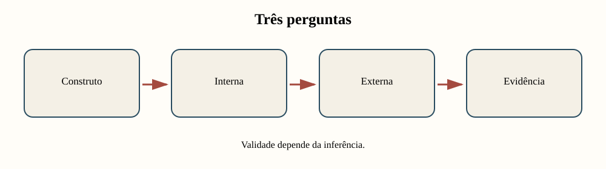

Elas não competem; apontam partes diferentes do argumento.

---

# Exemplo: “o tema aumentou”

| Dimensão | Ameaça | Evidência útil |
|---|---|---|
| construto | palavra não equivale a tema | concordâncias e variantes |
| interna | cobertura aumentou | metadados por período |
| externa | um acervo não representa todos | replicação em outro corpus |

A conclusão deve mudar quando a evidência não resolve a ameaça.

---

# Validade não é apenas precisão técnica

Um classificador pode ter desempenho alto e ainda:

- operacionalizar a categoria errada;
- aprender marcas do acervo;
- falhar no período relevante;
- excluir casos não digitalizados;
- sustentar uma inferência mais forte do que os dados permitem.

“Funciona” sempre exige completar: para qual tarefa, população e uso?

---

# Uma matriz liga ameaça a ação

| Alegação | Ameaça | Evidência | Efeito possível |
|---|---|---|---|
| “tema cresceu” | mudança de OCR | taxa de erro por ano | limitar período |
| “grupos diferem” | composição desigual | descrição estratificada | ajustar comparação |
| “modelo generaliza” | deriva temporal | teste fora do tempo | restringir alcance |

Uma lista genérica de limitações não altera o estudo.

---

<!-- _class: atividade -->

# U13-A02 · Cadeia de uma alegação

**Modalidade:** individual e revisão em dupla · **Tempo:** 30 minutos  
**Produto:** cadeia completa e três ameaças priorizadas

Escolha uma conclusão do projeto e registre conceito, indicador, transformação,
resultado e inferência. O colega deverá tentar quebrar um elo e pedir evidência.

Use o notebook `01_validade_de_construto_interna_e_externa.ipynb`.

---

# O mapa define o que precisa ser avaliado

Agora passamos da cadeia conceitual para evidências empíricas:

- um baseline fornece escala;
- métricas resumem padrões;
- uma matriz localiza tipos de erro;
- casos revelam mecanismos;
- estratos mostram onde a média falha.

Nenhum desses componentes basta isoladamente.

---

<!-- _class: divisor -->

# 2 · Como avaliar sem esconder os casos?

## Baseline, métricas e leitura qualitativa

---

# Um baseline responde “melhor que o quê?”

Nesta base balanceada, um método que sempre prevê a classe 0 obtém:

- acurácia = 0,500;
- precisão, revocação e F1 da classe positiva = 0.

O baseline não é concorrente sofisticado. Ele mostra o que se obtém sem aprender a
identificar a classe positiva.

---

# O modelo supera o baseline na média

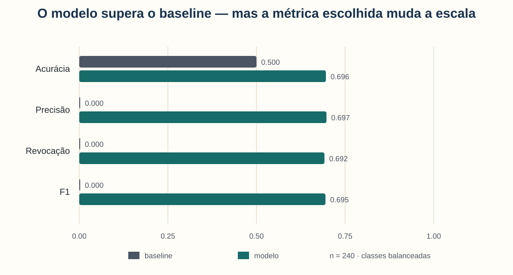

O modelo fica próximo de 0,70 nas quatro métricas. Isso justifica investigar seus
erros — não declarar a análise encerrada.

---

# Acurácia conta decisões corretas

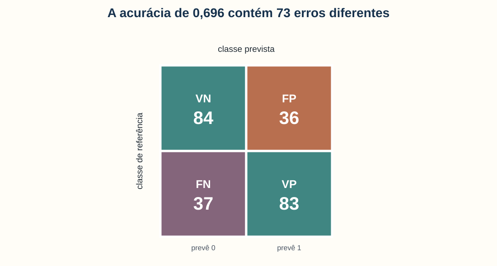

$$
\text{Acurácia}=\frac{VP+VN}{n}
$$

**Em linguagem comum:** divida todos os acertos pelo total de casos.

**Exemplo:** $(83+84)/240=0{,}696$, ou **69,6%**.

---

# A mesma média contém 73 erros


Falsos positivos e falsos negativos podem ter consequências substantivas distintas.
Leia ambos em seus documentos e contextos.

---

# Métricas agregam; casos explicam mecanismos

| Caso | Erro observado | Hipótese inicial |
|---|---|---|
| C008 | grafia histórica não reconhecida | mudança linguística |
| C121 | novo vocabulário institucional | mudança temporal |
| C180 | metadado de origem incorreto | qualidade da base |

A hipótese organiza investigação; ainda precisa ser testada.

---

# Confiança alta não garante acerto

Na base fictícia:

- 73 de 240 casos estão errados;
- 20 erros têm confiança igual ou superior a 0,85.

Uma pontuação interna pode ajudar a ordenar revisão, mas precisa ser calibrada e
auditada. Não é probabilidade de verdade por definição.

---

# A amostra manual deve desafiar a média

Inclua deliberadamente:

- acertos e erros;
- falsos positivos e falsos negativos;
- confiança alta e baixa;
- casos claros e ambíguos;
- períodos e origens distintos;
- situações de maior dano.

Uma amostra apenas aleatória pode conter poucos casos raros importantes.

---

# Avaliação mista reúne perspectivas

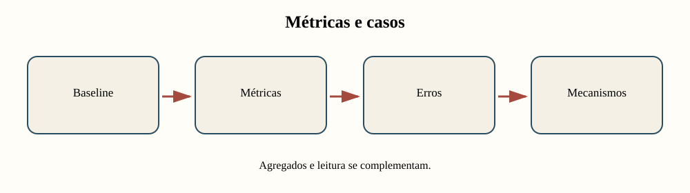

Quantificar mostra extensão; ler casos ajuda a formular o mecanismo que produz o erro.

---

# Correção deve responder ao mecanismo

| Mecanismo provável | Ação coerente |
|---|---|
| variantes históricas ausentes | ampliar léxico e testar novo período |
| OCR degradado | melhorar transcrição ou restringir uso |
| categoria incoerente | revisar protocolo de anotação |
| cobertura desigual | buscar novas fontes ou limitar inferência |
| confiança mal calibrada | calibrar e rever limiar |

Ajustar o algoritmo não resolve todo problema de dados ou conceito.

---

<!-- _class: atividade -->

# U13-A03 · Amostra que desafia a média

**Modalidade:** trio — analista, leitor e crítico · **Tempo:** 30 minutos  
**Produto:** baseline, amostra de 12 casos e hipóteses de erro

Comparem modelo e baseline; estratifiquem a amostra; agrupem erros por hipótese e
digam qual correção mudaria a interpretação do estudo.

Use o notebook `02_avaliacao_quantitativa_e_qualitativa.ipynb`.

---

# Uma avaliação ainda depende de escolhas

O resultado observado muda com:

- representação textual;
- semente aleatória;
- inclusão de casos ambíguos;
- divisão entre treino e teste;
- período usado para generalização;
- métrica e limiar decisório.

Sensibilidade torna essa dependência visível.

---

<!-- _class: divisor -->

# 3 · O que permanece sob escolhas plausíveis?

## Robustez, sensibilidade e incerteza

---

# Robustez não significa resultado idêntico

Uma conclusão é mais robusta quando alternativas defensáveis preservam:

- direção;
- ordem entre grupos;
- magnitude substantivamente semelhante;
- decisão em relação a um limiar pré-definido.

Variação é esperada. A questão é se ela muda o argumento.

---

# Análise de sensibilidade varia decisões justificadas

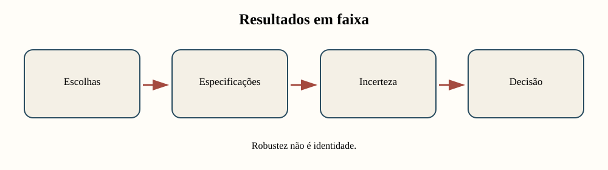

Não inclua combinações arbitrárias apenas para gerar muitos resultados. Cada
especificação deve representar uma decisão metodológica plausível.

---

# Cinco especificações, uma faixa ampla


Retirar casos ambíguos melhora a nota, mas também muda a população de interesse.
O teste temporal é mais difícil e mais informativo sobre generalização.

---

# Defina o limiar antes de olhar

Suponha que a tarefa exija **F1 ≥ 0,70**.

| Especificação | F1 | Decisão |
|---|---:|---|
| principal | 0,742 | atende |
| sem bigramas | 0,721 | atende |
| outra semente | 0,713 | atende |
| teste temporal | 0,648 | não atende |

A decisão muda quando o contexto de teste se aproxima do uso pretendido.

---

# Bootstrap reamostra os casos observados

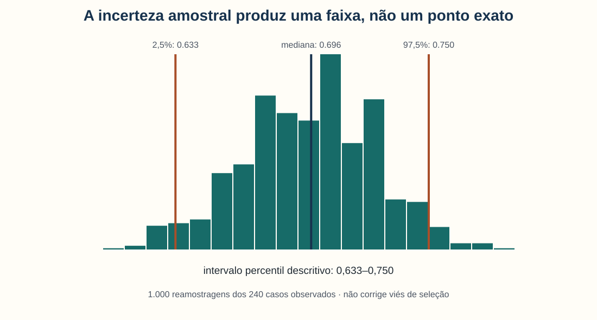

O intervalo descreve variação amostral sob reamostragem destes 240 casos. Ele não
inclui automaticamente erro de anotação, seleção ou mudança de contexto.

---

# Incerteza tem várias fontes

| Fonte | Exemplo | Estratégia |
|---|---|---|
| amostragem | poucos casos observados | intervalo/reamostragem |
| medida | rótulo ambíguo | dupla anotação e adjudicação |
| modelo | semente e representação | sensibilidade |
| contexto | período recente | teste externo/temporal |
| decisão | limiar de uso | análise de consequências |

Um único intervalo não resume todas elas.

---

# Bootstrap não corrige seleção

Se o corpus contém apenas documentos preservados e digitalizados, reamostrar suas
linhas continua reamostrando a mesma seleção.

Ele pode quantificar:

- variação entre amostras semelhantes às observadas.

Ele não pode, sozinho:

- recuperar documentos ausentes;
- corrigir cobertura desigual;
- garantir transporte para outro contexto.

---

# “Inconclusivo” pode ser a conclusão correta

Relate resultado inconclusivo quando:

- a direção muda entre especificações;
- a faixa atravessa o limiar decisório;
- o teste relevante tem poucos casos;
- o desenho não distingue explicações rivais;
- a medida não representa bem o construto.

Incerteza explícita é mais informativa que certeza fabricada.

---

<!-- _class: atividade -->

# U13-A04 · O que permanece?

**Modalidade:** dupla — posição favorável e posição cética · **Tempo:** 30 minutos  
**Produto:** conclusão robusta e conclusão forte demais

Ordenem as especificações, definam um limiar, interpretem o bootstrap e indiquem
qual afirmação resiste e qual excede a evidência.

Use o notebook `03_robustez_incerteza_e_sensibilidade.ipynb`.

---

# A média global pode esconder contextos

Mesmo que a conclusão seja estável em várias especificações, pergunte:

- quem entrou na amostra?
- quem ficou invisível?
- em quais períodos o método falha?
- que origem ou gênero tem menos cobertura?
- o erro tem a mesma consequência para todos?

---

<!-- _class: divisor -->

# 4 · Onde o viés entra?

## Amostra, corpus, algoritmo e mudança de contexto

---

# Viés pode surgir em toda a cadeia

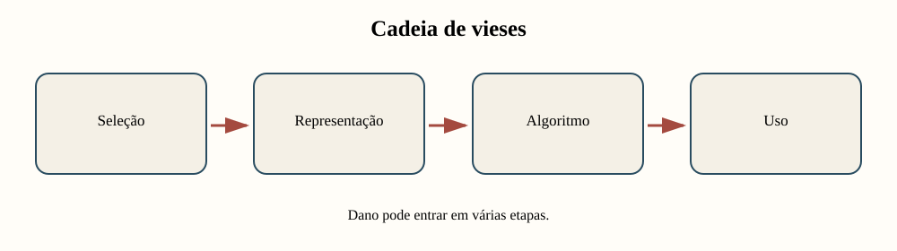

Concentrar toda a crítica no algoritmo deixa invisíveis decisões anteriores e
consequências posteriores.

---

# Quatro locais para investigar

| Etapa | Pergunta |
|---|---|
| amostra | quais casos foram preservados, digitalizados e escolhidos? |
| corpus | quais gêneros, períodos e vozes predominam? |
| representação/modelo | quais sinais são favorecidos ou perdidos? |
| uso | quem recebe a decisão e qual é a consequência? |

Uma diferença de desempenho é pista, não diagnóstico de causa.

---

# Período e origem têm resultados diferentes

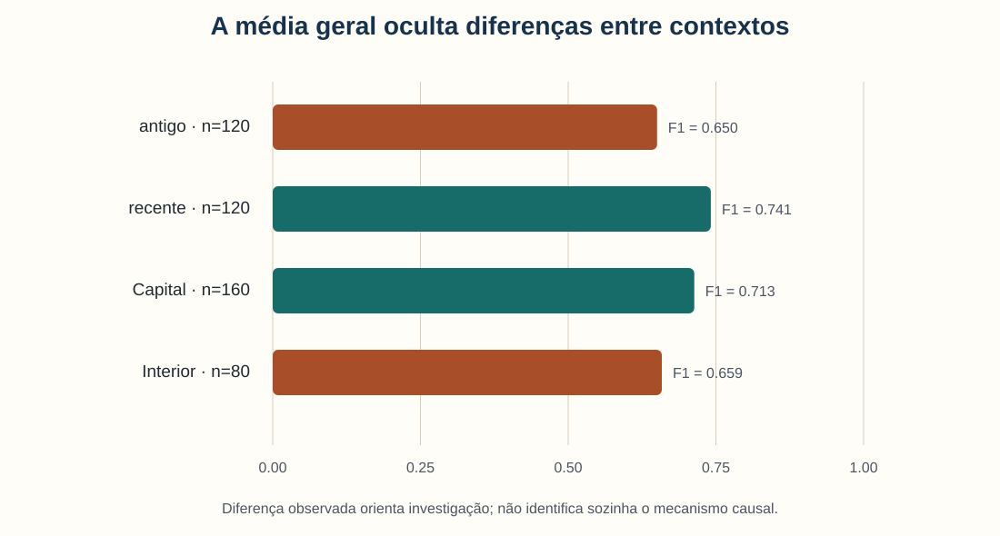

Mostre sempre o tamanho dos grupos: antigo e recente têm 120 casos cada; Capital
tem 160, Interior tem 80.

---

# Lacuna é diferença, não explicação


$$
\Delta_{F1}=F1_{Capital}-F1_{Interior}
$$

**Em linguagem comum:** subtraia o desempenho dos dois contextos.

**Exemplo:** $0{,}713-0{,}659=0{,}054$ — cerca de 5,4 pontos.

---

# Preserve mecanismos rivais

A lacuna por origem pode resultar de:

- cobertura menor no Interior;
- grafia ou gênero diferentes;
- qualidade desigual do OCR;
- protocolo de anotação inadequado;
- diferença substantiva no fenômeno;
- acaso amostral.

Cada hipótese pede um teste diferente.

---

# Mudança temporal desafia generalização

O período antigo tem F1 0,650; o recente, 0,741.

Antes de concluir “o modelo é enviesado contra textos antigos”, examine:

- qualidade e composição das fontes;
- grafia e vocabulário;
- critérios de anotação;
- distribuição das classes;
- processo de treinamento.

---

# Diferença de desempenho não resume justiça

Avaliação responsável inclui:

- qualidade da representação;
- distribuição de benefícios e danos;
- possibilidade de contestação;
- participação dos grupos afetados;
- finalidade do sistema;
- alternativas não algorítmicas.

Paridade métrica pode ser insuficiente ou incompatível com outros objetivos.

---

# Mitigação deve corresponder ao mecanismo

| Hipótese | Teste | Mitigação possível |
|---|---|---|
| OCR pior no período antigo | auditar CER por período | corrigir OCR ou excluir uso |
| léxico regional ausente | ler falsos negativos | ampliar recursos e reavaliar |
| cobertura desigual | comparar metadados | incorporar novas fontes |
| rótulo incoerente | dupla anotação | revisar definição |

Não prometa correção antes de identificar a causa.

---

<!-- _class: atividade -->

# U13-A05 · Diferença, mecanismo e mitigação

**Modalidade:** trios · **Tempo:** 35 minutos  
**Produto:** lacuna quantificada, três mecanismos e respectivos testes

Escolham período ou origem, leiam casos e preservem ao menos duas explicações
rivais. Para cada uma, proponham evidência e ação coerente.

Use o notebook `04_vieses_e_mudanca_de_contexto.ipynb`.

---

# Da ameaça genérica à decisão

Uma ameaça útil informa:

1. qual alegação afeta;
2. qual mecanismo é plausível;
3. que evidência já existe;
4. probabilidade e impacto;
5. que verificação falta;
6. como a conclusão deve mudar agora.

---

<!-- _class: divisor -->

# 5 · Oficina

## Validade, limitações e ameaças

---

# Produto: uma seção que altera conclusões

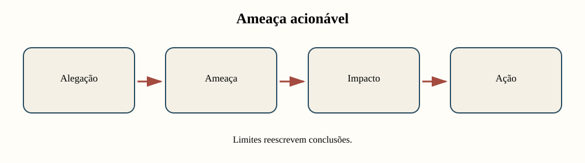

A seção não é um ritual no final do texto. Ela redefine alcance, linguagem e próximos
testes do relatório-notebook.

---

# Priorize em vez de listar tudo

| Ameaça | Probabilidade | Impacto | Prioridade |
|---|---|---|---|
| medida não captura conceito | alta | alto | imediata |
| semente altera poucos casos | média | baixo | monitorar |
| transporte temporal falha | alta | alto | restringir uso |

Uma matriz simples ajuda a concentrar recursos nas ameaças decisivas.

---

# Cada ameaça precisa de ação

Exemplos:

- **construto:** ler concordâncias e revisar indicador;
- **interna:** comparar composição e cobertura;
- **externa:** testar outro período ou corpus;
- **robustez:** variar duas especificações justificadas;
- **viés:** estratificar métricas e examinar casos;
- **incerteza:** mostrar faixa e decisão condicionada.

---

# Reescreva a conclusão depois da auditoria

**Forte demais:**

> O classificador mede o discurso com desempenho satisfatório.

**Condicionada:**

> Na amostra fictícia, o modelo supera o baseline, mas a queda no teste temporal
> limita seu uso comparativo entre períodos até que grafia, OCR e cobertura sejam
> auditados.

---

# Roteiro dos 75 minutos

| Tempo | Ação | Evidência |
|---:|---|---|
| 0–12 | selecionar três alegações | mapa |
| 12–27 | auditar três tipos de validade | matriz |
| 27–42 | comparar baseline, métricas e casos | avaliação mista |
| 42–55 | testar duas especificações | sensibilidade |
| 55–65 | examinar período/grupo | auditoria de viés |
| 65–75 | priorizar e reescrever | seção final |

---

<!-- _class: atividade -->

# U13-A06 · Incremento cumulativo

**Modalidade:** projeto individual ou grupo do projeto · **Tempo:** 75 minutos  
**Produto:** seção priorizada de validade e limitações

Para cada ameaça, registre evidência, probabilidade, impacto, ação e efeito na
conclusão. Atualize o mesmo relatório-notebook.

---

<!-- _class: atividade -->

# U13-A07 · Testar a conclusão

**Modalidade:** revisão por pares · **Tempo:** 20 minutos  
**Produto:** ponto claro, dúvida e mudança proposta

O colega escolhe a alegação mais forte e procura:

- um elo frágil;
- uma especificação alternativa;
- um grupo ou contexto omitido;
- uma conclusão mais proporcional à evidência.

---

# Checklist de validade

- [ ] conceito e indicador estão ligados por argumento;
- [ ] explicações rivais foram examinadas;
- [ ] alcance temporal, documental e territorial está declarado;
- [ ] baseline e métricas respondem à tarefa;
- [ ] casos de erro foram lidos;
- [ ] especificações plausíveis foram comparadas;
- [ ] grupos incluem métricas e tamanhos;
- [ ] ameaças alteram ações e conclusões.

---

# Linguagem proporcional à evidência

| Evite | Prefira |
|---|---|
| “o método é válido” | “esta inferência é sustentada sob…” |
| “o resultado é robusto” | “a direção se mantém em 4 de 5 especificações…” |
| “o modelo é enviesado” | “há lacuna que requer testar estes mecanismos…” |
| “o bootstrap prova generalização” | “a faixa descreve reamostragem destes casos” |
| “a limitação não afeta o resultado” | “a conclusão foi restringida a…” |

---

# Retorno ao exemplo inicial


Não existe um único número descontextualizado. Existe uma conclusão sobre tarefa,
amostra, medida e contexto — e ela enfraquece quando o uso exige transporte temporal.

---

# O que entra no projeto cumulativo?

```text
problema + corpus + documentação + análises e modelos
        + resultados rastreáveis
        + validade, robustez, incerteza, vieses e ações
```

A Unidade 13 revisa toda a cadeia construída, não adiciona apenas outra técnica.

---

# Síntese

- Validade é propriedade de uma inferência apoiada por evidências.
- Construto, interna e externa fazem perguntas diferentes.
- Baseline e métricas precisam de leitura de casos.
- Robustez compara escolhas defensáveis, não exige identidade.
- Bootstrap não corrige seleção ou mudança de contexto.
- Lacunas entre grupos orientam investigação; não provam causa.
- Ameaças úteis mudam ações e alcance da conclusão.

---

<!-- _class: atividade -->

# Saída · Uma conclusão que mudou

**Modalidade:** individual · **Tempo:** 5 minutos  
**Produto:** antes e depois da auditoria

Escreva:

1. a formulação original de uma conclusão;
2. a ameaça mais importante;
3. a evidência que falta;
4. a nova formulação com alcance proporcional.

---

# Referências — 1/2

- MESSICK, S. Validity of Psychological Assessment. *American Psychologist*,
  50(9), p. 741–749, 1995. <https://doi.org/10.1037/0003-066X.50.9.741>
- SHADISH, W. R.; COOK, T. D.; CAMPBELL, D. T. *Experimental and
  Quasi-Experimental Designs for Generalized Causal Inference*. Houghton
  Mifflin, 2002.
- GRIMMER, J.; STEWART, B. M. Text as Data. *Political Analysis*, 21(3),
  p. 267–297, 2013. <https://doi.org/10.1093/pan/mps028>

---

# Referências — 2/2

- SALGANIK, M. J. *Bit by Bit: Social Research in the Digital Age*. Princeton
  University Press, 2018. <https://www.bitbybitbook.com/>
- SURESH, H.; GUTTAG, J. A Framework for Understanding Sources of Harm
  throughout the Machine Learning Life Cycle. *EAAMO*, 2021.
  <https://doi.org/10.1145/3465416.3483305>
- SIMMONS, J. P.; NELSON, L. D.; SIMONSOHN, U. False-Positive Psychology.
  *Psychological Science*, 22(11), p. 1359–1366, 2011.
  <https://doi.org/10.1177/0956797611417632>
- Todos os dados da apresentação são **inteiramente fictícios**.
