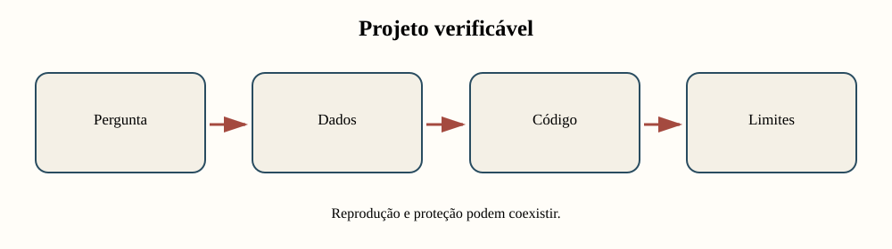
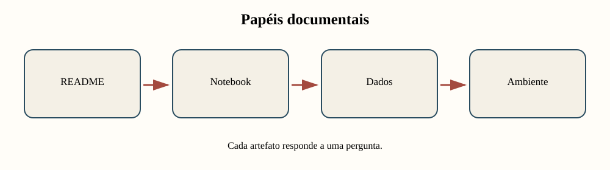
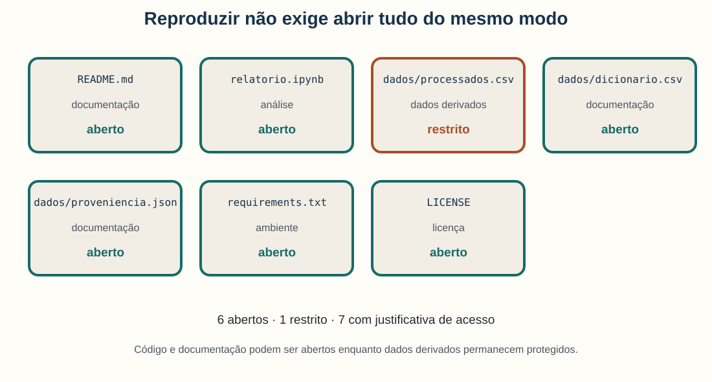
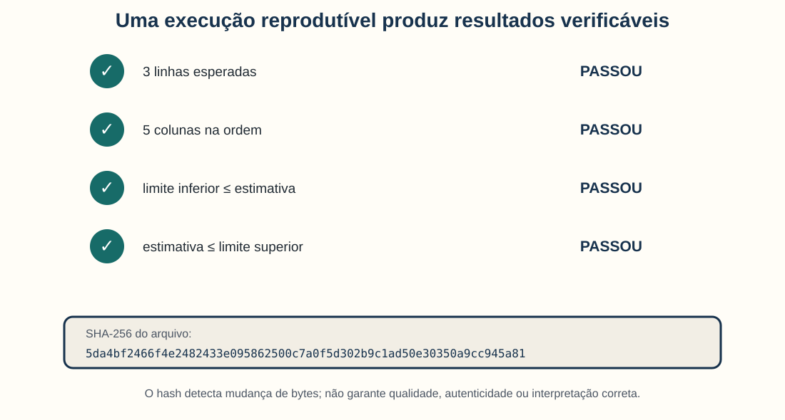
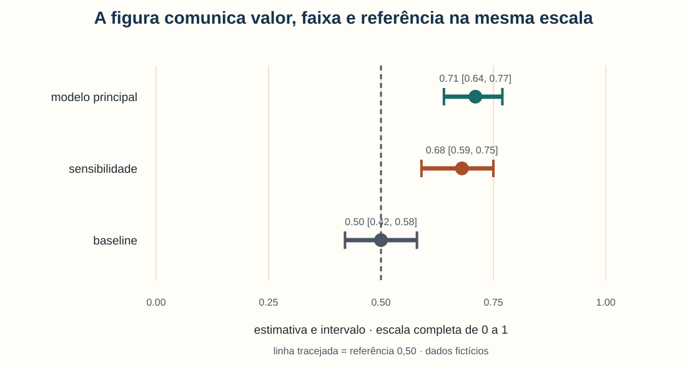
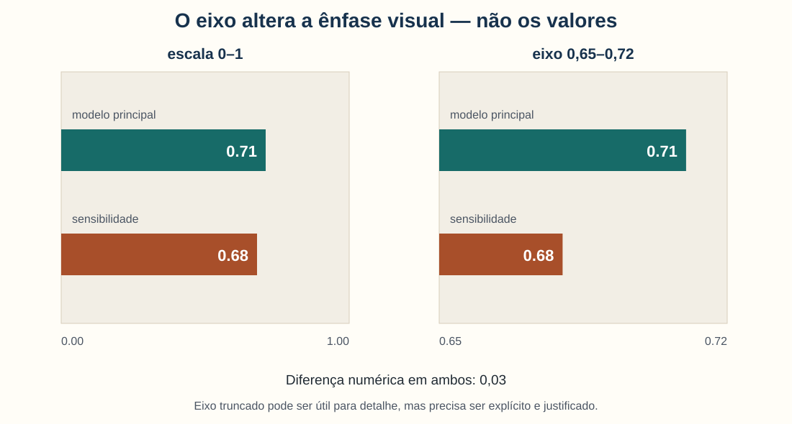
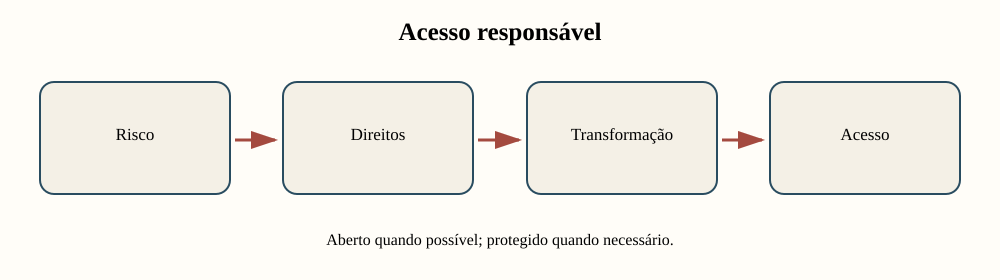
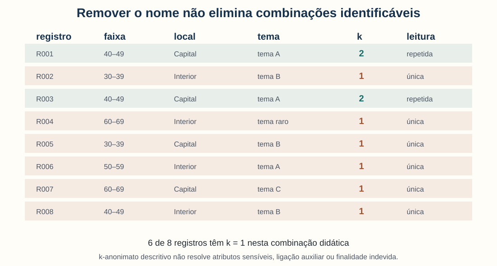
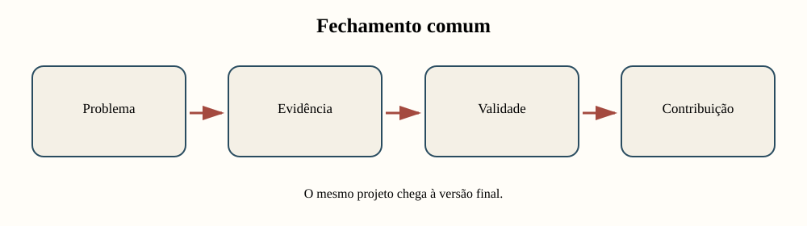

<!-- _class: capa -->
<!-- _paginate: false -->
<!-- _footer: "" -->

# Unidade 14

## Documentar e comunicar

**Problema orientador:** como transformar o relatório-notebook cumulativo em um
projeto compreensível, verificável, compartilhável e intelectualmente honesto?

---

<!-- _class: exemplo -->

# Projeto fictício usado no fechamento

- `manifesto_projeto.csv`: sete artefatos, seus papéis e níveis de acesso.
- `resultados_comunicacao.csv`: três estimativas acompanhadas por intervalos.
- **Finalidade:** testar documentação, execução, checks e comunicação visual.

O projeto e seus resultados foram criados para ensino. Não correspondem a pesquisa,
participantes ou desempenho reais.

---

# Registros fictícios de compartilhamento

- **Unidade de observação:** oito registros com faixa etária, local, tema e documentos.
- Seis registros têm combinação única de quase-identificadores no exemplo.
- **Finalidade:** demonstrar risco de ligação e limites do k-anonimato.
- **Limite:** não há pessoas reais nem avaliação completa de anonimização.

As decisões de proteção são exemplos pedagógicos, não parecer jurídico ou ético.

---

<!-- _class: exemplo -->

# Antes da teoria: “aqui funciona”

Um colega recebe o notebook final e encontra:

```python
dados = pd.read_csv("/home/ana/Desktop/base_final_agora_v3.csv")
```

Também faltam versões, dicionário, instruções e explicação sobre qual célula executar.

<p class="pergunta">O resultado está documentado se apenas o autor consegue reproduzi-lo?</p>

---

# O número final depende de uma cadeia

```text
pergunta → fontes → dados → transformações → ambiente
        → execução → resultados → avaliação → conclusão
```

Se um elo não pode ser compreendido ou verificado, a pessoa leitora não sabe:

- o que entrou;
- o que mudou;
- por que o número apareceu;
- até onde a conclusão vale.

---

# Um projeto reprodutível é mais que código



Reprodutibilidade combina materiais, instruções, decisões, verificações e limites.

---

# Agenda

1. Organizar documentação e histórico de decisões
2. Preparar ambiente e execução verificável
3. Comunicar resultados, intervalos e limites
4. Definir acesso, direitos e proteção
5. Consolidar o relatório-notebook e o pacote
6. Ensaiar a apresentação final do projeto

---

# Ao final, você deverá conseguir…

- distinguir reprodução, replicação e reutilização;
- distribuir funções entre README, notebook, dicionário e proveniência;
- registrar ambiente, sementes, caminhos e versões;
- criar verificações substantivas de entradas e saídas;
- produzir figura autônoma e alegação calibrada;
- planejar acesso sem presumir abertura irrestrita;
- identificar combinações raras e limites do k-anonimato;
- entregar e apresentar o mesmo projeto cumulativo.

---

# Todas as unidades convergem aqui

O relatório-notebook final reúne:

1. pergunta humanística e operacionalização;
2. fontes, corpus, ética e proveniência;
3. preparação e exploração;
4. método e resultados;
5. avaliação, sensibilidade e vieses;
6. conclusão, limites e contribuição;
7. ambiente, referências e execução.

Não é um projeto novo: é a versão consolidada do mesmo percurso.

---

<!-- _class: atividade -->

# U14-A01 · Reproduzir, replicar ou reutilizar?

**Modalidade:** duplas · **Tempo:** 15 minutos  
**Produto:** três objetivos e seus requisitos documentais

Comparem:

1. reexecutar mesmos dados e código;
2. testar a análise em novos dados;
3. adaptar um componente para outra pesquisa.

Indiquem o que precisa ser compartilhado e o que pode permanecer restrito.

---

<!-- _class: divisor -->

# 1 · Como outra pessoa entra no projeto?

## Documentação e versionamento

---

# Notebook não substitui README

| Artefato | Função principal |
|---|---|
| README | orientar entrada, instalação, execução e limites |
| notebook | articular pergunta, código, saída e interpretação |
| dicionário | definir campos, unidades, categorias e ausências |
| proveniência | registrar origem, seleção e transformações |
| ambiente | declarar dependências e versões |
| licença/acesso | informar usos permitidos e restrições |

---

# Documentação distribui responsabilidades



Duplicar tudo em todos os arquivos cria inconsistência; omitir papéis cria dependência
de explicação oral.

---

# O manifesto inventaria o projeto



Cada linha registra caminho, papel, nível de acesso e justificativa. Um arquivo
restrito continua fazendo parte do inventário.

---

# Acesso não é uma escolha binária

Possibilidades incluem:

- aberto;
- aberto com licença específica;
- acesso mediante solicitação;
- acesso em ambiente controlado;
- somente metadados e esquema;
- substituto sintético;
- não compartilhável, com justificativa.

“Não publicar” não significa “não documentar”.

---

# Registro de decisão explica a mudança

| Campo | Exemplo |
|---|---|
| decisão | excluir duplicatas exatas |
| motivo | mesma fonte e identificador |
| alternativa | manter e ponderar |
| impacto | 12 registros removidos |
| versão/data | v0.4, 22/10/2026 |

O histórico permite reconstruir por que o resultado atual difere do anterior.

---

# Versionamento preserva estados significativos

Boas práticas:

- mudanças pequenas e coerentes;
- mensagens que explicam intenção;
- dados brutos preservados quando permitido;
- derivados gerados por código;
- versões ou lançamentos identificáveis;
- registro de autoria e revisão.

`final_agora_v3_corrigido.ipynb` não é um histórico suficiente.

---

# O que não deve entrar no repositório

- senhas, tokens e chaves;
- caminhos pessoais desnecessários;
- dados restritos sem autorização;
- cópias redundantes de arquivos grandes;
- saídas intermediárias regeneráveis;
- informações que permitam reidentificação.

Use mecanismos apropriados de segredo e ignore arquivos locais sensíveis.

---

# FAIR e CARE fazem perguntas complementares

**FAIR:** materiais localizáveis, acessíveis sob condições, interoperáveis e
reutilizáveis. *(Wilkinson et al., 2016)*

**CARE:** benefício coletivo, autoridade para controlar, responsabilidade e ética.
*(Carroll et al., 2020)*

“Acessível” pode significar procedimento de acesso, não download irrestrito.

---

<!-- _class: atividade -->

# U14-A02 · Manifesto e registro de decisão

**Modalidade:** dupla com teste sem explicação oral · **Tempo:** 30 minutos  
**Produto:** manifesto real e três decisões documentadas

Uma pessoa tenta localizar cada artefato e reconstruir as decisões apenas pelos
arquivos. Tudo que exigir memória do autor deve ser revisado.

Use o notebook `01_documentacao_e_versionamento.ipynb`.

---

# Arquivos presentes ainda podem não executar

Problemas comuns:

- ordem de células implícita;
- variável criada em execução anterior;
- pacote sem versão compatível;
- caminho absoluto;
- arquivo produzido manualmente;
- aleatoriedade sem controle;
- entrada alterada silenciosamente.

Reprodução precisa virar um teste observável.

---

<!-- _class: divisor -->

# 2 · O que significa conseguir reexecutar?

## Ambiente, execução e verificações

---

# Três objetivos próximos, mas distintos

| Objetivo | Operação |
|---|---|
| reprodução | mesmos dados e procedimentos |
| replicação | nova coleta ou novo contexto |
| reutilização | adaptação de dados, código ou esquema |

Os termos variam entre áreas; defina explicitamente como serão usados no projeto.

---

# Uma execução limpa começa do zero

Procedimento:

1. reiniciar o ambiente;
2. obter uma cópia nova do projeto;
3. seguir apenas o README;
4. executar na ordem documentada;
5. registrar primeiro erro;
6. corrigir documentação ou código;
7. repetir até produzir as saídas esperadas.

---

# Ambiente é parte da análise

Registre:

- sistema e arquitetura quando relevantes;
- versão do Python;
- bibliotecas e versões;
- idioma, locale e codificação;
- ferramentas externas;
- data da execução;
- hardware quando influencia o resultado.

Versões exatas favorecem repetição; faixas controladas ajudam manutenção.

---

# Caminhos relativos favorecem portabilidade

**Frágil:**

```python
pd.read_csv("/home/ana/Desktop/base.csv")
```

**Portável:**

```python
from pathlib import Path
BASE = Path.cwd()
pd.read_csv(BASE / "dados" / "base.csv")
```

O projeto não deve depender do nome do usuário ou da pasta pessoal.

---

# Semente controla uma parte da aleatoriedade

Registrar a semente ajuda a repetir:

- amostragens;
- divisões treino/teste;
- inicializações;
- permutações;
- reamostragens.

Ela não garante identidade entre bibliotecas, versões, hardware ou algoritmos
intrinsecamente não determinísticos.

---

# Hash identifica o conteúdo em bytes

O SHA-256 do arquivo de resultados do exemplo começa por:

```text
5da4bf2466f4e2482433e095862500c7a...
```

Se um byte mudar, o hash tende a mudar.

Ele detecta diferença; não demonstra que o arquivo é correto, autêntico ou ético.

---

# Checks transformam expectativas em verificações

Exemplos:

- número esperado de linhas;
- nomes e ordem das colunas;
- identificadores únicos;
- categorias permitidas;
- ausência dentro do limite;
- estimativa dentro do intervalo;
- arquivos de saída presentes.

Um check deve falhar com mensagem útil quando a suposição deixa de valer.

---

# A execução fictícia passa em quatro checks



Passar nos checks confirma expectativas declaradas; não substitui revisão substantiva.

---

# Reproduzir inclui interpretar diferenças

Quando a saída muda, pergunte:

- entrada diferente?
- versão diferente?
- aleatoriedade?
- ordem de execução?
- plataforma?
- correção deliberada?
- erro oculto anteriormente?

Uma diferença documentada pode representar melhoria, não fracasso.

---

<!-- _class: atividade -->

# U14-A03 · Teste de execução limpa

**Modalidade:** troca de notebooks entre duplas · **Tempo:** 30 minutos  
**Produto:** log, primeiro erro, correção e três checks

Reinicie e execute tudo sem instrução oral. Registre tempo, ambiente, falha e
correção. Converta três suposições importantes em verificações automáticas.

Use o notebook `02_execucao_e_verificacoes.ipynb`.

---

# Reproduzir números não garante comunicar bem

Uma figura pode ser produzida corretamente e ainda:

- omitir unidade ou denominador;
- esconder incerteza;
- exagerar diferença por escala;
- usar cores inacessíveis;
- sugerir causalidade indevida;
- ocultar casos que contradizem a média.

---

<!-- _class: divisor -->

# 3 · Como comunicar sem exagerar?

## Figura, incerteza e linguagem

---

# Uma figura autônoma responde perguntas básicas

- qual pergunta está sendo mostrada?
- que dados e população foram usados?
- qual unidade e denominador?
- o que representam pontos, linhas e cores?
- como a incerteza foi calculada?
- qual referência orienta a leitura?
- que limite acompanha a conclusão?

O código pode reproduzir a figura; a legenda deve permitir compreendê-la.

---

# Valor, faixa e referência aparecem juntos



O resultado principal é 0,71 com intervalo 0,64–0,77; a análise de sensibilidade
é 0,68 com faixa mais ampla, 0,59–0,75.

---

# Leia também o que a figura não mostra

A figura permite comparar estimativas e faixas nos dados fictícios.

Ela não informa, sozinha:

- como os intervalos foram produzidos;
- se o desenho sustenta causalidade;
- se os casos são representativos;
- por que a sensibilidade é maior;
- quais erros têm maior consequência.

---

# O eixo altera a ênfase



A diferença continua sendo 0,03. Um eixo truncado pode mostrar detalhe, mas precisa
ser explícito, justificado e acompanhado da magnitude numérica.

---

# Escolhas visuais também são analíticas

Prefira:

- posição em escala comum para comparar valores;
- paleta com contraste e acessibilidade;
- rótulos diretos quando possível;
- intervalos e denominadores visíveis;
- ordem substantiva, não decorativa;
- texto alternativo que descreva a relação principal.

Evite efeitos tridimensionais e áreas sem necessidade.

---

# A força da frase deve acompanhar o desenho

| Nível | Formulação adequada |
|---|---|
| descrição | “na coleção, a proporção foi…” |
| associação | “X esteve associado a Y…” |
| previsão | “no teste reservado, o modelo previu…” |
| causalidade | “intervir em X alteraria Y…” |

Causalidade exige desenho e suposições próprios; não nasce do título do gráfico.

---

# Compare título forte e título calibrado

**Forte demais:**

> O método aumenta a participação cultural.

**Calibrado:**

> Na coleção fictícia, a estimativa do modelo ficou acima do baseline, com
> resultado parcialmente sensível às especificações.

O segundo título descreve evidência e condição sem inventar mecanismo causal.

---

# Casos mantêm a comunicação ligada às fontes

Uma apresentação quantitativa também pode incluir:

- caso típico;
- falso positivo ou negativo;
- caso limítrofe;
- documento que revela mudança de definição;
- exemplo que explica uma decisão de modelagem.

O caso não substitui a distribuição; torna seu mecanismo discutível.

---

<!-- _class: atividade -->

# U14-A04 · Figura, legenda e alegação

**Modalidade:** teste de leitura em dupla · **Tempo:** 30 minutos  
**Produto:** figura revisada, legenda autônoma e conclusão calibrada

Uma pessoa vê apenas a figura e tenta reconstruir unidade, denominador, incerteza,
referência e alcance. O autor revisa tudo que não pôde ser inferido corretamente.

Use o notebook `03_visualizacao_incerteza_e_linguagem.ipynb`.

---

# Clareza não autoriza abertura irrestrita

Antes de compartilhar, avalie:

- necessidade e finalidade;
- consentimento e expectativas;
- base ética e jurídica;
- direitos autorais e licença;
- risco de ligação com outras bases;
- grupos e comunidades afetados;
- acesso, retenção e governança.

---

<!-- _class: divisor -->

# 4 · O que pode ser compartilhado?

## Proteção, direitos e acesso responsável

---

# Classifique antes de transformar



Não escolha anonimização ou licença antes de compreender pessoas, materiais,
finalidades e ameaças.

---

# Remover nomes não basta

Uma combinação como:

```text
60–69 anos + Interior + tema raro
```

pode identificar um registro em um contexto pequeno, ainda que o nome tenha sido
retirado. Idade, local e tema funcionam como quase-identificadores.

---

# Seis de oito registros têm combinação única



O exemplo é didático. Em dados reais, a análise exigiria contexto, atacantes
plausíveis, fontes auxiliares e consequências.

---

# k descreve o tamanho do grupo equivalente


$$
k(\mathbf{q})=\left|\{i:Q_i=\mathbf{q}\}\right|
$$

**Em linguagem comum:** conte quantos registros compartilham a mesma combinação
$\mathbf q$ de quase-identificadores.

**Exemplo:** `40–49 + Capital + tema A` aparece 2 vezes: $k=2$.

---

# k-anonimato tem limites importantes

Mesmo com $k$ maior, ainda pode haver:

- atributo sensível igual em todo o grupo;
- ligação com base externa;
- informação revelada pelo contexto;
- dano coletivo;
- uso incompatível com consentimento;
- reidentificação por variáveis não consideradas.

É um diagnóstico parcial, não selo de anonimização.

---

# Estratégias alteram risco e utilidade

| Estratégia | Exemplo | Perda possível |
|---|---|---|
| minimizar | remover campo desnecessário | menos detalhe |
| generalizar | idade → faixa | menor precisão |
| agregar | publicar contagens | perde casos |
| controlar acesso | ambiente seguro | menor conveniência |
| substituir | dados sintéticos | não reproduz todos os padrões |
| não compartilhar | documentar restrição | verificação limitada |

---

# Direitos variam por artefato

Verifique separadamente:

- fonte original;
- transcrição;
- fotografia ou fac-símile;
- metadados;
- base derivada;
- código;
- figuras;
- texto do relatório.

Possuir acesso não significa possuir direito de redistribuição.

---

# Dados restritos ainda permitem transparência

Compartilhe, quando permitido:

- README e procedimento de acesso;
- dicionário e esquema;
- código e ambiente;
- proveniência sem informação sensível;
- dados sintéticos ou amostra licenciada;
- checks e resultados agregados;
- justificativa das restrições.

Assim, outras pessoas podem compreender e testar partes do processo.

---

# FAIR não substitui governança

FAIR enfatiza capacidade de localizar, acessar sob condições, interoperar e reutilizar.

CARE pergunta também:

- quem se beneficia?
- quem tem autoridade para controlar?
- quais responsabilidades acompanham o dado?
- o uso é eticamente legítimo?

A abertura máxima não é automaticamente o resultado mais responsável.

---

<!-- _class: atividade -->

# U14-A05 · Plano de compartilhamento

**Modalidade:** trio — pesquisador, participante e curador · **Tempo:** 35 minutos  
**Produto:** matriz de acesso e substitutos reproduzíveis

Classifiquem cada artefato como aberto, restrito ou não compartilhável. Registrem
direito, risco, transformação, acesso e alternativa possível.

Use o notebook `04_protecao_direitos_e_compartilhamento.ipynb`.

---

# O fechamento tem três produtos articulados

1. **relatório-notebook:** argumento completo e executável;
2. **pacote:** materiais, documentação, acesso e ambiente;
3. **apresentação:** problema, evidência, contribuição e limite.

Os três devem corresponder à mesma versão e à mesma conclusão.

---

<!-- _class: divisor -->

# 5 · Oficina final

## Projeto reprodutível e apresentação

---

# Estrutura do relatório-notebook

1. pergunta, contribuição e contexto humanístico;
2. fontes, corpus, critérios, ética e proveniência;
3. preparação e decisões reproduzíveis;
4. exploração e método escolhido;
5. resultados com figuras, tabelas e casos;
6. avaliação, sensibilidade, vieses e limites;
7. conclusão calibrada e próximos passos;
8. referências, ambiente e execução.

---

# O pacote precisa permitir orientação e verificação



Inclua apenas artefatos autorizados e substitutos documentados para o que permanece
restrito.

---

# README final: percurso mínimo

- título e pergunta;
- contribuição esperada;
- estrutura de pastas;
- requisitos;
- instruções de execução;
- entradas e saídas;
- tempo ou recursos esperados;
- acesso e licenças;
- limitações e contato.

Teste o README com alguém que não acompanhou o desenvolvimento.

---

# Notebook final: explique antes e interprete depois

Cada bloco importante deve conter:

1. pergunta local;
2. entrada utilizada;
3. operação e justificativa;
4. código necessário;
5. saída legível;
6. interpretação;
7. limite e passagem à próxima etapa.

Evite sequências de células sem texto ou saídas sem leitura.

---

# Verificação final em ambiente limpo

- execute do início ao fim;
- confirme caminhos relativos;
- remova dependência de estado oculto;
- verifique versões e sementes;
- teste checks e mensagens de erro;
- limpe credenciais e dados não autorizados;
- confirme que figuras e tabelas correspondem ao texto;
- registre versão entregue.

---

# Roteiro dos 90 minutos

| Tempo | Ação | Evidência |
|---:|---|---|
| 0–15 | executar do início | log e checks |
| 15–30 | conferir manifesto e acesso | pacote |
| 30–48 | revisar cadeia argumentativa | mapa |
| 48–63 | revisar figuras e casos | comunicação |
| 63–75 | ensaiar apresentação de 7 min | roteiro |
| 75–90 | implementar parecer | registro |

---

<!-- _class: atividade -->

# U14-A06 · Versão final cumulativa

**Modalidade:** projeto individual ou grupo do projeto · **Tempo:** 90 minutos  
**Produto:** versão final do mesmo relatório-notebook e pacote autorizado

Entregue notebook evoluído, dados compartilháveis ou substitutos, dicionário,
proveniência, requisitos, README, licença e identificador de versão.

---

# Uma apresentação de 7 minutos exige escolha

Sugestão de sequência:

1. problema e contribuição — 1 min;
2. corpus e método — 1 min;
3. resultado principal — 2 min;
4. caso ou fonte — 1 min;
5. validade e limite — 1 min;
6. contribuição e próximo passo — 1 min.

Não tente narrar todas as células do notebook.

---

<!-- _class: atividade -->

# U14-A07 · Banca simulada

**Modalidade:** apresentação de 7 minutos + perguntas · **Tempo:** 20 minutos  
**Produto:** respostas registradas e ajuste final

Apresente problema, dados, método, resultado, caso, validade, limite e contribuição.
Os pares fazem duas perguntas; o autor registra resposta e mudança implementada.

---

# Critérios finais

- coerência entre pergunta, dados e método;
- contribuição às Humanidades;
- documentação e reprodutibilidade;
- avaliação quantitativa e qualitativa;
- sensibilidade, vieses e incerteza;
- ética, direitos e acesso;
- comunicação visual;
- honestidade sobre limites.

---

# Falhas finais frequentes

- criar um notebook novo sem histórico;
- entregar código sem narrativa;
- apresentar resultado sem caso ou fonte;
- esconder resultado negativo;
- citar limitação sem mudar a conclusão;
- publicar dados porque “estão no Git”;
- omitir ambiente e instruções;
- tratar apresentação como resumo de todas as etapas.

---

# Checklist antes da entrega

- [ ] outra pessoa executou o projeto;
- [ ] o manifesto corresponde aos arquivos;
- [ ] dados restritos estão protegidos;
- [ ] hashes e checks foram atualizados;
- [ ] figuras têm unidade, escala e incerteza;
- [ ] conclusões correspondem às análises;
- [ ] referências e licenças estão completas;
- [ ] apresentação e relatório usam a mesma versão.

---

# Retorno ao exemplo inicial

O caminho absoluto foi substituído por estrutura relativa; agora há:

- README;
- manifesto;
- dicionário e proveniência;
- ambiente registrado;
- execução limpa;
- checks;
- acesso justificado;
- conclusão com limites.

“Aqui funciona” torna-se “outra pessoa consegue compreender e verificar”.

---

# O percurso da disciplina

```text
pergunta → corpus → dados → exploração → comparação
→ associações → modelos → padrões → extração
→ tempo/espaço → uso responsável → validade
→ documentação e comunicação
```

Computação aplicada às Humanidades é uma cadeia de decisões argumentadas, não uma
coleção de ferramentas.

---

# Produto cumulativo final

O mesmo relatório-notebook agora contém:

- uma pergunta humanística clara;
- corpus e proveniência;
- operações reproduzíveis;
- resultados quantitativos e qualitativos;
- comparação e sensibilidade;
- exemplos ligados às fontes;
- ameaças à validade;
- decisão ética de acesso;
- contribuição e limites.

---

# Síntese

- Documentação distribui funções entre artefatos.
- Versionamento registra decisões, mas não autoriza publicação.
- Reprodução exige ambiente limpo e verificações observáveis.
- Hash detecta mudança de bytes, não qualidade.
- Figuras comunicam valores, incerteza e condições.
- Remover nomes não garante anonimização.
- Reprodutibilidade é compatível com acesso responsável.
- A entrega final consolida o mesmo projeto cumulativo.

---

<!-- _class: atividade -->

# Saída · A promessa do projeto

**Modalidade:** individual · **Tempo:** 5 minutos  
**Produto:** declaração final em quatro frases

Complete:

1. “Este projeto contribui ao mostrar…”
2. “A evidência principal é…”
3. “A conclusão vale sob…”
4. “Outra pessoa pode verificar por meio de…”

---

# Referências — 1/2

- WILSON, G. et al. Good Enough Practices in Scientific Computing. *PLOS
  Computational Biology*, 13(6), 2017. <https://doi.org/10.1371/journal.pcbi.1005510>
- RULE, A. et al. Ten Simple Rules for Writing and Sharing Computational Analyses
  in Jupyter Notebooks. *PLOS Computational Biology*, 15(7), 2019.
  <https://doi.org/10.1371/journal.pcbi.1007007>
- PENG, R. D. Reproducible Research in Computational Science. *Science*,
  334(6060), p. 1226–1227, 2011. <https://doi.org/10.1126/science.1213847>

---

# Referências — 2/2

- WILKINSON, M. D. et al. The FAIR Guiding Principles. *Scientific Data*, 3,
  160018, 2016. <https://doi.org/10.1038/sdata.2016.18>
- CARROLL, S. R. et al. The CARE Principles for Indigenous Data Governance.
  *Data Science Journal*, 19, 43, 2020. <https://doi.org/10.5334/dsj-2020-043>
- CLEVELAND, W. S.; MCGILL, R. Graphical Perception. *JASA*, 79(387),
  p. 531–554, 1984. <https://doi.org/10.1080/01621459.1984.10478080>
- BRUNTON, F.; NISSENBAUM, H. *Obfuscation*. MIT Press, 2015.
